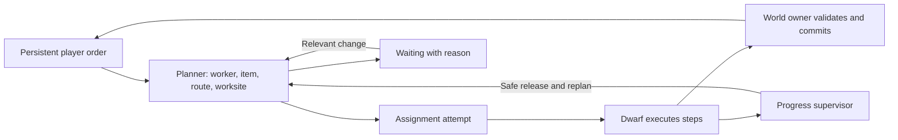

# 125 — Jobs and dwarves: completion and recovery review

**Review recorded 2026-10-11; four implementation steps subsequently completed.**
This document preserves the pre-change findings and proposed design. Read
[126 — Shared lifecycle and recovery](126_job_lifecycle_and_recovery.md) for the
implemented contract, tests and deliberate boundaries (including runtime rather
than durable commit receipts). Statements below about missing features describe
the reviewed baseline, not the current implementation.

Requested after repeated stuck-worker/job reports and the saved-game ladder
starvation fix. This review reads the current scheduler, dwarf executor, work
sources, navigation and save/load boundaries. The ladder reproduction in
[88](88_ladder_task_reachability.md) is existing experimental evidence; the
other structural risks below are code findings, not newly reproduced incidents.

## Conclusion

Keep the intent-sized work sources, bounded scheduler, physical item ownership
and navigation system. Add a common lifecycle for assignment attempts, explicit
waiting reasons, complete work plans and a bounded progress supervisor. Migrate
one family at a time. Running a Temporal service inside this single-process game
would not solve pathfinding, geometry, material shortages or incorrect game logic.

The contract should be: **every accepted order is progressing, deliberately
waiting on a named condition, completed, cancelled, or visibly failed. No order
or assigned dwarf may disappear into unexplained inactivity.** Successful
completion remains conditional on a feasible world, eligible workers, available
resources and fair scheduling. Permanent obstructions require player action.

## What works already

- Persistent sources own player intent and partial work; tasks are temporary
  leases. A mining zone does not create one queued task per block.
- Scheduler wakes are event-driven, time/probe bounded and resumable. The latest
  change gives other job types a turn when a higher-priority search uses its wake.
- Mining can search multiple exact working positions. Crafting, hauling and
  exact-item Move already have stronger candidate/route comparison than ordinary
  furniture placement. These provide useful patterns for a shared contract.
- Item/storage reservations have owner checks. Release preserves physical cargo,
  material identity and source work. Storage commits validate the actual cargo.
- Active movement rechecks routes after terrain changes. Missing-support recovery
  is distinct from navigation and does not invent a route out of a pit.
- Current saves reconstruct work from source state; interrupted cargo returns as
  real loose items. Resuming at safe logical boundaries is appropriate for a game.

## Findings, in priority order

| Priority | Finding and evidence | Consequence |
|---|---|---|
| High | No shared active-work progress supervisor. `Task.gd` has creation/retry times, but no attempt generation, current step, last meaningful progress or step deadline. `TaskManager._process()` uses its heartbeat to wake scheduling, not validate active execution. | Each job family must independently detect every way to stop progressing. A new missed transition can leave a dwarf assigned forever. |
| High | Ordinary `FETCH_BUILD` matching checks a work stand before the packed item is selected. `FurnitureGhostComponent.reserve_fetch()` then chooses/transfers a claim or nearby item; `DwarfAgent._fetch_travel_to_ghost()` chooses a stand again after pickup. | Assignment does not consistently prove worker → exact pickup → work stand. The closest walkable stand/item may be disconnected while another is usable. Existing craft/haul/Move improvements do not cover all furniture sources. |
| High | Search and fairness guarantees are incomplete. `_advance_mining_probe()` and ordinary probes include the moving idle dwarf's cell in their search key. `_rejected_workers()` discards failures on global navigation revision changes. `NavGrid.advance_reachability()` reports `UNREACHABLE` when its node cap is exhausted with search still unfinished. | Idle movement can reset long searches; unrelated edits can erase comparison progress; an expensive unknown route is treated like a proven impossible route. Cross-type fairness now helps, but does not establish bounded assessment of every same-type order/worker. |
| High | End-to-end completion is distributed across the agent, source callback and scheduler. `_fetch_complete()` removes cargo before calling the source's `complete_build()`, without a shared commit receipt. `complete_dwarf_task()` identifies the task solely through the dwarf's current assignment. | There is no common protection against an obsolete completion callback or partially applied future operation. This is an architectural exposure, not evidence that current furniture commits duplicate items. Existing owner checks must be preserved and strengthened. |
| Medium | Lifecycle terminology and diagnostics mix lease termination with intent completion. An empty `reserve_fetch()` is logged as task completion although the ghost remains unfinished. Backoff records time/count without a durable specific cause; the retained completion log does not describe all failed/released transitions. | “Completed,” “blocked,” and “Looking around” cannot reliably explain whether the player's order progressed, why it stopped, or which worker/material/route was rejected. |
| Medium | The dwarf executor combines movement, rest interrupts, handling, work-family dispatch, animation and cleanup. `FETCH_WORKING` dispatches through optional source methods; families have separate finish/cancel paths. | Every new family expands the number of combinations that must preserve the same ownership and recovery rules. Fixes tend to stay local. |

The latest ladder incident is the clearest example of a **planning livelock**:
mining searches above an unfinished ladder monopolized assignment effort while
the reachable ladder construction was ready. It was not an installation timeout
or missing timber. The saved colony completed the remaining sections after the
fairness fix. Simply retrying the same mining search more often would not help.

Relevant current implementation:

- [Task](../../scripts/systems/Task.gd), [TaskManager](../../scripts/systems/TaskManager.gd):
  `_try_assign_type`, `_advance_mining_probe`, `_rejected_workers`,
  `_assign`, `complete_dwarf_task`, `_apply_backoff`, `_log_completed`.
- [DwarfAgent](../../scripts/entities/DwarfAgent.gd): `_fetch_begin`,
  `_fetch_travel_to_ghost`, `_fetch_complete`, `_fetch_fail_release`,
  `restore_saved_runtime`, `_settle_missing_support`.
- [FurnitureGhostComponent](../../scripts/components/FurnitureGhostComponent.gd):
  `_ensure_claim`, `nearest_stand_target`, `reserve_fetch`, `cancel_fetch`.
- [WorkerCraftOrder](../../scripts/components/WorkerCraftOrder.gd) and
  [StorageComponent](../../scripts/components/StorageComponent.gd): existing
  quote, reservation, staged-input and commit patterns to reuse.
- [NavGrid](../../scripts/systems/NavGrid.gd): `advance_reachability`,
  `search_is_current`. The latter already tracks relevant chunk dependencies;
  preserve that useful behavior when improving scheduler-level invalidation.

## What Temporal actually guarantees

Temporal persists workflow event history and reconstructs execution through
deterministic replay after worker failure. Recorded activity results let replay
resume without repeating already recorded work. This is durable orchestration,
not proof that the application's desired outcome is achievable.
[Official event-history documentation](https://docs.temporal.io/encyclopedia/event-history).

Activity timeouts detect attempts that do not finish; optional heartbeat timeouts
detect a worker that stops reporting. Heartbeats can carry progress for another
attempt. A heartbeat alone cannot prove our dwarf is approaching the destination:
the application must define meaningful progress.
[Official failure-detection documentation](https://docs.temporal.io/encyclopedia/detecting-activity-failures).

Retry policies govern backoff and limits; permanent errors can be non-retryable.
Retries cannot create missing materials, make an impossible route possible, or
repair a deterministic logic error. Work can wait indefinitely or end in failure.
[Official retry-policy documentation](https://docs.temporal.io/encyclopedia/retry-policies).

An activity can execute again if its external effect happened but completion was
not recorded. Applications need idempotent effects: repeating the same logical
operation must not consume another item or create another result.
[Official activity documentation](https://docs.temporal.io/activity-definition).

For Deepdraft, borrow persistent intent, explicit attempts, progress detection,
safe retries and observable waiting. Retain ordinary game snapshots; a full
event-sourced world or continuous write-ahead log is not required for this work.
Crash durability remains limited to the last successful save unless deliberately
changed in a separate feature.

## Proposed contract

### Separate order, attempt and presentation

The existing source remains authoritative for desired result and completed work.
Give it a stable order identity; do not duplicate world progress in TaskManager.
Each assignment gets a new attempt generation and a small typed execution record:
order/lease/worker identity, current step, claimed resources, route dependencies,
last progress, expected duration, retry cause and recent transitions.

An order can offer several bounded leases, as mining does now. A successfully
finished lease is distinct from completion of the whole order. Repeating craft
or hauling intent can remain open while individual batches succeed.

Dwarf availability must be explicit: available, working, self-care, recovering,
or trapped. A single authority reconciles it with the active attempt and actual
actor state. No worker may be both idle and assigned, or indefinitely reserved
without a live source. Keep locomotion/support safety separate from job logic.

Animation expresses execution: an item commits at its valid contact/set-down
point; animation completion does not bypass world validation. Interrupted
presentation must report to the attempt rather than silently strand it.

### Plan the whole operation, then reserve

Use one work-source interface, introduced through adapters around current sources:
offer candidates, plan, validate/reserve, execute/check progress, commit, release.
The plan names the exact supply, pickup stand, work stand and relevant route
proofs, including safe departure where construction changes support/access.
Execution uses that plan and revalidates it at physical transfer boundaries.

Quotes are read-only. Reservation validates that the chosen worker, material,
site and dependencies still match; on failure, roll back all claims before
trying another candidate. Claims carry an attempt owner token. Long waits should
not hold scarce worker/item/workbench claims unnecessarily; any intentional
source claim must have explicit ownership and a release/reselection policy.

Use relevant terrain/item/source changes to resume waiting work. Keep a bounded
periodic reconciliation pass as a safety net for missed notifications. Do not
scan the whole world or all jobs every frame. Preserve the current CPU budget.

Separate `SEARCHING`, `SEARCH_BUDGET_EXHAUSTED` and proven `NO_ROUTE`. Unknown
routes can yield, escalate within a bounded policy, or use a coarser connectivity
check. Give each candidate/order eventual assessment without resetting useful
searches for ordinary leisure movement or unrelated edits. A short, bounded
planning hold on leisure is one possible technique, not an indefinite worker lock.

### Supervise progress and classify outcomes

Track meaningful progress: advancing along a route, transferring a physical
item, increasing source work, or finishing an animation step. “Process tick ran”
is insufficient. Expected duration includes route length, carrying speed,
climbing and the actual work/animation duration, with a measured tolerance.
Use simulation time for gameplay deadlines, honor pause/speed/loading, and use
wall-clock time only for computation budgets and diagnostics.

| Outcome | Response |
|---|---|
| Route changed / item taken before reservation | Safely release attempt and replan; try another worker/item/stand. |
| Missing material / no eligible awake worker | Wait with the specific reason; wake on supply/availability changes. |
| Access depends on unfinished construction | Report the known dependency; schedule that construction fairly. Never invent prerequisite work without a player order. |
| Worker stopped making progress | Validate actor/support/route, recover locally if legal, then release/reassign. Repeated identical failures become visible instead of an endless retry loop. |
| Target removed or order cancelled | End the intent deliberately and release claims/cargo exactly once. |
| Impossible route or trapped actor | Report the obstruction and required player intervention; do not teleport, consume imaginary supplies or mark success. |

A supervisor detects and contains stalls; it does not replace fixing the faulty
transition or route calculation. Its trace should make the underlying defect
reproducible. Bounded retries prevent recovery itself becoming a livelock.

### Commit safely and restore honestly

The world owner validates cargo, site and attempt token, then applies the
logical operation as one synchronous commit. Return a receipt keyed by stable
order and logical work-unit identity; repeat requests return the same result
without double consumption or reward. Attempt generation separately rejects
stale callbacks after reassignment. Mark commit state before emitting signals
that can re-enter the lifecycle; validation must precede irreversible mutation.

Release is idempotent and legal from every step. Preserve item key, quantity,
material and exact instance identity. A reservation ledger points to existing
physical owners; it does not become another inventory.

Save source checkpoints and enough order/diagnostic identity to explain resumed
work. Keep transient movement paths, animation phases and claims reconstructible.
On load, reconcile current physical state and create fresh attempts. Do not
persist an obsolete path just to imitate Temporal replay. No legacy development
save migrations are required under the current project policy.

## Recommended implementation order

1. **Make stalls explainable.** Add order/attempt identity, structured waiting and
   release reasons, meaningful progress data and a bounded transition history.
   Add a development job inspector showing order, worker, step, last progress,
   rejected candidates and blocking condition. Start reconciliation in diagnostic
   mode so we can establish accurate deadlines and avoid false recoveries.
2. **Pilot the common lifecycle on ordinary furniture and ladder construction.**
   Introduce the plan/reserve/execute/commit/release adapter and progress supervisor.
   Check both travel legs, protect completion with attempt identity and commit
   receipts, and recover safely from interruption. These cover both quick
   set-down and staged access construction without migrating everything at once.
3. **Migrate the other families and finish scheduling guarantees.** Apply the
   same contract to haul, craft, mining, surface work and uninstall. Preserve
   specialized candidate selection behind adapters. Improve same-type fairness,
   moving-start search behavior, dependency waits and bounded-search outcomes.
   Extract dwarf handling/work execution from locomotion/rest incrementally.
4. **Make combined failure scenarios a release gate.** Run shared lifecycle
   tests for every family plus mixed-world simulations with real leisure,
   sleep, water edits and constrained planning budgets. Keep the reproduced
   player-save cases as integration fixtures where practical.

Every phase includes tests; phase 4 adds sustained combined coverage rather than
postponing validation until the refactor is complete. No large replacement of
all job code, no new distributed infrastructure and no relaxation of world rules.

## Acceptance and fault testing

- Interrupt at pickup, transit, work, set-down and commit boundaries: sleep,
  cancel, worker/source removal, support loss and save/reload. No lost or
  duplicated items, material changes, phantom reservations or double rewards.
- Repeat release and completion; deliver an old completion after reassignment.
  The current attempt must remain intact and the logical result happen once.
- Remove supplies, block one approach or move an idle worker during search.
  Feasible alternatives eventually receive an attempt; impossible work exposes
  an accurate reason. Changes elsewhere must not restart unrelated searches.
- Mix unreachable mining above a partial ladder with available ladder kits and
  workers. Construction gets planning time, completes and wakes the mining work.
- Assert the source/lease/worker/claim ownership relationships continuously in
  test builds. Validate route/support separately from job-state consistency.
- In controlled feasible fixtures, require completion within a defined simulated
  time bound. In blocked fixtures, require a correct waiting reason within a
  bound and recovery after the blocking condition is removed. Measure fairness
  and CPU cost as population/order counts increase.
- Retain current save/load tests; no manual player-save mutation. The original
  review changed documentation only; subsequent implementation and verification
  are recorded in [126](126_job_lifecycle_and_recovery.md).

Existing [issue 001](00_open_issues.md) remains OPEN and issue 002 remains PARKED.
This review does not establish their original causes or close them.
