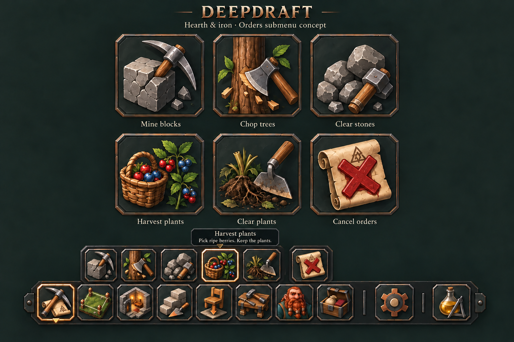

# 136 — Illustrated Orders submenu

Status: **implemented after approval** — 2026-10-12.

## Delivered

The live Orders submenu now uses the six approved illustrations, with no
permanent captions or title bar. It anchors above the Orders dock button, keeps
an extra gap before Cancel, and uses the same hover/focus information and copper
active frame/notch as the main dock. A short copper connector joins the two rails.
Icons are 64 px on desktop and 56 px on compact windows; the row wraps beside a
moved inspector while retaining square artwork. Zones subsequently gained the
same illustrated presentation in [137](137_illustrated_zones.md).

The active-tool panel now uses smaller typography and owner-provided compact
summaries, preserving actual selection counts and mining width/depth. Undo is
visible only with a pending creation receipt. Done, View order, transient
feedback, source guards and existing tool dispatch remain intact.

The exact concept artwork is stored at `assets/ui/dock/orders_atlas.png` and
selected through six neutral gallery regions in `data/ui/dock.json`. The painted
toolbar/labels are never displayed. `DockIconButton.setup()` shares presentation
between the main dock and Orders. UIRegistry still owns all layout data;
`OrdersShelf` owns layout/feedback and existing controllers own the work.

## Verified delivery

- Godot editor import and script validation passed.
- `OrdersShelfTest` passes headlessly and natively: actual world designation,
  tool exclusivity, live counts, mining zoom/modifiers, UI wheel isolation,
  release-over-UI, safe mixed cancellation, partial progress and stale receipts.
- Extended checks cover icon-only controls, exact parent anchoring, square art,
  hover/focus help, Enter activation, hidden-shelf tooltip cleanup, and Zones.
- Native captures at 960×540, 1280×720 and 2560×1440 were reviewed, including
  a centered inspector forcing the icon row to wrap into two rows.
- The existing native `DockArtPreview` and inherited dwarf-inspector checks
  pass after the shared icon-button setup was factored out.

Evidence: `tmp/orders_art_20261012/`; final headless result:
`tmp/orders_art_20261012/final/results.json`. The native dock fixture has its
existing empty-environment warning and no script errors. No player saves or
layout preferences are written by these fixtures.

Restart Play to load the illustrated submenu. No autoload, global script class,
task rule, save schema, or inventory/crop change was introduced.

## Approved design

The player requested an Orders submenu plan using the approved illustrated
Hearth & iron main-dock art. Stonehearth's screenshot informs the compact nearby
row of commands. Deepdraft uses its own artwork and existing tool behavior.

This image is an art-direction illustration, not a native screenshot or a final
pixel specification. Production placement must use the parent-button anchor and
hover/selected distinctions below; the painted mockup is approximate.

## Layout

- Replace the current text-tile shelf with six illustrated square buttons in
  one row, directly above the main dock, with an 8 px vertical gap.
- Anchor its left edge to the Orders parent button. Clamp to viewport margins;
  move only as needed to avoid a visible inspector. Keep the parent highlighted
  and use a small copper connector to retain the visual relationship.
- Start with 64 px submenu buttons on desktop and 56 px on compact screens.
  Preserve the main dock's existing sizing. Wrap only if the actual available
  width beside a window cannot fit the row; do not shrink below readable size.
- Use the same charcoal rail, clipped iron frames, illustrated materials and
  copper selected state. No permanent per-icon captions or large title/header.
- Keep a wider gap before Cancel orders. Its red wax X is confined to that
  command; normal buttons retain the main dock's palette.

## Six commands and their art

Retain the current order and internal bindings from `data/ui/dock.json`.

| Command | Internal tool | Artwork | Hover description |
|---|---|---|---|
| Mine blocks | `mine_precision` | Pickaxe striking a solid chipped rock block | Mark terrain for mining. |
| Chop trees | `chop` | Broad axe cutting a standing trunk, with wood chips | Mark trees for felling. |
| Clear stones | `clear_stones` | Loose fieldstones and a short heavy mallet | Break boulders and gather loose stone. |
| Harvest plants | `harvest_plants` | Basket of berries beside a living fruiting sprig | Pick ripe berries. Keep the plants. |
| Clear plants | `clear_shrubs` | Grub hoe, cut stems and severed roots | Permanently remove shrubs, flowers and reeds. |
| Cancel orders | `cancel_orders` | Work-order parchment crossed by a large red wax X | Cancel unfinished marked work. Keep completed work and partial progress. |

Mine must read as solid terrain; Clear stones as loose surface rocks. Harvest
must clearly preserve its living plant. Clear plants must show cut vegetation,
not a healthy packed/transplantable bush; it must not imply the Move/Uproot
workflow. Its detailed tooltip retains the actual yield rules: shrubs yield a
cutting, flowers/reeds no item. Harvest includes the current ripe shrub/juniper
targets; the icon's basket is decorative UI art, not a new carried object.

## Interaction and states

1. Click Orders to open/close the submenu. Closing the row retains an active
   Orders tool, as today; the parent and active-mode feedback remain visible.
2. Hover or keyboard focus shows the command name and explanation. Include the
   existing click/drag instructions and relevant modifiers in the tooltip.
   Tooltip stays on screen and cannot intercept world input.
3. Click an icon to select the tool immediately, leaving the row available.
   Selecting the same tool preserves its current brush/settings.
4. Hover/focus uses a thin pale border. Selected uses the copper outline and
   solid bottom notch shared by the main dock. Distinguish these independently
   of color; both the parent and selected child can be marked.
5. Switching tools, switching to Zones, opening management screens, and the
   Escape sequence retain the existing one-active-tool ownership rules.
6. Escape discards an incomplete gesture and ends the active tool, then a second
   Escape closes the shelf, preserving the existing behavior. Done keeps committed
   orders. **Cancel orders** is a separate world-selection tool, never a close
   button, delete-world-object action, or global cancel-all shortcut.

## Active-tool feedback

The icon strip replaces the bulky selection tiles, while a compact context strip
appears only during an active tool. Keep the tool name, actual selection count,
relevant brush state/short instruction and Done/Esc available. Detailed modifier
help belongs in the tooltip; important selection feedback must not require hover.
Avoid a permanent "Choose a tool" header and long repeated explanations.

Show Undo last order when there is a valid pending receipt. Keep a brief result
message and View order after a designation. Do not add another permanent row of
art icons for Undo/View/Done; these contextual text actions benefit from explicit
wording and are separate from the icon-only navigation row.

Undo cancels only remaining work in a creation receipt. It does not restore
mined terrain, chopped trees, removed plants, or completed harvesting. Cancellation
itself is not made undoable. Keep source identity guards and stored partial work.
Feedback and context strips clear the submenu, dock and inspector at compact sizes.

## Implementation sequence (completed)

1. Finalize the six illustrations at their real display sizes. Keep runtime
   hover/active outlines out of source art. Reuse framed atlas-region delivery
   from milestone 135 or export independent assets if production art warrants it.
2. Extend the existing icon button presentation for submenu use. Let UIRegistry
   supply submenu artwork/metadata from `dock.json`; route all selection through
   the existing OrdersShelf/tool-request path.
3. Replace the Orders tile layout and compact its context/feedback presentation.
   OrdersShelf still also serves Zones: preserve its current contents and input
   behavior without silently applying Orders artwork there.
4. Verify the real menus and world gestures at 960×540, 1280×720 and 2560×1440,
   both with and without a moved/open inspector. Review native captures for small
   icon readability, tooltip bounds, rail anchoring, state contrast and overlap.

UIRegistry remains the data owner; OrdersShelf owns presentation and opaque order
receipts; mining/tree/surface controllers own selection and work. Reuse current
owner-provided hints/counts. Any structured display fields should come from those
owners rather than parsing human-readable strings. UITheme owns common styling.
No new orders, task rules, inventory/crop behavior or save schema are part of this
plan. Construction and Zones remain their existing distinct main commands.

## Acceptance checks

- Six correct commands, stable order, one active tool, familiar brush modifiers.
- Every command identifiable by art and named on hover/focus; no caption leakage.
- Explicit distinction between Harvest/Clear and Mine/Clear stones at 56 px.
- Correct parent/child highlights with the shelf open or closed.
- Real click/drag selection, live counts, Done/Escape and switching behavior.
- Progress-safe Undo/Cancel, stale receipt rejection and View order navigation.
- Release-over-UI, focus loss, scroll isolation and keyboard activation.
- Existing OrdersShelfTest plus relevant mining/plant input checks and native
  visual review. Do not run gameplay tests merely to validate this planning doc.

## Concept provenance

Created with the built-in image-generation tool using
`assets/ui/dock/hearth_iron_atlas.png` as the Deepdraft style reference.
Saved concept: `concepts/136_orders_submenu.png`.

The generation brief requested a six-icon companion sheet in the approved
Hearth & iron materials/palette, the six subjects listed above, caption-free
submenu/main-dock previews, and a Harvest tooltip reading "Harvest plants" /
"Pick ripe berries. Keep the plants." A layout-only revision requested parent
anchoring, the Cancel gap, an 8 px rail gap and distinct hover/selected outlines.
The image remains an approximate concept; the written interaction/layout rules
are the implementation specification. The original planning pass changed no
production code; the delivered implementation is recorded above.
