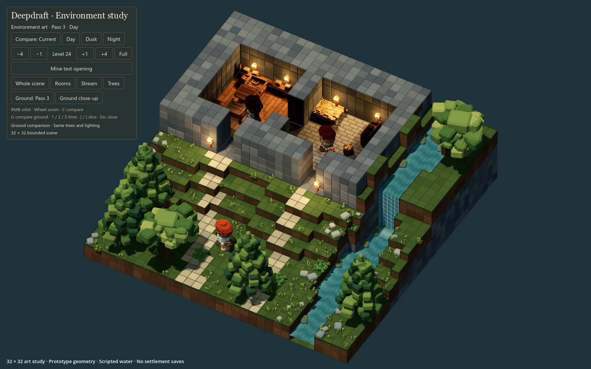
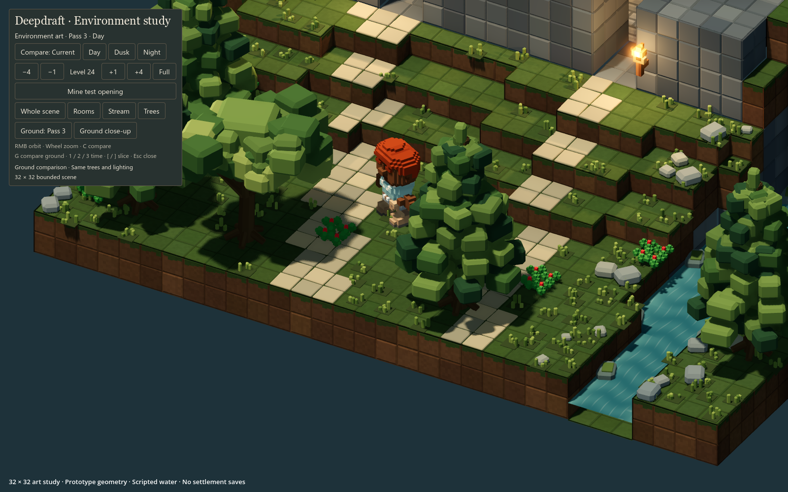
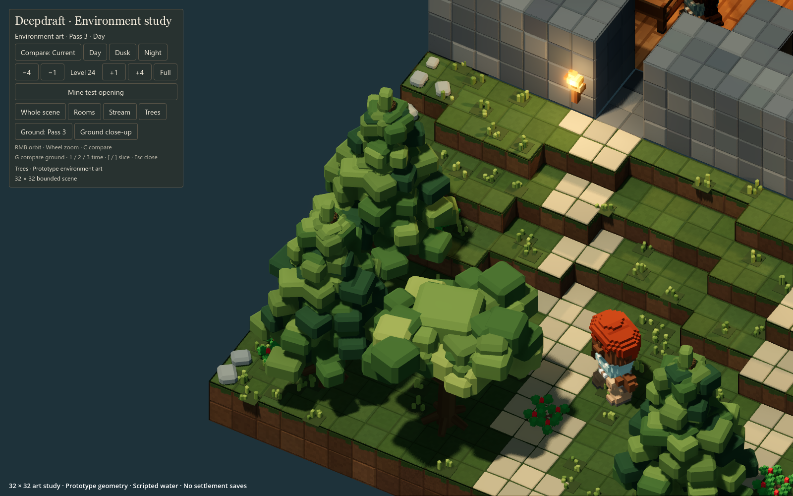

# 144 — World art direction and session handoff

Recorded **2026-10-12** for resuming on **2026-10-13**. Deepdraft's proposed
direction is **voxel-inspired, stylized low-poly art built on editable voxel
terrain**. The native study now gives us a concrete starting point: retain the
individual stone treatment and improved trees from pass 2, with pass 3's dirt
and grass as the preferred ground baseline.

The player likes these study improvements and has asked to preserve the wider
direction before continuing. Converting dwarves, animals, furniture and the
production world is still proposed work. This handoff records that plan; it
does not mean those conversions or production integration have happened.

## Resume here

1. Read this handoff and [143 — Visual quality study](143_visual_quality_study.md).
2. Double-click [Launch Visual Study.cmd](../../Launch%20Visual%20Study.cmd)
   from the project root. **F5 loads the normal game.** F6 only runs the study
   when its scene is selected in Godot's scene tabs.
3. Review Whole scene, Trees and Ground close-up. **C** compares the current
   assets with the study; **G** compares ground passes 2 and 3 while retaining
   the new trees, stone and lighting. Also review day, dusk, night and slicing.
4. Continue with the proposed small asset pilot below when the player resumes
   implementation. Keep it in the isolated study before replacing production art.

The next useful result is one coherent scene containing the preferred terrain
and trees alongside a redesigned dwarf, one animal and a small furniture set.
The exact pilot animal and furniture pieces remain to be chosen; they do not
require a full catalogue redesign first.

## Decisions and current status

| Subject | Position at this handoff |
|---|---|
| Individual stone blocks | The player explicitly likes the native study treatment. Retain this direction. |
| Trees | The player calls pass 2 a significant visual upgrade. Retain its clustered foliage and shaped trunks as the starting point. |
| Dirt and grass | Pass 3 was requested and preferred after review. Further refinement should preserve that improvement. |
| Wider asset style | Discussed as the likely direction for dwarves, animals, furniture and other world objects. No catalogue-wide conversion has started. |
| Ground rules below | Recommended continuation of the discussion, with exact seam strength, turf fringe and path design still open to visual tuning. |
| Large world integration | Unproven. The experiment is 32×32; the intended world remains 1024×1024 horizontally and 128 vertically. |
| Menus and HUD | The player likes the illustrated main menus. Retain their Hearth & iron theme; this is world-art work. |

The original illustration remains an aspiration for composition, atmosphere and
material richness. It is not an engine screenshot or a promise that the native
game already achieves its detail or performance. The saved references below
are actual native captures.

## Shared visual language

Use strong, chunky silhouettes, broad flat-shaded planes, a restrained palette
and selective bevels. Timber should feel substantial; stone should feel heavy;
foliage should read in clusters. Warm wood and firelight should sit comfortably
against cooler rock and muted greens. Retain the established dwarven identity
and room for underground bioluminescence.

Low-poly does not mean smoothing everything into rounded objects or adding a
bevel to every cube. Spend detail on silhouette, joints, recognisable materials
and features visible at normal RTS zoom. Keep wear and colour variation subtle
enough that mining, placement and selection remain legible.

Craftsmanship must remain visible. Starter items should still look crude;
shaped joinery, dressed masonry, metal fittings and framed doors belong to
appropriate later tiers. In particular, keep existing log doors frameless.

## Terrain surfaces and paths

The world grid remains the authority for digging, support, navigation, water,
room sealing, resources and saves. The renderer can shape the visible skin of
an exposed voxel without creating smaller simulation cells or changing its
material identity. Existing 1:8 art detail is an authoring scale, not a requirement
to subdivide the world simulation or to build floors one-eighth of a block thick.

| Surface | Recommended treatment | Gameplay boundary |
|---|---|---|
| Natural stone | Retain individually readable blocks, restrained chamfers and deterministic shade variation. Differentiate rock from dressed construction through material treatment where appropriate. | Existing block identity and mining yield remain authoritative. Do not add a wall-finish system. |
| Dirt | Softer edges, earth-colour variation and occasional small stones. Aim for continuous earth with weaker joints than laid masonry. | Rendering must not turn dirt into a new resource, obstacle or stack of constructed bricks. |
| Grass | A thin green top with a slightly uneven turf fringe over exposed brown soil; sparse tufts add variety. | The cap belongs to actual grassy terrain, not a separately placed structural block. |
| Constructed stone paths | Fitted, chunky stones with shallow joints, modest variation and a visually level walking surface. | A future functional path needs a real persistent construction designation and inspectable material. Study slabs are decorative only. |
| Permanent indoor floors | Carry the same material language into repeatable plank and laid-stone patterns. | Preserve [128 — Permanent floors](128_permanent_floor_preview.md): mine a full supporting layer and replace it to restore the walking height. |

Grass must not appear on artificial slice cuts, buried faces or every surface
newly revealed by digging. The current study only adds turf to actual grass
blocks with open air above. Grass spreading, seasonal changes and other ground
simulation are separate work, not automatic consequences of this art direction.

Bevels and fringes must meet cleanly at terrain steps and chunk boundaries.
Mining, construction and restoration must update neighbouring exposed surfaces
without cracks, floating tufts or mismatched natural/constructed slice caps.
The player's earlier constructed-stone top-face mismatch is a regression to avoid.
Artificial cuts must continue to conceal undiscovered resources.

The study path is not yet a buildable path and grants no movement bonus. Path
costs, unlocks, effects and whether it becomes a distinct catalogue entry are
undecided. Do not quietly reinterpret it as a thin flooring overlay. Rugs,
pelts and fitted carpets remain a separate deferred category. Wall coverings
and a combined Mine and Replace action remain excluded.

## Dwarves and other world assets

| Asset family | Proposed art treatment | Preserve during the pilot |
|---|---|---|
| Dwarves | Chunky proportions, expressive hair and beards, clearer faces, clothing and equipment; use shaped planes where they improve the silhouette. | Recognisable character variation, appearance assembly, animation anchors, equipment/carry poses, seating and sleeping alignment, existing logical clearance. |
| Animals | Species-specific silhouettes, tapered limbs and suitable fur or feather clusters. | Species size, movement/animation, ground or water alignment and existing navigation rules. |
| Furniture and stations | Thick timber, selective softened edges, readable joints and clear material/craftsmanship tiers. | Footprints, interaction and seating points, door hinges, wall mounts, material variants, placement ghosts and packed forms. |
| Trees and plants | Build from the fir/oak prototypes, then extend the language to bushes, flowers and other flora. | Species recognition, growth/season/crop states, harvest and transplant behaviour, authored footprints and slice visibility. |
| Items and props | Simplify forms around material and purpose, with detail appropriate to their screen size. | Item identity, quantity readability, carry/storage scale and the existing economy. |

Not every asset needs replacement. Review existing pieces in the new setting
and retain those that already fit. This is a staged art migration, with gameplay
contracts kept explicit for each family.

## What the study proves and what it does not

Pass 3 contains native stone/soil/turf geometry, six prototype trees, ground and
room dressing, decorative path slabs, scripted stream/waterfall presentation
and a different lighting treatment. Existing dwarf and furniture art is still
used. The scene uses real block data and roof-light sampling, but its actors
are posed and simulation is paused. Two manually positioned room fill lights
approximate bounce; they are not a production indirect-light solution.

The recorded pass 3 run passed **42 checks**, including comparison controls,
unchanged block data across the ground toggle, slicing, mining/restoration,
roof lighting and bedrock preservation. At 1600×1000 on an RX 9070 XT, Study GPU
medians were **1.71–2.22 ms** across night/dusk/day. The whole-scene view reported
76 draws and 158,342 primitives. A synchronous fixture remesh took about
**100 ms**, which is not suitable as the production mining update strategy.
See [143](143_visual_quality_study.md) for the complete conditions and results.

These are small-scene measurements, not full-game FPS or evidence that a large
colony and forest can use the same implementation unchanged. Production work
must address exposed-face batching, cached/instanced props where suitable,
distance detail levels, bounded terrain updates, lighting cost and memory.
There is no reason to render every stored world voxel as an individual object.

## Proposed implementation sequence

1. **Asset pilot in the study.** Add one dwarf, one animal and a small coherent
   furniture set beside the preferred trees/ground. Keep the old versions for
   direct comparison. Include basic motion and a relevant interaction pose so
   an attractive static model does not conceal broken use or proportions.
2. **Set the authoring standard.** Refine proportions, palette, bevel strength,
   detail density, mesh/material conventions and animation anchors from that
   pilot. Update the shared art guide when those choices are established.
3. **Test production scale and behaviour.** Exercise a representative generated
   settlement with active dwarves, wildlife, many trees and lights, normal zoom
   ranges, slicing and repeated terrain edits. Measure frame time, update spikes
   and memory; compare against the same scene using current art. Agree on target
   hardware and budgets before treating the small study as a performance target.
4. **Migrate by asset family.** Integrate the accepted treatment incrementally,
   verifying gameplay contacts, material variants, current saves and UI previews
   for each affected batch. Keep unfinished art experiments in the study.

Open choices for the next session are the pilot subject/set, the amount of
softening and detail at gameplay zoom, dirt seam strength, and the first
production performance target. None requires reopening the preference for the
improved trees, individual stone and pass 3 ground baseline.

## Native reference images

Copies are preserved beside this document so the visual baseline does not depend
on the temporary capture folder. These show the October 12 study, including
existing dwarf/furniture models; they are not examples of completed replacements.

### Whole scene



### Dirt and grass



### Tree forms



## Files and verification to resume with

| Location | Purpose |
|---|---|
| [Study scene](../../scenes/studies/visual_study.tscn) | Isolated native experiment |
| [VisualStudy.gd](../../tools/visual_study/VisualStudy.gd) | Comparison, cameras, lights and study setup |
| [StudyTerrain.gd](../../tools/visual_study/StudyTerrain.gd) | Fixture block data and exposed terrain rebuilding |
| [StudyMesh.gd](../../tools/visual_study/StudyMesh.gd) | Chamfers, turf/soil faces and mesh construction |
| [StudyEnvironmentArt.gd](../../tools/visual_study/StudyEnvironmentArt.gd) | Prototype trees, slabs and other dressing |
| [Terrain detail shader](../../tools/visual_study/terrain_detail.gdshaderinc) | Study surface shading |
| [CaptureStudy.gd](../../tools/visual_study/CaptureStudy.gd) | Native captures and checks |
| [Art guide](../60_asset_creation/61_voxel_art_guide.md) | Existing production conventions; not yet globally replaced |
| [Dwarf appearance guide](../40_economy_colony/41b_dwarf_appearance_glb.md) | Existing character asset contracts |

Run from `P:\Deepdraft` to regenerate the study evidence:

```powershell
powershell -NoProfile -ExecutionPolicy Bypass -File tools/visual_study/Launch.ps1 -Capture
```

The latest full captures and [report](../../tmp/visual_study_20261012/art_pass_3/report.json)
remain in `tmp/visual_study_20261012/art_pass_3/`; previous passes are retained.
The launcher uses a separate study profile and does not load settlement saves.
This documentation handoff adds no runtime changes. The working tree already
contains substantial earlier work; preserve it and avoid broad resets or
regeneration of unrelated assets when resuming.
