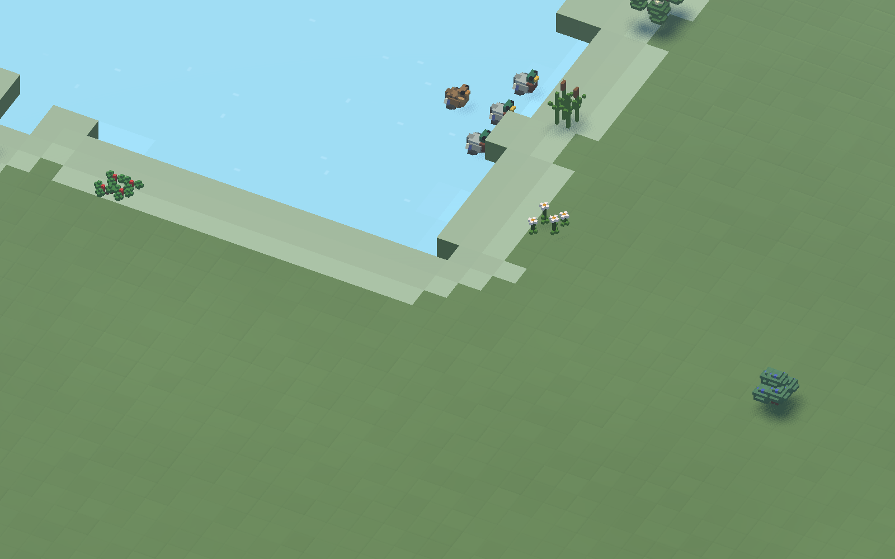
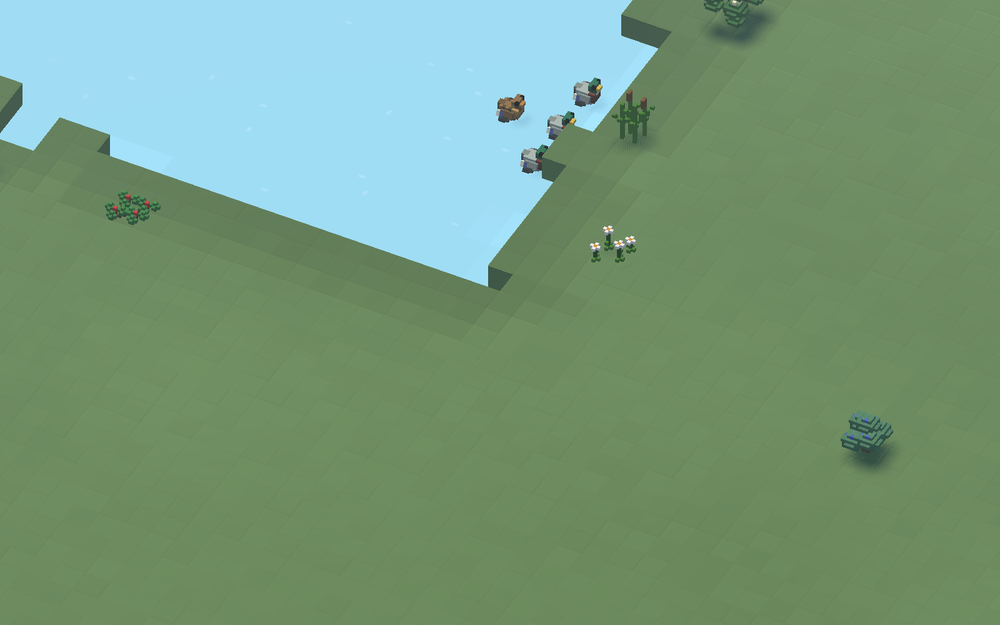
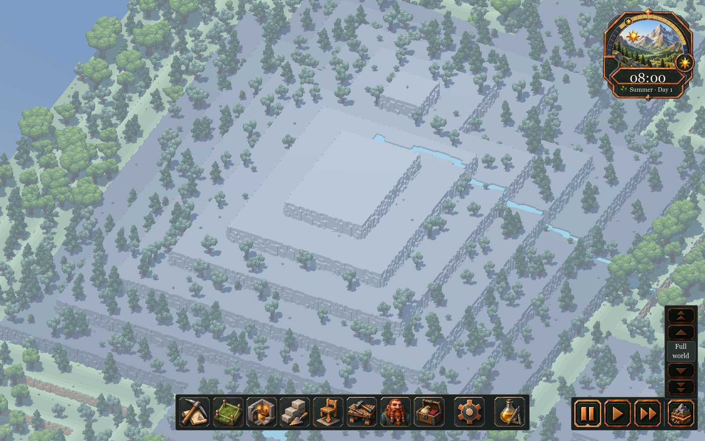
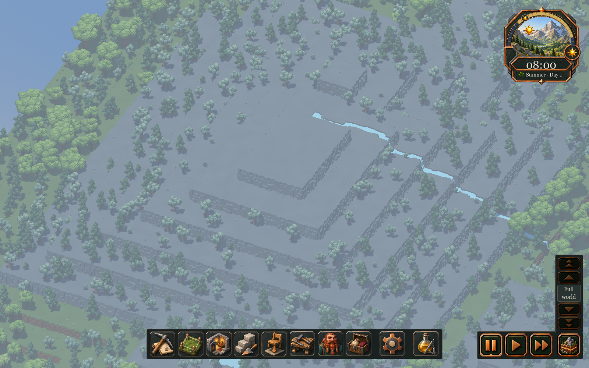
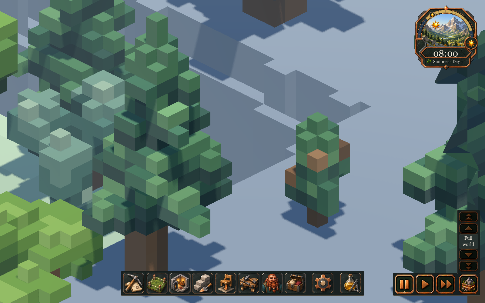
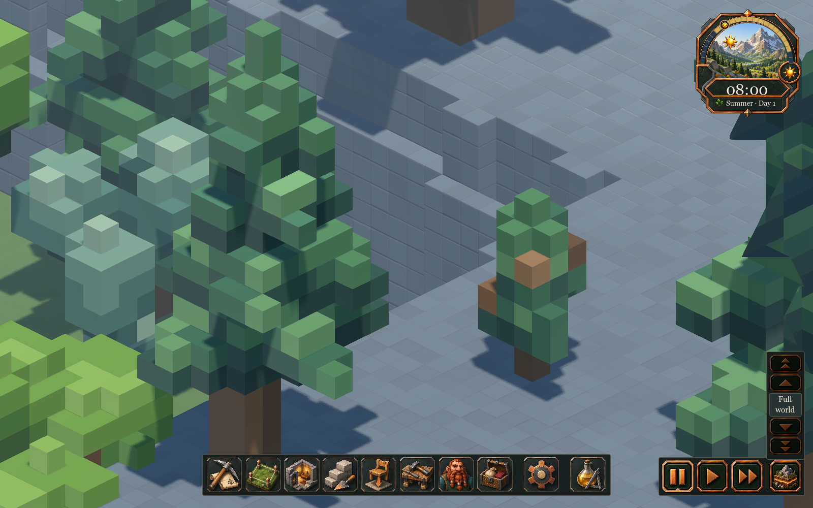
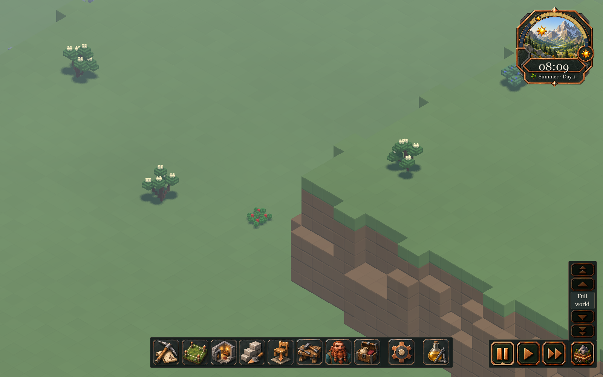

# 145 — Base world terrain art plan

**Next asset pilot delivered:** [146 — Pine and oak](146_tree_art_pilot.md)
integrates the preferred clustered tree treatment into production, with every
stage/season, gameplay verification and matched forest rendering measurements.

Recorded and implemented **2026-10-13**. **Status: all five phases complete.**
The player authorized the complete implementation after selecting the palette.
This starts the wider art migration with the existing base world voxels,
ahead of the character/animal/furniture pilot
previously proposed in [144 — World art direction](144_world_art_direction_handoff.md).

The player has confirmed **a coherent grey rock palette with subtle variation**
and **grass remaining a full voxel**. Grass over dirt, thin turf caps and fringes
are deferred. The visual reference remains pass 2's individual stone and pass 3's
softened ground forms, adapted to this full-voxel grass decision.

## Delivered result

**Shoreline follow-up (2026-10-13):** The player reported a pale band around water
that kept changing. `MoistureRenderer` still emitted the old sRGB colours over the
new linear grass palette and opted out of terrain detail. Soil getting wetter
therefore appeared as a bright moving ring. It now uses `get_terrain_color`, the
same terrain profile/material treatment and gradual moisture darkening. Its
refresh stamp includes the season, including when paused. Explicit moisture
coverage retains a separate debug palette with correct colour conversion.

Five targeted fixtures pass: MoistureRenderingTest (**314 checks**), WaterFlowTest,
WaterSurfaceMeshTest, WaterSurfaceMotionTest and TerrainAppearanceTest. Native
seed-1234 captures at 0, 30 and 90 simulation seconds reproduce the old band and
confirm its removal. Camera transforms and serialized water/moisture fingerprints
match across both runs. The water simulation, irrigation history and world data
are unchanged. Evidence: `tmp/shoreline_art_20261013/checks.json`, `before/` and
`fixed/`; reproduce the fixed view with
`tools/terrain_art/CaptureShoreline.ps1 -Label review`. Trees are hidden in this
diagnostic to expose the bank. Restart Play; current saves work without regeneration.

| Original moisture overlay at 90 seconds | Corrected overlay at the same state |
|---|---|
|  |  |

| Phase | Result |
|---|---|
| 1 — Baseline | Native seed-1234 production captures at 1600×1000 and 2560×1440, with matching cameras, edits, lighting and fingerprints. |
| 2 — Material pilot | Palette-only, edge-shading and real-chamfer comparisons; full grass faces, four seasons, daylight/dusk/night and torch light. Historical pass 3 remains available. |
| 3 — Production integration | Terrain-only world-space detail on merged tops, cliffs, cavity faces, slice caps, construction and added blocks. Exact chunk meshes share the profile contract. Overview batches complete asynchronously with revision/epoch checks and a 4 ms soft upload budget. |
| 4 — Retire old rules | All eleven rock variants share one grey; eight grass and four dirt variants share seasonal families. Grass edge maps, finalisation, readiness gate and recolour requeues are removed. Terrain/resource geography remains unchanged. |
| 5 — Validation and handoff | 41 distinct regression fixtures pass. Native full-world, mining, construction, slicing, seasons, lighting and active-agent captures are recorded below. Runtime/rendering/art guides updated. |

**Production uses edge shading, not new chamfer geometry.** Cube silhouettes,
support and selection planes stay exact. The native chamfer alternative increased
scene primitives from 49,298 to 85,858 and fixture rebuild time from 65.8 to
102.1 ms. Its regular seams also read more like masonry. The quieter shaded
treatment retained 49,298 primitives and measured 0.431 ms median GPU time
versus 0.425 ms palette-only and 0.516 ms geometry in the bounded study. These
are whole-scene study measurements, not full-world budgets. No study fill lights
or study SSAO were used in this comparison.

The shipped colours are authored sRGB values: rock `#727C82`; grass spring
`#718F58`, summer `#657F4E`, autumn `#8A8354`, winter `#A0AAA0`; dirt spring
`#69533F`, summer `#7A5F45`, autumn `#72583F`, winter `#8A8377`. BlockRegistry
converts terrain vertices to linear once. Ordinary UI colours and imported art
keep their existing API. Profiles in
[appearance_profiles.json](../../data/terrain/appearance_profiles.json) supply
local/broad variation and edge strengths. Fine detail fades by projected size
and distance; slice caps have much quieter detail. Grass is green-family material
on all six faces. The brown layer in the captures is a separate dirt voxel.

Native production references:

| Before | Implemented |
|---|---|
|  |  |
|  |  |

This grass diagnostic hides the tree spawner to expose the terrain. Mountain,
RTS and active-world measurements retain normal vegetation. Other native
references: [material pilot](concepts/145_terrain_art/material_pilot.png) and
[constructed stone sliced against natural rock](concepts/145_terrain_art/constructed_cut.png).

## Measurements and limits

Godot **4.7.2.stable.steam.ed1daf0bf**, AMD Radeon RX 9070 XT, seed 1234,
production lighting, Clear weather, native renderer, vsync disabled. Each static
view uses 120 frames after a 30-frame warm-up. The same camera transforms are
stored in the paired reports. These short local runs do not establish general
hardware requirements or guarantee 60 FPS.

| Measurement | Baseline | Implemented |
|---|---:|---:|
| Full-world overview tiles | 1,024 | 1,024 |
| Generated top samples | 1,048,576 | 1,048,576 |
| Merged top quads at startup | 19,391 | 14,900 |
| Side quads at startup | 114,842 | 79,874 |
| First visible tile, 1600×1000 | 5.231 s | 6.426 s |
| Central 121-tile region ready | 7.244 s | 7.291 s |
| Full overview complete | 11.163 s | 10.756 s |
| Mountain GPU median, 1600×1000 | 0.930 ms | 0.898 ms |
| RTS GPU median, 1600×1000 | 0.550 ms | 0.590 ms |
| Close terrain GPU median, 1600×1000 | 0.435 ms | 0.553 ms |
| Mountain GPU median, 2560×1440 | 1.166 ms | 1.206 ms |
| RTS GPU median, 2560×1440 | 0.583 ms | 0.593 ms |
| Close terrain GPU median, 2560×1440 | 0.528 ms | 0.575 ms |
| Static memory, 2560×1440 mountain | 377.80 MiB | 367.56 MiB |
| Reported video memory, same view | 634.70 MiB | 634.70 MiB |
| One-block mining command dispatch, 1600×1000 | 18.431 ms | 18.663 ms |
| 272-block mining command dispatch | 180.017 ms | 179.355 ms |
| Tiles rebuilt by those local edits | 4 | 4 |

First visibility was later in the final run; central readiness was similar and
full coverage was slightly earlier. Do not describe this as a universal startup
speedup. Equivalent material IDs can now merge, reducing geometry without losing
per-voxel shader variation. Frame/GPU differences include normal run-to-run noise.

An intermediate synchronous terrain build recorded a 45.44 ms worker wait.
The final extended route recorded at most **0.016 ms completed-worker wait,
2.914 ms individual upload and 4.293 ms main-thread drain**. The 4 ms target is a
soft budget because one upload is atomic. The separate full-world validation
route recorded 0.002/0.381/2.170 ms respectively. Active jobs only get joined
during teardown/reload; normal frames poll for completion. Revision, season,
slice and world-epoch checks prevent old results replacing newer terrain.

The instrumented startup built 1,024 tiles with 13.70 s of aggregate CPU work
across workers: surface lookup 6.41 s, sides 6.02 s, top merging 1.23 s and
main-thread mesh creation 0.04 s. The slowest tile took 20.9 ms, of which 0.042 ms
was upload. Summed worker CPU time is not main-thread blocking time or elapsed
startup time. Instrumentation adds overhead and is off during the paired GPU runs.

**Existing gameplay stalls remain.** The 272-block command itself still takes
about 179 ms, separate from terrain worker/build/upload time. It took 180 ms in
the baseline. Active simulation also misses a consistent 16.7 ms frame budget:
the paired active *sliced* view has frame p95 26.876→25.535 ms at 1600 and
25.090→26.111 ms at 2560. The original capture route directly changed the slice
plane while the tool was inactive, so its `active_world` label means slice 47 in
both baseline and comparison. Treat that pair accordingly.

A corrected, additional `active_full_world` capture explicitly restores slice
127 and exercises the real tool lifecycle. With five dwarves and the wildlife
manager's 92 children present, frame p50/p95/p99/max were
9.183/37.649/66.034/66.799 ms; GPU median was 1.340 ms. An active camera pan
recorded p95 46.222 ms and max 109.476 ms. This is evidence of remaining game-wide
performance work, not an art-rendering 60 FPS claim. No before/after speedup is
claimed for that extra unpaired view.

Season refreshes of the full overview finished over 3.90–3.99 s while existing
meshes remained visible; sampled frame p95 was 3.72–3.77 ms. The winter sample
included a 33.01 ms maximum. The settle timer includes all elapsed time, but its
frame samples begin after four initial frames; those percentiles are not an
exhaustive bound on event-time spikes. Command dispatch is measured separately.

## Verification and reproducibility

All **41 distinct fixtures** pass: the 32-test job gate, four focused terrain
fixtures, four generation fixtures and WaterFlowTest. Construction and floor
tests were also repeated after the final added-terrain mesh adjustment.
TerrainAppearanceTest has **564 checks**, including full grass faces, linear
colour/profile tags, quiet caps, permitted resource colours, merging, seasonal
added blocks, face culling and stale async result rejection. The startup test
checks full 1,024-tile coverage, local mesh retention, edits during a pending
batch and save/load with a pending batch. CaveGenerationTest now attaches its
mining fixture to the tree before querying scene-owned construction.

Generation coverage includes 1,000 macro-layout seeds, eight full generation
seeds, four resource diagnostic seeds and eight cave seeds. Seed-1234 height,
water, domain and complete cave-catalog fingerprints match the baseline.
21,945 sampled material/resource identities also match. Raw decorative IDs
match before retiring grass bands; afterwards only the expected grass variant
assignment changes. No geography/resource rewrite or save-format migration was
introduced. Bedrock, three-block dwarf clearance, legitimate discovery, navigation
and current-version persistence retain their existing contracts.

Evidence under `tmp/terrain_art_20261013/`:

- `baseline_1600/`, `baseline_2560/`: before screenshots and reports.
- `final_1600/`, `final_2560/`: paired finished-art route and measurements.
- `validation_1600/`: corrected full-world active route, constructed contacts,
  cut faces and four seasonal ground views; ends at slice 127.
- `material_pilot/`: palette/shading/geometry, four seasons, dusk and night.
- `profiling_1600/`: detailed CPU surface/side/merge/upload breakdown.
- `verification.json`, `job_gate/`, `verify_focused/`, `verify_generation/`,
  `added_terrain_gate/`: passing results and logs; `regression_evidence/` preserves
  generated diagnostics without replacing the older tracked reference captures.
- `import.out`/`import.err`, `export.out`/`export.err`: editor import and Windows
  export-pack validation; the exported pack includes the profile JSON and shader include.

Reproduce native views with `tools/terrain_art/Capture.ps1 -Label review -Extended`
(add `-Large` for 2560×1440; `-Profile` enables per-section CPU instrumentation).
Use `tools/terrain_art/Verify.ps1 -Group Focused` or `-Group Generation` for the
terrain fixtures. The runners isolate APPDATA and preserve player saves.
Restart Play to load the changed registry/shader. There are no new autoloads,
global classes, project-setting changes or user asset imports.

The remaining sections retain the approved design and implementation sequence;
the measured decisions and completion record above take precedence over the
earlier proposal to use selective real chamfers.

## Intended result

The landscape should read as a continuous, chunky low-poly world. Individual
blocks remain understandable for mining and building, while broad material
families carry the scene. Colour should describe the material; shape, lighting
and deliberate slice shading should explain relief and depth.

| Material | Planned treatment |
|---|---|
| Natural rock | One restrained neutral-to-cool grey family at every altitude. Subtle, deterministic local variation and shallow selective chamfers give individual blocks character. Remove the visible horizontal colour bands. Avoid making an entire mountain resemble laid masonry. |
| Grass | A full green-family voxel, including exposed sides and undersides. Use muted seasonal greens and gentle local variation without bright edge rings. Dirt begins at a separate dirt voxel; there is no brown soil band inside the grass block. |
| Dirt | Warm, restrained browns with softer edges and weaker seams than stone. Remove conspicuous colour stripes between otherwise equivalent dirt variants; retain the actual grass/dirt/rock arrangement and soil depth. |
| Cave soil and bedrock | Preserve their separate material identities and readable distinction. Tune them alongside the main palette; bedrock remains protected. |
| Ore and gems | Retain recognisable resource colours on legitimately revealed faces. Fit them to the rock treatment without making undiscovered deposits visible. |
| Constructed stone | Carry the same stone family through placed blocks and their cut faces. Check existing permanent stone/plank floors for lighting and contact consistency; a new floor or masonry catalogue is outside this phase. |

Retain seasonal colour changes. Retune spring, summer, autumn and winter together
so a later season does not restore the old edge gradient. Winter remains a
palette treatment in this work; snow accumulation is separate. Full grass faces
use the season's grass palette, with ordinary lighting and slice dimming.

Trees remain a useful composition reference. Their production conversion,
characters, animals, furniture, water redesign, path construction and lighting
overhaul follow separately. The first comparison uses production lighting so
material decisions are not dependent on the study's manually placed fill lights.

## What the current implementation does

The project review found that both colour patterns originate in generated block
variants and registry palettes. The production lighting shader does not calculate
the grass edge rings.

| Current mechanism | Migration work |
|---|---|
| `WorldGenerator._altitude_rock_body_id`, `_mountain_shelf_block_id` and surface selection choose `rock01`–`rock11`; their definitions have different grey values. | Give these natural-rock variants a coherent authored colour family. Height can still participate in real terrain/resource generation, but it must stop determining decorative rock brightness. |
| Lowland and foothill distance maps select grass bands. `_grass_variant` also has edge and regional fallbacks. `surface_palettes.json` supplies eight seasonal grass palettes. | Replace the edge-distance colour hierarchy with restrained local variation. Remove the obsolete band maps, finalisation pass, readiness signal, renderer requeue and associated diagnostic assumptions together. |
| Four dirt variants have different seasonal browns; shelf generation also assigns them in vertical bands. | Unify the earth palette without changing where soil exists. Check vertical faces as well as surface patches. |
| `BlockRegistry.get_color` and immutable colour lookups supply mesh vertex colours. | Keep JSON and BlockRegistry as the owners of material appearance, including any new terrain style parameters. |
| Normal play uses 32×32 overview tiles, merged top faces and side bands, discovered cavity surfaces, and separate added-terrain geometry. | Apply one material treatment to every active path. Keep the dormant exact chunk path compatible; activating it in normal play is not the migration strategy. |
| The native study builds individual chamfered faces and custom soil/turf geometry with a study shader. | Use it as a visual prototype. Replace its turf geometry for this pilot and adapt the useful parts to production batching and lighting. |

The reference study is 32×32 and reports roughly **100 ms for a synchronous
fixture remesh**. Its GPU results at 1600×1000 do not establish full-world
performance. Production overview work also waits for worker batches before
assigning meshes; moving heavier work into those workers alone will not remove
the main-thread wait.

## Material and rendering design

Use a small set of **JSON-authored terrain appearance profiles**, loaded by
BlockRegistry and resolved from the chosen block definition. Profiles describe
base/seasonal colours, variation strength, seam strength and bevel treatment.
Extend the existing terrain data rather than introducing another material
authority or per-voxel scene objects.

Keep the current block keys during the appearance migration. Remove their old
artistic role as an ordered height/edge palette. Grass generation should select
variants deterministically without measuring distance to the terrace edge;
variants can share a profile. Removing equivalent block definitions later is
optional cleanup after checking their consumers, not a prerequisite for the
new look. There is no requirement to build legacy development-save migrations.
Current-version save/load must still reproduce the terrain and its appearance.

The recommended rendering approach is batched exposed surfaces, inexpensive
world-space colour variation, and selective real chamfers where the silhouette
benefits. Begin with broad, low-contrast patches and a much weaker per-cell
shade change. Fade fine detail with distance. Do not split every merged surface
just to give each cell a slightly different colour, and do not add dark borders
to every grass or dirt face. A shader can soften shading but cannot change a
silhouette; phase 3 measures where actual edge geometry is worthwhile.

Derive appearance only **after** existing visibility rules choose the allowed
surface material. Slice caps and planned excavations use concealed strata;
revealed cavity faces use their permitted real material. Variation must not
sample a hidden ore/gem ID or encode it in mesh attributes. It must be stable
across reloads, tile boundaries and camera movement.

Keep the existing roof/sky lighting, fog, local lights and slice dimming. Use
terrain-specific mesh attributes or an opt-in material path if needed. The
shared underground shader also serves actors and props, so terrain changes must
not silently recolour them. Verify the colour-space path with known swatches:
the study contains extra colour conversion and hard-coded ground colours that
must not be copied wholesale into the shared production shader.

## Implementation phases

### 1. Record the production baseline

Capture the same seed, camera positions, time and season at close, normal RTS
and distant zoom. Include a mountain spanning several old rock bands, a grassy
terrace edge, a dirt cliff, a cave entrance and a small excavated room. Add
natural/constructed stone contacts and representative slice levels.

Record terrain frame cost, mesh counts, memory, startup visibility and the time
to update one mined block and a short excavation sequence. Keep the world seed,
settings and camera positions with the evidence so later comparisons are useful.

**Deliverable:** a reproducible visual and performance baseline. This phase
establishes what changes in later captures; it does not redesign the world shape.

### 2. Establish the palette and full-voxel grass treatment

Extend the isolated terrain comparison with grey rock, warm dirt and fully
green grass blocks. Show flat ground, steps, convex/concave corners, vertical
faces and a mined opening. Keep the historical pass 3 turf treatment available
as an old reference, with the new full-voxel treatment clearly identified.

Compare palette-only changes first, then the same palette with softened edges.
Use normal game lighting and inspect all four seasons, daylight, dusk and a
torch-lit room. Start with one coherent grey proposal; exact swatches, seam
strength and bevel width remain visual tuning choices within that direction.

**Deliverable:** native before/after captures and the authored palette/profile
values. The result must read well at normal gameplay zoom, with no rock bands,
grass edge rings or turf-over-dirt sides. This is the first implementation
milestone to review before expanding the renderer work.

### 3. Prove the treatment in the production renderer

Integrate the profile lookup and required mesh attributes into a limited
production test area spanning several tiles and chunk boundaries. Compare
merged faces with shader detail against selective chamfer geometry, using the
same palette. Choose the least expensive treatment that retains the accepted
appearance, especially at normal RTS zoom.

Cover overview tops and cliffs, discovered cavity walls/floors/ceilings, cut
caps, and added terrain. Keep terrain edits local, including the neighbour
faces whose exposure changes. Ensure corners and material transitions close
without gaps or overlapping dark seams. Visual softening must preserve support,
selection alignment and the contact plane used by agents and placed objects.

Measure CPU mesh construction, worker wait, main-thread upload, GPU time and
mesh memory separately. If existing batch waits exceed the update budget,
bound the work or consume completed jobs asynchronously. Any asynchronous
results need revision checks so an older mesh cannot overwrite a newer edit,
season or slice state.

**Deliverable:** an end-to-end production terrain prototype with measured cost,
clean boundaries and working mining/restoration. Do not carry the study's whole
fixture rebuild into normal terrain editing.

### 4. Replace the old colour rules throughout production

Apply the accepted profiles to all existing natural-rock, grass and dirt
variants. Remove grass edge-band generation and its renderer/startup plumbing.
Keep geography, caves, soil thickness, water and resource placement unchanged;
decorative variant reassignment is allowed only within the same material family.
Check other consumers before changing variant selection, including generation
diagnostics, resource replacement, surface placement and save regeneration.

Compare the same seeds before and after. During palette/renderer work, generated
block IDs should match. After deliberately changing decorative variant selection,
compare material families and gameplay properties as well as height, water,
cave and resource fingerprints. Update assertions that specifically encode the
retired art rule; keep the gameplay and concealment assertions.

**Deliverable:** the generated game world uses the new terrain treatment on every
active surface path. Old grass distance maps and redundant rebuilding no longer
run. Natural and constructed stone remain consistent when sliced or restored.

### 5. Validate full-world play and record the result

Run the same camera route in the 1024×1024×128 world with active dwarves,
wildlife, vegetation and lights. Include near/distant views, fast panning,
repeated slicing, mining across tile boundaries, construction, season changes
and save/reload. Compare frame-time distributions and worst terrain-edit stalls,
not only average FPS.

Use 1600×1000 for comparison with the study and the project's 2560×1440 viewport
for the production measurement on the available machine. Establish a terrain
CPU/GPU/memory budget from phase 1 before widening the prototype; 60 FPS is a
proposed working target, not a measured guarantee or a confirmed hardware
requirement. The change must fit that budget, avoid world-wide rebuilds for
local edits and eliminate study-sized synchronous edit stalls. If the baseline
already misses the target, record that separately from the added art cost.

**Deliverable:** paired native captures, measured production results and relevant
passing regressions. Update the rendering and art guides with what actually
shipped. Character, animal, furniture and tree migration can then use this terrain
as their visual foundation.

## Verification checklist

| Area | Required evidence |
|---|---|
| Appearance | Rock stays in one grey family across elevations; grass is a full seasonal-colour voxel; dirt has no obvious decorative shelf stripes. Detail remains calm at RTS zoom. |
| Exposure and concealment | Slice and planned excavation reveal no undiscovered ore, gems or caves. Actual discovery reveals the correct resources. Test caps and side faces separately. |
| Geometry and editing | All face orientations, corners, grass/dirt/rock transitions, tile/chunk boundaries, repeated dig/restore and constructed-stone contacts remain closed and aligned. |
| Terrain behaviour | Bedrock, topology, soil distribution, water, resource placement, mining yields, navigation and object support retain their contracts. |
| Lighting and seasons | Day/dusk/night, indoor torch light, fog, roof removal and all four seasons work; shared actor/prop materials have no incidental colour conversion change. |
| Persistence and startup | New/current-version saves restore edits, discovery and slice state; startup and restored slices have complete terrain coverage without obsolete grass-band dependencies. |
| Performance | Record CPU/GPU frame-time percentiles, edit/season/slice spikes, worker wait, uploads, draws, primitives and memory against the same baseline. |

Use existing fixtures where they cover the changed behaviour:
`WorldGenerationTest`, `WorldLayoutTest`, `WorldResourceDiagnosticsTest`,
`WorldTerrainStartupTest`, `TerrainExplorerTest`, `FloorConstructionTest`,
`UndergroundLightingTest` and `SaveManagerRoundTripTest`. Extend focused coverage
for new geometry and appearance contracts. Run the normal job gate when the
integrated change reaches gameplay verification; native captures remain necessary
to assess the art.

## Implementation locations

| Location | Responsibility |
|---|---|
| [terrain_blocks.json](../../data/terrain/terrain_blocks.json) and [surface_palettes.json](../../data/terrain/surface_palettes.json) | Authored material definitions, seasonal colours and profile associations |
| [BlockRegistry.gd](../../scripts/registries/BlockRegistry.gd) | Appearance lookup, validation and immutable worker-safe data |
| [WorldGenerator.gd](../../scripts/systems/WorldGenerator.gd) | Retire decorative grass edge rules while preserving real material geography |
| [WorldRenderer.gd](../../scripts/systems/WorldRenderer.gd) | Production overview, cavity and added-terrain surfaces; local rebuilding |
| [ChunkMesher.gd](../../scripts/systems/ChunkMesher.gd) | Compatible appearance contract for the exact chunk path |
| [underground_lighting.gdshader](../../scripts/shaders/underground_lighting.gdshader) | Existing lighting contract; any terrain detail must be explicitly scoped |
| [StudyTerrain.gd](../../tools/visual_study/StudyTerrain.gd), [StudyMesh.gd](../../tools/visual_study/StudyMesh.gd) and [VisualStudy.gd](../../tools/visual_study/VisualStudy.gd) | Full-voxel grass pilot, native comparisons and reference captures |
| [World rendering guide](../20_player_interface/24_world_rendering.md) and [Art guide](../60_asset_creation/61_voxel_art_guide.md) | Update production conventions after implementation is verified |

This plan changes the immediate work order and terrain art decisions. Historical
study captures and measurements in [143](143_visual_quality_study.md) and
[144](144_world_art_direction_handoff.md) remain evidence of those earlier passes.
