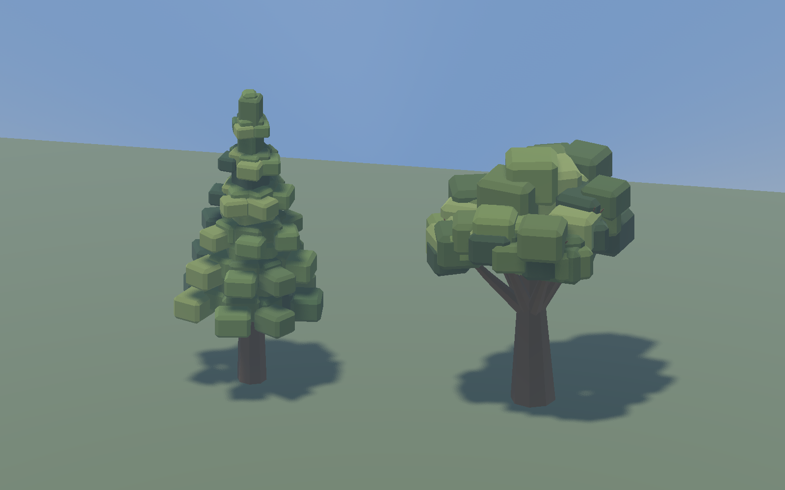
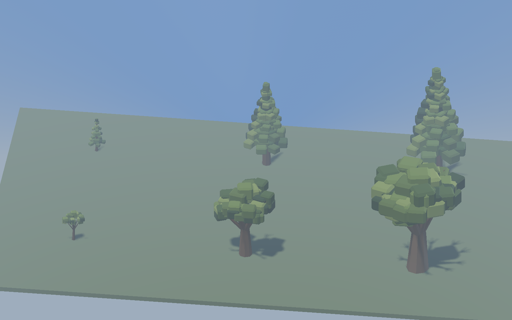
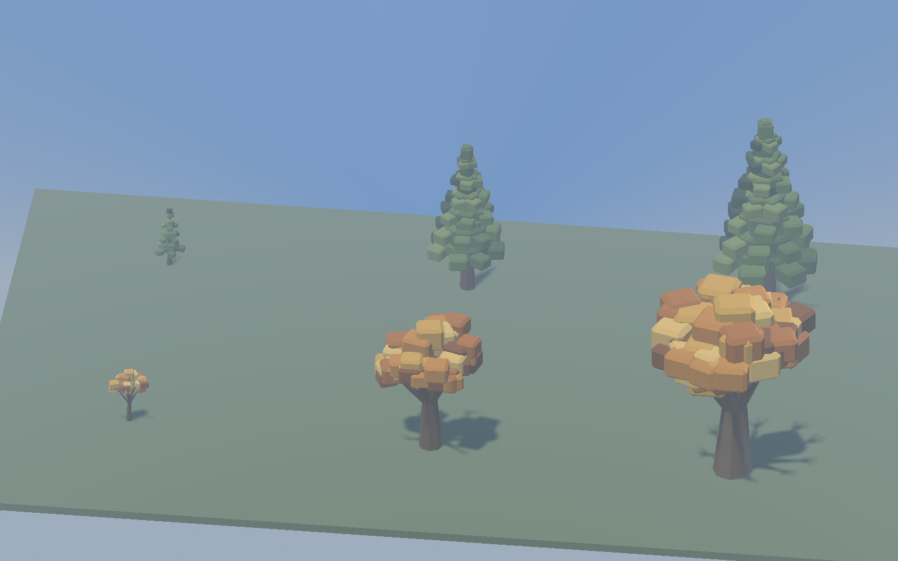
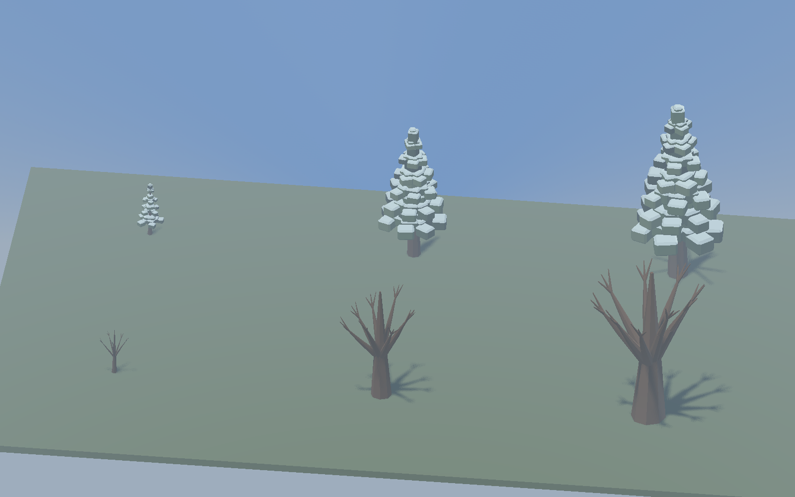
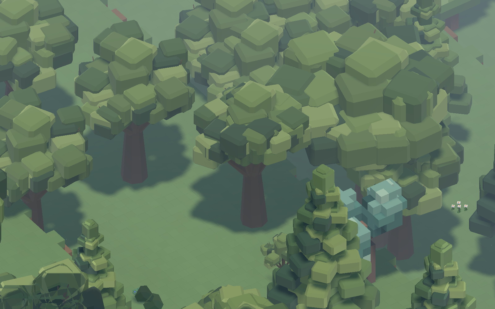

# 146 — Pine and oak art pilot

**Family completed:** The user approved this pilot and requested the remaining
trees. [147](147_complete_tree_family.md) records apple/juniper and the complete
94-model roster. The pine/oak assets and historical results below are unchanged.

**Implemented: 2026-10-13.** The first production asset family after terrain
plan [145](145_base_world_terrain_art_plan.md). The user authorized a conifer and
broadleaf pilot based on the preferred pass-2 trees in
[144](144_world_art_direction_handoff.md).

Pine and oak now use clustered foliage with small real bevels, tapered flat-sided
trunks, roots, and visible branching. Pine keeps its tall tiered silhouette; oak
has an irregular broad crown. The palette follows the study's muted greens and
warm bark. These are native GLB models using the existing production tree
material and lighting, without study fill lights or a new world shader.

## Delivered scope

- **42 GLBs:** 14 pine and 28 oak. All three growth stages are covered. Mature
  and ancient stages retain three deterministic variants; saplings retain one.
- Oak has fresh spring, muted summer, ochre autumn and bare winter forms.
  Its wood scaffold is identical across seasons. Pine retains its summer
  fallback for spring/autumn and snow-tinted upper foliage faces in winter.
  Snow uses the same closed geometry, avoiding a separate coplanar cap.
- Models live in `assets/models/flora/trees/pilot/{pine,oak}/`. Only the model
  paths and explanatory comments changed in the two flora definitions.
  The previous assets remain available for the capture tool's baseline mode.
- `tools/generate_tree_pilot.py` builds the complete pilot deterministically.
  `data/art/tree_pilot.json` owns offline dimensions and sRGB palettes. Exported
  vertex colors are linear, alpha is one, roots have identity transforms, and
  each GLB has one closed mesh with one material surface. Runtime scene caching
  and the shared tree material stay in `SurfaceFloraSpawner`.
- The legacy full-roster generator preserves species already using pilot paths
  during `--install`; it cannot silently switch pine/oak back to the old art.

## Gameplay contracts

Placement domains, density, moisture requirements, edge rules, stage weights,
growth metadata, appeal, material tags, felling work, yields and seeds are
unchanged. A semantic comparison against the previous definitions, excluding
model paths/comments, passes for both species.

Pine retains trunk footprints **1 / 2 / 3** and oak **1 / 3 / 5**. Saplings
remain walk-through clutter. Adult collision and navigation occupancy still
come from the existing footprint and `clearance_height`, not the canopy bounds.
All adult visual overhang starts above the three-block walking corridor; there
are no colliders embedded in the GLBs. All model bases sit at Y=0.

Art heights are pine **8 / 20 / 27** and oak **7 / 17 / 24** world units. These
are visual dimensions, distinct from trunk occupancy heights. Picking uses the
actual imported triangles and bounds. Existing whole-tree base-height slice
culling remains intact. Model selection still hashes world position, so a
season change preserves the same variant index. No save schema changes.

This delivers all authored growth-stage visuals. Automatic tree aging is not
implemented by this pilot; the existing tree growth metadata remains untouched.

## Verification

- `TreePilotTest`: **976 checks**, all 42 imported models, seasonal variant
  identity, live spawner integration, ground alignment, trunk-only collision,
  canopy clearance, slicing, shared material and unchanged visual-only save state.
- `TreeFellingTest`: real scheduler/worker chopping, axe contact, cancellation,
  partial progress, yields and felled-tree persistence pass.
- `ObjectExplorerTest`: selection/picking, terrain occlusion, slice/tool exclusion
  and seasonal replacement pass with the new models.
- `NavigationRegressionTest` and `SaveManagerRoundTripTest` pass, including the
  save fixture's intentional corruption/backup-recovery cases.
- Generator `--check` verifies byte-for-byte reproducibility, seasonal geometry
  and wood consistency, ground contacts, finite geometry and canopy envelopes.
  An isolated legacy-generator install confirms it preserves both pilot species.
- Native captures show all stages in four seasons, mature specimens at 12:00
  and 19:00, and the actual generated forest at close and overview scales.

Logs and raw captures: `tmp/tree_pilot_20261013/`. Final asset/gameplay tests are
in `final_tests/`; navigation and full save/load results are in `tests/`.
That earlier test folder also records an initial fixture-only slice failure:
manually spawned test trees were not in the spawner's column tracking. The
fixture now registers them exactly as production does; all slice checks pass.

## Production rendering comparison

Godot **4.7.2**, **RX 9070 XT**, seed **1234**, paused simulation, clear weather,
production lighting/material/fog, VSync disabled. Same cameras and **2,953 tree
identities** in both runs. The selected 64×64 forest neighborhood contains 20
pine/oak trees, with additional trees visible around it. Each sample warms up
30 frames and measures 120. No other test was running during the final pair.

| View | GPU median before → pilot | GPU p95 before → pilot | Frame p95 before → pilot | Draws before / pilot |
|---|---:|---:|---:|---:|
| Forest, 1600×1000 | 0.573 → 0.604 ms | 0.680 → 0.616 ms | 1.142 → 1.142 ms | 148 / 148 |
| Forest, 2560×1440 | 0.747 → 0.882 ms | 0.778 → 0.912 ms | 1.186 → 1.224 ms | 155 / 155 |
| Overview, 1600×1000 | 1.136 → 1.628 ms | 1.167 → 1.659 ms | 1.623 → 1.946 ms | 546 / 546 |
| Overview, 2560×1440 | 1.495 → 2.072 ms | 1.531 → 2.217 ms | 1.906 → 2.521 ms | 605 / 605 |

At the larger overview, reported primitives rise from **1,988,914 to 3,099,570**.
Video memory rises by about **4.6 MiB**. Individual source GLBs contain
1,024–5,376 triangles. Closed foliage clusters add geometry; batching each tree
into one surface avoids adding draws. These short paused-world samples establish
the pilot's added rendering cost on this machine, not a minimum-hardware target
or a many-dwarf active-simulation guarantee. Lower-hardware budgets and deliberate
distant-forest LOD work remain part of the wider migration.

The preserved [comparison data](concepts/146_tree_pilot/comparison.json) includes
render CPU, frame distributions, memory, camera transforms and identity checks.
Capture with `tools/tree_art/CaptureTreePilot.ps1`; `-Baseline` switches only the
capture process to the old assets. The script uses an isolated APPDATA profile.
Its stage platform is a diagnostic display under production light, not a new
placeable game object. The forest images come from the actual generated world.

## Native references

### Mature pine and oak

[Matched previous models](concepts/146_tree_pilot/before_mature_pair.png)

### Growth stages — pine behind oak; sapling, mature, ancient from left to right

### Generated world

[Wider forest view](concepts/146_tree_pilot/forest_1600.png)

## Handoff

**Restart Play** to see the new models; no project reload or new world is needed.
Pine/oak were subsequently approved; apple and juniper are completed in [147](147_complete_tree_family.md).
The next broader visual pilot remains dwarf/animal/furniture under the same
terrain and production light. Full grass voxels remain the current direction;
grass-over-dirt caps are still deferred.
