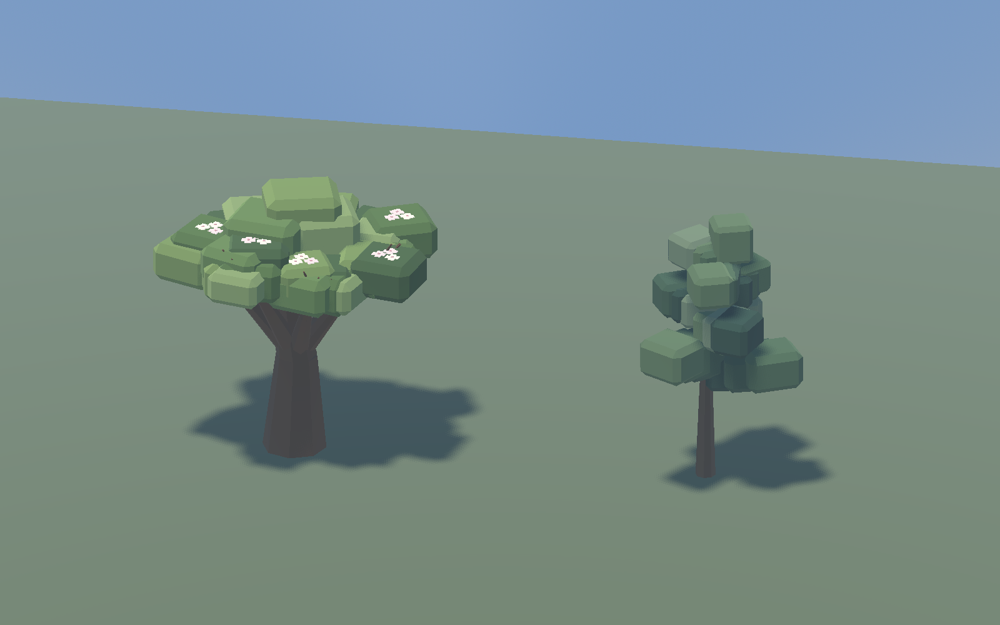
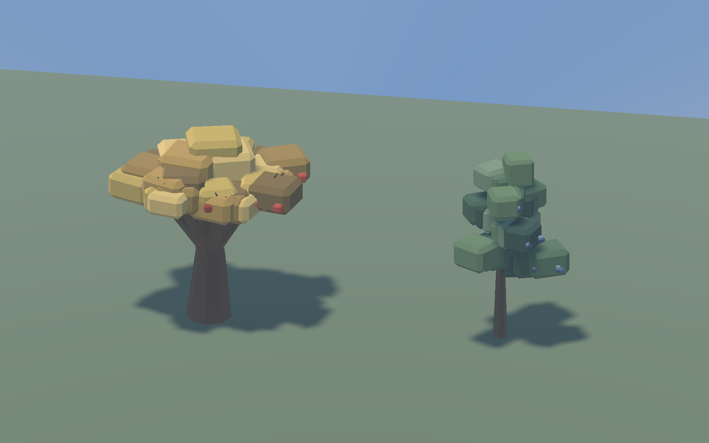
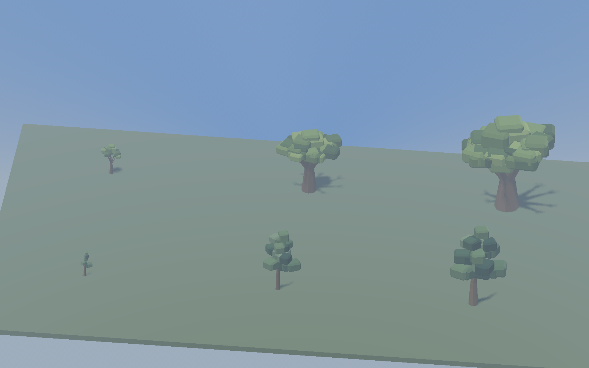
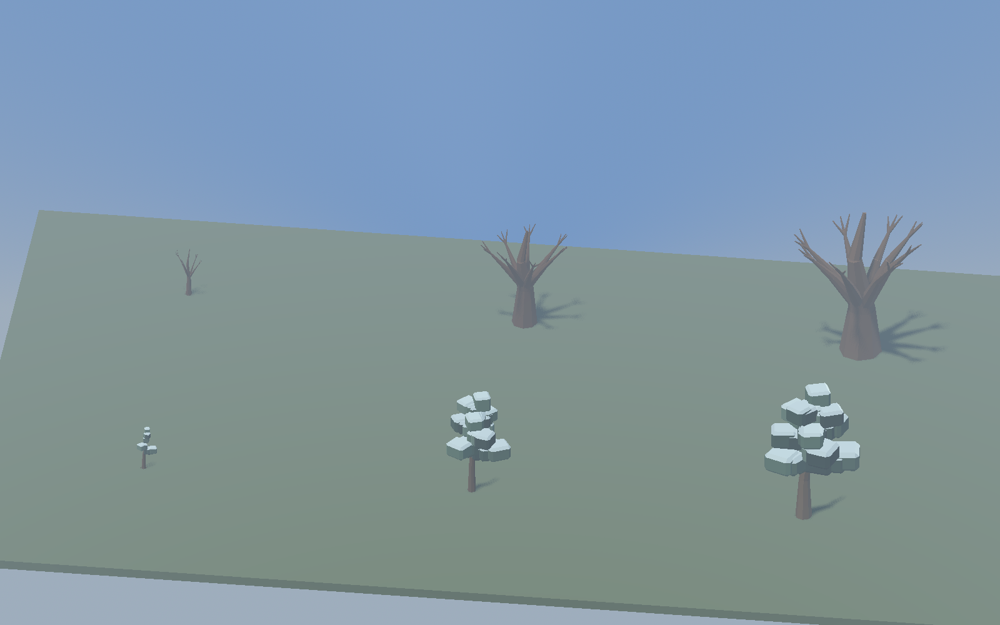

# 147 — Complete clustered tree family

**Later implementation (2026-10-19):** [252 — Apple harvesting](252_apple_harvesting.md)
adds worker apple picking and saved picked visuals. The future-gameplay statement
below describes the original art pass, before that implementation.

**Implemented: 2026-10-13.** After approving the pine/oak pilot in
[146](146_tree_art_pilot.md), the user requested the remaining trees. Apple and
juniper now use the same flat planes, closed beveled foliage masses, shaped wood
and restrained palette. All four live surface-tree species are converted.

## Appearance and content

**Apple** has a low, spreading crown, warm branching trunk and exposed clusters
of cream/pink spring blossoms. Summer is green; autumn uses muted gold with red
fruit on the existing fruiting variants; winter exposes the same wood scaffold.
Visual heights remain 6 / 12 / 18 world units for sapling / mature / ancient.
There are **34 apple models**, including all six adult autumn-fruiting variants.

**Juniper** has an irregular evergreen crown on a bent leader, cooler green
foliage, blue berry clusters and snow on upper foliage faces in winter. It is
smaller and less regular than pine. Visual heights remain 5 / 12 / 16 units.
There are **18 juniper models**, including all eight adult picked variants.
Picking removes berry geometry while leaving every wood/foliage vertex and color
unchanged. Saplings have no fruit; out-of-season adults use their existing
berry-free model selection.

The new **52 GLBs** bring the family to **94**. Hash comparisons confirm the
42 approved pine/oak models are byte-for-byte unchanged. Each new model uses one
opaque vertex-color surface, root scale one, ground Y0, linear exported colors,
and the existing shared production material. No runtime shaders, production
lighting, density, or scene hierarchy changed.

The stable asset location remains `assets/models/flora/trees/pilot/`; its name
records the origin of the family. `tools/generate_tree_pilot.py` now builds all
four species from `data/art/tree_pilot.json`, including the `picked_models`
roster. Use `--check` for deterministic verification. Source GLBs span 896–8,708
triangles; apple blossom versions contain the most geometry. Do not use the old
voxel generators for current art. The legacy full-roster install preserves all
four migrated species, verified in an isolated directory.

## Gameplay contracts

Only model paths and comments changed in the apple/juniper definitions. Semantic
comparisons confirm every gameplay field is unchanged: placement niches, grove
clustering, density, growth metadata, stage weights, work, yields and seeds.
Apple retains **1 / 3 / 5** trunk footprints; juniper retains **1 / 1 / 2**.
Adult overhang leaves the three-block walking corridor clear. GLBs have no
embedded physics, and saplings remain walk-through clutter.

Juniper's existing autumn worker harvest still yields two/four berries, swaps
only the visual child and preserves the trunk's physics/occupancy identity.
Picked state, partial work and annual renewal retain the existing save behavior.
Apple fruiting models remain seasonal visuals: worker apple harvesting is still
future gameplay, as enforced by the existing harvest fixture. This art pass does
not implement automatic tree growth or new fruit mechanics. No save migration.

## Verification

- `TreePilotTest`: **2,064 checks across all 94 imported models**, covering
  seasonal and positional variant identity, runtime instancing, ground contacts,
  collision, overhang clearance, slicing, materials and juniper crop refresh.
- `JuniperHarvestTest`: passes headless and natively with actual workers,
  interruption/resume, partial-progress saves, picked-state streaming,
  new-year renewal, yields, mixed Orders and subsequent felling. Native capture
  helpers now accept `--capture-output=` and keep the inspector beside the tree.
- `TreeFellingTest`, `ObjectExplorerTest`, `NavigationRegressionTest` and
  `SaveManagerRoundTripTest` pass. The save fixture includes intentional backup
  recovery cases. Final geometry also passed the focused asset, harvesting and
  picking fixtures after its visual refinement.
- Generator `--check` verifies reproducibility, identical seasonal wood,
  unchanged structural geometry across leafy seasons, picked/unpicked geometry
  relationships, bounds and ground clearance. Inputs explicitly use UTF-8.
- Native production-light captures cover the generated world, all three stages
  in four seasons, apple blossoms/fruit, juniper ripe/picked forms and late-day
  light. The diagnostic stage platform is capture-only; forest views use the
  actual generated map.

Logs: `tmp/tree_family_20261013/{tests,final_tests,harvest_native}/`.
Final paired captures: `tmp/tree_pilot_20261013/{family_baseline,family_final}/`.
The baseline keeps the approved pine/oak and uses the previous apple/juniper.

## Matched rendering sample

Godot 4.7.2, RX 9070 XT, seed 1234, paused simulation, clear weather, unchanged
production lighting/fog, VSync off. Both runs have the same **2,953 generated
tree identities** and matching camera transforms. The selected 64×64 area has
12 apple/juniper trees, with other trees visible around it. Thirty warm-up frames
precede each 120-frame sample; benchmarks run separately from gameplay tests.

| View | GPU median before → complete family | GPU p95 before → complete family | Draws before / after |
|---|---:|---:|---:|
| Forest, 1600×1000 | 0.528 → 0.514 ms | 0.664 → 0.709 ms | 82 / 82 |
| Forest, 2560×1440 | 0.679 → 0.689 ms | 0.702 → 0.729 ms | 87 / 86 |
| Overview, 1600×1000 | 1.516 → 1.577 ms | 1.637 → 1.693 ms | 558 / 558 |
| Overview, 2560×1440 | 1.906 → 2.030 ms | 2.049 → 2.166 ms | 582 / 582 |

At the larger overview, primitives rise from **2,904,858 to 3,161,662**, frame
p95 from **2.356 to 2.490 ms**, and reported video memory by about **1.3 MiB**.
The extra median GPU cost is about **0.12 ms** for this view. Small differences
in the close view are within short-run noise; do not treat the lower median as
an optimization. These are paused-world measurements on this GPU, not a
minimum-hardware or active-colony performance guarantee. Spring blossom costs
are represented in the isolated seasonal captures, not the summer forest table.

[Full comparison data](concepts/147_tree_family/comparison.json) and
[content contracts](concepts/147_tree_family/contracts.json) are preserved.
Reproduce with `tools/tree_art/CaptureTreePilot.ps1 -FruitTrees`; add `-Baseline`
for the previous apple/juniper assets. The tool uses an isolated APPDATA profile.

## Native references

### Apple and juniper in spring

### Autumn fruit

[Matched previous models](concepts/147_tree_family/before_mature_autumn.png) ·
[Juniper after picking](concepts/147_tree_family/juniper_picked.png) ·
[Completed worker harvest](concepts/147_tree_family/harvest_completed.png)

### Stages and winter

Apple is behind juniper; sapling, mature and ancient read left to right.

[Apple in the generated world](concepts/147_tree_family/apple_in_world.png) ·
[Juniper in the generated world](concepts/147_tree_family/juniper_in_world.png)

## Handoff

**Restart Play** to load the complete tree family. Existing worlds/saves can use
the new art. Tree conversion is complete. [148 — Surface vegetation](148_surface_vegetation.md)
subsequently completes bushes, wildflowers and reeds. The broader character/animal/furniture
pilot remains future visual work. Full grass voxels stay in place, with
turf-over-dirt still deferred.
