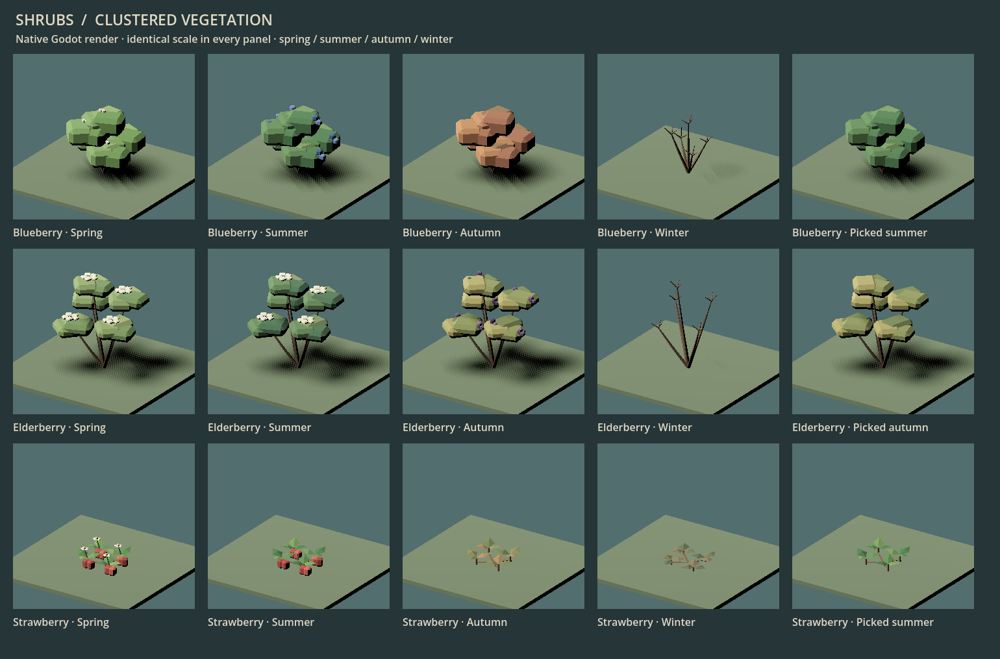
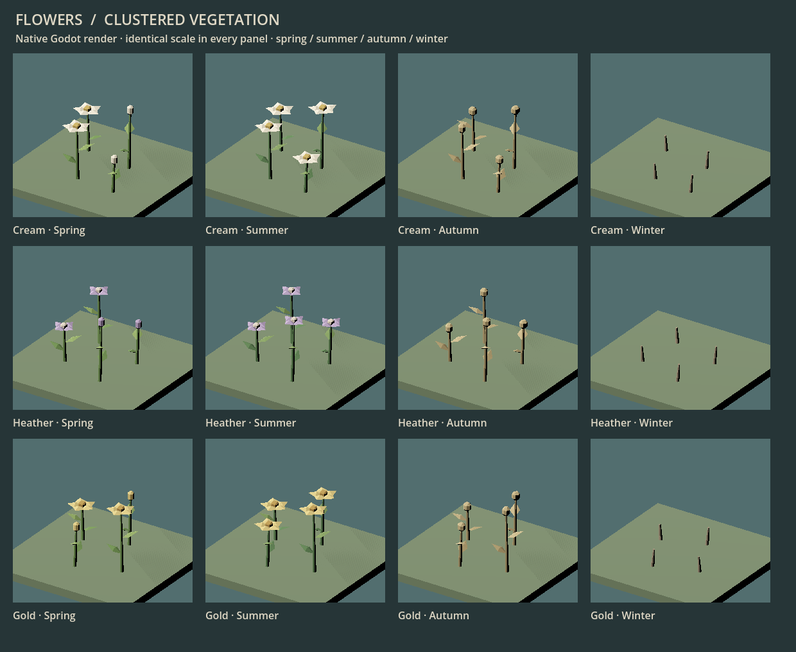
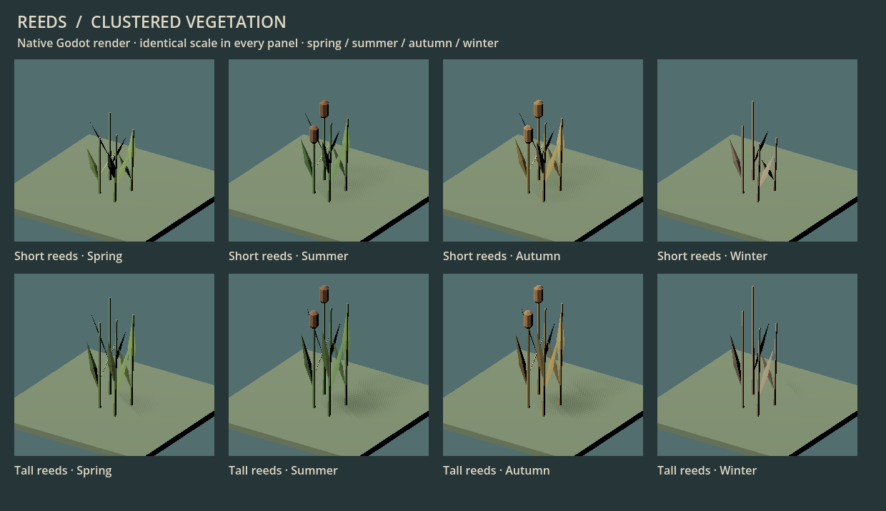
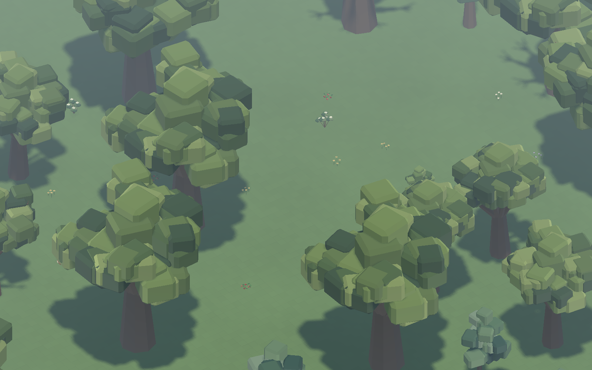

# 148 — Bushes, wildflowers and reeds

Completed 2026-10-13, following the approved tree family in [147](147_complete_tree_family.md).

The three berry bushes, three wildflower colors and both reed variants now share
the trees' restrained, voxel-inspired low-poly style. The smaller plants use
simple closed leaf/petal shapes, tapered stems and light foliage clusters.

## Delivered art

| Family | Treatment | Live models |
|---|---|---:|
| Blueberry | Rounded clustered crown, exposed blue fruit, cream spring buds, rusty autumn foliage | 14 |
| Elderberry | Taller open branches, flat cream flower umbels, purple autumn berries | 14 |
| Wild strawberry | Low trifoliate rosettes and runners, small white flowers and red fruit | 16 |
| Wildflowers | Cream, heather and gold petals; partial spring bloom, full summer bloom, dry seedheads and winter stems | 24 |
| Reeds | Short/tall clumps, pointed solid blades, summer/autumn cattails and dry winter stems | 8 |
| **Total** | **Every live seasonal/state model** | **76** |

Bush totals include young, mature, picked and packed forms. Flowers include all
four seasons planted and packed. Reeds retain their existing clearing-only
behavior. Young bushes have no fruit; picking removes only fruit geometry,
preserving the exact foliage and stem vertices/colors. Packed models translate
the same plant above a cloth-wrapped root bundle or flower root mat.

The first preview exposed buried blueberry/elderberry fruit. Final models place
the fruit on exposed crown edges. Young plants also retain enough size to read
at gameplay scale while remaining below their one-block clearance.

## Integration and authoring

- Offline profile: `data/art/surface_vegetation.json`.
- Generator: `tools/generate_surface_vegetation.py`; `--check` verifies closed
  geometry, winding, envelopes, crop/packing invariants, live registry coverage
  and byte reproducibility for all 76 models.
- Assets: `assets/models/flora/vegetation/`, separated into bushes, flowers and reeds.
- Only model paths changed in the three shrub definitions, surface-detail
  definitions and six packed-item fallback definitions. Existing registry and
  item-drop ownership remains unchanged.
- Author in world units with unit roots, base Y0, one opaque linear vertex-color
  surface and no embedded physics. The shared tree mesh builder supplies bevels
  and tapered stems; its accepted tree output is unchanged.

The complete gameplay definitions compare identically after normalizing the
new path prefix. Planting areas, habitat/moisture rules, stable identities,
seasons, yields, cutting growth, regrowth, worker durations, bloom queries and
save data are unchanged. Every plant remains nonblocking. The wildflower bloom
contract for future honey production remains intact.

All **94 accepted tree GLBs** and all **76 previous plant GLBs** remain
byte-identical. Previous plant assets stay available for matched comparisons;
their old voxel generators no longer author the live roster. Terrain, full grass
voxels and the deferred turf-over-dirt decision are unchanged.

## Verification

**1,831 imported-asset/production-spawner checks** pass in
`SurfaceVegetationArtTest`: all 76 models, four rotations/seasons, unit transforms,
grounding/clearance, shared materials, no colliders, slice visibility, young/picked
selection and carried/loose model selection.

Ten existing gameplay fixtures also pass: `ShrubPilotTest`, `FlowerPilotTest`,
`ReedPilotTest`, `ShrubTransplantTest`, `ShrubRegrowthTest`, `ShrubCuttingTest`,
`ShrubPlantingAnimationTest`, `ShrubMoveHandoffTest`, `PlantHabitatTransplantTest`
and `SaveManagerRoundTripTest`. These cover actual workers, picking, clearing,
planting, Move interruptions, regrowth and current saves. Native worker planting
also passes while capturing the real carried models at start/middle/release.

[Final test results](concepts/148_surface_vegetation/tests.json) ·
[Content contracts](concepts/148_surface_vegetation/contracts.json).
Raw logs and reproducible intermediate evidence: `tmp/vegetation_art_20261013/`.
The initial new fixture needed a real supporting floor; the corrected fixture
passes without changes to production behavior.

## Matched production captures

Godot **4.7.2**, Forward+ / D3D12, **AMD Radeon RX 9070 XT**, seed **1234**,
paused clear summer at noon. Each view warms for 30 frames and measures 120.
Before/after runs are sequential, with identical cameras, lighting, plant
identities and the already-upgraded tree assets.

The world contains **2,953 trees** plus **275 blueberries, 353 elderberries,
441 strawberry plants, 780 flower clumps and 15 reed clumps**. All placement
identity hashes match. Existing boulders/scree remain unchanged.

| View | Previous / new median GPU ms | Previous / new draws |
|---|---:|---:|
| Vegetation neighborhood, 1600×1000 | 0.487 / 0.463 | 35 / 35 |
| Vegetation neighborhood, 2560×1440 | 0.531 / 0.525 | 37 / 37 |
| Overview, 1600×1000 | 0.880 / 0.852 | 222 / 222 |
| Overview, 2560×1440 | 1.195 / 1.154 | 233 / 233 |

There is no measured GPU regression in these views; differences of this size
are short-run noise, not an optimization claim. Across the complete asset roster,
triangles change from **70,864 to 69,736**. Source GLBs grow from **6.60 MB to
9.29 MB** because the flat-shaded builder duplicates triangle vertices. Reported
video memory rises by about **1 MiB** in the matched views. These
paused-world measurements are not a guarantee for minimum hardware or an active
large colony. Seasonal sheets separately cover winter and fruiting/bloom states.

[Full comparison data](concepts/148_surface_vegetation/comparison.json).
Reproduce with `tools/vegetation_art/CaptureVegetation.ps1`; use `-Baseline` for
previous plant art and `-GalleryOnly` for asset sheets. Captures use isolated
APPDATA profiles. `CapturePlanting.gd -- --capture` runs the native worker fixture
and also requires an isolated `vegetation_art_20261013` profile.

## Native references

[Young plants](concepts/148_surface_vegetation/young.png) ·
[Packed bushes](concepts/148_surface_vegetation/packed_shrubs.png) ·
[Packed flowers](concepts/148_surface_vegetation/packed_flowers.png) ·
[Worker planting](concepts/148_surface_vegetation/worker_planting.png).

[Previous neighborhood](concepts/148_surface_vegetation/before_vegetation_1600.png) ·
[Previous bushes](concepts/148_surface_vegetation/before_shrubs.png) ·
[Previous flowers](concepts/148_surface_vegetation/before_flowers.png) ·
[Previous reeds](concepts/148_surface_vegetation/before_reeds.png).

## Handoff

**Restart Play** to see all updated plants. Existing worlds and saves work;
no new world or migration is needed. Main surface vegetation now follows the
new direction. [149 — Ground stones](149_ground_stones.md) subsequently completes
the boulder/scree families and the current surface-clutter pass.
Character, animal and furniture pilots remain future art work;
turf caps remain deferred.
