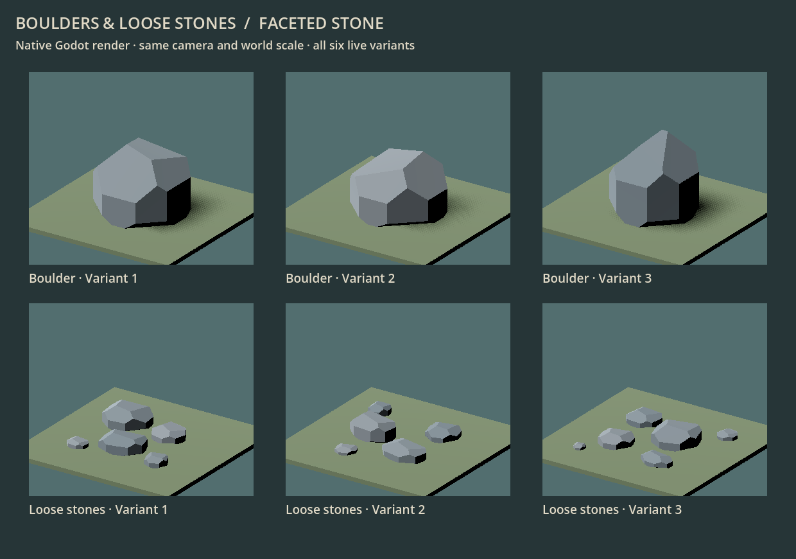
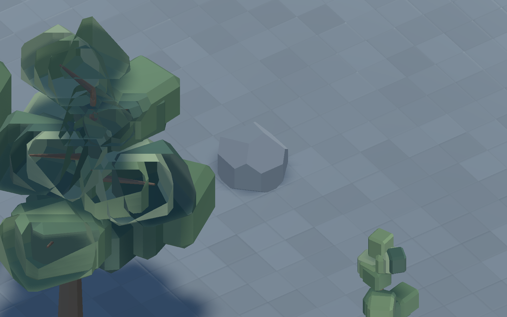
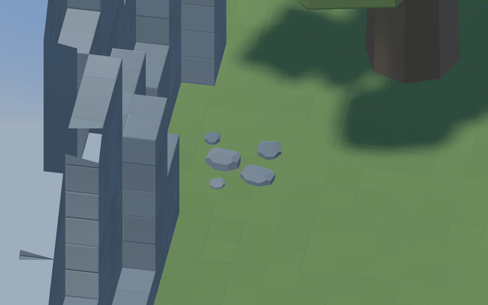

# 149 — Boulders and loose stones

Completed 2026-10-13, following [148 — Surface vegetation](148_surface_vegetation.md).

All three boulders and all three gatherable loose-stone clumps now use the
terrain's coherent grey family with broad, irregular fracture planes. This
completes the current surface-clutter conversion after trees, bushes, flowers
and reeds.

## Delivered appearance

Boulders have distinct broad, low and upright silhouettes, slanted tops and
chipped shoulders/bases. Their palette starts at terrain stone `#727C82`, with
two nearby greys and restrained local face variation. Lighting defines the
facets; there are no altitude bands, noisy voxel speckles or painted cracks.

Scree uses the same stone language at a smaller scale. Each clump has five or
six separate fragments, each grounded at Y0, with open gaps exposing the floor.
The clumps remain below half a block and within their three-block support area.

[Previous six models](concepts/149_ground_stones/before_stone_family.png).

## Integration and preserved behavior

Only **six model paths** change in `data/entities/surface_details.json`.
Normalized definitions compare identically with the previous versions.

| Contract | Preserved behavior |
|---|---|
| Boulder | 2×2 footprint, 2-block collision height; blocks walking; one collision body on layer 2 |
| Loose stones | 3×3 support envelope; no collision or navigation obstacle; mesh-only picking through open gaps |
| Clearing | Boulder: 7 seconds and two rough stones; scree: 3 seconds and one rough stone |
| Placement | Same seeds, variants, rotations, habitat, density and margins |
| State | Same partial work, cancellation, support loss, construction displacement, slice concealment and saves |

The six previous GLBs stay available for matched comparisons. All **94 tree**
and **76 plant** GLBs remain byte-identical. Terrain and dropped rough-stone item
definitions are unchanged; this pass covers the natural ground props.

## Authoring

- Profile: `data/art/ground_stones.json`.
- Generator: `tools/generate_ground_stones.py`.
- Live assets: `assets/models/details/faceted/boulders/` and
  `assets/models/details/faceted/scree/`.
- Previous voxel generators are labeled historical and write only comparison assets.

The generator intersects planar cuts to form closed convex stones, with real
flat faces and correctly transformed normals. Each GLB has a unit root, one
opaque linear vertex-color surface and no embedded collision. World placement
continues to own the boulder's logical body. The existing shared material is reused.

`--check` verifies reproducibility, registry coverage, finite geometry, triangle
winding, closed edges, grounding, support bounds and separated scree fragments.
No new runtime system, global class or project setting is introduced.

## Verification

`GroundStoneArtTest` passes **476 checks** across six imported models and all
four rotations, including support bounds, collision, navigation, exact mesh
picking, open scree gaps, season stability, slice concealment and unchanged
save deltas.

`BoulderPilotTest`, `ScreePilotTest`, `NavigationRegressionTest` and
`SaveManagerRoundTripTest` also pass. The two worker fixtures additionally pass
in the native renderer while capturing real breaking/gathering actions. Clearing
removes each prop once, yields the configured stone count and does not resurrect
it or duplicate rewards on load.

[Final test results](concepts/149_ground_stones/tests.json) ·
[Content contracts](concepts/149_ground_stones/contracts.json) ·
[Worker breaking](concepts/149_ground_stones/boulder_breaking.png) ·
[Worker gathering](concepts/149_ground_stones/scree_gathering.png).

Raw evidence is under `tmp/ground_stones_20261013/`. Initial new-fixture issues
were a missing explicit GDScript type and test cleanup order around an occupancy
signal; the final fixture passes without production behavior changes.

## Production comparison

Godot **4.7.2**, Forward+ / D3D12, **AMD Radeon RX 9070 XT**, seed **1234**,
paused clear summer at noon. Sequential before/after runs use identical camera
transforms and the accepted terrain/vegetation. Every view warms for 30 frames
and measures 120. World detail hashes match, including **58 boulders** and
**192 scree clumps**; the world retains **2,953 trees** and the same other plants.

| View | Previous / new median GPU ms | Previous / new draws |
|---|---:|---:|
| Stone neighborhood, 1600×1000 | 0.523 / 0.515 | 107 / 107 |
| Stone neighborhood, 2560×1440 | 0.656 / 0.649 | 111 / 111 |
| Overview, 1600×1000 | 0.958 / 0.955 | 301 / 301 |
| Overview, 2560×1440 | 1.299 / 1.289 | 321 / 321 |

There is no measured GPU regression in these views; millisecond differences
this small are noise rather than an overall speedup claim. Source geometry
falls from **9,204 to 1,140 triangles** across the six models, and GLB size from
**853,228 to 157,092 bytes**. The larger overview submits 1,507,318 primitives
instead of 1,560,382. Reported video memory falls by about **0.62 MiB**.
These are paused-world measurements on this GPU, not minimum-hardware or
large active-colony guarantees.

[Full comparison](concepts/149_ground_stones/comparison.json).
Reproduce with `tools/stone_art/CaptureGroundStones.ps1`; use `-Baseline` for the
previous assets or `-GalleryOnly` for the six-model sheet. The tool uses isolated
APPDATA and chooses close-up camera approaches from terrain geometry, preserving
the same before/after view around cliffs. Worker capture tools are
`CaptureBoulderWork.gd` and `CaptureScreeWork.gd`, run with `-- --capture` in an
isolated `ground_stones_20261013` profile.

## Native world references

[Previous boulder](concepts/149_ground_stones/before_boulder_1_in_world.png) ·
[Previous scree](concepts/149_ground_stones/before_scree_2_in_world.png) ·
[Whole neighborhood](concepts/149_ground_stones/stone_neighborhood_1600.png) ·
[Previous neighborhood](concepts/149_ground_stones/before_stone_neighborhood_1600.png).

## Handoff

**Restart Play** to load the new ground stones. Existing worlds/saves work;
no new world or migration is needed. Current surface clutter is converted.
Character, animal and furniture art remain future passes; full grass voxels
remain in place and turf-over-dirt remains deferred.
