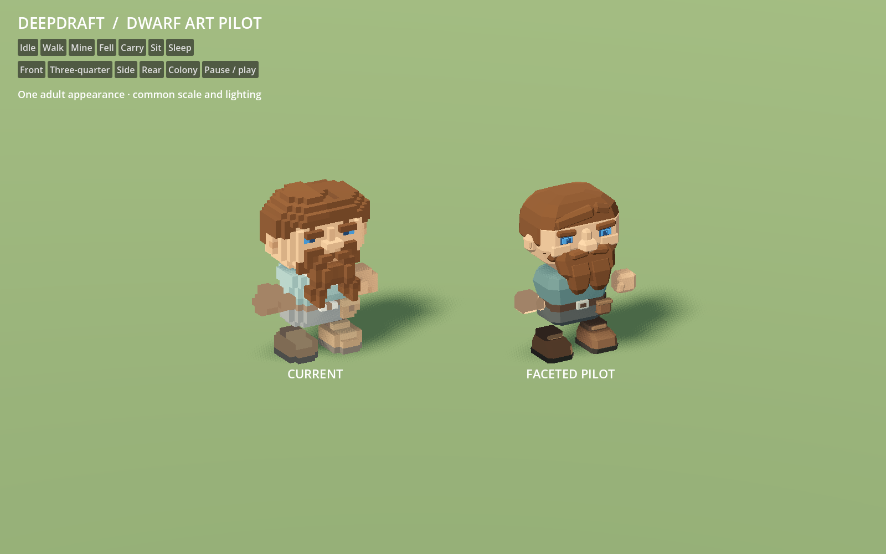
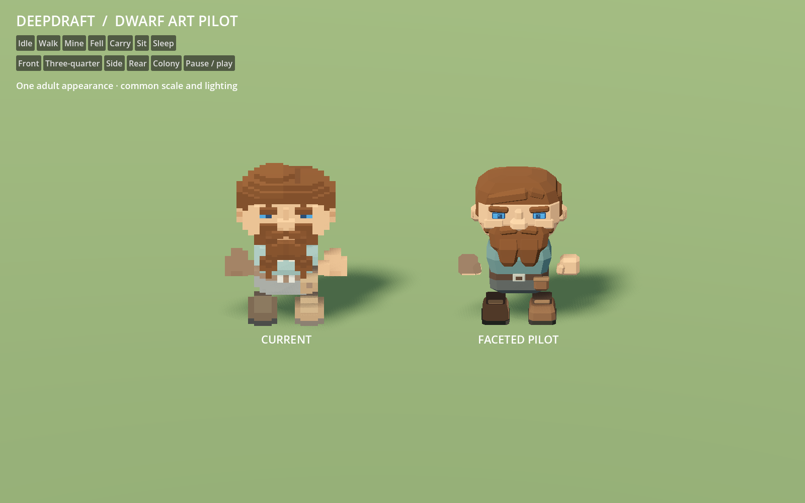
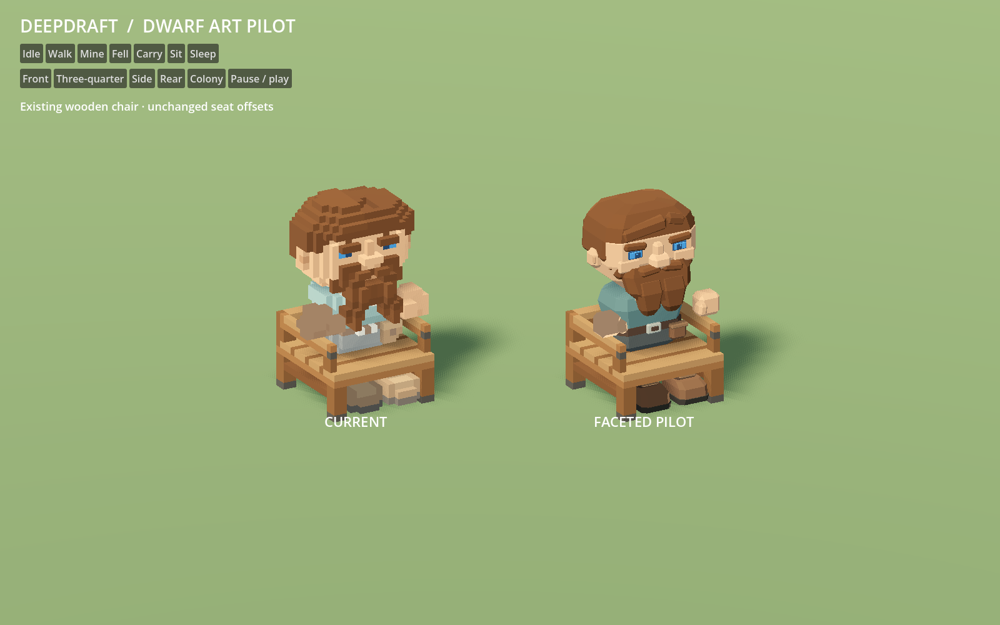
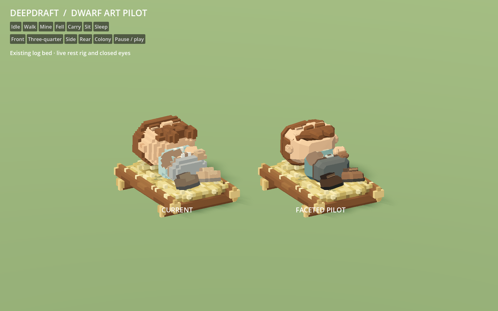
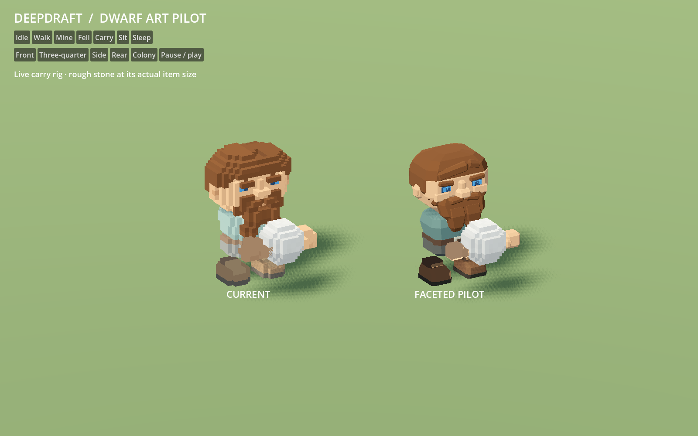
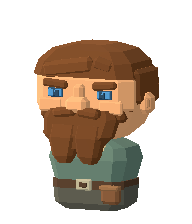

# 150 — Dwarf art pilot

Completed **2026-10-13** as the first character study after the terrain and surface
clutter passes. One adult dwarf now has a faceted head, swept hair, forked beard,
shaped mittens and boots, and a restrained teal work tunic. The larger planes and
selective bevels follow the accepted environment direction.

**Visual direction approved by the player on 2026-10-13.** Use this pilot as
the reference for the later dwarf appearance conversion.

This is an isolated, reviewable pilot. Normal Play still uses the existing 41
appearance models. The other ages, hairstyles, beards, brows and scars have not
been converted. The [deer](151_animal_art_pilot.md) and
[furniture](152_furniture_art_pilot.md) pilots are also approved. Their combined
[shared art standard](../60_asset_creation/63_shared_art_standard.md) is finalized;
the [production-scale comparison](153_settlement_art_comparison.md) is complete.
Full dwarf roster conversion is next in the [144 roadmap](144_world_art_direction_handoff.md).

## Review

Double-click [Launch Dwarf Pilot.cmd](../../Launch%20Dwarf%20Pilot.cmd) in the
project folder. The viewer shows the current dwarf on the left and the pilot on
the right, at the same scale and under the same lighting. Choose Idle, Walk,
Mine, Fell, Carry, Sit or Sleep; view from the front, side, rear, three-quarter
angle or a wider colony angle. Pause freezes the current animation phase.
Escape closes the viewer.

The viewer runs the existing DwarfAgent animation rigs. It includes the current
wooden chair, log bed, axe, pick and rough-stone item at their authored sizes.
Its separate user-data profile and save folder keep settlement saves isolated.
No project reload is required. F5 continues to launch the normal game.





## Asset and animation contracts

Eight GLBs live in `assets/dwarves/pilot/`. The offline generator is
`tools/generate_dwarf_pilot.py`, with palette, head profile and anchor references
in `data/art/dwarf_pilot.json`. Each part has one opaque vertex-color surface,
unit root scale and world-unit positions in the shared authoring frame. Skin,
hair and eyes retain the production runtime tint pipeline; tunic and boots use
baked linear colors.

The torso contains no arms or legs. Hands and boots remain independent mirrored
parts. The palm anchor stays at `(1.0625, 1.25, .1875)`, and eyes retain the
sleeping-lid coordinates. The highest point is 3.32 blocks; the production
navigation/collision box remains 1×1×3. The pilot does not change work reach,
equipment, item size, furniture offsets or appearance save IDs.

The study temporarily substitutes resources through the existing DwarfAssets
owner during pilot assembly, then immediately restores its tables. The test
adapters use the same substitution in isolated processes. No production asset,
registry, appearance pool, animation script or gameplay definition is edited.







The production portrait renderer also accepts the pilot without camera or
material changes:



## Verification

- Generator `--check`: reproducible bytes, finite geometry, outward normals,
  closed components, opaque colors, sole height and palm containment for all
  eight parts.
- `DwarfPilotArtTest`: **173 checks pass** for imported parts, all skin/hair/eye
  tints, registry restoration, logical collision, tool grips, mirrored resets,
  walking/ground-rest clearance, closed eyes, slicing and appearance save IDs.
- `DwarfPilotMiningTest`: existing mining fixture passes with pilot resources,
  including reach heights, cardinal directions, underfoot work, exact pick
  contact, interruption, sleep, pause/speed and tool swaps.
- `DwarfPilotHaulingTest`: existing hauling fixture passes with pilot resources,
  including actual pickup, travel, deposit and interruption.
- `DwarfPilotRestTest`: existing rest fixture passes with pilot resources,
  including shelter selection, lying/seated poses, wake, gait, save restoration,
  separate claims and support removal.
- Native Godot captures include five viewing angles, three phases of each of
  six motion/interaction modes, and two portraits: **25 images**. The paired
  stage is a visual study; production-scale measurements are recorded in [153](153_settlement_art_comparison.md).

The assembled pilot uses **2,572 triangles**, compared with **6,032** for the
selected current appearance, with the same ten visible part meshes. The eight
source files total 316,096 bytes versus 519,080 bytes for their current
counterparts. These are geometry/file counts, not a measured full-game speedup.
See [geometry](concepts/150_dwarf_pilot/geometry.json) and
[test results](concepts/150_dwarf_pilot/tests.json).

The first asset-fixture run encountered Godot's standalone-script autoload
compilation ordering; loading the factory after startup corrected the fixture.
The final asset run and all three gameplay adapters pass. The viewer also waits
for deferred sky startup before restoring its comparison lighting. Neither
correction changes production code.

## Reproduce

From `P:\Deepdraft`, using the configured Python and Godot executables:

```powershell
python tools/generate_dwarf_pilot.py --check
powershell -NoProfile -ExecutionPolicy Bypass -File tools/dwarf_pilot/Launch.ps1 -Capture
```

Run the four named fixtures with `tools/run_job_reliability.ps1`. Full capture
and test logs are in `tmp/dwarf_pilot_20261013/`; selected native images and
reports are preserved beside this document. The approved appearance is ready
to guide the later dwarf family conversion; production integration remains
separate work.
