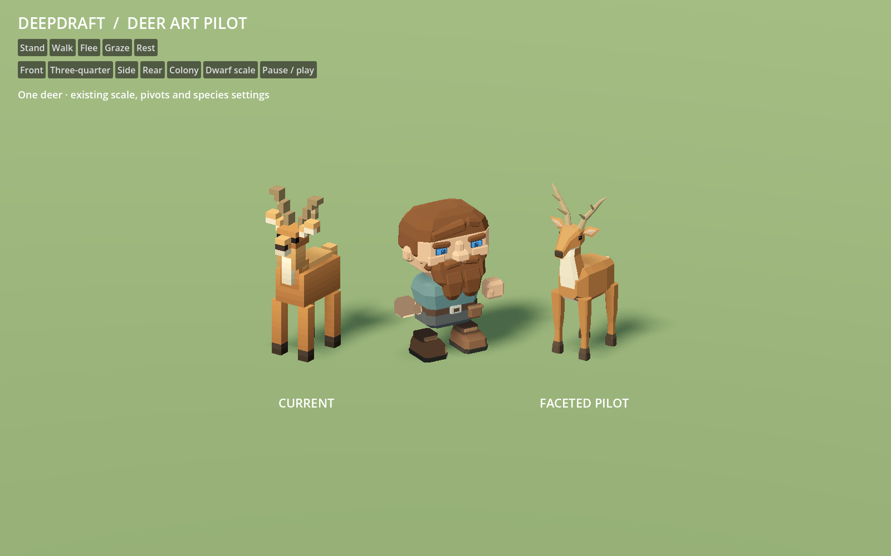
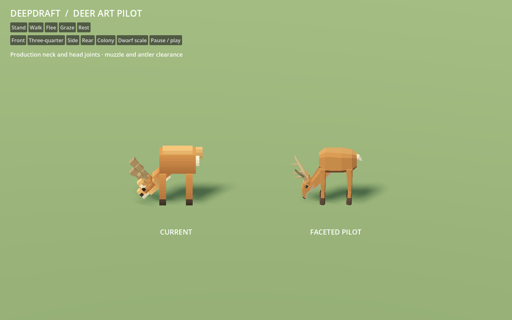
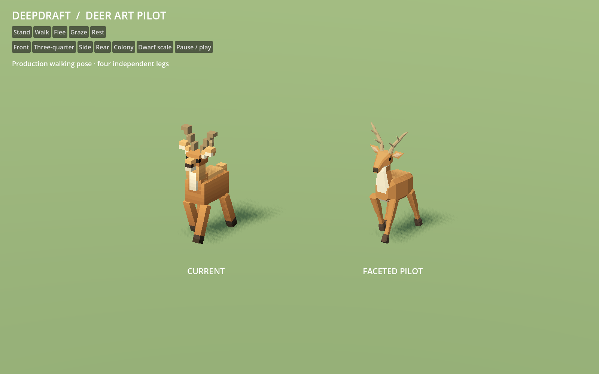

# 151 — Animal art pilot

Completed **2026-10-13** for visual review after the approved dwarf in
[150](150_dwarf_art_pilot.md). The deer now has a faceted torso and neck, a
shaped muzzle, pointed ears, tapered legs, beveled hooves and branching antlers.
Broad anatomical planes and a restrained warm coat replace the stepped cubes.

This is one isolated deer pilot. Normal Play still uses the existing animal
models. Rabbit, wolf and duck art remain future work. **The player approved this
deer direction on 2026-10-13.** The [furniture pilot](152_furniture_art_pilot.md)
is also approved; the [shared art standard](../60_asset_creation/63_shared_art_standard.md)
now records their common authoring rules.

## Review

Double-click [Launch Animal Pilot.cmd](../../Launch%20Animal%20Pilot.cmd).
The current deer is on the left and the new deer on the right, at the same size
and under the same lighting. Stand, Walk, Flee, Graze and Rest use the production
DeerAgent pose code. The movement comparisons animate in place; the behavior
fixture separately exercises actual travel and decisions.

Front, three-quarter, side, rear and colony views show both silhouettes.
**Dwarf scale** adds the approved dwarf at its authored size. Pause / play
freezes motion; Escape closes the viewer. The launcher uses a separate user-data
profile, and the study configures its own save folder. F5 still runs the game.




## Asset and behavior contracts

Six GLBs live in `assets/animals/pilot/deer/`: body, neck, head, ears, antlers
and one leg instanced four times. Authoring uses `tools/generate_deer_pilot.py`
and the offline palette/profile `data/art/deer_pilot.json`. Each file contains
closed geometry, a unit root and one opaque linear vertex-color surface with
no embedded physics. The existing runtime material and lighting path applies.

The production 2×2 footprint and four-block clearance remain unchanged. Parts
retain the neck pivot `(0, 1.5, -.3)`, head origin `(0, 2.65, -.55)` and hip
height `1.25`. Upper legs overlap the torso, and the beveled sole clears the
support plane during rigid-leg swings. The muzzle reaches within .15 blocks of
grass through the grazing head-bob cycle; antlers stay above ground, and the
lowered head stays inside the extra forward row already checked for grazing.

WildlifeManager remains the definition and model owner. The viewer substitutes
its deer model cache only while assembling the pilot, then restores it. A
test-only manager subclass retains the pilot cache across save restoration.
No shipping model, animal definition, behavior script or project setting changes.
The existing wildlife fixture gains a manager-construction hook and a more
useful rest-bounds failure message; its gameplay assertions are preserved.





## Verification

- Generator `--check` passes for all six files: byte reproducibility, finite
  nondegenerate geometry, outward normals, closed components, color ranges,
  standing envelope and grounded soles.
- `DeerPilotArtTest`: **66 checks pass**, including imported roots, surfaces,
  opaque materials, nine assembled meshes, anchors and 64 sampled phases each
  of idle, walking, fleeing, grazing and rest. It checks actual transformed
  vertices for ground/height clearance and resting selection bounds.
- `DeerWildlifeTest` passes with current art; `DeerPilotWildlifeTest` runs the
  same fixture with pilot art. Coverage includes exact mesh selection,
  inspection, pause/slicing, real grazing and interrupted meals, sleeping and
  fleeing, footprint support/headroom, herd steering, mixed rabbit/deer state
  restoration and deterministic replay. Historical save-format assertions in
  this fixture are not a broader old-save compatibility promise.
- Native Godot Forward+ captures pass: **30 comparisons** at 1600×1000 across
  six standing views and three phases of four motions from two angles.

The first geometry pass slightly dipped a resting hoof below support. Shorter
toe/heel extents and a beveled sole corrected rest and walking clearance.
The muzzle was lowered in the authored head to bring grazing close to grass.
Both corrections preserve the production rig and behavior settings.

| Source geometry | Current deer | Pilot |
|---|---:|---:|
| Assembled triangles, counting four legs | 2,416 | 1,308 |
| Visible part meshes | 9 | 9 |
| Six GLB files, bytes | 180,084 | 128,520 |

These are source geometry/file counts, not measured full-game performance.
Production-scale measurements are recorded in [153](153_settlement_art_comparison.md). Preserved pilot evidence:
[geometry](concepts/151_animal_pilot/geometry.json),
[tests](concepts/151_animal_pilot/tests.json), and
[reproducibility](concepts/151_animal_pilot/reproducibility.json).
Complete logs/captures are in `tmp/animal_pilot_20261013/`.

## Reproduce and continue

```powershell
python tools/generate_deer_pilot.py --check
powershell -NoProfile -ExecutionPolicy Bypass -File tools/animal_pilot/Launch.ps1 -Capture
```

Run the three named fixtures with `tools/run_job_reliability.ps1`, using the
configured Godot executable. The deer and furniture directions are approved;
the shared authoring standard is finalized and the [production-scale comparison](153_settlement_art_comparison.md)
is complete. The [144 roadmap](144_world_art_direction_handoff.md) proceeds with
the full dwarf roster, followed by separate animal and furniture batches.
