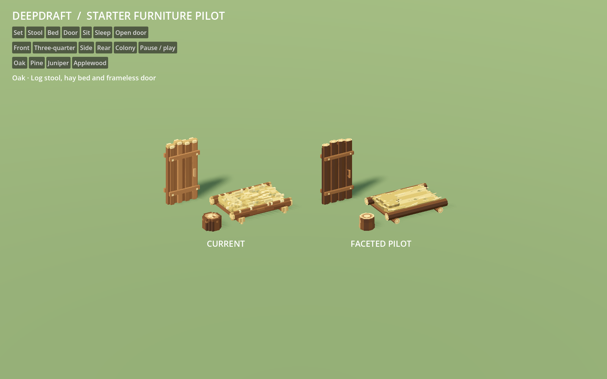
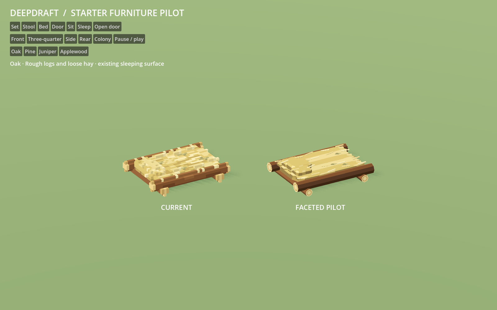
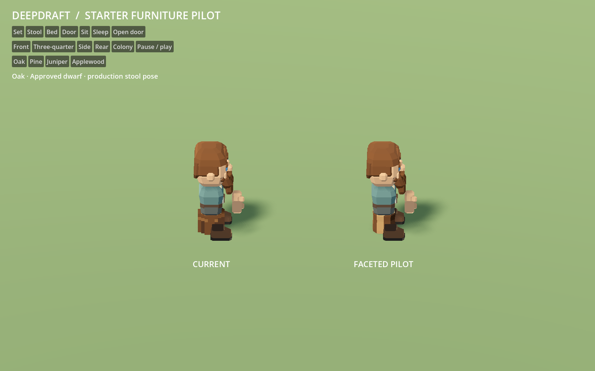
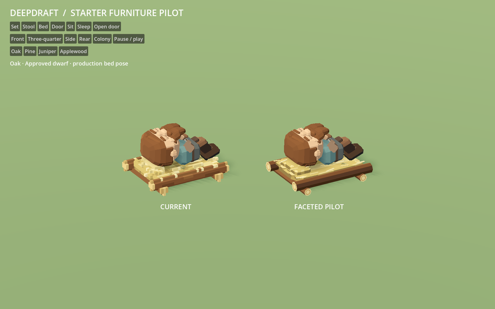
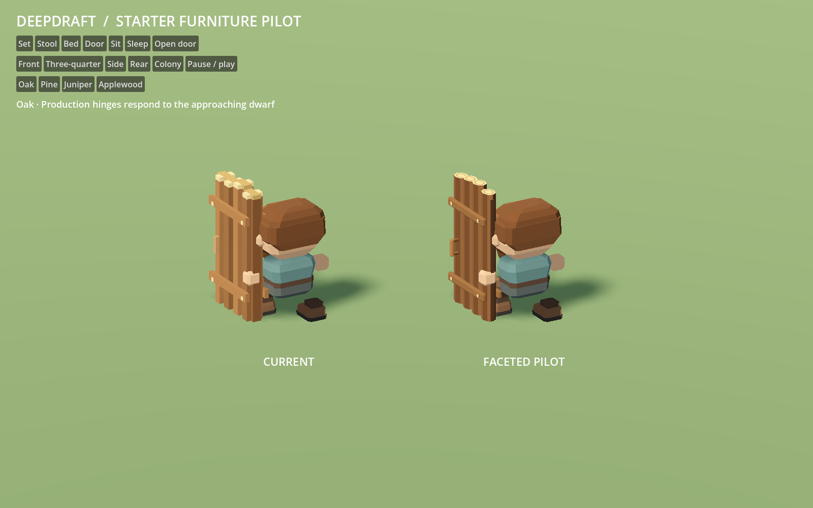

# 152 — Starter furniture art pilot

Completed **2026-10-13** for visual review after the approved
[dwarf](150_dwarf_art_pilot.md) and [deer](151_animal_art_pilot.md). This small
set covers the log stool, log bed and two-wide log door. Broad wood facets,
cut-end grain, loose hay bundles and plain wooden fittings carry the new art
direction into starter furniture while retaining its crude construction.

**Visual direction approved by the player on 2026-10-13.** The three models
remain in an isolated study; normal Play keeps the shipping furniture catalogue.
Their shape, material and interaction rules now inform the finalized
[shared art standard](../60_asset_creation/63_shared_art_standard.md).
Production-scale measurement and gradual family conversion follow in
[144](144_world_art_direction_handoff.md).

## Review

Double-click [Launch Furniture Pilot.cmd](../../Launch%20Furniture%20Pilot.cmd).
Current furniture is on the left and the pilot on the right. Both sides use
the approved dwarf for interaction comparisons.

- **Set, Stool, Bed, Door:** inspect the collection or an individual piece.
- **Sit, Sleep:** production dwarf poses against the actual furniture surfaces.
- **Open door:** the production hinge component responds to an approaching
  study dwarf, including approach from both sides and closing after departure.
- Choose **Oak, Pine, Juniper or Applewood**, a viewing angle, and Pause / play.
  Escape closes the viewer.

The launcher uses a separate user-data profile and the scene configures its own
save folder. F5 continues to launch the game. The studio drives dwarf movement
for repeatable comparisons; the separate gameplay fixtures exercise real workers,
navigation, placement and interaction decisions.





## Preserved contracts

Three GLBs live under `assets/models/furniture/pilot/`. Their generator is
`tools/generate_furniture_pilot.py`, with offline shapes in
`data/art/furniture_pilot.json`. Source wood colors come from the existing
semantic palettes owned at runtime by CraftMaterials. Colors are encoded in
linear space, with one opaque surface per model, unit roots, world-unit vertices,
closed geometry and no embedded collision.

| Piece | Visual and interaction boundary |
|---|---|
| Log stool | Fits the 1×1 footprint; flat cut top remains exactly .75 blocks high. No arms or back. Seated torso and boots use the existing pose. |
| Log bed | Fits 4×3, with .75 bedding and head hay below one block. Rough rails and supports, extra loose hay at the head; no frame headboard, sewn pillow or cloth cover. |
| Two-wide log door | Fits 2×1 beneath four-block clearance. Every visible part belongs to `leaf_left`, hinged at the existing outer edge. No fixed frame or metal hardware. |

FurniturePlacementController remains the sole furniture-definition owner. The
study helper temporarily substitutes only model paths, restoring its owner
after assembly. Test adapters retain those substitutions in isolated processes.
CraftMaterials applies all four existing wood palettes; hay and dried leaves
retain their own colors. Packed furniture keeps the existing neutral crate.

Definitions, dimensions, recipes, worker times, collision, room sealing, material
identity, appeal and save behavior are unchanged. Three- and four-wide doors,
benches, torches, crafted chairs/tables and later furniture tiers are outside this
pilot. No production script, model or project setting is modified.







## Verification

- Generator `--check` passes: reproducible bytes, finite nondegenerate geometry,
  outward normals, closed components, footprint/height envelopes and grounding.
- `FurniturePilotArtTest`: **70 checks pass** for imported roots/surfaces,
  unchanged definitions, all four semantic recolors, untouched hay/leaf colors,
  source-mesh preservation, seat/bedding contacts, selection and hinge geometry.
- `FurniturePilotBedroomTest`: real bed crafting, delivery and installation;
  wood identity, room requirements, sleeping/waking, exclusive claims, four
  rotations, removal and save restoration. Uses the dwarf pilot resources.
- `FurniturePilotDoorTest`: real worker crafting/installation, approach from
  both sides, pause, closing, walk-through, room sealing, rotations and restore.
  The fixture also retains its checks for the unchanged wider doors and bench.
- `FurniturePilotSeatingTest`: real idle seating on four stools beside a fire,
  approach/occupancy, facing, head/body clearance, focus changes and restored plans.
  Uses the dwarf pilot resources.
- `FurniturePilotMaterialTest`: four real wood crafts, hauling/storage,
  material-filtered installation, refund, persistence and palette isolation.
- **28 native Godot Forward+ comparisons** at 1600×1000 cover four wood sets,
  individual pieces, sitting/sleeping at three angles and nine door-motion phases.
  Switching out of sleep also verifies that the dwarf's eyes reopen.

| Source triangles | Current | Pilot |
|---|---:|---:|
| Stool | 592 | 220 |
| Bed | 5,208 | 2,638 |
| Door | 3,928 | 2,356 |
| Total | 9,728 | 5,214 |

Both sets use three visible meshes. Source GLBs total 898,236 bytes for current
art and 691,540 bytes for the pilot. These are geometry/file counts, not measured
full-game performance. Evidence: [geometry](concepts/152_furniture_pilot/geometry.json),
[five passing fixtures](concepts/152_furniture_pilot/tests.json) and
[reproducibility](concepts/152_furniture_pilot/reproducibility.json).
Complete logs and captures are under `tmp/furniture_pilot_20261013/`.

## Reproduce

```powershell
python tools/generate_furniture_pilot.py --check
powershell -NoProfile -ExecutionPolicy Bypass -File tools/furniture_pilot/Launch.ps1 -Capture
```

Run the five named fixtures with `tools/run_job_reliability.ps1`, supplying the
configured Godot executable. Existing accepted environment, dwarf and deer art
is retained. All three pilot subjects are visually approved and the shared
authoring standard is finalized. Catalogue-wide integration remains separate
work after the completed [production-scale comparison](153_settlement_art_comparison.md),
with the full dwarf roster as the next migration batch.
