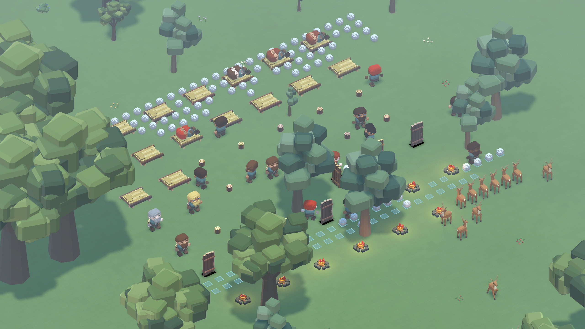

# 153 — Production-scale settlement art comparison

**Subsequent integration:** [154](154_complete_family_conversion.md) now ships
the complete dwarf, wildlife and furniture families. The measurements below
remain the preserved pre-conversion current/pilot experiment. Running the tool
now without a substitution uses the integrated shipping catalogue; do not label
that a rerun of the legacy baseline. The three pilot launchers explicitly retain
legacy assets on the left for visual comparisons.

Completed **2026-10-13** after the approved dwarf, deer and starter furniture
pilots and [63 — Shared art standard](../60_asset_creation/63_shared_art_standard.md).
This is step 3 of [144](144_world_art_direction_handoff.md): compare the art in
the full production scene before converting the remaining families.

## Workload and method

The fixture uses `scenes/main/debug_world.tscn`, the complete generated
1024×1024×128 world at seed 1234, and the accepted terrain, trees, plants and
stones. A repeatable camp is placed on valid natural grass near `(560, 19, 128)`.
Placement, lighting, animation, scheduling, hauling, leisure, sleeping, wildlife,
slicing and editing use their production owners.

| Content | Starting count |
|---|---:|
| Dwarves | 24 |
| Log beds / stools / two-wide doors | 16 / 16 / 8 |
| Campfires with lights | 8 |
| Trees | 2,953 |
| Rabbits / deer / wolves / ducks | 48 / 30 / 4 / 11 |
| Loose stone goods for hauling | 96 |
| Ground storage slots | 48 |

The nearby twelve-deer herd supplements the natural eighteen deer so the tested
animal is visible around the camp. Dwarves use the same adult male appearance
shape and generated color/trait variation on both sides; this measures the
approved adult pilot, not a completed age/gender/appearance roster. Existing
rabbit, wolf, duck, campfire, item and environment art remains fixed.

The runner temporarily substitutes resources through DwarfAssets,
WildlifeManager and FurniturePlacementController in isolated processes. Shipping
asset paths and definitions remain unchanged. It isolates APPDATA and SaveManager
storage; no player save is loaded. This is a deliberately populated comparison
camp, not a player-built settlement or proof of an arbitrarily large colony.

Hardware: **Ryzen 7 9800X3D, Radeon RX 9070 XT, 61.56 GiB system-reported
RAM**, Windows, Godot **4.7.2**, Forward+ / D3D12. Native captures
use **2560×1440**. Audio output is disabled equally in both runs. VSync is off;
`--fixed-fps 60` fixes simulation delta while rendering runs uncapped. Measured
wall-frame times remain actual elapsed time, not a forced 60 FPS result.

Each view warms for 120 frames, then records 600 frames. Paused close,
neighborhood, overview and night views isolate rendering cost. Active views add
the real scheduler/AI at close, neighborhood, overview, night, a camera pan and a
sliced view. Three slice changes and three mine/restore cycles of 24 blocks
exercise renderer updates. Save validation and native restoration follow the
timed route.

Start-state hashes, generated-world fingerprints, surface-detail identities,
camera transforms and sample settings must match. Active simulation can diverge
after that start because the production scheduler and asynchronous work use
wall-clock budgets. Compare paused rendering separately from active throughput;
do not mistake different worker progress or wildlife movement for mesh cost.

`FrameProbe.gd` measures scene processing every frame. Viewport CPU/GPU timing and
wall-frame distributions are retained separately, alongside draws, primitives,
static memory and reported video memory. Cached `Performance.TIME_PROCESS` values
are not treated as per-frame measurements. Raw arrays remain in each run folder.

## Scale fault found and corrected

The initial current-art probe exhausted Godot's default shader-instance uniform
capacity. It emitted **121 allocation errors**, followed by repeated allocation
state errors; some dwarf parts appeared black. This occurred before the new art
was substituted, so it was an existing production-capacity limit exposed by the
larger workload.

`project.godot` now sets `rendering/limits/global_shader_variables/buffer_size`
to **131072**, twice the default 65536 uniform slots. This is the sole production
change in this milestone. Both art sets are measured with the corrected capacity;
the failed probe is retained separately and excluded from the comparison. The
setting controls shared uniform-buffer capacity, as documented by
[Godot](https://docs.godotengine.org/en/stable/classes/class_projectsettings.html#class-projectsettings-property-rendering-limits-global-shader-variables-buffer-size).
It is not a model-count or population guarantee. Restart Play to use it.

## Evidence and reproduction

Run sequentially; simultaneous native benchmarks compete for the same CPU/GPU:

```powershell
powershell -NoProfile -ExecutionPolicy Bypass -File tools/settlement_art/Run.ps1 -Label current_1
powershell -NoProfile -ExecutionPolicy Bypass -File tools/settlement_art/Run.ps1 -Label pilot_2 -Pilot
powershell -NoProfile -ExecutionPolicy Bypass -File tools/settlement_art/Run.ps1 -Label current_2
powershell -NoProfile -ExecutionPolicy Bypass -File tools/settlement_art/Run.ps1 -Label pilot_3 -Pilot
python tools/settlement_art/compare.py current_1 pilot_2 current_2 pilot_3 --output tmp/settlement_art_20261013/comparison.json
```

Use `-Small` for 1600×1000 or `-Quick` for a setup probe; quick runs are excluded
from the summary tool. Each run writes `report.json`, native PNGs, per-view sample
arrays, isolated save data and stdout/stderr under `tmp/settlement_art_20261013/`.
The runner rejects engine/script errors as well as failed fixture assertions.

The earlier `pilot_1` and `restore_probe` runs are excluded: an initial harness
assertion compared live `StringName` and numeric variants against JSON-normalized
save data. The corrected check follows SaveManager's JSON normalization and
compares numeric round trips within `0.00001`; it preserves exact IDs, keys and
collections. No production save behavior changed. `current_1` predates the reload
check; later clean runs include it. `-RestoreFrom <label>` runs a separate native
restore probe against a copy of a prior isolated save.

## Results

Four clean native runs—two current, two pilot—recorded **24,000 sampled frames**
across ten views, with another 4,800 warmup frames. All four passed, with zero
engine/script errors and identical initial fixture, world and detail hashes.
The fixture SHA-256 is
`8f102c8117e7264edf61bed32325626adfc82f15fa3d40c42c7751a3c1ae776b`.

The tables summarize the median of each pair of per-run measurements, not a
pooled frame distribution. GPU values are milliseconds; primitives are submitted
rendering primitives, including additional rendering passes.

| Paused view | GPU p50, current → pilot | Draws, both | Primitives, current → pilot |
|---|---:|---:|---:|
| Close | 1.421 → 1.390 | 438 | 380,200 → 306,677 |
| Neighborhood | 1.664 → 1.622 | 493 | 695,225 → 624,686 |
| Overview | 1.752 → 1.713 | 663 | 2,041,747 → 1,965,952 |
| Night | 1.334 → 1.311 | 467 | 585,042 → 518,274 |

The close view submits **19.34% fewer primitives** with unchanged draw counts.
Rendering cost is comparable on this machine; the small timing differences do
not establish a general FPS improvement. Paused frame p95 stays around
7.5–8.6 ms. Campfire flipbooks continue to animate while the world clock is paused,
causing small per-run primitive-count differences even with the same art.

Reported paused video memory is about **3.75 MiB higher** for the pilot, while
static memory is about **3.26 MiB lower**. These are engine counters, not peak
process memory. The isolated override retains preloaded original dwarf resources,
so this is not the final memory cost of replacing the full roster.

| Active view | GPU p50, current → pilot (ms) | Wall-frame p95, current → pilot (ms) |
|---|---:|---:|
| Close | 2.010 → 1.956 | 66.871 → 66.676 |
| Neighborhood | 2.123 → 2.031 | 48.599 → 48.359 |
| Overview | 3.659 → 3.539 | 71.665 → 72.820 |
| Night | 1.979 → 1.869 | 71.038 → 70.721 |
| Camera pan | 2.487 → 2.280 | 71.571 → 72.430 |
| Slice | 2.489 → 2.311 | 72.141 → 72.672 |

**CPU world-processing spikes remain in both art sets.** Scene-processing p95
is about 45–70 ms and closely tracks the slow active frames; per-run maximum
wall-frame times are roughly 100–116 ms. This is an acceptable relative art-cost
result for staged migration, not a shipping 60 FPS pass. CPU profiling and a
minimum-hardware target remain separate work.

The first 24-block mining dispatch took 67.6–78.4 ms across the runs; later
mine/restore dispatches took about 12.5–21 ms. The first renderer settle took
338–348 ms, with later settles about 80–134 ms. Slice transitions settled in
about 3.1 seconds through asynchronous work; that elapsed duration is not a
continuous main-thread stall. No material art-dependent update-cost regression
was observed.

## Behavior and persistence

Each run completed **eight real haul tasks** and stored **32 stacks**. The route
observed carrying, wildlife movement, door rotation, seat claims and sleeping;
native captures show workers using beds and furniture among the new models.
Observer counts for seat claims and sleep state include approach behavior and
must not be interpreted as counts of fully seated or resting poses. This outdoor
fixture uses freestanding doors; indoor room/enclosure behavior remains covered
by the earlier furniture gameplay fixtures.

All four runs wrote valid saves. The three later runs restored them in the native
scene and passed dwarf count, furniture, wildlife, clock, snapshot validation and
stone-conservation checks. The final current/pilot pair also checked dwarf
identity, appearance, traits, profession, experience, work permissions and terrain
edits. All **96 stone goods** survive restoration, accounting for carried goods
being dropped to loose items by the existing save contract. No production save
format or behavior changed.

## Preserved evidence and next batch

- [Comparison data](concepts/153_settlement_art/comparison.json) and
  [validation summary](concepts/153_settlement_art/validation.json).
- Individual reports: [current 1](concepts/153_settlement_art/current_1.json),
  [pilot 2](concepts/153_settlement_art/pilot_2.json),
  [current 2](concepts/153_settlement_art/current_2.json),
  [pilot 3](concepts/153_settlement_art/pilot_3.json).
- Matched close captures: [current](concepts/153_settlement_art/current_close.png)
  and [pilot](concepts/153_settlement_art/pilot_close.png).
- Native pilot captures: [active](concepts/153_settlement_art/pilot_active.png),
  [night](concepts/153_settlement_art/pilot_night.png),
  [slice](concepts/153_settlement_art/pilot_slice.png) and
  [overview](concepts/153_settlement_art/pilot_overview.png).



Roadmap step 3 is complete. The subsequent production migration under
[63](../60_asset_creation/63_shared_art_standard.md) is recorded in
[154](154_complete_family_conversion.md): 41 dwarf parts, 21 wildlife parts and
41 furniture forms. This report preserves the original pilot comparison and its
cost limits; 154 records the integrated scene/save checks. Full grass voxels
remain, and turf caps stay deferred.
