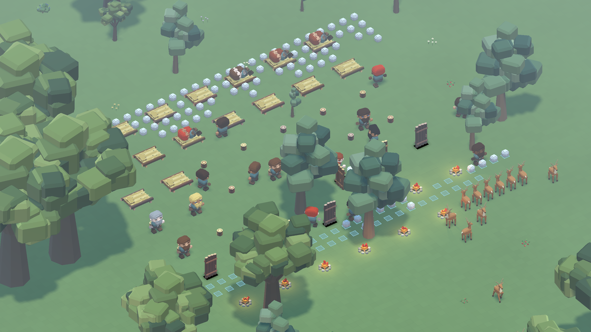
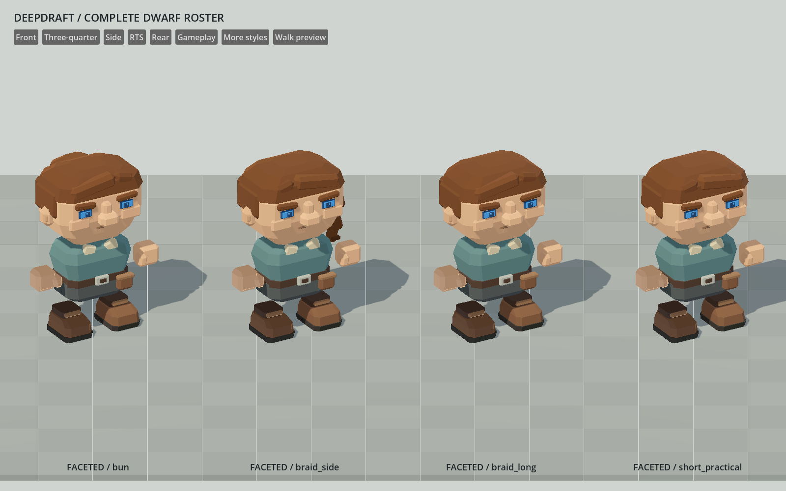
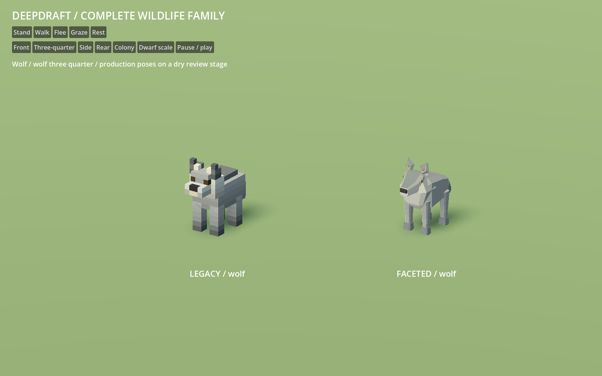
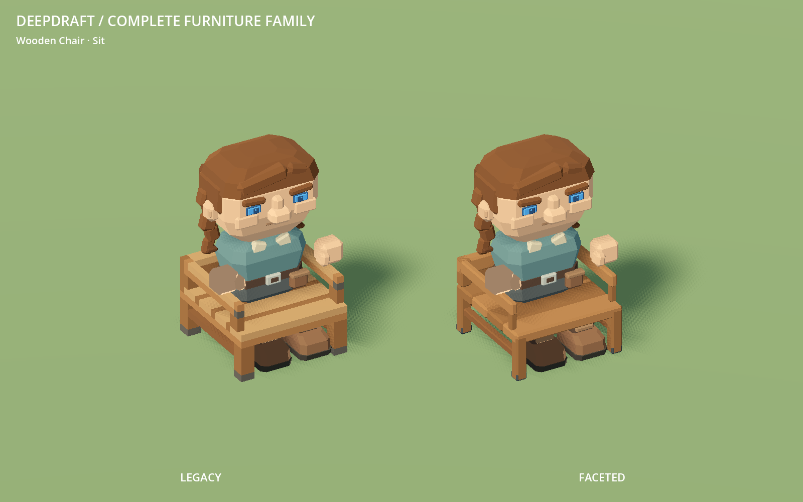
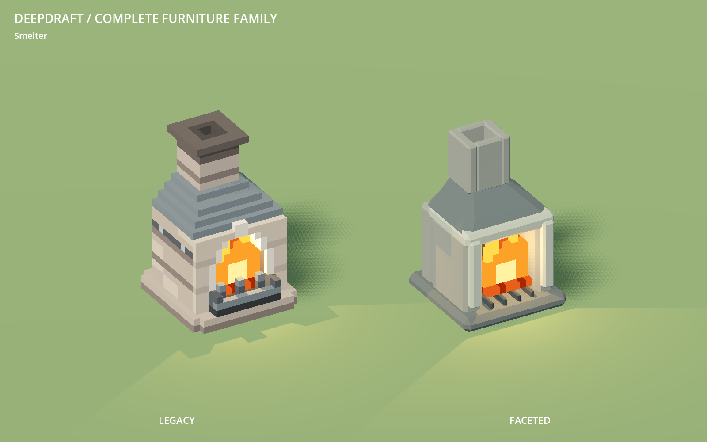

# 154 — Complete dwarf, wildlife and furniture conversion

Completed **2026-10-13**, following explicit approval to continue through all
three families. Normal Play now uses the faceted art across the complete dwarf
appearance roster, every live animal species and the furniture catalogue.
This completes the core family migration in [144](144_world_art_direction_handoff.md)
under [63 — Shared art standard](../60_asset_creation/63_shared_art_standard.md).
Restart Play. Current-format saves need no migration or new world.

## Integrated scope

| Family | Complete inventory | Production source |
|---|---|---|
| Dwarves | 41 modular GLBs: four ages, shared eyes/body/hand/foot, 14 hair styles, seven beards, eight brows, four portrait scars; bald/no-beard remain absent parts | `tools/generate_dwarf_faceted.py`; `data/art/dwarf_pilot.json`, `dwarf_roster.json`; `assets/dwarves/faceted/` |
| Wildlife | 21 GLBs: rabbit 3, deer 6, wolf 5, duck 7 including male/female bodies and heads | `tools/generate_wildlife_faceted.py`; `data/art/deer_pilot.json`, `wildlife.json`; `assets/animals/faceted/` |
| Furniture | 41 GLBs covering 30 definitions, saved one-cell chair, ladder heights 1–4, bridge spans 1–5, shared crate and two access kits | `tools/generate_furniture_faceted.py`; CraftMaterials source palettes and `data/art/furniture_catalog.json`, `furniture_pilot.json`; `assets/models/furniture/faceted/` |

The **17 approved exports** (eight dwarf, six deer, three furniture) remain
byte-identical to their pilots. Original voxel assets stay in their original
paths. Terrain, the 94 trees, 76 surface plants and six ground stones retain
their accepted models. World grass remains a full voxel.

Furniture includes the small and communal tables; wide chair, old chair, stool
and bench; both beds; barrels, chest and shelf; tavern/trade counters; workbench,
brewing vat, aging rack, anvil and smelter; all doors, ladders and bridges;
campfire, hearth, brazier and wall/log torches; settlement flag and both water
stones. Named flame meshes and existing animation libraries are retained.
The stockpile furniture crate stays a neutral shared packed form.

## Preserved contracts and integration details

Appearance IDs, pools, runtime skin/hair/eye colors, detached hand/foot rig,
work grips, selection and slice behavior are unchanged. All 800 shape assemblies
are instantiated in QA; 22 representative assemblies exercise live poses.
This is broad modular coverage, not an assertion that every color/shape/pose
permutation was inspected by eye. The bun was pulled forward enough to avoid
floor clipping in the existing lying pose. Portraits now add the saved scar
through DwarfAssets; map actors continue to omit portrait-only scars.

Wildlife changes only model paths. Navigation, arrivals, predation, needs,
population limits, articulation, movement and save fields are unchanged. Duck
toes were raised around their existing joint to clear the ground during the
walking cycle. Species poses and both duck sexes are shown in native captures;
water/air poses in the dry review studio are supplemented by real wildlife
behavior fixtures, rather than presented as a swimming environment.

Furniture keeps gameplay footprints, collision regions, saved layout versions,
seat/sleep heights, access positions, recipes, work times, storage, room sealing,
heat and lights. The saved one-cell chair gets its own converted model. Bridge
visuals now derive their model directory from the owner definition, so every
span uses the selected art family. Flag placement previews use the converted
flag. No new save fields or global classes were added.

Campfire wood uses the existing once-linear `oak_log` source palette instead of
the legacy double-encoded `camp_fire` palette. All four selectable woods pass
exact imported-color checks, including preservation of non-wood colors. Light
definitions and flame clips are unchanged. Native review caught and corrected
coplanar bench/bridge surfaces and barrel bands that intersected the broad faces.

The furniture thumbnail tool refreshed all **39 placed-form thumbnails** (30
catalogue entries plus nine already-converted plants); the two water-stone
inventory thumbnails were refreshed separately. Furniture inventory uses its
placed-form catalogue image. The three original pilot launchers explicitly use
legacy art on the left, preserving their comparisons after production integration.

## Verification

All **30 distinct final fixtures pass**. The [validation summary](concepts/154_family_conversion/validation.json)
records the final invocation and source log for each test.

| Area | Evidence |
|---|---|
| Dwarf imports, modular assembly and live rig | `DwarfFacetedArtTest`: 6,818 checks, 41 imports, 800 shape combinations, 22 pose cases; 39 native roster/portrait/pose images |
| Dwarf gameplay/UI/save | HaulingAnimationTest, MiningAnimationTest, DwarfRestTest, TreeFellingTest, DwarfRosterTest, SaveManagerRoundTripTest |
| Wildlife imports/poses | `WildlifeFacetedArtTest`: 184 checks; 64 samples per activity/species; 38 paired native views |
| Wildlife behavior | RabbitWildlifeTest, DeerWildlifeTest, WolfWildlifeTest, DuckWildlifeTest |
| Furniture imports/material/contact | `FurnitureFacetedArtTest`: 581 checks; all 41 models, 30 definitions, selectable woods, ground/seat/sleep surfaces, hinges and flame frames; 57 paired native views |
| Furniture gameplay/UI | CraftMaterialTest, LogFurnitureTest, BedroomTest, BedOwnershipTest, FurnitureAssignmentTest, FurniturePlacementAnimationTest, FurnitureMoveTest, SettlementFlagMoveTest, LogBridgeTest, BridgeCornerWalkingTest, LadderTest, LadderMiningTest, FireAudioTest, WorkerCraftingWoodTest, ColonyInventoryTest |
| Native room lighting | DoorLightingTest passes all widths/rotations; BedroomLightingTest passes the actual enclosed bedroom with converted bed, door and torch |

The new asset fixtures total **7,583 checks**. Generator `--check` validates
closed components, normals, colors and deterministic bytes. The offline audit
confirms unchanged non-art fields in all 34 furniture/animal definitions and
byte-identical approved pilot exports. Native imports and pilot-viewer smoke
checks finish without script errors. `DwarfRosterTest` was repaired to find the
existing illustrated dock captions and current developer menu route; production
dock behavior was not changed.

Initial runs retained in `tmp/` caught bun/duck contact issues and the stale dock
test lookup. Door/bedroom rendering tests were rerun using the native renderer
after unsuitable headless invocations; the door test also requires its isolated
APPDATA profile. The final results above refer to the corrected invocations.

## Full-world integration and save compatibility

The [integrated settlement run](concepts/154_family_conversion/settlement.json)
uses the full seed-1234 1024×1024×128 world at 2560×1440 on Godot 4.7.2 / RX 9070 XT:
24 dwarves, 48 placed furniture pieces, eight lights, 2,953 trees and all four
live wildlife species. It records 6,000 sampled frames plus warmup, edits,
slicing and reload. Eight worker tasks complete; hauling, sitting, sleeping,
animal movement and door opening are observed. There are no reported failures
or native script errors. Predation reduces rabbits from 48 to 46 during play,
consistent with the unchanged live wildlife behavior.
Starting world fingerprints, clutter identities and fixture hash match the
preserved pre-conversion `current_2` run exactly.

Both the new scene's native save/reload and a **pre-conversion `current_2` save**
loaded with the new art pass all eight checks: valid snapshot, dwarf count and
identity/appearance, furniture, wildlife, terrain edits, stone conservation and
clock. The [older-save restore report](concepts/154_family_conversion/restore.json)
preserves that evidence. Saves are copied into isolated test profiles; player
saves are not modified.

The fixture still uses the representative stool/bed/door/campfire settlement
layout from 153. The wider furniture catalogue is covered by the studio and
focused worker/placement fixtures, not all placed in that one camp.

This is an integration run, **not a new matched performance study**. The
preserved controlled comparison is [153](153_settlement_art_comparison.md).
CPU world-processing spikes remain visible; this conversion does not establish
a frame-rate target or resolve those stalls.

## Source geometry cost

Counts total each source GLB once, including variants and packed forms. They
are neither assembled-character counts nor per-frame rendering counts.

| Family | GLBs | Legacy → faceted triangles | Legacy → faceted mesh/surface count | Legacy → faceted file bytes |
|---|---:|---:|---:|---:|
| Dwarves | 41 | 38,480 → 12,728 | 41 → 41 | 3,585,060 → 1,726,144 |
| Wildlife | 21 | 4,916 → 3,412 | 21 → 21 | 474,652 → 473,280 |
| Furniture | 41 | 104,068 → 37,942 | 48 → 48 | 9,624,944 → 4,990,256 |

[Per-file counts, hashes and contract audit](concepts/154_family_conversion/audit.json)
come from `tools/audit_faceted_conversion.py`. Different export layouts mean
file size need not fall proportionally to triangle count. Existing flame frames
remain outside the regenerated inventory and unchanged.

## Review and reproduce

Use the three production Python generators above with `--check` to compare
deterministic output. Their profiles are offline authoring sources; runtime
definitions still belong to DwarfAssets, WildlifeManager and the furniture/item
owners. Never hand-edit `.import` or `.tres` files. Let Godot import new GLBs.

- Dwarf native capture: `tools/dwarf_art/review.tscn`.
- Wildlife native capture: `tools/wildlife_art/review.tscn -- --capture`.
- Full furniture native capture: `tools/furniture_art/RunReview.ps1`.
- Settlement: `tools/settlement_art/Run.ps1 -Label migration_final`.
- Earlier-save check: `tools/settlement_art/Run.ps1 -Label migration_restore -RestoreFrom current_2`.

The two last labels name the preserved evidence; use fresh labels for another
run. Raw outputs are in `tmp/dwarf_faceted_20261013/`,
`tmp/wildlife_faceted_20261013/`, `tmp/furniture_faceted_20261013/` and
`tmp/settlement_art_20261013/migration_{final,restore}/`.

The next art choice is among the remaining cave flora, farm crops and loose
resource/tool models. Existing fire/water effects can receive a separate pass.
No new furniture types, animation systems or gameplay changes were introduced.
Grass caps, fringes and path/floor gameplay remain deferred.
