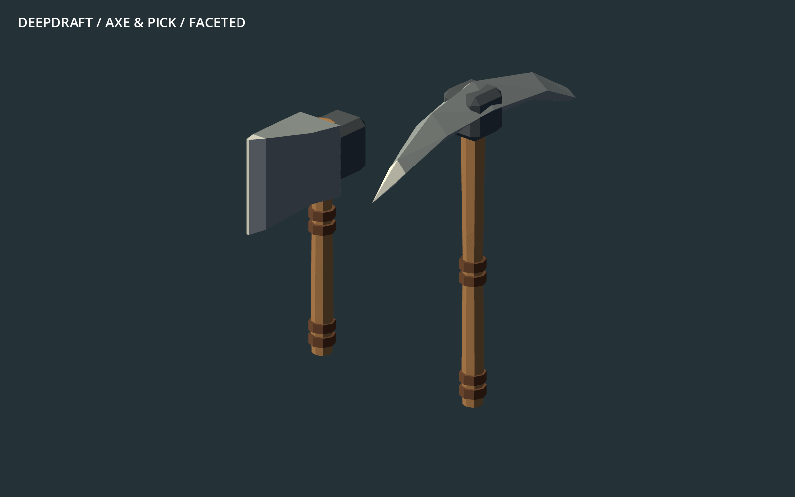
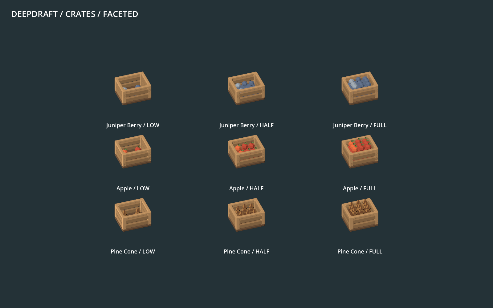

# 155 — Resource drops and work tools

Integrated **2026-10-13**, after the player requested all remaining goods and
the dwarf's chopping/mining tools. The batch follows
[154](154_complete_family_conversion.md) and
[63 — Shared art standard](../60_asset_creation/63_shared_art_standard.md).
Restart Play to load the new models. Current-format saves need no migration.

## Scope

**94 models:** 92 item presentations across 62 definitions, plus the felling
axe and mining pick. This finishes the remaining item catalogue; previously
converted packed furniture, packed plants and water stones retain their models.

| Family | Forms |
|---|---:|
| Dressed stone and rough stone | 5 |
| Soils | 3 |
| Metal ores and coal | 6 |
| Gems | 6 |
| Raw timber and oak stave | 5 |
| Starter inventory tools | 4 |
| Produce, seeds and cuttings: 15 types × three fill states | 45 |
| Drinks, including aged/reserve variants | 9 |
| Harvested plump helmet, pig tail, hops and grapes | 4 |
| Fossil, cloth bolt, water bucket, honey jar | 4 |
| Gold coin | 1 |
| Animated axe and pickaxe | 2 |

The audit found **23 pre-existing missing model references**: four dressed
stone blocks, nine drinks, four harvested plants, four miscellaneous goods,
oak stave and gold coin. These now resolve to real models instead of the
item owner's neutral fallback cube. The other 69 old item exports and both
old work tools remain available for comparison.

Raw stone and soil use broad fracture planes. All metal ores share geometry
and mineral-patch placement, changing their established material colors;
coal remains dark throughout. Gems retain their finished-jewel appearance
and existing light-driven gloss, without adding a processing stage. Logs
remain single bark-covered sections with cut end grain. Crates keep an open
rim and three visibly different fill levels. Inventory tools stay stone and
pegged wood; their four selectable wood palettes remain functional.

## Runtime boundaries

Production changes are restricted to model paths in
`data/entities/items/resources.json` and the two tool preloads in
`scripts/registries/DwarfAssets.gd`. The baseline audit confirms every non-art
item field is unchanged: IDs, recipes, quantity, weight, tags, capacities,
material selection, surface properties and save data stay with their owners.
No gameplay or animation implementation was changed.

- Ground goods use world units and Y0; raw logs and crates retain a radius
  below `.5`, fitting a stockpile cell at every yaw. Long inventory tools keep
  their existing category envelopes and flat ground orientation.
- Crates retain capacity 24 and thresholds 1–8, 9–16 and 17–24. They remain
  one physical cargo item; representative contents do not change quantities.
- Work tools remain rooted at the lower palm, with shaft +Y and strike +Z.
  Both contain the exact existing impact point in their geometry: axe
  `(0,1.0625,.6875)`, pick `(0,1.375,.9375)`. The upper grip stays `(0,.625,0)`.
  Hand mirroring, strike timing, reach heights and work duration are unchanged.
- Starter inventory tools use the owned `starter_tool` palette. Native checks
  confirm pine, oak, juniper and applewood alter wood alone, keeping stone fixed.
- All new exports use one opaque mesh/surface and unit root transforms, with
  closed components and no embedded collision. Existing owners apply lighting,
  slice visibility and gem gloss. All 62 inventory thumbnails were refreshed.

## Verification

The [validation record](concepts/155_item_conversion/validation.json) lists final
fixture invocations. **15 distinct fixtures pass**, including 1,507 imported
asset, crate-stage, material, tool-anchor, storage-fit and carrying checks in
`ItemFacetedArtTest`. Real mining and felling fixtures verify both hands and
impact throughout the existing motion and reach cases. Hauling, crate splitting,
storage filtering/relocation, timber, crafting, item permissions, inventory,
food and current save round trips also pass.

`GemDropArtTest` now checks flat sloping facets and the established jewel envelope
instead of its obsolete cube-grid assertion. Native daylight, sealed darkness,
local torchlight, carrying and shelf storage pass, including actual specular
response and zero sunlight leakage into the sealed probe.

The native review provides 50 views covering all 92 item forms, matched legacy
examples, axe/pick motion phases, four-material inventory tools, and carrying at
close and colony zoom. Missing legacy examples are explicitly labelled fallback.
The source generator checks every triangle, normal and closed component and
reproduces all 94 exports exactly.

Initial QA runs caught a test's arbitrary minimum stone-vertex count on the
spear and a missing isolated profile for the storage test. Those invocations
were corrected; the material test now checks semantic wood/non-wood roles
directly. The capture harness also received definition-aware drink lookup and
safe handling of optional services. These were review-tool fixes, not production
behavior changes.

## Full-world and save checks

The [integrated settlement run](concepts/155_item_conversion/settlement.json)
passes in the full seed-1234 world at 2560×1440: 24 dwarves, 48 furniture pieces,
eight lights, 2,953 trees and all four wildlife species. Eight worker tasks
complete; hauling, seating, sleep, wildlife movement and door opening are
observed. Day/night, three slice changes, terrain edits and native save/reload
finish without reported failures. All eight persistence checks pass, including
96 conserved stone units. World and fixture fingerprints match the previous
family-conversion run.

The [pre-item-conversion save](concepts/155_item_conversion/restore.json) from
`migration_final` also restores with all eight checks passing. Both runs use
isolated copied test saves; player saves are untouched. The last ore inset
triangulation correction was subsequently reimported and passed the asset,
reproduction and native catalogue checks; settlement measurements precede that
same-silhouette correction.

This fixture covers the established representative camp, not all 92 item forms
simultaneously; the catalogue and focused fixtures supply that coverage. It is
an integration run, not a new controlled performance comparison. Existing CPU
world-processing spikes remain, as documented in 153.

## Source cost

| Comparable set | Legacy triangles | Faceted triangles |
|---|---:|---:|
| 69 existing item models | 94,592 | 62,346 |
| Two work tools | 804 | 796 |

The complete new inventory, including models for the 23 missing references,
contains **69,310 triangles** across 94 single-surface GLBs (9,252,460 source
bytes). Counts total each source form once, not each visible instance or frame.
The [audit and asset manifest](concepts/155_item_conversion/audit.json) records
paths, bounds, hashes and baseline checks. The same 88 reference exports
captured before this batch remain byte-identical; other accepted families were
not regenerated. These source counts are not a full-game FPS claim.

## Reproduce and continue

- Author: `tools/generate_items_faceted.py`; offline profile `data/art/items.json`.
- Generate: `python tools/generate_items_faceted.py`; verify with `--check`.
  `--update-data` installs only the owned model-path substitutions.
- Exports: `assets/models/items/faceted/` and `assets/dwarves/tools/faceted/`.
- Audit: `python tools/audit_items_faceted.py` checks the preserved gameplay,
  reference exports, all model paths, thumbnails and current import fingerprints.
- Native review: run `tools/furniture_art/RunReview.ps1` with
  `-Script res://tools/item_art/CaptureItems.gd -Output tmp/item_art_20261013`.
- Full logs and captures: `tmp/item_art_20261013/`; retained evidence below
  `concepts/155_item_conversion/`. Let Godot import assets; never edit metadata.

This batch includes harvested plant items, not growing cave flora or crop stages.
Those and remaining effects are the next art families to review. Terrain keeps
full grass voxels; grass caps remain deferred.
