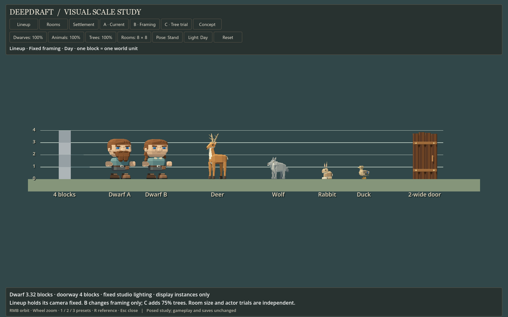

# 162 — Visual scale review

**Follow-up:** [163 — Stonehearth scale comparison](163_stonehearth_scale_comparison.md)
adds actual local reference meshes and measured ratios. Current pine heights
already match the sampled Stonehearth stages; the 75% tree candidate below
remains a separate choice toward the earlier settlement concept.

**Study ready for player review, 2026-10-13.** After the faceted art migration,
the player requested the deferred comparison of dwarves, blocks and animals
against the earlier torch-lit cliff settlement concept. This is a proportion
review; the “production-scale” work in [153](153_settlement_art_comparison.md)
measured performance and behavior under a larger workload.

Double-click **[Launch Scale Study.cmd](../../Launch%20Scale%20Study.cmd)**.
It opens a separate native Godot window using current production models.
The production scene, asset dimensions, navigation, camera and saves are unchanged.

## What to compare

1. **Lineup:** two assembled dwarves, all four animal species, a four-block
   ruler and the two-wide door. This view holds its camera fixed across presets.
   Toggle **Dwarves** or **Animals** to compare 100% with 90% independently.
2. **Rooms:** compare two furnished 8×8 interiors with 6×6 interiors at the same
   camera and four-block wall height. The bed, one barrel, one dwarf and torches
   move enough to fit the smaller interior; their sizes remain unchanged.
   Trees are hidden in this view so their crowns cannot obscure the rooms.
3. **Settlement:** **A** uses current model sizes with wide framing; **B** only
   moves closer through camera framing; **C** keeps B's camera and uses 75% trees.
   A/B/C reset the independent dwarf/animal and room trials. Their camera settings
   are study comparisons, not reproductions of the production camera presets.
4. **Concept** displays the earlier target. Compare the balance of characters,
   furnished rooms and foliage. Its painted masonry is not a calibrated block grid.
5. **Pose** switches between standing and an animated walk preview; **Light**
   changes fixed day/dusk illumination. Right mouse orbits, wheel zooms, keys
   1/2/3 select presets, R opens the reference, and Escape closes the reference
   or exits. Reset restores A's sizes and framing while retaining the view,
   pose and lighting selection.

## Measured baseline

One terrain block is one world unit. Dimensions below come from the assembled
visible meshes in their standing pose, measured in model-local axes; hidden work
tools are excluded. An ear, hair or antler tip counts toward the visible height.
These are visual bounds, not navigation or collision envelopes.

| Specimen | Height in blocks | Relevant comparison |
|---|---:|---|
| Dwarf A, forked beard | 3.320 | 2.600 wide across resting hands; head assembly 2.060 wide; torso 1.400 wide |
| Dwarf B, twin braids | 3.280 | 2.600 across hands; head assembly 2.063 wide |
| Deer | 3.769 | Includes antlers; not shoulder height |
| Wolf | 1.840 | Includes ears |
| Rabbit | 1.470 | Includes upright ears |
| Duck | 1.105 | Current standing pose |
| Log door | 3.860 | 1.990 wide, inside a nominal 2×4 opening |
| Crude workbench | 0.875 | Existing crafting contact height |
| Log bed | 1.000 | 3.960 × 2.960 footprint |
| Mature pine | 20.000 | 6.02 dwarf heights; 75% trial is 15.00 blocks / 4.52 dwarf heights |
| Mature oak | 17.000 | 5.12 dwarf heights; 75% trial is 12.75 blocks / 3.84 dwarf heights |

The 90% dwarf trial is 2.988 blocks tall. Scaling a complete actor also changes
every contact and anchor on that instance, so this is only a visual comparison.

## Review findings and recommendation

**Keep the unit grid and current dwarf height as the baseline.** The dwarf,
four-block room and door already form a usable vertical hierarchy. The 90%
trial gives more headroom but does little to change the broad-headed silhouette.
The concept's apparent stone courses vary; using them to set a literal two-block
dwarf would create an unsupported scale target.

**Review dwarf width before another overall height reduction.** A head assembly
slightly wider than two blocks and a resting hand span of 2.6 explain much of
the crowded appearance in doorways and furnished rooms. A useful next character
pilot would retain roughly 3.3-block height and compare a narrower head/hair
envelope plus closer resting hands. That requires a separate check of every
appearance, walking, tools, hauling, sleeping and seating contact before adoption.
The study does not claim that the full resting silhouette fits a two-block door.

**Keep animal sizes initially.** The lineup preserves a clear large/medium/small
species hierarchy. Antlers make the deer taller than a dwarf while its torso
remains lower. Uniformly reducing all animals offers no clear benefit, and the
small species lose visibility first at settlement distance. Any later change
should be species-specific, supported by in-world motion and interaction checks.

**Favor compact room layouts and trial smaller trees near settlements.** Six-wide
rooms read as furnished spaces sooner than eight-wide rooms with identical
contents. Seventy-five-percent trees expose more of the settlement and shift
attention toward inhabitants. These changes move the composition toward the
reference more clearly than shrinking every actor. They are review candidates,
not approved new global sizes: forests still need mature/ancient stature and
species identity. The tight tree comparison deliberately retains the same camera;
some large crowns extend behind the upper UI panel at that closer framing.

Room footprints remain a player layout choice. No new minimum room rule is
proposed. This posed study also does not establish that the compact layout has
valid live approach paths for every item.

## Evidence and limitations



Compare [90% dwarves](concepts/162_visual_scale/lineup_dwarves_90.png),
[90% animals](concepts/162_visual_scale/lineup_animals_90.png),
[walking pose](concepts/162_visual_scale/lineup_walk.png),
[8×8 rooms](concepts/162_visual_scale/rooms_current.png) and
[6×6 rooms](concepts/162_visual_scale/rooms_compact.png).

Settlement captures: [A day](concepts/162_visual_scale/settlement_a_day.png),
[B day](concepts/162_visual_scale/settlement_b_day.png),
[C day](concepts/162_visual_scale/settlement_c_day.png),
[A dusk](concepts/162_visual_scale/settlement_a_dusk.png),
[B dusk](concepts/162_visual_scale/settlement_b_dusk.png) and
[C dusk](concepts/162_visual_scale/settlement_c_dusk.png).
The [reference overlay](concepts/162_visual_scale/concept_reference.png) preserves
the target in context; the original is copied without alteration into
`tools/scale_study/settlement_reference.png`.

Native captures at **1600×1000** pass **80 checks**. The
[report](concepts/162_visual_scale/report.json) records all measurements and
camera/trial settings. Checks cover capture output, unchanged actor-trial camera
transforms, room floor area, exact terrain restoration after the compact toggle,
finite visible bounds, reset scales, reference controls, paused simulation and
disabled isolated save storage. Button signals exercise dwarf, animal, room,
pose and reference controls. The final run has no script or renderer errors.

The scene uses production models, registry-owned definitions, one-unit terrain,
the current terrain appearance shader and full grass voxels. It uses neutral
studio lighting and an **orthographic** camera to make comparisons measurable;
normal Play uses perspective and its full world-lighting system. It is a posed
diorama, not a performance benchmark, live navigation test or approval of a new
production scale. Gameplay adoption remains pending the player's visual review.

Implementation: [scene](../../scenes/studies/scale_study.tscn),
[viewer](../../tools/scale_study/ScaleStudy.gd),
[terrain fixture](../../tools/scale_study/ScaleTerrain.gd),
[launcher](../../tools/scale_study/Launch.ps1).
The launcher isolates APPDATA, and the scene disables autosave and uses
`user://scale_study`. Regenerate evidence from the project root with:

```powershell
powershell -NoProfile -ExecutionPolicy Bypass -File tools/scale_study/Launch.ps1 -Capture
```

Fresh captures and logs go to `tmp/scale_study_20261013/`. The curated copies
beside this document preserve this review's baseline.
