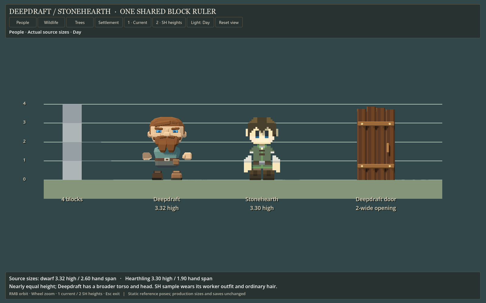
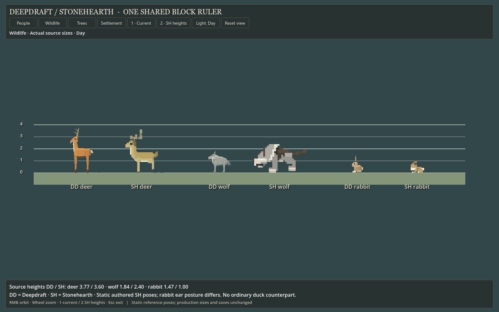
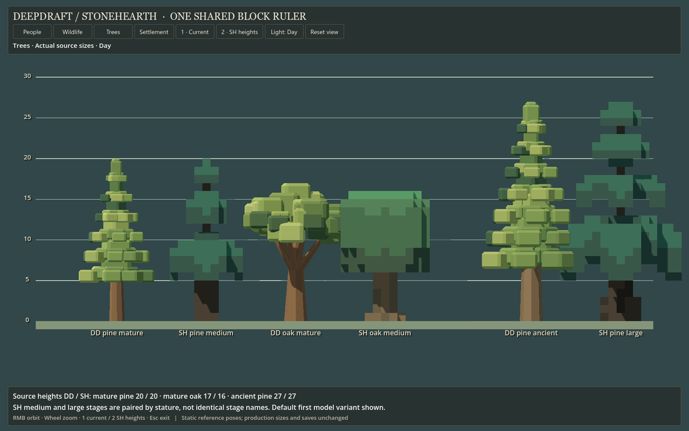

# 163 — Stonehearth scale comparison

**Follow-up:** [164 — Dwarf and wolf proportion trials](164_dwarf_wolf_proportion_trials.md)
now compares narrower dwarves and two taller/longer wolves with current art,
keeping dwarf and pine heights fixed. Those alternatives remain study-only.

**Ready for player review, 2026-10-13.** The player requested a comparison
against the actual local `P:/stonehearth` files after [162](162_visual_scale_review.md).
The native viewer now places the supplied Stonehearth models beside current
Deepdraft art on a shared terrain-block ruler.

Double-click **[Launch Stonehearth Comparison.cmd](../../Launch%20Stonehearth%20Comparison.cmd)**.
Choose **People**, **Wildlife**, **Trees** or **Settlement**. **1 · Current** shows
current dimensions; **2 · SH heights** uniformly scales the Deepdraft display
instances to each reference's measured height. It holds the camera fixed and
leaves Stonehearth reference models unchanged. It does not reshape our anatomy
to match the reference's width/depth. Orbit with right mouse, zoom with the wheel,
and use Reset view to restore framing. Escape exits.

## Method and sources

The local [Changing the scale guide](P:/stonehearth/docs/modding_guide/modding_guide/basic/adding_items/item_scale/index.html)
documents a default model scale of **0.1** and the tree/boulder override of **1**.
The exporter resolves each entity's JSON mixins and `render_info.scale`, then
measures occupied QB voxels including each matrix's signed position. Empty padding
does not contribute. This avoids confusing model-detail voxels with terrain blocks.

The sample is the local male hearthling definition with `head`, `body`, `eyes`,
`hair_1` and the worker job's default outfit. Clothing is merged as specified by
its equipment mixin; skin, hair and eye palette mappings are applied. His base
head reaches 3.2 blocks; the selected hair raises the full silhouette to 3.3.
The guide's **1.3-block face width** excludes the full head's ears; the occupied
head matrix spans **1.7 blocks**. Compare like envelopes rather than treating
face width as the whole character's width.

Wildlife references are horned deer, forest wolf and rabbit. The forest wolf's
explicit **0.15** render scale matters: using the default 0.1 would understate
its size by a third. Tree references are the first default model variant of
medium/large pine, sapling pine and medium oak. Deepdraft mature/ancient pines are
paired with SH medium/large by stature; the stage names are not equivalent.

Reference meshes use the **authored static QB assembly**, not Stonehearth's live
animation poses. Deepdraft animals use their runtime idle pose. Antlers, tails
and ears affect these bounds; rabbit ear posture differs visibly. These are
visual bounds, not collision dimensions or universal values for every variant.
The supplied DuckDuck is a different creature, so it is not used as an ordinary
duck counterpart. No exact counterpart was established for our duck in this pass.

## Results in terrain blocks

Dimensions are height × width × depth in each model's local axes before the
viewer rotates them. All displayed soles sit on the same ground plane.

| Pair | Deepdraft | Stonehearth reference |
|---|---:|---:|
| Dwarf / sampled hearthling | 3.320 × 2.600 × 1.485 | 3.300 × 1.900 × 1.400 |
| Horned deer | 3.769 × 1.456 × 1.976 | 3.600 × 1.500 × 2.700 |
| Wolf | 1.840 × 0.780 × 1.949 | 2.400 × 1.650 × 4.500 |
| Rabbit | 1.470 × 0.570 × 0.956 | 1.000 × 0.700 × 1.100 |
| Mature / medium pine | 20.000 × 9.277 × 9.378 | 20.000 × 9.000 × 9.000 |
| Ancient / large pine | 27.000 × 12.367 × 12.520 | 27.000 × 15.000 × 15.000 |
| Mature / medium oak | 17.000 × 12.881 × 13.131 | 16.000 × 11.000 × 11.000 |
| Sapling pine, measured but not a separate gallery pair | 8.000 × 3.595 × 3.815 | 8.400 × 4.900 × 4.900 |

Our dwarf's head assembly is about **2.06 wide**, versus the reference head's
**1.70**; the torso is **1.40** versus **0.90**. The complete resting hand span
is **37% wider**, the torso about **56% wider**, and the head about **21% wider**.
Height differs by less than 1%. This is primarily a proportion difference.

## What this changes about the recommendation

**Keep dwarf height and the world grid.** They already align closely with the
Stonehearth reference. A narrower torso and less widely spaced resting hands
would move toward hearthling proportions while retaining a deliberately broader
dwarven head. That should be an isolated character pilot with appearance and
interaction checks, not a global rescale.

**Keep current pine heights if Stonehearth is the size target.** Mature and
ancient pine heights match exactly in these samples. Ancient Deepdraft pine is
actually narrower. The 75% tree trial in 162 is a different compositional choice
toward the earlier compact settlement concept; it is not a Stonehearth correction.
Oak is only 6.25% taller but approximately 17% wider than the sampled SH oak.
Density, placement and canopy shape remain separate from height.

**Revisit the wolf independently.** Its source comparison has the largest
difference: the SH wolf is 30% taller, about twice as wide and 2.3 times as long.
The SH pose and more exaggerated predator design contribute. A 130% height
trial makes our wolf more prominent, but does not reproduce that anatomy.
The deer already has a close vertical scale; its body is shorter in depth.
The rabbit reads taller mostly through its upright head/ears. Do not decide a
rabbit shrink solely from two different static poses; inspect hopping and resting
silhouettes before changing the asset.

The **Settlement** toggle lets the player see the practical effect of matching
heights: dwarf about 99%, deer 96%, wolf 130%, rabbit 68%, mature oak 94%, mature
pine 100%, pine sapling 105%. Duck, furniture and oak sapling keep current sizes.
No production scale, model, animation, gameplay rule or save file is changed.

## Native evidence







Compare [current settlement](concepts/163_stonehearth_scale/settlement_current.png)
with [SH-height trial](concepts/163_stonehearth_scale/settlement_sh_heights.png).
Additional trials: [people](concepts/163_stonehearth_scale/people_sh_heights.png),
[wildlife](concepts/163_stonehearth_scale/wildlife_sh_heights.png),
[trees](concepts/163_stonehearth_scale/trees_sh_heights.png).

The viewer uses the same neutral native lighting and orthographic camera for both
games' meshes. QB palette colors are converted to linear vertex colors for glTF.
This is a geometry/scale review, not an emulation of Stonehearth's renderer,
material effects, environment lighting or animation system.

## Verification and reproducibility

- **Four binary parser fixtures pass:** known occupied bounds with signed origins
  and empty padding, compressed/uncompressed equivalence, BGRA colors, and
  rejection of trailing data.
- **78 native checks pass:** imported reference width/height/depth equal the
  independently recorded QB bounds, soles share the floor, height trials retain
  camera transforms and size, displayed heights reach the reference target,
  reset restores unit scale, terrain bytes remain unchanged, save storage is
  isolated/disabled and all eight captures write successfully.
- **39 source files retain their SHA-256** across export. Source paths, model
  parts, scales and hashes are in the [measurement report](concepts/163_stonehearth_scale/measurements.json).
  Runtime dimensions and cameras are in the [native report](concepts/163_stonehearth_scale/report.json).
- Native capture and headless editor import finish without errors. Review
  screenshots are 1600×1000. No performance claim is made.

[Exporter](../../tools/scale_study/stonehearth_reference.py),
[parser fixtures](../../tools/scale_study/test_stonehearth_reference.py),
[viewer](../../tools/scale_study/StonehearthScaleStudy.gd),
[scene](../../scenes/studies/stonehearth_scale_study.tscn) and
[launcher](../../tools/scale_study/LaunchStonehearth.ps1) reproduce the comparison:

```powershell
powershell -NoProfile -ExecutionPolicy Bypass -File tools/scale_study/LaunchStonehearth.ps1 -Capture
```

Use `-Source` to select another local Stonehearth directory. The supplied folder
is read-only for this operation. Generated reference meshes live only in the
git-ignored/Godot-ignored `tmp/stonehearth_scale_20261013/reference/` folder and
load dynamically in the viewer. They are not production assets. The launcher
regenerates them on demand and uses an isolated APPDATA profile. The reports and
curated screenshots beside this document preserve the reviewed sample.
