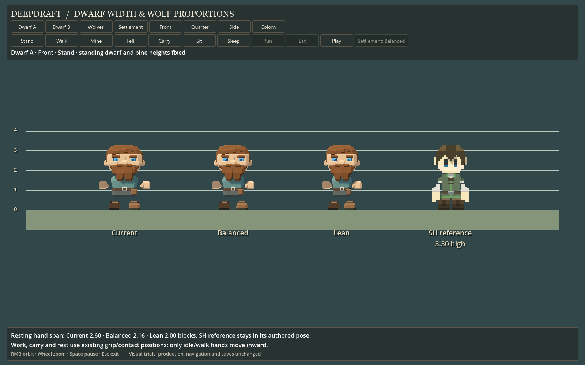
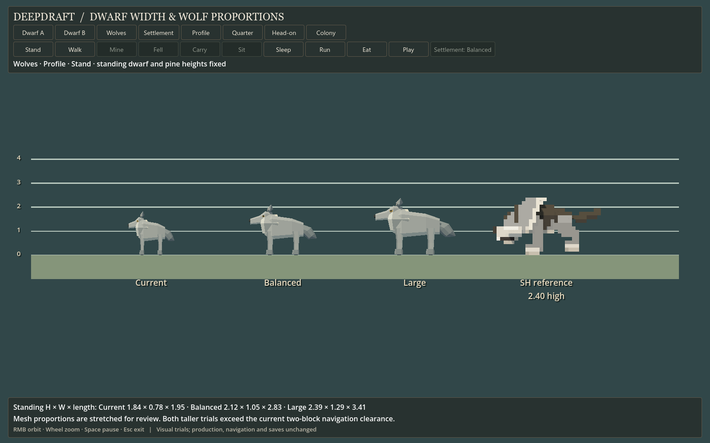

# 164 — Dwarf and wolf proportion trials

**Selected and integrated in [165](165_approved_actor_proportions.md):** the player
chose Balanced dwarves and Large wolves. The viewer now calls the old shape
**Before** and offers an **Approved** settlement preset pairing that selection.
Evidence and measurements below preserve the original review milestone.

**Ready for player review, 2026-10-13.** Following the local
[Stonehearth comparison](163_stonehearth_scale_comparison.md), the player requested
dwarf-width and wolf-proportion trials with dwarf and pine heights held fixed,
and explicitly included a taller wolf option.

Double-click **[Launch Proportion Study.cmd](../../Launch%20Proportion%20Study.cmd)**.
The native viewer places Current, Balanced and Lean/Large alternatives beside
the same local Stonehearth reference. Dwarf A and Dwarf B show two appearances;
Wolves shows the animal trials. Choose an angle and pose, then use Pause/Play
or Space. Right mouse orbits, the wheel zooms, and Escape exits. Settlement
cycles the three paired choices in the existing furnished terrain scene.

## Dwarf width

All values below are in terrain blocks. Height includes the selected hair.
The measured resting span includes both hands; head width includes ears and hair.

| Profile | A / B height | Resting hand span | Torso width | Head assembly width |
|---|---:|---:|---:|---:|
| Current | 3.32 / 3.28 | 2.60 | 1.40 | 2.06 |
| Balanced | 3.32 / 3.28 | 2.16 | 1.12 | 1.92 |
| Lean | 3.32 / 3.28 | 2.00 | 1.01 | 1.81 |
| Sampled SH hearthling | 3.30 | 1.90 | 0.90 | 1.70 |

**Recommend Balanced for the next production candidate.** Its resting span is
about 17% narrower and torso 20% narrower. It retains a broad dwarven head and
stocky silhouette, while reducing the spread around furniture. Lean moves closer
to the reference, but sacrifices more of the existing breadth. This is a visual
preference from the trial, not a new approved export standard.

The study scales torso X to 80%/72% and the complete head assembly X to 93%/88%.
Hands move inward by .22/.30 per side in standing and walking; feet move inward
by .06/.10. Head height, body height, depth and foot geometry stay current.
The eye, lid, hair and beard children travel with the head assembly.

Mining, felling, carrying, sitting and sleeping retain their existing hand/foot
contacts. Only the torso and head narrow in those poses. This prevents a width
trial from moving the established tool grips or seat/bed contacts, but also means
work-pose hand span is not uniformly reduced. The viewer drives the production
pose rigs directly; it does not run jobs or pathfinding.



[Second appearance](concepts/164_proportion_trials/dwarf_b_quarter.png),
[walking](concepts/164_proportion_trials/dwarf_b_walk_20.png),
[mining contact](concepts/164_proportion_trials/dwarf_a_mine_93.png),
[felling contact](concepts/164_proportion_trials/dwarf_a_fell_55.png),
[carrying](concepts/164_proportion_trials/dwarf_a_carry_55.png),
[sitting](concepts/164_proportion_trials/dwarf_a_sit_55.png),
[sleeping](concepts/164_proportion_trials/dwarf_a_sleep_55.png).

## Wolf proportions

Dimensions are measured in local axes in the runtime standing pose, before the
viewer turns the animal. Length includes the tail. Both alternatives are taller.

| Profile | Height | Width | Length | Visual X / Y / Z factors |
|---|---:|---:|---:|---|
| Current | 1.840 | .780 | 1.949 | 1 / 1 / 1 |
| Balanced | 2.116 | 1.053 | 2.826 | 1.35 / 1.15 / 1.45 |
| Large | 2.392 | 1.287 | 3.411 | 1.65 / 1.30 / 1.75 |
| Sampled SH wolf | 2.400 | 1.650 | 4.500 | Source scale .15 |

**Balanced is the moderate recommendation.** It reads as a larger, longer canine
without approaching the reference's more exaggerated bulk. Large is useful if
wolves should have a stronger predator presence: it nearly matches SH height,
while remaining narrower and shorter. Review both in motion and the settlement
before selecting the intended level of threat.

These are nonuniform transforms of the current faceted model and articulated
visual hierarchy, not separately authored anatomy. Head, muzzle, torso, tail and
leg spacing therefore change together. Hop/sleep offsets scale with height so
the visual rig is evaluated consistently. The SH wolf remains in its authored
static pose; it does not animate with the Deepdraft wolves.

**Integration constraint:** both taller trials exceed the current two-block wolf
navigation clearance, and their longer silhouettes overhang its two-cell footprint.
A production choice needs a deliberate clearance/footprint decision and live
movement, capture, attack, selection and save/reload checks. The study changes
none of those gameplay settings. Do not copy these transforms directly into
production and describe the navigation as validated.



[Head-on widths](concepts/164_proportion_trials/wolves_side.png),
[running](concepts/164_proportion_trials/wolves_run_20.png),
[eating](concepts/164_proportion_trials/wolves_eat_55.png),
[resting](concepts/164_proportion_trials/wolves_sleep_55.png).

## Colony context and verification

Compare [Current](concepts/164_proportion_trials/settlement_0.png),
[Balanced](concepts/164_proportion_trials/settlement_1.png), and
[Lean dwarf / Large wolf](concepts/164_proportion_trials/settlement_2.png).
The two families can be selected independently for eventual integration; these
paired scene views are convenient presets, not a requirement to adopt both.
Pines, other animals, furniture, terrain and actor positions remain identical.

**363 native checks pass, with 63 captures and no runtime errors.** Checks cover
standing ground contact, unchanged dwarf height and logical 1×1×3 clearance,
finite posed bounds, both tool grips, mining/felling contact points and both
carry grips. Cycling every tested pose restores the original standing dimensions
for all nine gallery specimens without accumulated scaling. Terrain bytes and
tree transforms stay unchanged; saves are isolated and disabled. Pose samples
are at .20, .55 and .93 through each cycle. Representative native screenshots
were reviewed for the two appearances, tool use, rest, wolf motion and settlement.

The [report](concepts/164_proportion_trials/report.json) records dimensions,
trial parameters, camera transforms and all capture states. Native headless editor
import also passes. These are posed visual/rig checks, not a full appearance-roster,
gameplay, transition-blending or performance validation.

[Profile data](../../tools/scale_study/proportion_trials.json) is owned by this
study. [Viewer](../../tools/scale_study/ProportionStudy.gd) reuses the current
scale-study stage and production pose rigs. The
[launcher](../../tools/scale_study/LaunchProportions.ps1) regenerates local SH
reference meshes with the read-only exporter from 163 and starts an isolated
APPDATA profile. All 39 source-file hashes remain unchanged. Reference meshes
stay in ignored scratch storage and never become production assets.

```powershell
powershell -NoProfile -ExecutionPolicy Bypass -File tools/scale_study/LaunchProportions.ps1 -Capture
```

Production models, generators, registries, animation code, navigation and saves
are unchanged. Player selection and a focused integration pass remain next.
