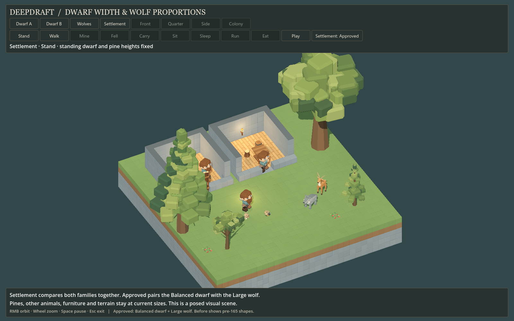

# 165 — Approved dwarf and wolf proportions

**Integrated, 2026-10-13.** The player selected **Balanced dwarves and Large wolves**
from [164](164_dwarf_wolf_proportion_trials.md). New and restored actors now use
those shapes in the normal game. Restart Play to rebuild existing runtime rigs.
No new world or save migration is required for the tested current-format saves.

## Result

| Subject | Before | Production now |
|---|---:|---:|
| Sampled dwarf A height | 3.32 | 3.32 |
| Sampled dwarf B height | 3.28 | 3.28 |
| Dwarf resting hand span | 2.60 | 2.16 |
| Dwarf torso width | 1.40 | 1.12 |
| Sampled dwarf head assembly width | 2.06 | 1.92 |
| Wolf standing height | 1.840 | 2.392 |
| Wolf standing width | .780 | 1.287 |
| Wolf nose-to-tail length | 1.949 | 3.411 |

Dimensions are in terrain blocks. Hair and posed anatomy affect the measured
envelope. Character height, world blocks and every pine height remain unchanged.
The other animals, furniture, terrain and vegetation retain their existing sizes.

## Dwarf integration

`DwarfAssets` owns [proportions.json](../../data/entities/dwarves/proportions.json).
`DwarfAgent` applies .8 torso width and .93 head width during assembly, before
the work rigs capture their rest transforms. The complete head hierarchy includes
hair, beard, brows, eyes and procedural eyelids. Resting hands move inward .22
per side, with .06 inward foot spacing; walking retains that stance.

Tool, carrying and furniture poses keep their explicit contacts. Pickup and
set-down still plant the boots; work grips and strike points remain in the shared
authored coordinate frame. Interruptions return to the narrower relaxed stance.
Ground/bed rest applies the selected widths through its pose blends. Portraits
use the same body/head factors, including the saved optional scar overlay.

This is a rig presentation setting, not a rewrite of the modular mesh source.
All 41 appearance parts retain their IDs, tints and shared coordinates. The logical
1×1×3 body, worker reach, movement speed and jobs are unchanged.

[Frontal comparison](concepts/165_actor_proportions/dwarf_a_front.png),
[second appearance](concepts/165_actor_proportions/dwarf_b_quarter.png),
[mining](concepts/165_actor_proportions/dwarf_a_mine_93.png),
[felling](concepts/165_actor_proportions/dwarf_a_fell_55.png),
[carrying](concepts/165_actor_proportions/dwarf_a_carry_55.png),
[sleeping](concepts/165_actor_proportions/dwarf_a_sleep_55.png).

## Wolf integration and clearance

The [wolf definition](../../data/entities/animals/wolf.json), loaded by
`WildlifeManager`, owns `visual_scale: [1.65, 1.3, 1.75]`. `WolfAgent` scales its
articulated visual hierarchy and applies the same height factor to hop and
sleep offsets. Meshes and local articulation pivots remain unchanged.

The enlarged body uses **4×4 supported space and three-block headroom**. This
conservative square contains the sampled standing, moving, eating and sleeping
forms through every tested facing. Wolves now reject low ceilings, narrow gaps,
unsupported corners and obstacles that intersect this larger space.

Flat strides remain **two cells**, preserving existing walking, fleeing and
hunting speeds and the 1.6-block capture radius. One-block terrace transitions
span four cells so their support footprints do not overlap incompatible floor
heights. Those strides take twice as long; rising happens before crossing the
edge, and descending after clearing it. Both endpoint volumes cover the complete
cardinal sweep. The arrival planner uses the same clearance and stride rules.
Rabbit and deer movement dimensions and durations remain unchanged.

Needs, prey reserve floors, chase timeout, eating credit, populations, audio and
save fields are unchanged. Current saves instantiate current proportions and
navigation settings. The usual live support recovery still applies when terrain
or construction no longer permits an animal to stand where it was saved.

[Profile comparison](concepts/165_actor_proportions/wolves_front.png),
[head-on widths](concepts/165_actor_proportions/wolves_side.png),
[running](concepts/165_actor_proportions/wolves_run_20.png),
[resting](concepts/165_actor_proportions/wolves_sleep_55.png).

## Verification

- **17 distinct fixtures pass:** ProportionIntegration, DwarfFacetedArt,
  WildlifeFacetedArt, RabbitWildlife, DeerWildlife, WolfWildlife, DuckWildlife,
  HerdArrival, MiningAnimation, TreeFelling, HaulingAnimation, DwarfRest,
  DwarfIdleBehavior, Bedroom, DwarfDining, DwarfInspector and SaveManagerRoundTrip.
- The focused proportion fixture has **205 checks** for exact selected dimensions,
  persistent width factors, gait, work/rest reset, portraits/scars, wolf facings,
  pits, ceilings, corners, terrace sweep and unchanged flat movement duration.
- Dwarf family coverage includes **800 appearances and 22 pose cases**, with
  **6,818 checks**. Wildlife imported/pose validation adds **184 checks**. Hunting
  tests exercise real prey escape, one atomic capture/meal, interruption, picking,
  slicing and deterministic saved chase replay. Arrival checks cover four seeds.
- The refreshed native viewer passes **364 checks and 64 captures**. It labels
  the original proportions **Before**, and offers **Approved** as a fourth
  settlement preset pairing Balanced dwarves with the Large wolf. Historic
  evidence under 164 remains unchanged.
- The full native settlement run passes with **24 dwarves, 48 furniture pieces,
  four wolves, 2,953 trees and eight lights**. It completes eight tasks and observes
  movement, carrying, seated and sleeping dwarves, moving wildlife and door use.
  Day/night views, slices, terrain edits and save/reload all complete without errors.
- A separate copy of the pre-change `structure_restore` settlement restores its
  24 dwarves, 48 furniture pieces and all four wildlife species, preserving the
  checked identity, appearance, clock, furniture, terrain and inventory state.
- **All 381 production GLBs are byte-identical** to the start of this task.
  The source Stonehearth files are unchanged. Native editor import and scoped
  whitespace checks pass. No new autoload or global class is introduced.

[Fixture results](concepts/165_actor_proportions/verification.json),
[viewer report](concepts/165_actor_proportions/viewer_report.json),
[live settlement report](concepts/165_actor_proportions/settlement_report.json),
[pre-change save restoration](concepts/165_actor_proportions/restore_report.json),
[native live settlement](concepts/165_actor_proportions/live_settlement.png).

Reproduce the viewer with **[Launch Proportion Study.cmd](../../Launch%20Proportion%20Study.cmd)**.
The focused fixture is [ProportionIntegrationTest.gd](../../scripts/tests/ProportionIntegrationTest.gd).
Test logs are under `tmp/proportion_integration_20261013/`; full native runs use
`tmp/settlement_art_20261013/proportions_live/` and `proportions_restore/` with
isolated APPDATA profiles. This pass validates the size integration and behavior;
the native timing samples are not a controlled performance comparison.
