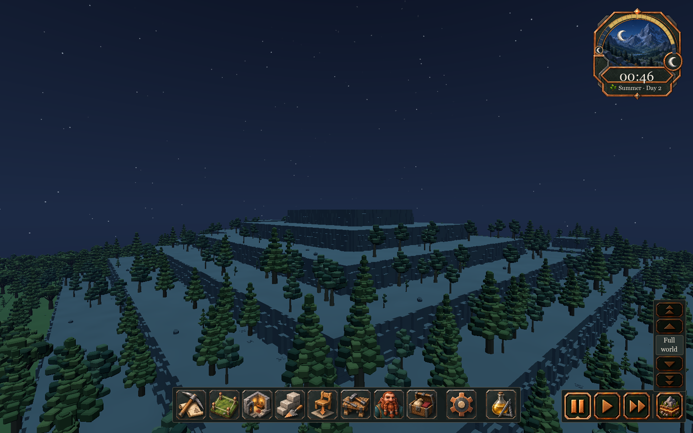
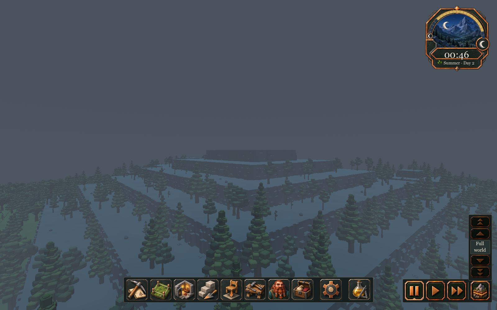

# 166 — Full-sphere diorama sky

**Save-load follow-up:** [167 — Sky scene lifetime](167_sky_scene_lifetime.md)
fixes an update during scene detachment that this initial immediate-rebind
fixture missed. The sky now releases old lights before reading their transforms;
the exact reproducer and real menu-driven save loads pass. Appearance is unchanged.

Implemented 2026-10-13 for player review. Clear summer nights previously had a
flat grey background: the procedural sky supplied only color, while the scene
applied a static daytime fog color to the sky and distant terrain.

The new native sky surrounds the entire diorama, including below the horizon.
Clear nights have a deep blue gradient, restrained star points and an ivory
crescent. Daylight is blue, dawn/dusk are warm, and overcast/fog/snow add cloud
cover and stronger haze. Seasonal sunrise/sunset events drive the transitions.

## Runtime ownership

- `SkyController` loads `data/sky/sky_settings.json` and installs
  `scripts/shaders/diorama_sky.gdshader` on the scene Environment. The existing
  calendar and directional sun/moon light curves remain unchanged.
- `sky_gradient_colors` supplies top/horizon/bottom color; `starfield_brightness`
  supplies the calendar fade; `diorama` supplies gradient shape, star density/energy,
  disc radii, cloud colors and the clear atmosphere. Each weather definition
  overrides only its `sky_overrides.atmosphere` values.
- `sky_atmosphere.gdshaderinc` supplies the same broad gradient to the sky's
  radiance cubemap and the roof-aware terrain/prop material. Fog is still gated
  by physical sky access. Decorative stars, discs and clouds are excluded from
  the ambient cubemap, so they cannot paint bright points onto world surfaces.
- Clear haze is depth fog: density .2, start 90, end 450 blocks. Foggy weather
  blends to .78 / 20 / 180; overcast .32 / 65 / 360; snow .55 / 35 / 260. Fog
  color follows the sky; it no longer washes a night sky with daytime grey.
- Sky features use view direction, with no camera-position or shader `TIME`
  dependency. Clouds rotate with the game hour and stop when time is paused.
  The full-turn wrap is continuous. Orthographic views use the camera's angular
  FOV for the background, preventing world-unit zoom from stretching stars.
- Rebinding after scene replacement installs the current sky and reuses the
  scene's Moon when present. Repeated binds no longer accumulate extra lights.

There is no sky mesh, new bitmap asset, panorama seam or ground disc. Obsolete
unused panorama paths and `height_fog` reference data were removed. Weather
selection, saves, streaming budgets, terrain, actors and gameplay visibility are
unchanged. This is atmosphere presentation; it does not implement the separate
world-edge occlusion/streaming redesign from roadmap 08. The crescent is an art
choice, not a lunar-phase simulation. Precipitation and cloud shadows remain
separate work.

## Validation

`tools/sky_art/Run.ps1` captures the real seeded production scene into an isolated
profile. Baseline and final each have 18 captures at 1600×1000: four times of day,
four cardinal night orbits, upper/lower views, and the other three weather types
by day and night. Final captures and reports live in `concepts/166_diorama_sky/`;
scratch runs/logs live in `tmp/sky_art_20261013/`.

`tools/sky_art/Verify.ps1` runs six fixtures; all pass:

| Fixture | Evidence |
|---|---|
| DioramaSkyTest | 85 checks: four seasons, event continuity, weather recovery, scene replacement, repeated binding, projection switching, pixel-identical sky under translation at four yaws, full-turn wrap and lower-hemisphere stars |
| SkyDialTest | HUD time/weather/season, pause/speed and restoration remain consistent |
| WeatherPersistenceTest | 12 deterministic saved/unsaved comparisons across seasons/year rollover |
| UndergroundLightingTest | Physical entrance falloff, roof changes, enclosed rooms and replay |
| RoomLightingTest | Unlit sealed room luminance .019; native vs roof-aware outdoor fog difference .0039 at both tested day/night distances; firelight still works |
| TunnelEntranceTest | Entrance light and live actor shading; corrected actor-vs-legacy pixel difference .358 |

The tunnel fixture needed maintenance for earlier art changes: its legacy shader
replacement targeted obsolete source text, its material loop included the
separate dwarf-occlusion shader, and its freed dwarf remained in the task roster.
The fixture now checks that replacement actually occurred, checks the production
lighting material, and deregisters its test actor before freeing it. Production
actor and task behavior did not change.

Headless editor import passes without errors. The local GPU median for the
paired landscape captures is comparable: night 2.58→2.54 ms, day 2.64→2.70 ms,
overcast day 2.65→2.65 ms. These are single local review samples, not minimum
hardware guarantees. Godot's sky shader and environment APIs are documented in
[Sky shaders](https://docs.godotengine.org/en/stable/tutorials/shaders/shader_reference/sky_shader.html)
and [Environment](https://docs.godotengine.org/en/stable/classes/class_environment.html).

**Playtest:** restart Play. The existing game time/weather drives the new sky;
no save migration or project reload is required. Review a clear summer night,
orbit around a world edge, then compare dawn/day/dusk and cloudy weather.
