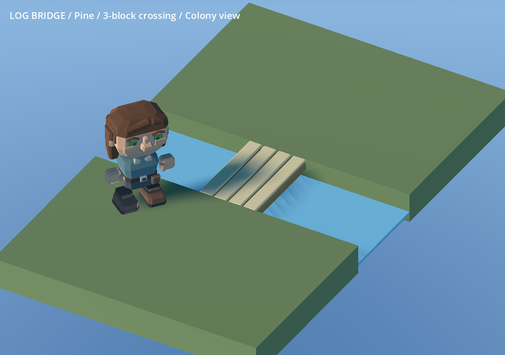
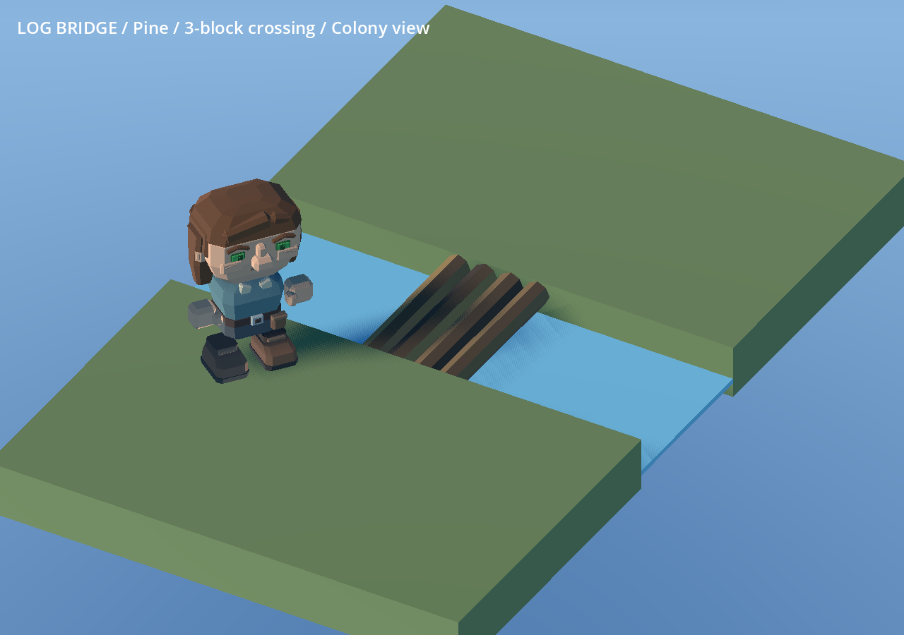

# 172 — Rudimentary log bridge

2026-10-13. The player requested a simpler bridge built from logs; the pale,
flat walking boards looked too advanced for rudimentary crafting.

All five placed spans now use four continuous bark-covered trunks, slightly
different diameters and lengths, oblique cut ends and rough cross-log supports.
Broad faceted bark replaces the pale board tops. The existing packed kit already
uses bundled logs and is retained. The placed-form catalogue thumbnail is refreshed.

`data/art/furniture_catalog.json` owns the log profiles and semantic bark roles;
`tools/generate_furniture_faceted.py` builds the meshes. Selectable pine, oak,
juniper and applewood retain exact CraftMaterials swatches. Only five of the 381
production GLBs changed; all other 376 models remain byte-identical. Exact revisions
are recorded in `data/art/asset_revisions.json`.

The two-wide footprint, spans of one to five water blocks, bank anchors and Y0
walking crowns remain unchanged. Buried bank tails avoid coplanar flicker. No
gameplay, recipe, navigation, water or save-format changes are introduced. Existing
bridges acquire the updated models on the next launch/load.

## Validation

- Furniture generator geometry and reproducibility checks pass: closed components,
  consistent flat normals, finite vertices and unit roots; 896 triangles per span.
- All 41 furniture fingerprints match their original or explicitly revised records.
- FurnitureFacetedArtTest: 582 imported geometry, palette and interaction checks pass.
- LogBridgeTest: crafting, installation, hauling across the bridge, saved partial
  and installed structures, dismantling, item conservation and water invariance pass.
- BridgePlacementInputTest and BridgeCornerWalkingTest pass.
- Nine matched native views before and after cover spans 1/3/5 at close/colony
  distances and all four wood palettes; reviewed alongside a current dwarf.
- One bridge thumbnail regenerated. The thumbnail tool accepts an optional `--out`
  directory so captures can be staged before replacing an in-use PNG.
- Windows playtest ZIP rebuilt successfully with the updated bridge and icon.

The older cross-family audit compares all gameplay JSON to Git HEAD, which predates
other approved changes such as wolf proportions. Its broad gameplay check is not
a valid gate for this art-only edit. The scoped furniture fingerprint audit and
bridge gameplay regression results are recorded below; unrelated files were retained.

Evidence: [assets](concepts/172_rudimentary_log_bridge/assets.json),
[tests](concepts/172_rudimentary_log_bridge/tests.json),
[furniture audit](concepts/172_rudimentary_log_bridge/furniture_audit.json).

Before:

After:

Restart Play or relaunch the exported game. Share the refreshed
`build/windows/Deepdraft-Windows-Playtest.zip`; it replaces the package from 171.
