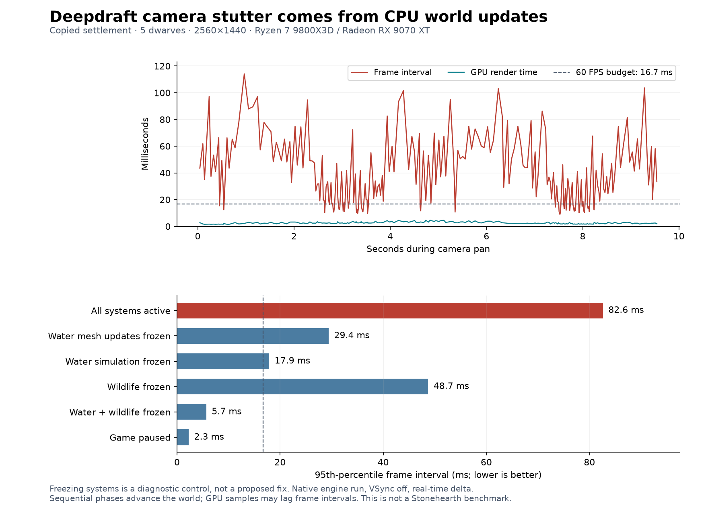

# 178 Performance baseline and camera stutter

**Measured 2026-10-14.** Deepdraft's recurring frame stalls are dominated by CPU
world updates, especially water presentation and simulation, followed by wildlife.
They reproduce before founding a colony. Camera motion exposes the uneven frame
delivery; the camera controller itself is inexpensive in these measurements.

This investigation adds repeatable measurement tools and evidence. Production
behavior is unchanged. The issues in [177](177_project_review_deferred_2026_10_14.md)
remain parked. Fog of war is an idea for future design, not an implementation decision.

## Current measurements

Three sequential native runs sampled **44,057 frames over 271.45 seconds** across
32 phases. Hardware: Ryzen 7 9800X3D, Radeon RX 9070 XT. Engine: Godot 4.7.2 Steam,
D3D12 Forward+, 2560×1440, VSync disabled, uncapped, real-time simulation delta.
These are separate native engine processes, not headless rendering or a newly
exported release. The existing editor remained open. Audio used the Dummy device;
game-side audio calculations remained enabled except in the audio control.

- Fresh seed 1234: zero dwarves, zero furniture, 81 animals, 2,953 trees,
  2,114 surface details and 24,090 water columns.
- Copied player settlement, seed 2520450404: five dwarves, 20 furniture pieces,
  79 animals, 2,925 trees, 2,137 surface details and 19,322 water columns.
- Player saves were copied into isolated APPDATA/LOCALAPPDATA. Before/after SHA-256
  checks confirmed the source save was unchanged. Autosaving was disabled only
  inside the benchmark processes.

The table uses the saved-settlement repeat without detailed process markers.
P95 means 95% of sampled frame intervals were at or below that value; the slowest
5% were worse. A 60 FPS frame has **16.67 ms** available; 120 FPS has 8.33 ms.

| Camera pan condition | Median frame ms | P95 frame ms | P99 frame ms | Maximum ms |
|---|---:|---:|---:|---:|
| All systems active | 35.02 | 82.63 | 101.54 | 114.12 |
| Water mesh updates frozen | 11.73 | 29.42 | 60.68 | 73.78 |
| Water simulation frozen | 11.43 | 17.90 | 20.53 | 25.83 |
| Wildlife updates frozen | 2.73 | 48.72 | 77.80 | 97.49 |
| Water simulation and wildlife frozen | 2.19 | 5.70 | 7.12 | 9.48 |
| Game paused | 1.53 | 2.28 | 4.46 | 7.95 |

The active pan averaged 39.75 ms per frame, approximately 25.2 frames per second
over that sample. **76 of 240 frames exceeded 50 ms.** GPU P95 was only 3.87 ms.
With the camera stationary and the game active, frame P95 was still 79.34 ms.
The final active-pan repeat returned to 79.34 ms after the diagnostic controls.

The instrumented saved-colony run gave a similar active-pan P95 of 87.15 ms.
Removing the detailed markers therefore does not remove the observed problem.
The fresh-world active pan measured 65.60 ms P95 initially and 102.82 ms in its
later repeat; paused panning measured 2.05 ms. Runtime state evolves, especially
water, so a single short average is not a dependable performance gate.



The controls freeze selected updates while retaining existing scene geometry.
They locate costly work; they are not valid gameplay optimizations. In particular,
stopping water simulation also stops most downstream water-mesh invalidation.
Phases run sequentially and advance the same world, so differences are diagnostic
ranges rather than exact additive savings or promises of optimized performance.

## Where CPU time goes

Sibling markers measured intervals around existing process callbacks without
changing their relative order or priorities. Intervals include same-priority
descendants. The overall Renderer interval includes Water, so those values must
not be added together. The table uses the instrumented saved-colony active pan.

| Interval | Mean ms per frame | P95 ms |
|---|---:|---:|
| Water presentation | 16.46 | 41.65 |
| Water simulation owner | 5.94 | 17.89 |
| Wildlife manager and same-priority descendants | 8.80 | 13.20 |
| Underground lighting | 1.39 | 3.17 |
| Task manager | 0.023 | 0.045 |
| Camera controller | 0.020 | 0.032 |
| Dock UI | 0.035 | 0.111 |

### Water rebuilds consume whole frames

[WaterManager.advance](../../scripts/systems/WaterManager.gd) runs a 0.1-second
simulation tick and permits up to four catch-up steps in one frame. The configured
384-cell limit is a work-count limit, not a millisecond budget. `_flush_changes()`
marks 32×32 presentation tiles dirty for changed cells and neighboring columns,
irrespective of the camera's location.

[WaterRenderer._process](../../scripts/components/WaterRenderer.gd) rebuilds up
to three dirty tiles per frame. `_build()` scans each tile's 1,024 columns and
their water spans, evaluates neighboring surfaces and falls, builds arrays, then
creates and uploads a replacement mesh. There is no camera-distance/frustum
filter in that rebuild loop. Three tiles can cost far more than the entire
16.67 ms frame budget. The terrain overview's existing threaded upload budget
does not cover this separate water path.

Freezing water mesh updates reduces the saved-colony P95 from 82.63 to 29.42 ms
while water simulation continues. Freezing water simulation reduces it further
to 17.90 ms once pending presentation work drains. Both sides warrant attention.

### Wildlife pays detailed costs across the world

[WildlifeManager.advance](../../scripts/systems/WildlifeManager.gd) advances
every animal on every active frame. It updates herd/flock context, movement,
needs, visibility, poses and hunting behavior. The visibility check considers
slice height and cave discovery; it does not establish simulation distance tiers.

At the start of the saved control run, **zero of 79 animal origin points were
inside the camera frustum, and zero animals were within 100 blocks of the camera
target**. Their updates still ran. Origin-point frustum membership is a diagnostic,
not a full occlusion or gameplay-visibility test.

[GrazerAgent](../../scripts/entities/GrazerAgent.gd) checks support each advance
and rechecks movement clearance during hops. [AnimalNavigation](../../scripts/components/AnimalNavigation.gd)
samples live blocks and occupancy repeatedly; herd/flock context also scans the
animal population. These are source-level candidates for narrower profiling,
not individually measured shares of the 8.80 ms manager interval.

### Secondary costs and an unresolved hitch

Audio and HUD controls did not eliminate the stalls. Lighting remains worth
profiling after the larger costs are reduced. One measured room rebuild reached
29.86 ms, although its ordinary frames were inexpensive.

The saved active-static samples also contain an isolated **239–244 ms frame**.
In the instrumented run, only 27.69 ms was inside the scene-process interval for
that frame. The current markers do not explain the remainder. Capture the full
frame with Godot's profiler and, if needed, a platform tracing tool before blaming
water, shader compilation, physics, deferred work, or the driver for this outlier.

## Fog of war and distant activity

The player's Stonehearth comparison suggests a useful design direction: give
nearby, relevant activity more detail than distant activity. This investigation
does not measure Stonehearth or establish why its implementation runs faster.

Fog of war is the rule deciding what the player may see. Simulation detail and
rendering visibility are separate decisions. Darkening distant terrain alone
does not stop its AI, water calculations, animation updates or mesh rebuilding.
Godot's automatic frustum culling already avoids drawing many offscreen meshes;
it does not cancel this project's explicit wildlife loop.

A useful approach without adding fog would be:

- Update visible animation smoothly, while running decisions and route checks
  only when needed or on staggered schedules.
- Give distant wildlife coarser simulation, preserving elapsed needs, travel,
  arrivals, predation and save state. Promote animals before they can affect a
  colony or enter view, avoiding teleportation and sudden behavioral changes.
- Prioritize nearby water presentation and retain dirty state for distant tiles.
  Offscreen upstream flow must still affect downstream flooding correctly.
- Keep gameplay relevance separate from camera position. A dwarf working
  offscreen or a wolf approaching the colony cannot simply stop existing.

These changes can later support fog of war, but should have independent
correctness and performance tests.

## Recommended order of work

1. **Reduce water presentation stalls.** Separate simulation changes from visual
   rebuild requests; avoid rebuilding geometry for imperceptible level changes;
   prioritize nearby dirty tiles; measure time rather than limiting only tile
   count. If one tile is too expensive, reduce the unit of work or generate mesh
   data off the main thread with immutable snapshots and revision checks.
   Preserve shoreline seams, waterfalls, slice concealment and current water truth.
2. **Bound water simulation work.** Profile connection and level-reach searches,
   cache topology with correct invalidation, and schedule work without a burst of
   expensive catch-up steps. Preserve mass, determinism and elapsed-time debt;
   dropping steps or freezing unseen water is not an acceptable shortcut.
3. **Introduce wildlife update tiers.** Separate decisions, support validation,
   and animation; cache terrain/occupancy checks until relevant revisions change;
   stagger expensive decisions and use spatial neighborhoods for threats and peers.
   Validate large-animal clearance, water movement, arrivals and predation.
4. **Profile remaining frame outliers and larger colonies.** Revisit lighting,
   room rebuilds, deferred work, terrain uploads and task planning after the
   dominant global costs are reduced. Then expand to 24/48/100 dwarves and dense
   furniture/item workloads, plus packaged-release and lower-end hardware runs.

Start with a proposed 60 FPS gate: normal camera movement P95 at or below
16.67 ms, P99 at or below 25 ms, and investigate every unexplained frame above
50 ms. Treat these as initial targets to agree on, not achieved guarantees.
Loading, save/load, first shader use, season changes, slicing and terrain edits
need their own latency budgets rather than being averaged into steady movement.

## Repeatable measurement workflow

[`tools/performance/Run.ps1`](../../tools/performance/Run.ps1) launches the real
scene with an isolated profile, records CPU/GPU and frame intervals, and copies
an optional source save without modifying it. Use a new label for every run.

```powershell
& tools/performance/Run.ps1 -Label fresh_baseline_01 -Seconds 30
& tools/performance/Run.ps1 -Label colony_baseline_01 -Seconds 30 `
  -SavePath "$env:APPDATA/Godot/app_userdata/Deepdraft/saves/quicksave.json"
& tools/performance/Run.ps1 -Label colony_control_01 -Seconds 30 -NoMarkers `
  -SavePath "$env:APPDATA/Godot/app_userdata/Deepdraft/saves/quicksave.json"
```

Match the save, seed, camera path, resolution, speed, weather and warmup. Run
benchmarks sequentially with other heavy workloads stopped. Compare at least
three repetitions before accepting smaller improvements. Record median, P95,
P99, maximum and counts above 16.7/33.3/50/100 ms, alongside GPU time, CPU
subsystem intervals, draw calls, scene counts and pending-work queues. Report
startup separately. The current run phases have a 1.5-second warmup and require
at least 240 sampled frames and the requested wall duration.

The new harness uses ordinary real-time delta. The older settlement art tool's
`--fixed-fps 60` remains useful for controlled art comparisons but changes how
simulation time relates to wall time and is not this harness's timing mode.

Use Godot's **Debugger → Profiler** to select a slow frame and examine both
inclusive and self function time. Use rendering measurements alongside CPU
measurements, since a single FPS counter does not identify which resource is
limiting a frame. See the official [profiler documentation](https://docs.godotengine.org/en/stable/tutorials/scripting/debug/the_profiler.html)
and [optimization workflow](https://docs.godotengine.org/en/stable/tutorials/performance/general_optimization.html).
For a later draw-call bottleneck, regional batching can help; Godot's
[MultiMesh documentation](https://docs.godotengine.org/en/stable/tutorials/performance/using_multimesh.html)
explains why one world-sized batch loses per-instance culling. Today's evidence
does not make that the first priority.

## Evidence and scope

Durable summaries: [CSV](concepts/performance_20261014/summary.csv),
[fresh report](concepts/performance_20261014/fresh_1_report.json),
[instrumented settlement](concepts/performance_20261014/saved_1_report.json),
[settlement control](concepts/performance_20261014/saved_control_report.json),
[chart SVG](concepts/performance_20261014/frame_pacing.svg).
Raw per-frame records and process logs remain in ignored
`tmp/performance_20261014/`. They contain no modifications to the source save.

All three native runs completed without script/engine errors. Script-launch
startup warnings reported the initial lack of a scene and world seed; the scene
was subsequently bound, and the saved runs restored weather state. Fresh-world
weather RNG initialization should be made explicit for longer cross-day studies.
The first two runs measured the wait between frame callbacks, excluding the
small recorder work between waits; the final control uses complete successive
callback intervals. The large stalls persist under both methods. GPU timestamps
can lag the corresponding CPU frame, so they are compared as distributions.

The chart generator is [`Analyze.py`](../../tools/performance/Analyze.py) and
requires matplotlib. This session installed plotting dependencies only under
ignored `tmp/performance_20261014/python_packages`. Tools and evidence are
excluded by the existing Windows export filters. No production script, scene,
asset, game setting or packaged build was changed for this investigation.
