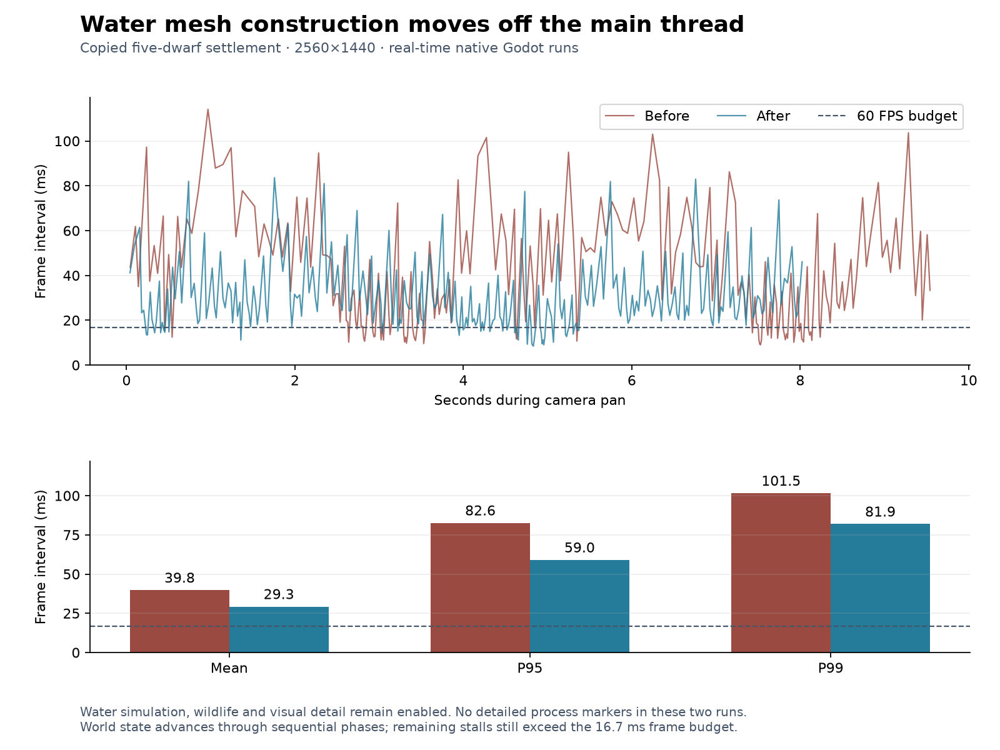

# 179 Water mesh rebuild performance

**Implemented 2026-10-14.** Water mesh construction now runs on workers using
private snapshots. Main-thread preparation and uploads use a soft time budget,
nearby work gets priority, and repeated requests coalesce. Water simulation,
wildlife, visual detail and save formats are unchanged. This implements the
first priority from [178](178_performance_baseline_and_camera_stutter.md).
The unrelated findings in [177](177_project_review_deferred_2026_10_14.md) remain parked.

## Measured result

Same Ryzen 7 9800X3D / RX 9070 XT, Godot 4.7.2, D3D12 Forward+, 2560×1440,
VSync off, real-time delta and copied five-dwarf settlement as the baseline.
Runs were sequential; regression tests and exports did not run alongside timing
samples. All systems remain enabled in the rows below.

| Sample | Before P95 ms | After P95 ms |
|---|---:|---:|
| Saved settlement, first active pan | 82.63 | 59.00 |
| Saved settlement, later active-pan repeat | 79.34 | 54.74 |
| Fresh world, first active pan | 65.60 | 30.75 |
| Fresh world, later active-pan repeat | 102.82 | 69.40 |

The final saved comparison has no detailed process markers on either side.
Mean frame time falls from **39.75 to 29.28 ms**, approximately 25.2 to 34.2 FPS.
P99 falls from **101.54 to 81.89 ms**. Frames above 50 ms fall from
76/240 (31.7%) to 29/274 (10.6%). The harness samples at least eight wall-clock
seconds and 240 frames per phase, so the number of frames differs.

The final saved pan's measured mesh preparation/dispatch/upload work is
**3.86 ms P95, 4.87 ms maximum**. In the instrumented fresh-world comparison,
the whole water presentation interval falls from **37.08 to 7.21 ms P95**.
That whole interval also includes current-texture updates and splashes; it is
not the same metric as the narrower new mesh-work timer.

Improvement varies with the evolving simulation. Earlier development trials
measured saved-pan P95 around 44–48 ms; the table records the final source's
59 ms confirmation, not the most favorable trial. The final fresh and saved
reports include SHA-256 fingerprints of both production mesh scripts.

This does **not** achieve the 16.67 ms frame budget for steady 60 FPS. In the
later fresh sample, wildlife alone reached 35.07 ms P95 and one 187.52 ms
update inside a 215.03 ms frame. Water simulation and surface animation remain
separate costs. This attributed wildlife hitch does not explain the earlier
baseline's unrelated 239–244 ms outlier.

## Implementation and boundaries

- [WaterRenderer](../../scripts/components/WaterRenderer.gd) copies one tile
  plus a one-column halo. Mutable topology arrays, water quantities, visibility
  decisions, motion-slot IDs and palette values belong to that snapshot.
- [WaterMeshBuilder](../../scripts/components/WaterMeshBuilder.gd) creates only
  geometry arrays and waterfall-site data. It reads no live nodes, terrain,
  simulation state or GPU resources. The main thread polls completion and then
  creates/assigns the `ArrayMesh`. At most two worker jobs are in flight.
- [Water configuration](../../data/world_gen/water.json) replaces the three-tile
  allowance with a **2 ms soft budget** for preparation and uploads. One snapshot
  or upload remains atomic and can exceed that target. The measured maxima above
  are observed bounds on this machine, not a universal hard cap.
- Dirty tiles coalesce by identity. Exact unchanged snapshots reuse the existing
  mesh. Hidden water and sub-threshold films with no visible surfaces share an
  empty geometry input, so their changing quantities do not trigger new meshes.
  Visible heights are not quantized; tiny step-closing faces remain intact.
- Camera-near tiles, with a center-point frustum preference, are selected first.
  This is a scheduling hint, not a visibility/culling rule. Every eighth selection
  serves the oldest available request; repeated changes retain its original
  timestamp. Distant work continues to make progress.
- A changed tile keeps its previous mesh until a replacement is complete. Edits
  during a build remain queued for the next snapshot. Slice/world invalidation
  hides old geometry immediately and rejects results from the previous epoch.
  Teardown joins outstanding workers, which own only copied data.

The saved first-pan queue peaked at **19 pending tiles** and **1.02 seconds**
for the oldest request; it ended with eight pending tiles and one worker. The
later saved repeat peaked at 17 pending tiles and 0.99 seconds. Fresh samples
peaked at six/ten pending tiles and 0.15/1.15 seconds respectively. These are
short-run bounds, not a promise that every visible change updates within one
frame. Regression and native checks also drain the queue with simulation paused.

The threading boundary follows Godot's [thread-safety guidance](https://docs.godotengine.org/en/stable/tutorials/performance/thread_safe_apis.html):
scene and GPU mutations stay on the main thread; workers operate on independent
containers. No engine threading or renderer project settings were changed.

## Verification

Seven relevant fixtures pass: WaterMeshSchedulingTest, WaterSurfaceMeshTest,
WaterSurfaceMotionTest, WaterFlowTest, WaterAudioTest, WaterWorldTest and
SaveManagerRoundTripTest. The new scheduling fixture covers coalescing, bounded
concurrency, immutable mass/topology snapshots, updates arriving during a build,
empty-mesh reuse, slice/reload invalidation, hidden cave water, draining,
nearby priority, distant progress and worker teardown.

A separate differential check compared the previous and new renderer across
**36 tile/slice combinations**, including multiple water spaces in a column,
tile seams, cave concealment and waterfalls. All mesh arrays, waterfall locations
and splash-site records were identical. The previous renderer was copied before
editing from base commit `d4b05c10ef7560162045d824420adc22ab7fc7c9`; its file SHA-256
is `f73a21bc5cb1b34cb8d61d6a0602b4ca3c9f010148a059e4651ee1a006ab2d05`.

Native WaterPresentationTest passes with reviewed captures of the
[spring](concepts/water_mesh_20261014/spring.png),
[lake](concepts/water_mesh_20261014/lake.png),
[falls](concepts/water_mesh_20261014/falls.png) and
[dammed channel](concepts/water_mesh_20261014/flood.png).
The fixture now waits for actual terrain and water queues before capturing
startup and dam views; fixed frame counts could capture water before the
surrounding terrain was ready.

The refreshed Windows release also passes normal native DirectX 12 startup.
The exported PCK passes a copied-save load, five seconds of active water, a slice
to Y35 and return to Y127; it finishes with zero pending water tiles/jobs and all
five dwarves restored. The PCK check runs from the package directory using
Godot's editor executable and `--main-pack`, with loose workspace access checked
absent. Release executables do not support `--script`; their normal launch is
tested separately. The performance table above uses native engine runs, not a
separate release-executable timing benchmark.

Use [this Windows executable](../../build/windows/releases/20261014-164409-853-5bef146e/Deepdraft/Deepdraft.exe)
or the refreshed [playtest ZIP](../../build/windows/Deepdraft-Windows-Playtest.zip).
The existing running/build directories were preserved. ZIP SHA-256:
`f3e8aa4368d5b1e2a0ec51ed4a5641aef175448a6e158d184a9a2e8b53a09f6c`.

## Evidence and reproduction

- [Comparison data](concepts/water_mesh_20261014/comparison.json),
  [final saved report](concepts/water_mesh_20261014/water_mesh_final_saved_report.json),
  [final fresh report](concepts/water_mesh_20261014/water_mesh_fresh_1_report.json)
  and [vector chart](concepts/water_mesh_20261014/frame_pacing.svg).
- [Validation results](concepts/water_mesh_20261014/validation.json),
  [packed-save/slice check](concepts/water_mesh_20261014/packed_smoke.json)
  and [release startup](concepts/water_mesh_20261014/release_startup.json).
- [Benchmark runner](../../tools/performance/Run.ps1) and
  [chart generator](../../tools/performance/CompareWaterMeshes.py). Per-frame
  traces and logs remain in ignored `tmp/performance_20261014/`; fixtures and
  the differential check are in ignored `tmp/water_mesh_20261014/`.
- Final timing runs: `water_mesh_final_saved` (no detailed process markers)
  and `water_mesh_fresh_1` (markers). Intermediate development runs are not the
  final acceptance measurements. The baseline sampling caveats in 178 still apply.

Benchmarks use isolated APPDATA/LOCALAPPDATA and a copy of the earlier settlement
snapshot. Source-copy hashes remained unchanged. No player save was modified.
There is no migration. Restart Play to load the scripts; previously exported
executables need a refreshed package.

Next profiling should address water simulation/surface-animation work and
wildlife's increasingly costly updates. Fog of war remains an independent design
decision. Larger colonies, long sessions and lower-end hardware still need their
own performance gates.
