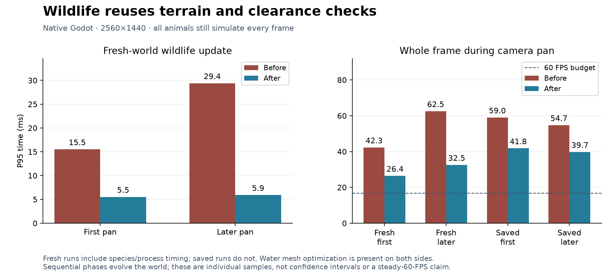

# 180 Wildlife navigation performance

**Implemented 2026-10-14.** Wildlife now reuses terrain, clearance and support
queries until the relevant world state changes. All animals still simulate
every active frame, including offscreen animals. This follows the water mesh
work in [179](179_water_mesh_rebuild_performance.md); unrelated review findings
in [177](177_project_review_deferred_2026_10_14.md) remain parked.

## Measured improvement

Native Godot 4.7.2, D3D12 Forward+, Ryzen 7 9800X3D / RX 9070 XT,
2560×1440, VSync disabled, real-time delta, Dummy audio. Benchmarks ran
sequentially, without concurrent tests or exports. Water mesh optimization is
already present on both sides of these comparisons.

| Whole frame during camera pan | Before P95 ms | After P95 ms |
|---|---:|---:|
| Fresh world, first pan | 42.29 | 26.43 |
| Fresh world, later pan | 62.52 | 32.53 |
| Copied settlement, first pan | 59.00 | 41.79 |
| Copied settlement, later pan | 54.74 | 39.73 |

The copied five-dwarf settlement's first-pan mean falls from **29.28 to
16.50 ms**, approximately **34.2 to 60.6 FPS**. P99 falls from 81.89 to
66.73 ms. Frames above 50 ms fall from 29/274 (10.6%) to 14/485 (2.9%).
The later saved pan averages 14.53 ms versus 27.59 ms previously.
These averages do **not** imply steady 60 FPS: slow frames still visibly exceed
the 16.67 ms budget, and the saved first-pan maximum remains 76.73 ms.

Detailed fresh-world timing identifies the improvement within wildlife itself:

| Wildlife update | Before P95 ms | After P95 ms | Before max ms | After max ms |
|---|---:|---:|---:|---:|
| First pan | 15.52 | 5.52 | 26.74 | 10.71 |
| Later pan | 29.40 | 5.91 | 69.47 | 20.82 |

In the later fresh sample, wolf updates fall from 19.26 to 0.17 ms P95;
their maximum falls from 61.43 to 16.79 ms. Deer fall from 6.39 to 0.86 ms
P95. Ducks remain a separate cost, around 4.08 ms P95. The previous report's
187.52 ms wildlife outlier did not recur in this new baseline; the comparison
above uses this pass's paired runs rather than treating that old outlier as its
baseline. It also does not explain the earlier unattributed frame stalls.

The cache removed enough repeated work to retain the existing simulation
schedule. Distance-based update rates, staggered decisions and fog of war are
not part of this change. Needs, travel, predation, population reserves, poses,
RNG consumption and save formats retain their existing behavior.

## Implementation

- [AnimalNavigation](../../scripts/components/AnimalNavigation.gd) caches raw
  terrain identity and complete clearance/support results, including rejected
  queries. Results include species footprint and height in their keys.
- Exact terrain edits, registered/unregistered obstacles and water occupancy
  changes invalidate overlapping footprints immediately. Invalidation includes
  neighboring cache tiles for bodies that cross a tile edge or corner. All
  vertical levels in those tiles are discarded conservatively.
- Raw terrain and live water remain separate. Fractional water overlays are
  queried live; cached clearance is invalidated by WaterManager's existing
  occupancy-change signal. World/water revisions, generation readiness/seed and
  the new bulk occupancy-reset revision clear caches across reloads.
- Deferred chunk notifications discard queries when generated chunks arrive.
  The cache is main-thread-only and uses the existing deterministic terrain
  fallback for unstreamed areas. No dwarf navigation or terrain-generation
  algorithm changes were made.
- Storage is bounded to 128 tiles and 1,024 entries per tile. Least recently
  used tiles are evicted; a full tile discards its entries on the next insertion.
  The final fresh and saved later-pan snapshots contain 24,959 and 26,301 entries
  respectively. These are entry counts, not measured memory bytes.
- [DuckNavigation](../../scripts/components/DuckNavigation.gd) uses the same raw
  terrain cache for body sweeps. Water surfaces, swimming heights, canopy checks
  and flight-route decisions remain live.
- [WildlifeManager](../../scripts/systems/WildlifeManager.gd) has optional
  per-species timing, disabled in normal play. The benchmark records these times,
  cache statistics and production source fingerprints.

## Verification

Ten fixtures pass: AnimalNavigationCacheTest, RabbitWildlifeTest,
DeerWildlifeTest, WolfWildlifeTest, DuckWildlifeTest, DeerPopulationTest,
DuckPopulationTest, ArrivalEventTest, HerdArrivalTest and
SaveManagerRoundTripTest. The cache, wolf and duck fixtures were rerun after
tightening insertion-time memory bounds.

The new cache fixture covers warmed reuse, mined support, restored floors,
different body heights, ceilings, obstacles, tile seams/corners, rising and
withdrawn water, water/world resets, bulk occupancy reset, direct authoritative
read comparisons and cache eviction. Existing fixtures cover interrupted hops,
falling, escape, hunt claims/captures/reserves, blocked contact, duck flight and
water changes, arrivals, deterministic restoration and pause/speed behavior.

A separate comparison against the pre-change navigation script passes **392
checks**, including neighbor order, line of sight and sixteen wolf routes with
both cold and warm caches. Those same sixteen route queries took 642.10 ms
before, 50.01 ms cold and 14.02 ms warm in the synthetic fixture. This is a
controlled workload comparison, not a game frame-rate measurement.

The exported PCK restores the copied five-dwarf, 79-animal settlement. All 79
animals start outside the camera frustum; every surviving animal advances its
simulation time, and 72 move during eight active seconds. Pause preserves the
complete wildlife snapshot; slice concealment and reveal pass. Native captures
of a [wolf under its canopy](concepts/wildlife_20261014/wolf.png) and a
[swimming duck](concepts/wildlife_20261014/duck.png) were reviewed. The package
check uses the editor executable with `--main-pack` from the export directory
and verifies that loose workspace files are unavailable. Normal release-EXE
startup is checked separately; neither is a release-EXE performance benchmark.

## Build and evidence

Restart Play, or launch the refreshed
[Windows executable](../../build/windows/releases/20261014-170908-903-8a8c38bd/Deepdraft/Deepdraft.exe).
The [playtest ZIP](../../build/windows/Deepdraft-Windows-Playtest.zip) is refreshed;
earlier release directories are preserved. ZIP SHA-256:
`672a537dc836448975e4fd5dcf268837991a242fc7a6d0977d75b82f36b48b72`.

- [Comparison data](concepts/wildlife_20261014/comparison.json),
  [fresh baseline](concepts/wildlife_20261014/wildlife_before_fresh_report.json),
  [fresh result](concepts/wildlife_20261014/wildlife_cache_fresh_report.json),
  [saved result](concepts/wildlife_20261014/wildlife_cache_saved_report.json),
  [vector chart](concepts/wildlife_20261014/wildlife_performance.svg).
- [Validation](concepts/wildlife_20261014/validation.json),
  [differential checks](concepts/wildlife_20261014/differential.json),
  [packed-save check](concepts/wildlife_20261014/packed_smoke.json),
  [release startup](concepts/wildlife_20261014/release_startup.json).
- Reproduce with [Run.ps1](../../tools/performance/Run.ps1) and
  [CompareWildlife.py](../../tools/performance/CompareWildlife.py).
  The packaged check is [SmokeWildlifeExport](../../tools/performance/SmokeWildlifeExport.gd).
  Per-frame traces and logs remain in ignored `tmp/performance_20261014/` and
  `tmp/wildlife_20261014/`.

The final source runs are `wildlife_cache_fresh` and `wildlife_cache_saved`.
Fresh before/after runs include process/species markers; saved before/after runs
do not. Fresh seed is 1234 with 81 animals; the settlement uses the same saved
seed 2520450404 and starting snapshot as 179. Phases evolve the world, and faster
rendering changes the number of simulation callbacks. These are individual
samples, not confidence intervals or proof for larger colonies/long sessions.
The original player save is untouched; all runs use isolated profiles and copies.

Water simulation and water presentation are the next measured CPU targets.
Further wildlife scheduling should be justified by longer-session and larger
population measurements before changing simulation cadence.
