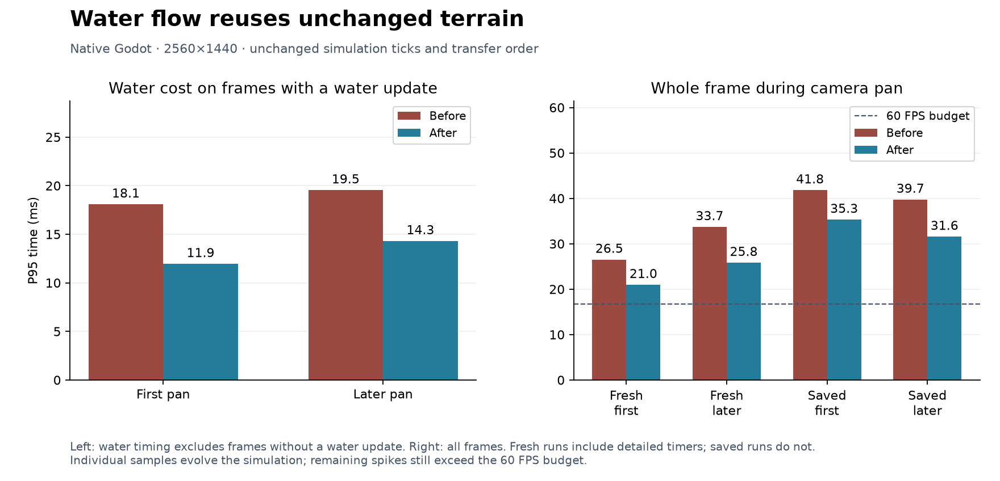

# 181 Water simulation performance

**Implemented 2026-10-14.** Water flow now reuses unchanged terrain geometry and
avoids redundant work when neighboring cells are already queued. The update
schedule, transfer order and water amounts retain their existing behavior.
This follows [179 — Water mesh rebuilds](179_water_mesh_rebuild_performance.md)
and [180 — Wildlife navigation](180_wildlife_navigation_performance.md).
Unrelated findings in [177](177_project_review_deferred_2026_10_14.md) remain parked.

## Measured improvement

Native Godot 4.7.2, D3D12 Forward+, Ryzen 7 9800X3D / RX 9070 XT,
2560×1440, VSync disabled, real-time delta, Dummy audio. Timing runs were
sequential, without concurrent tests or exports. The prior water mesh and
wildlife improvements are already present on both sides.

| Whole frame during camera pan | Before P95 ms | After P95 ms |
|---|---:|---:|
| Fresh world, first pan | 26.51 | 20.95 |
| Fresh world, later pan | 33.69 | 25.82 |
| Copied settlement, first pan | 41.79 | 35.31 |
| Copied settlement, later pan | 39.73 | 31.56 |

The saved settlement's first-pan mean falls from **16.50 to 14.48 ms**
(approximately 60.6 to 69.1 FPS); the later mean falls from 14.53 to 12.79 ms.
First-pan frames over 50 ms fall from 14/485 (2.9%) to 10/553 (1.8%).
The maximum does not improve: 76.73 → 78.30 ms. These measurements show a
reduction in routine CPU cost, with long stalls still present.

Water runs at 10 Hz, so most rendered frames have no water update. The following
table measures **only frames containing water work**, avoiding an all-frame P95
whose interpretation changes as rendering gets faster. Each sample contains
80 such frames. These are accumulated frame timings, potentially including
catch-up ticks, rather than a separate per-tick benchmark.

| Water update | Before mean ms | After mean ms | Before P95 ms | After P95 ms |
|---|---:|---:|---:|---:|
| Fresh first pan | 13.15 | 8.88 | 18.08 | 11.95 |
| Fresh later pan | 15.70 | 10.88 | 19.53 | 14.30 |

Average water-update cost falls by **31–32%**. Flow alone falls from
11.65 to 7.34 ms mean initially and from 13.66 to 8.84 ms later. Moisture and
change-processing costs remain similar. The final water-update maximum is
13.77 ms initially and 15.06 ms later, versus 19.25 and 20.53 ms before.

## Why flow was the target

New optional stage timers separate sources, flow, moisture, occupancy/dirty-tile
updates and notifications. Flow accounts for approximately **87–89% of total
water-update time** in the fresh baseline. Moisture and change processing are
smaller contributors; notifications and sources are very small in these samples.
The change therefore targets repeated solver work. Soil moisture behavior and
notification timing remain unchanged.

## Implementation

- [WaterFlow](../../scripts/components/WaterFlow.gd) caches valid space ceilings
  and the terrain geometry of flat reaches. Every equalization still checks live
  water amounts and stops at a dry gap. Cache entries never contain water levels.
- Terrain edits discard all reach geometry, including reaches rooted away from
  the edited column, and invalidate that column's ceilings. Restore discards
  derived caches; changing reach length invalidates reach geometry.
- Reach storage is capped at 8,192 entries. Ceiling storage follows valid spaces
  already represented by the solver's existing topology caches. These are entry
  limits, not measured byte totals.
- Transfers reuse level reads within each neighbor operation. Waking neighbors
  first checks whether they are already queued, avoiding volume reads and calls
  that could not add work. Queue insertion order stays identical.
- The 0.1-second tick, 384-cell budget, four-tick catch-up cap, integer water
  units, transfer rounding, sources, drains and offscreen simulation are unchanged.
  There are no new save fields or migration requirements.
- [WaterManager](../../scripts/systems/WaterManager.gd) exposes optional stage
  timings, disabled in normal play. The benchmark records production source
  fingerprints alongside the measurements.

## Correctness verification

All 13 regression fixtures pass: WaterFlowCacheTest, WaterFlowTest,
WaterSurfaceMotionTest, WaterSurfaceMeshTest, WaterMeshSchedulingTest,
WaterAudioTest, WaterStoneLifecycleTest, MoistureRenderingTest,
AnimalNavigationCacheTest, DuckWildlifeTest, WaterWorldTest,
WaterStabilityTest and SaveManagerRoundTripTest.

The new [cache fixture](../../scripts/tests/WaterFlowCacheTest.gd) covers dry
gaps becoming wet, remote dam edits, displacement conservation, altered ceilings,
new space identities, reach-length changes, restoration and bounded reach storage.
Existing fixtures cover flooding, breaching, occupancy, pause/speed, moisture,
water stones, wildlife navigation and full-save backup recovery.

Two additional comparisons run the original and final solvers against the same
operations. A 900-tick synthetic case matches complete serialized flow state,
changed cells and surface flux on every tick, including terrain edits, sources,
withdrawal and JSON restoration. Its solver work takes **1,420.55 → 856.94 ms**,
about **40% less CPU time**. This is a controlled workload, not a frame-rate result.
A full generated-world comparison matches mass and surface flux for 500 ticks
and all 21 complete manager snapshots, including moisture, a dam, withdrawal
and reload. Both comparisons report zero failures.

WaterStabilityTest also runs four seeds for 3,000 ticks each: **12,000 ticks**
with zero unintended floods, off-channel depths or spill. MoistureRenderingTest
passes 314 checks. The original player save is untouched; native settlement
checks use an isolated profile and a copy of the same starting save as 179/180.

Native WaterPresentationTest passes after 6,000 manual water steps with its test
dam. Captures of the [spring](concepts/water_sim_20261014/spring.png),
[lake](concepts/water_sim_20261014/lake.png),
[falls](concepts/water_sim_20261014/falls.png),
[dam pool](concepts/water_sim_20261014/flood.png),
[moisture overlay](concepts/water_sim_20261014/moisture.png) and
[controls](concepts/water_sim_20261014/controls.png) were reviewed.

The exported PCK loads the copied five-dwarf settlement, simulates eight seconds
and passes exact integer water conservation. Pause and slice 35/reveal preserve
the complete water snapshot, with all mesh jobs drained. The package contains
the active topology cache (6,882 reaches, 20,964 ceiling entries in this check).
The fixture uses the editor executable with `--main-pack` from the package
directory and rejects loose workspace files. Normal native release-EXE startup
and world generation also pass separately, with no script errors.

## Measurement boundaries and next target

Fresh before/after runs include detailed process/stage markers. Saved runs do
not, on either side. Fresh seed is 1234 with 81 animals and no dwarves; the saved
settlement starts with five dwarves, 79 animals and 20 furniture items at seed
2520450404. The saved baseline is the accepted `wildlife_cache_saved` run;
fresh runs use a new paired baseline with stage timers.

Each phase samples eight seconds and advances the same world. Faster rendering
changes callback counts and subsequent activity. These are individual samples,
not confidence intervals or evidence for larger colonies or long sessions.
Native timings use the editor executable as a standalone game, not an exported
release-EXE performance run. Validation of the release package is separate.

Steady 60 FPS still requires frames within 16.67 ms. The final fresh-world
renderer process bracket reaches **47.70 ms initially and 54.06 ms later**;
water presentation within that bracket peaks at 13.24/13.84 ms. Nested process
brackets must not be summed. The next step is to break down the remaining
renderer spike before changing scheduling or detail. These timings identify
an area to investigate, not the precise operation responsible for every stall.

## Build and evidence

Restart Play, or launch the refreshed
[Windows executable](../../build/windows/releases/20261014-173617-253-93eba001/Deepdraft/Deepdraft.exe).
The [playtest ZIP](../../build/windows/Deepdraft-Windows-Playtest.zip) is refreshed;
earlier release directories are preserved. ZIP SHA-256:
`9da046220d5887d31fe40e600ad7551244afee2ad53b529e9be07f0aa7a79aba`.

- [Comparison data](concepts/water_sim_20261014/comparison.json),
  [fresh baseline](concepts/water_sim_20261014/water_sim_before_fresh_report.json),
  [fresh result](concepts/water_sim_20261014/water_sim_final_fresh_report.json),
  [saved baseline](concepts/water_sim_20261014/wildlife_cache_saved_report.json),
  [saved result](concepts/water_sim_20261014/water_sim_final_saved_report.json),
  [vector chart](concepts/water_sim_20261014/water_simulation.svg).
- [Validation](concepts/water_sim_20261014/validation.json),
  [flow differential](concepts/water_sim_20261014/differential_flow.json),
  [world differential](concepts/water_sim_20261014/differential_world.json),
  [packed-save check](concepts/water_sim_20261014/packed_smoke.json),
  [release startup](concepts/water_sim_20261014/release_startup.json),
  [build record](concepts/water_sim_20261014/windows_build.txt).
- Reproduce native measurements using [Run.ps1](../../tools/performance/Run.ps1),
  [CameraBenchmark](../../tools/performance/CameraBenchmark.gd) and
  [CompareWaterSimulation.py](../../tools/performance/CompareWaterSimulation.py).
  Use `-NoMarkers` for the saved benchmark. The package fixture is
  [SmokeWaterSimulationExport](../../tools/performance/SmokeWaterSimulationExport.gd).
  Per-frame traces and logs remain in ignored `tmp/performance_20261014/` and
  `tmp/water_sim_20261014/`.
