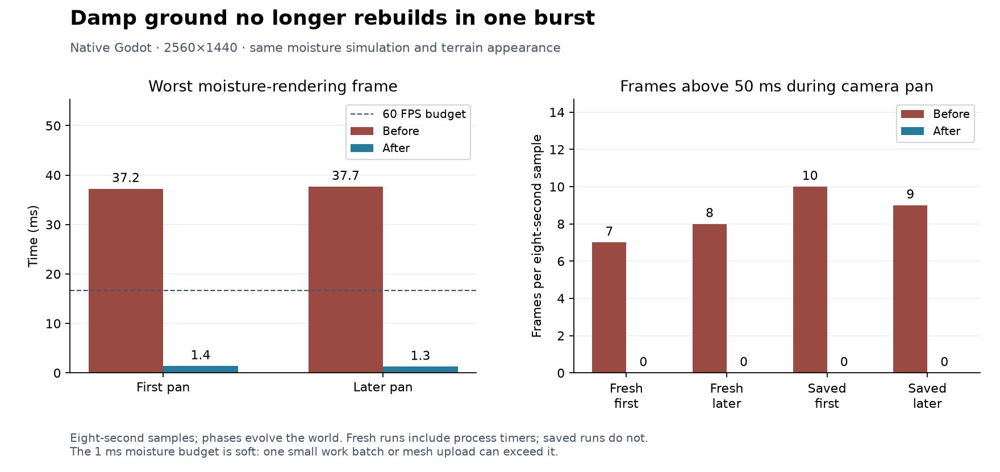

# 182 Moisture rendering performance

**Implemented 2026-10-14.** Damp ground now uses small tiles and a soft 1 ms
main-thread work budget. This replaces the whole-mesh rebuild that periodically
interrupted camera motion. Moisture simulation, water volume, terrain colors,
surface films and save formats retain their existing behavior.
This follows [181](181_water_simulation_performance.md); unrelated findings in
[177](177_project_review_deferred_2026_10_14.md) remain parked.

## Confirmed source of the periodic hitch

The previous renderer copied the tracked soil dictionary, scanned all stored
water for surface films, sampled every candidate ground cell and rebuilt one
mesh each simulated second. A new direct process timer confirms eight moisture
rendering stalls in each eight-second pan, reaching **37.23 ms initially and
37.66 ms later**. Each stall exceeds the entire 16.67 ms budget for a 60 FPS
frame. This work also ran with the developer moisture overlay closed.

## Implementation

[MoistureRenderer](../../scripts/components/MoistureRenderer.gd) maintains a
disposable spatial index of tracked soil and thin water films, divided into
16×16-column tiles. Initial indexing resumes across frames. After that, soil
contact changes and fractional water changes update the index incrementally;
there is no full water scan every second.

[SoilMoisture](../../scripts/components/SoilMoisture.gd) emits an optional signal
using its existing affected-cell set, and
[WaterManager](../../scripts/systems/WaterManager.gd) emits its already collected
changed water cells. The renderer coalesces these notifications. Neither signal
changes the simulation state, update schedule or saved data.

Tiles with changing analytic moisture refresh on the existing one-second
simulation cadence. Settled tiles need no periodic rebuild. Dirty tiles coalesce,
and identical geometry keeps its existing mesh. Camera-near tiles receive
priority; every eighth dispatch selects the oldest tile to ensure distant
progress. All moisture continues to simulate independently of visibility.

The renderer checks its time budget between batches of 16 cells. Large tiles
resume sampling in later frames; mesh uploads are per tile. The new
`rendering.moisture_budget_ms` setting is 1.0. This is a soft budget: a work batch,
upload or initial key snapshot can exceed it. Color changes can appear
progressively as tiles finish.

Slice/discovery invalidation immediately hides existing tiles and discards any
partial build before rebuilding against the current view. Terrain edits hide
and refresh their affected tile. Season and developer-overlay changes also
invalidate tiles while paused. Owner replacement and reload discard the index
and disconnect the previous moisture owner.

## Native measurements

Native Godot 4.7.2, D3D12 Forward+, Ryzen 7 9800X3D / RX 9070 XT,
2560×1440, VSync disabled, real-time delta and Dummy audio. Native timing runs
ran alone, without concurrent tests or exports. Both sides already include
the earlier water mesh, wildlife navigation and water solver changes.

| Moisture rendering | Before worst frame ms | After worst frame ms |
|---|---:|---:|
| Fresh first pan | 37.23 | 1.38 |
| Fresh later pan | 37.66 | 1.25 |

Both fresh pans go from eight moisture updates above 33.3 ms to zero. Whole
frames above 50 ms fall from **7 → 0 initially and 8 → 0 later**. Whole-frame
maximum falls from 55.95 to 41.24 ms initially and from 56.95 to 32.83 ms later.

There is a scheduling tradeoff: measured moisture-renderer CPU work rises from
36.8 to 43.9 ms per wall-clock second initially, and from 36.6 to 46.1 ms later.
The captured view also has seven additional draw calls. Fresh whole-frame mean
changes from 6.61 to 7.14 ms initially and 7.89 to 8.05 ms later; P95 changes
from 16.25 to 18.15 ms and 19.21 to 19.50 ms. This pass removes the periodic
long stall, while the fresh samples do not show a general average-FPS gain.
P95 alone misses a hitch that affects fewer than one percent of frames.

The latest copied five-dwarf settlement samples, compared with the final
measurements from 181, show these long-frame counts and overall frame times:

| Saved camera pan | Mean before → after ms | P95 before → after ms | P99 before → after ms | Frames above 50 ms before → after |
|---|---:|---:|---:|---:|
| First | 14.48 → 9.49 | 35.31 → 24.50 | 63.18 → 34.94 | 10 → 0 |
| Later | 12.79 → 8.73 | 31.56 → 21.94 | 56.52 → 34.43 | 9 → 0 |

Saved whole-frame maximum falls from 78.30 to 40.49 ms initially and from
75.98 to 38.48 ms later. These frames still exceed the 16.67 ms budget for
steady 60 FPS; the once-per-second moisture stall is removed from these samples.

Each phase lasts eight seconds and evolves the world. Fresh before/after runs
include process timers; saved runs do not. The fresh seed is 1234 with 81 animals
and no dwarves. Saved runs start from the same seed-2520450404 snapshot with
five dwarves, 79 animals and 20 furniture items. The saved baseline is the final
water-solver run from 181; fresh runs use a new paired baseline with the direct
moisture timer. Faster rendering changes callback counts and later activity.
These are individual samples, not confidence intervals or a long-session
guarantee. Native timing uses the editor executable running the game; package
correctness and native release startup are checked separately.

## Verification

Nine regression fixtures pass: MoistureRenderingTest, MoistureSchedulingTest,
WaterFlowTest, WaterSurfaceMotionTest, WaterSurfaceMeshTest,
WaterMeshSchedulingTest, AnimalNavigationCacheTest, WaterWorldTest and
SaveManagerRoundTripTest, including backup recovery.

The existing **314 appearance checks** pass with the tiled renderer, including
all four seasons, dirt/grass colors, gradual darkening, the near-dry threshold,
debug colors, standing water, hidden caves and slice concealment.

A new [scheduling fixture](../../scripts/tests/MoistureSchedulingTest.gd) passes
17 checks. It renders 4,096 ground faces over 16 tiles with a deliberately small
budget, verifies that work yields and eventually drains, invalidates a partial
tile during slicing, and covers new irrigation, drying, debug coverage, film
creation/removal, terrain edits and owner replacement. Rendering leaves the
saved moisture history unchanged.

A generated seed-1234 world produces **12 exact geometry matches** against the
original renderer: vertices, normals and colors agree per ground face, despite
different mesh grouping. Cases include 600 water ticks, a dam, summer/winter,
slice 35/127, debug coverage and a concealment flag. The comparison also verifies
that complete water snapshots remain unchanged by drawing. The focused fixture
separately exercises actual hidden cave soil.

Native WaterPresentationTest passes after 6,000 water steps with its test dam.
The [dam pool](concepts/moisture_20261014/flood.png),
[moisture overlay](concepts/moisture_20261014/moisture.png) and
[controls](concepts/moisture_20261014/controls.png) captures were reviewed.
Spring, lake, waterfall, dam and moisture-overlay PNGs are byte-identical to
the previous water-solver build's captures.

The exported PCK restores the copied five-dwarf settlement and runs eight active
seconds with exact integer water conservation. Pause preserves the complete
water snapshot; slice 35 conceals all moisture vertices above its plane, and
reveal preserves simulation state. All water jobs and moisture tile/index work
drain. This uses the editor executable with `--main-pack`, rejecting loose
workspace files. Normal release-EXE startup and world generation also pass.

## Build and evidence

Restart Play, or launch the refreshed
[Windows executable](../../build/windows/releases/20261014-182820-266-5daa15b7/Deepdraft/Deepdraft.exe).
The [playtest ZIP](../../build/windows/Deepdraft-Windows-Playtest.zip) is refreshed;
earlier release directories are preserved. ZIP SHA-256:
`dd2966e004ec71e5c7e9e541a7be1346c2c9611cb0cf015a4ae5bfdc78f9e89d`.

- [Comparison](concepts/moisture_20261014/comparison.json),
  [fresh baseline](concepts/moisture_20261014/moisture_before_fresh_report.json),
  [fresh result](concepts/moisture_20261014/moisture_final_fresh_report.json),
  [saved baseline](concepts/moisture_20261014/water_sim_final_saved_report.json),
  [saved result](concepts/moisture_20261014/moisture_final_saved_report.json),
  [vector chart](concepts/moisture_20261014/moisture_performance.svg).
- [Validation](concepts/moisture_20261014/validation.json),
  [exact geometry comparison](concepts/moisture_20261014/geometry.json),
  [packed-save check](concepts/moisture_20261014/packed_smoke.json),
  [release startup](concepts/moisture_20261014/release_startup.json),
  [build record](concepts/moisture_20261014/windows_build.txt).
- Reproduce using [Run.ps1](../../tools/performance/Run.ps1),
  [CameraBenchmark](../../tools/performance/CameraBenchmark.gd),
  [CompareMoisture.py](../../tools/performance/CompareMoisture.py) and
  [SmokeMoistureExport](../../tools/performance/SmokeMoistureExport.gd).
  Use `-NoMarkers` for saved measurements. Per-frame traces and logs remain
  under ignored `tmp/performance_20261014/` and `tmp/moisture_20261014/`.
