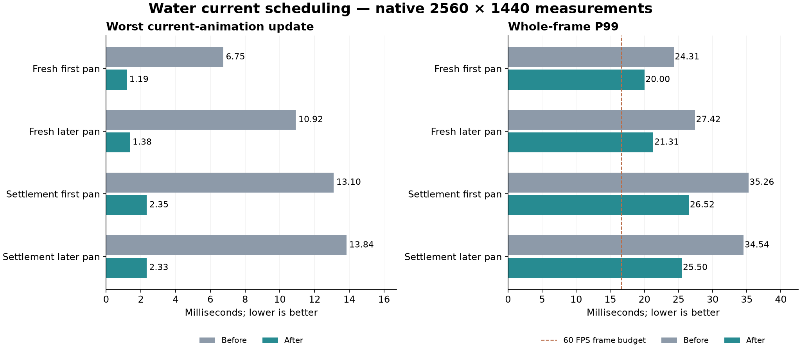

# 183 Water current animation performance

**Implemented 2026-10-14.** Water-current animation now samples compact inputs
and processes them across frames within a soft 1 ms budget. This follows
[182](182_moisture_rendering_performance.md). Water simulation, water geometry,
shader detail, offscreen activity and save formats are unchanged. Unrelated
review findings in [177](177_project_review_deferred_2026_10_14.md) remain parked.

## Measured cause

Optional timers in [WaterRenderer](../../scripts/components/WaterRenderer.gd)
separate current animation, view invalidation, mesh preparation/uploads, motion
texture upload and splashes. They are disabled during normal play.

The paired baseline confirms that current animation is the largest remaining
water-presentation spike: 6.75–10.92 ms in the fresh-world pans and 13.10–13.84 ms
in the copied settlement. Texture uploads and splashes are much smaller. Mesh
preparation is still a separate source of several milliseconds of frame work.

## Implementation and timing tradeoff

[WaterSurfaceMotion](../../scripts/components/WaterSurfaceMotion.gd) takes
ownership of the accumulated, disposable flux telemetry. The solver immediately
continues recording into a fresh dictionary. A packed array snapshots only the
volumes needed by flowing or still-decaying currents; it does not duplicate the
whole water table. Later simulation changes cannot alter those sampled volumes.

The same smoothing, drying threshold, speed mapping and texture pixels are
computed in batches of 16 entries. The renderer checks the remaining frame
budget between batches. Existing currents without new flux still decay, and a
key present in both input lists is processed exactly once. Sampling never
modifies water amounts, source rates, solver queues or persistent state.

The new `rendering.motion_budget_ms` setting in
[water.json](../../data/world_gen/water.json) is 1.0. Snapshot capture counts
against that budget but is atomic, so this is a soft limit. Worst measured
motion work is 1.19–1.38 ms in the fresh world and 2.33–2.35 ms in the settlement.
Texture uploads retain their existing format and API; there are more small
updates while a sample drains.

Shader animation continues each frame. Changes in current velocity appear
progressively as batches finish. The longest completed sample in the measured
pans takes 54.6/74.7 ms in the fresh world and 132.9/117.0 ms in the settlement.
Only one sample is processed at a time; later flux accumulates for the next
sample with its actual elapsed simulation time. The existing minimum 0.2-second
sampling interval remains. Pause lets already captured work finish, then freezes
the result. Reload, time reset and owner replacement discard pending work and
clear the current field while preserving mesh slot identities.

## Native results

Native Godot 4.7.2, D3D12 Forward+, Ryzen 7 9800X3D / Radeon RX 9070 XT,
2560×1440, VSync disabled, uncapped real-time delta and Dummy audio. The four
accepted runs ran sequentially without concurrent tests or exports. Both sides
include the earlier mesh, wildlife, solver and damp-ground improvements, and
both fresh and saved runs enable the same direct stage timers.

| Camera pan | Worst current update before → after ms | Worst water-renderer update before → after ms |
|---|---:|---:|
| Fresh first | 6.75 → 1.19 | 10.17 → 5.19 |
| Fresh later | 10.92 → 1.38 | 13.74 → 5.53 |
| Settlement first | 13.10 → 2.35 | 16.74 → 6.54 |
| Settlement later | 13.84 → 2.33 | 17.86 → 6.65 |

| Camera pan | Mean before → after ms | P95 before → after ms | P99 before → after ms |
|---|---:|---:|---:|
| Fresh first | 6.69 → 6.95 | 16.71 → 16.70 | 24.31 → 20.00 |
| Fresh later | 8.16 → 8.21 | 19.74 → 18.87 | 27.42 → 21.31 |
| Settlement first | 9.78 → 9.73 | 24.99 → 22.54 | 35.26 → 26.52 |
| Settlement later | 9.10 → 8.92 | 21.88 → 21.12 | 34.54 → 25.50 |

Settlement frames above 33.3 ms fall from **15 to 1** initially and **15 to 0**
later. Whole-frame maximum changes from 40.48 to 37.43 ms and 37.50 to 28.99 ms.
Fresh maxima change from 28.00 to 25.95 ms and 33.38 to 27.64 ms.

The demonstrated benefit is shorter stalls. Fresh mean frame time is about
4% slower initially and 0.6% slower later; settlement means improve by about
0.5% and 1.9%. This is not a general average-FPS increase or steady 60 FPS.
Measured current-processing CPU per wall-clock second decreases from
22.0/26.8 to 19.5/23.4 ms in the fresh pans and 43.4/43.5 to 37.0/37.5 ms in the
settlement. Texture-upload CPU rises from roughly 0.5 to 1.4–1.5 ms per second.

Each phase samples eight seconds of an evolving world. The fresh seed is 1234
with 81 animals and no dwarves. The saved seed is 2520450404 with five dwarves,
79 animals and 20 furniture items, loaded from the same isolated snapshot on
both sides. Different frame counts change later activity; these are individual
samples, not confidence intervals or long-session guarantees. Native timing
uses the editor executable running the game; exported-package correctness is
checked separately. Direct stage totals exclude descendants, unlike the older
scene-tree process brackets; nested timing groups must not be summed.

## Verification

Nine regression fixtures pass on the final production code: WaterMotionSchedulingTest,
WaterSurfaceMotionTest, WaterFlowTest, WaterSurfaceMeshTest,
WaterMeshSchedulingTest, WaterAudioTest, MoistureSchedulingTest, WaterWorldTest
and SaveManagerRoundTripTest, including backup recovery.

The expanded [scheduling fixture](../../scripts/tests/WaterMotionSchedulingTest.gd)
passes **103 checks**. It uses 8,192 sampled spaces and compares completed
samples with the original equations, including texture pixels. It checks tiny
budgets yielding and draining, live mass edits after capture, new transfers
arriving during a sample, decay, drainage, stacked pools, newly assigned slots,
pause, reset and texture growth while work is pending. The existing current
fixture also checks all four river directions, bends, quiet pools and solver
equivalence with motion telemetry enabled versus disabled.

Native WaterPresentationTest passes after 6,000 manual simulation steps and a
real test dam. All six captures were inspected. Spring, lake and waterfall
captures are byte-identical to 182; flood/moisture/control views remain visually
consistent but are not byte-identical. Current sampling now completes across
frames during the fixture's accelerated stepping, and controls contain timing
text. [Visual comparison](concepts/water_motion_20261014/visual_comparison.json)
records the exact hashes.

The exported PCK loads the copied five-dwarf settlement, runs eight seconds of
live simulation, conserves integer water volume exactly, freezes simulation and
the settled current texture while paused, preserves slice concealment and drains
all presentation work. A normal native release EXE startup also passes.
[Packaged results](concepts/water_motion_20261014/packed_smoke.json) and
[release startup](concepts/water_motion_20261014/release_startup.json) are retained.
The source save remains unchanged.

## Playtest build

Restart Play in Godot or launch
[the refreshed Windows EXE](../../build/windows/releases/20261014-190355-243-565699be/Deepdraft/Deepdraft.exe).
The [Windows playtest ZIP](../../build/windows/Deepdraft-Windows-Playtest.zip)
is refreshed; prior release folders are preserved.

ZIP SHA256: `b387413f8a271448b017288a5fbefadfe3ec8e04b9107badb12fbf595b36112c`.
No project reload, new world or save migration is required.

## Evidence and reproduction

- [Comparison data](concepts/water_motion_20261014/comparison.json)
- [Validation notes and final source hashes](concepts/water_motion_20261014/validation_notes.json),
  [native validation](concepts/water_motion_20261014/native_validation.json) and
  [build record](concepts/water_motion_20261014/build.json)
- [Regression results](concepts/water_motion_20261014/test_results.json) and
  [expanded sample checks](concepts/water_motion_20261014/sample_checks.json)
- [Fresh baseline](concepts/water_motion_20261014/before_fresh_report.json) and
  [final run](concepts/water_motion_20261014/after_fresh_report.json)
- [Settlement baseline](concepts/water_motion_20261014/before_saved_report.json) and
  [final run](concepts/water_motion_20261014/after_saved_report.json)

The evidence directory also retains run arguments, source hashes and compact
per-frame pan traces. Full scratch traces remain under
`tmp/performance_20261014/motion_baseline_{fresh,saved}` and
`tmp/performance_20261014/motion_compact_{fresh,saved}`.
Exploratory runs are excluded: the earlier whole-table snapshot candidate still
spiked during capture and was replaced by the compact snapshot implementation.

Use [Run.ps1](../../tools/performance/Run.ps1) with a new label for each run and
`-SavePath` for a copied settlement. It isolates player storage and checks that
the source save is unchanged. [CompareWaterMotion.py](../../tools/performance/CompareWaterMotion.py)
accepts `--before-fresh`, `--after-fresh`, `--before-saved`, `--after-saved` and
`--output` to reproduce the comparison from the run directories.
