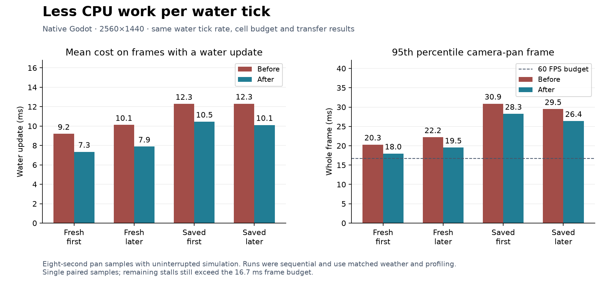

# 184 Water flow loop performance

**Implemented and verified 2026-10-14.**
This follows [183](183_water_current_performance.md). The selected change reduces
repeated work inside the water solver. In the final matched camera measurements,
water updates average 15–22% less CPU time and whole-frame P95 improves by 8–12%.
Occasional larger stalls remain. Unrelated findings in
[177](177_project_review_deferred_2026_10_14.md) stay parked.

## What changed

[WaterFlow](../../scripts/components/WaterFlow.gd) now:

- Keeps the receiving ceiling in each cached terrain connection. Existing
  terrain-edit invalidation refreshes both sides of that connection; restore
  clears it. This adds one integer per cached connection.
- Reads a receiving water level once when finding free outlets. During local
  exchanges it reuses the source quantity and each receiver's quantity, updating
  the source after every transfer in the original order.
- Iterates cached reach geometry directly and counts its currently wet prefix,
  avoiding a temporary key array for every leveling operation. Live water
  quantities, dry boundaries, integer remainder distribution and current flux
  stay authoritative.

The 0.1-second tick, 384-cell budget, catch-up cap, source/drain rates, transfer
rounding, offscreen simulation and save format are unchanged. No new gameplay
setting or migration is required. The selected version adds no per-tick
notification cache.

## Profiling and candidate selection

An isolated 400-tick generated-world diagnostic records 879,902 mass-setting
calls, 153,600 outlet scans and 78,088 leveling calls. This identified repeated
lookups, neighbor work and temporary lists as useful targets. The
[inner profile](concepts/water_loop_20261014/inner_profile.json) includes nested
timers and instrumentation overhead; its inclusive timings must not be summed
or treated as normal frame timings.

An additional notification-cache candidate offered only a small extra controlled
gain. Its initial native runs were mixed, including slower whole-frame results.
A reverse-order repeat also found large variation in the original solver's later
pan. The selected version keeps the simpler lookup and allocation reductions.
The [exploratory comparison](concepts/water_loop_20261014/exploratory_comparison.json)
and [reverse-order repeat](concepts/water_loop_20261014/exploratory_repeat.json)
are retained, including the regressions; they are not the final result table.

The benchmark now accepts an explicit weather setting and records weather in
each phase. It also supports `-NoAblations`, which keeps simulation and rendering
running through both active pans. Diagnostic freeze/unfreeze phases remain
available separately. The final four runs all use this uninterrupted mode;
their later pan is at a different simulation age from earlier reports.

## Final native measurements

Each entry is before → after, in milliseconds. Water means include only frames
that execute a water update; whole-frame statistics include every sampled frame.

| Scenario | Water update mean | Flow calculation mean | Whole-frame mean | P95 | P99 | Maximum |
|---|---:|---:|---:|---:|---:|---:|
| Fresh, first pan | 9.20 → 7.35 | 7.59 → 5.71 | 9.02 → 8.23 | 20.31 → 17.98 | 25.25 → 23.86 | 41.70 → 28.00 |
| Fresh, next pan | 10.12 → 7.89 | 8.20 → 5.99 | 10.43 → 9.20 | 22.20 → 19.53 | 28.29 → 24.12 | 35.23 → 47.83 |
| Saved, first pan | 12.29 → 10.45 | 10.08 → 8.10 | 14.43 → 13.47 | 30.89 → 28.26 | 36.88 → 34.87 | 46.61 → 63.09 |
| Saved, next pan | 12.31 → 10.12 | 10.09 → 7.93 | 14.30 → 13.05 | 29.48 → 26.40 | 35.51 → 34.18 | 41.00 → 37.61 |

The saved run's 63.09 ms maximum contains a **36.91 ms RoomManager rebuild**.
The fresh run's 47.83 ms outlier has only 14.63 ms inside the scene probe and
6.04 ms of water work; the recorded stages do not explain its entire wall time.
These results support cheaper recurring water updates, not elimination of every
stall or sustained 60 FPS. Room rebuilding remains a separate opportunity.

Runs use Godot 4.7.2, DirectX 12 Forward+, Ryzen 7 9800X3D / Radeon RX 9070 XT,
2560×1440, VSync disabled, uncapped real-time frames and Dummy audio. Fresh seed
1234 has 81 animals and no dwarves; the copied settlement has five dwarves,
79 animals and 20 furniture items. Fresh runs explicitly use rain; the saved
world restores clear weather. Camera, actor counts and all recorded production
source hashes match except WaterFlow.

Each pan samples eight seconds. Worlds evolve between phases, and callback
counts and AI activity can differ with frame rate. These are single matched
samples, not confidence intervals or a large-colony/long-session claim. Absolute
timings varied substantially across exploratory runs; the final pair should be
read together rather than compared directly with a prior report's absolute FPS.
Native performance runs were sequential, without simultaneous tests or builds.
They use the editor executable as a standalone game. Export validation is separate.

## Correctness and package verification

All 16 final-source fixtures pass: WaterFlowCacheTest, WaterFlowTest,
WaterSurfaceMotionTest, WaterMotionSchedulingTest, WaterSurfaceMeshTest,
WaterMeshSchedulingTest, WaterAudioTest, WaterStoneLifecycleTest,
MoistureSchedulingTest, MoistureRenderingTest, AnimalNavigationCacheTest,
DuckWildlifeTest, WaterWorldTest, WaterStabilityTest, SpringCaveTest and
SaveManagerRoundTripTest. Stability covers four seeds and 12,000 ticks; cave
checks cover nine seeds. Current scheduling passes 103 checks and moisture
rendering passes 314 checks. Full-save restoration and backup recovery pass.

The differential diagnostic matches **3,200 ticks** against the frozen prior
solver: three 900-tick synthetic cases and a 500-tick generated world. It checks
mass, modified cells, queue order/membership, displacement, accounting, changed
cells and current flux every tick, plus 21 complete world snapshots. Cases vary
tick sizes, cell budgets, conductance, epsilon and telemetry, and exercise sources,
withdrawal, dams, changed ceilings, reach settings and JSON restoration.

With identical inputs and alternating execution order, the synthetic cases use
29–30% less solver CPU time. Complete generated-world water updates take
4,432.41 → 3,491.77 ms across 500 ticks, **21% less CPU time**. These controlled
measurements support the solver improvement independently of frame-rate variation.

SpringCaveTest initially used a detached mining controller, causing a null-tree
error in its construction lookup. Its setup now attaches the controller to the
scene tree, as the production controller requires. The initial diagnostic is
retained; all nine seeds pass on the selected source after the fixture repair.

Native WaterPresentationTest passes after 6,000 manual water steps and its test
dam. The spring, lake, falls, dam pool, moisture overlay and controls captures
were visually reviewed. Water surfaces and concealment remain consistent.

The exported PCK loads the copied five-dwarf settlement and runs eight seconds
of active simulation with exact integer conservation. Cached receiving ceilings
match current topology. Pause and slice/reveal preserve the complete water
snapshot; mesh, moisture and current-animation queues drain. The packaged check
rejects loose workspace files. Normal release-EXE startup and full terrain
generation also pass. The source save is unchanged.

## Windows build

Restart Play, or launch the refreshed
[Windows executable](../../build/windows/releases/20261014-201613-015-f03ec728/Deepdraft/Deepdraft.exe).
The [playtest ZIP](../../build/windows/Deepdraft-Windows-Playtest.zip) is refreshed;
earlier release folders remain intact. ZIP SHA-256:
`87cbb97ce6022d8829ad994c2a5d761860c2f458b1035a58524ddf7392b431b9`.

## Reproduction and evidence

Use [Run.ps1](../../tools/performance/Run.ps1) with a fresh label, `-NoAblations`,
and `-Weather base:weather:rain` for the fresh world. Add `-SavePath` for an
isolated copy of a settlement. The four accepted labels are `loop_control_fresh`,
`loop_control_saved`, `loop_optimized_fresh`, and `loop_optimized_saved`.

- [Comparison data](concepts/water_loop_20261014/comparison.json),
  [vector chart](concepts/water_loop_20261014/water_flow_loop.svg).
- [Fresh baseline](concepts/water_loop_20261014/loop_control_fresh_report.json),
  [fresh result](concepts/water_loop_20261014/loop_optimized_fresh_report.json),
  [saved baseline](concepts/water_loop_20261014/loop_control_saved_report.json),
  [saved result](concepts/water_loop_20261014/loop_optimized_saved_report.json).
- [CompareWaterFlow.py](../../tools/performance/CompareWaterFlow.py) preserves
  reports and compact pan traces. Full raw traces remain in ignored
  `tmp/performance_20261014/`.
- [RunWaterFlowDifferential.ps1](../../tools/performance/RunWaterFlowDifferential.ps1)
  runs [WaterFlowDifferential](../../tools/performance/WaterFlowDifferential.gd)
  against the [frozen prior solver](concepts/water_loop_20261014/WaterFlowBefore.gd.txt).
- [Validation and hashes](concepts/water_loop_20261014/validation.json),
  [16 fixture results](concepts/water_loop_20261014/tests.json),
  [differential results](concepts/water_loop_20261014/differential.json),
  [initial cave-fixture diagnostic](concepts/water_loop_20261014/initial_cave_fixture_error.log).
- [Native validation](concepts/water_loop_20261014/native_validation.json),
  [spring](concepts/water_loop_20261014/spring.png),
  [lake](concepts/water_loop_20261014/lake.png),
  [falls](concepts/water_loop_20261014/falls.png),
  [dam pool](concepts/water_loop_20261014/flood.png),
  [moisture](concepts/water_loop_20261014/moisture.png),
  [controls](concepts/water_loop_20261014/controls.png).
- [Packaged-save check](concepts/water_loop_20261014/packed_smoke.json),
  [release startup](concepts/water_loop_20261014/release_startup.json),
  [build record](concepts/water_loop_20261014/windows_build.txt),
  [package fixture](../../tools/performance/SmokeWaterFlowExport.gd).
