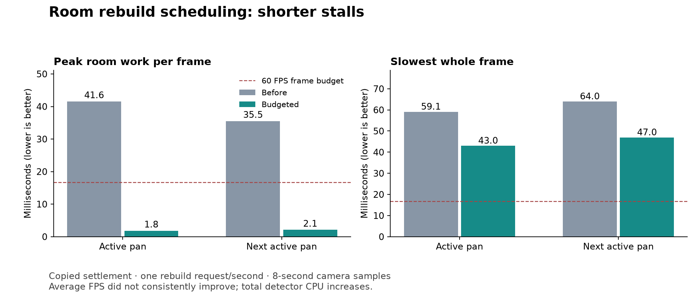

# 185 — Room rebuild performance

Implemented 2026-10-14. Room detection now yields across frames instead of
blocking a frame for a full flood fill. In the copied settlement's repeated-rebuild
camera test, peak RoomManager work falls from **35–42 ms to 1.8–2.1 ms**.
Whole-frame maxima fall from **59/64 ms to 43/47 ms** in the two active pans.
Average FPS does not consistently improve. This change trades additional total
CPU and delayed room-cache publication for shorter individual stalls.

The unrelated review findings in [177](177_project_review_deferred_2026_10_14.md)
remain parked. Water simulation, wildlife, rendering quality and saves are unchanged.

## Implementation and behavior

- `RoomManager` retains its existing 0.5-second edit-coalescing delay, then
  advances `RoomRebuild` under a **soft 1.5 ms frame budget**, checked every
  16 operations. Settings live in `data/rooms/detection.json`, loaded by the manager.
- Door boundaries, seeds, flood expansion, leaked-cell bookkeeping, cell indexing,
  floor coverage, exposure and furniture classification all have resumable stages.
  No worker thread reads mutable world data.
- The last complete room/cell maps stay available during work. Both replacement
  maps are installed before any room update/removal signal. Temperature uses the
  current clock at publication. Bedroom ownership changes invalidate pending work.
- Terrain queries record their chunks. A change to an examined chunk cancels the
  job; the next frame restarts without another coalescing delay. Unexamined chunks
  are read live later, so distant streaming cannot continually restart a scan.
  Door/light/heat/bed changes also cancel pending work. World reload clears it.
- Physical door lighting boundaries still change immediately. Door animation,
  collision, navigation clearance, room-size limit and room formulas are unchanged.
  The private synchronous drain remains for fixtures/development tools only.

This is a soft budget: one operation, dictionary allocation/destruction, final
map publication and signal callbacks cannot be interrupted. Current tests cover
up to a 4,096-cell hall, not an arbitrarily large colony with hundreds of rooms.
Continuous edits in examined chunks can postpone publication until a scan completes.

## Measurements

Saved settlement: seed 2520450404, five dwarves, 79 animals and 20 furniture items;
clear weather, 2560×1440, Godot 4.7.2, DirectX 12 Forward+, Ryzen 7 9800X3D /
Radeon RX 9070 XT. Uncapped/VSync off, Dummy audio, eight seconds per phase.
No subsystem-freezing ablations. All performance runs executed sequentially,
without concurrent tests/builds. These use the editor executable as a standalone
game; exported-build functional validation is separate.

The repeatable stress scenario requests one room rebuild per second during camera
pans, without changing the room geometry. Each pan requests eight rebuilds;
requests can coalesce or invalidate unfinished scans. This exercises scheduling
under a defined workload, rather than implying natural mining rebuilds every second.

| Repeated-rebuild scenario | Peak room work, ms | Mean frame, ms | P95, ms | P99, ms | Max frame, ms | Frames >50 ms |
|---|---:|---:|---:|---:|---:|---:|
| Paused pan | 28.61 → 1.78 | 1.83 → 1.85 | 2.50 → 3.47 | 3.88 → 5.00 | 31.05 → 35.16 | 0 → 0 |
| Active pan | 41.56 → 1.84 | 13.68 → 13.70 | 28.87 → 28.15 | 44.63 → 37.26 | 59.14 → 43.04 | 4 → 0 |
| Next active pan | 35.53 → 2.08 | 13.06 → 15.56 | 27.23 → 30.75 | 36.37 → 37.56 | 64.00 → 46.98 | 5 → 0 |

The next active pan's mean/P95 regress despite the much smaller room spikes.
Water, renderer and wildlife costs also increase in that sample. Worlds continue
evolving and callback counts depend on frame rate; this single pair cannot assign
the whole difference to room scheduling. The additional detector CPU is real,
and is measured separately below. No claim of an overall FPS improvement is made.

An ordinary benchmark using only natural triggers provides a second check:

| Natural scenario | Peak room work, ms | Mean frame, ms | P95, ms | P99, ms | Max frame, ms |
|---|---:|---:|---:|---:|---:|
| Active pan | 27.18 → 1.68 | 12.58 → 13.19 | 26.71 → 27.31 | 33.73 → 34.15 | 38.79 → 40.24 |
| Next active pan | 0.002 → 0.002 | 12.85 → 12.99 | 25.74 → 26.24 | 34.81 → 32.60 | 39.62 → 40.33 |

The later natural pan has no material room rebuild work in either version. These
samples are consistent with a focused hitch reduction, not elimination of the
remaining camera stalls or sustained 60 FPS.

**Responsiveness and CPU tradeoff:** natural active rebuilds complete in about
0.28–0.49 seconds after the scan starts, in addition to the existing coalescing
delay. The repeated-request run observes roughly 0.21–0.63 seconds. Room metadata
uses the previous complete result during that interval; physical door lighting
updates do not wait for it.

A separate deterministic headless comparison alternates old/new order over 12
trials per geometry, with the same clock and terrain. Every resulting room field
matches the frozen original detector. Times below are total CPU per rebuild,
not whole-frame times:

| Geometry | Original CPU, ms | Budgeted CPU, ms | Largest budgeted slice, ms |
|---|---:|---:|---:|
| One furnished room | 11.09 | 15.91 | 1.59 |
| Two rooms with shared door | 12.40 | 17.62 | 1.57 |
| Plus 4,096-cell hall | 43.20 | 58.20 | 1.82 |

The state machine and invalidation tracking cost **35–43% more detector CPU** in
these fixtures. An experimental per-job block cache did not solve that tradeoff:
small cases became slightly slower and the large case improved only about 3%.
It was removed. Both [selected CPU results](concepts/room_rebuild_20261014/cpu_uncached.json)
and [rejected-cache results](concepts/room_rebuild_20261014/cpu_cached.json) are retained.

## Correctness and release validation

- **15 exact scheduling scenarios** compare every room field and cell count with
  the frozen original detector: wall/roof breaches and repairs, shared doors,
  ownership, light removal, floors, furniture restore, clock changes, world clear,
  and the inclusive 4,096-cell limit. Pending maps stay unchanged; signal observers
  see complete matching maps. Distant streaming preserves progress; edits to
  examined chunks cancel it. The fixture forces many short slices to exercise yields.
- **12 distinct fixtures pass:** RoomRebuildSchedulingTest, BedroomTest,
  BedroomComfortTest, BedOwnershipTest, BedroomPrivacyTest, ConstructionTest,
  WallMountHeightTest, SaveManagerRoundTripTest, LogFurnitureTest,
  FloorConstructionTest, RoomLightingTest and DoorLightingTest. The save test
  includes real scene reload and backup recovery. Door tests cover all three widths.
- **36 additional controlled rebuild comparisons** pass across the three CPU
  benchmark geometries. The experimental cache's comparisons are separate.
- Native RoomLightingTest now waits for the production scheduler instead of
  forcing a synchronous rebuild. Darkness, corridor/room lights, door changes,
  slice controls and room inspector checks pass. [Unlit room](concepts/room_rebuild_20261014/closed_unlit.png),
  [lit room](concepts/room_rebuild_20261014/lit_room.png) and
  [compact inspector](concepts/room_rebuild_20261014/panels_960.png) were visually inspected.
- The exported PCK loads a copied settlement with **five dwarves and four rooms**.
  Four comparisons against the original detector pass: initial load, door removal
  during a scan, door replacement and active colony simulation. Paused room edits
  preserve full water state. Pending room work drains and the original save copy's
  SHA256 remains unchanged. A separate release-EXE launch generates the world cleanly.

The initial DoorLightingTest runner was rejected by its isolated-profile guard;
it was rerun successfully with the correct profile and native renderer. Its failed
invocation is retained in the floor/door runner record and is not counted as a pass.
Room fixture setup was corrected before final validation to initialize the mock
waterline and remove both light-emitting pieces in the light-removal case.

## Build and reproducibility

- Play: `build/windows/releases/20261014-203748-560-f9544a2f/Deepdraft/Deepdraft.exe`
- Share: `build/windows/Deepdraft-Windows-Playtest.zip` (76.9 MiB)
- ZIP SHA256: `bee905b85e859ac65af82d4210b4085c48e2b7274bd2da5c3353b0502e489f30`
- Restart Play or launch this release. No new autoload/global script class or save
  migration is required. Earlier release directories are preserved.

Source hashes, package identity and save hash are in
[validation.json](concepts/room_rebuild_20261014/validation.json).
Compiled export scripts are remapped, so FileAccess cannot supply their original
`.gd` hashes in the packed check; those empty fields mean unavailable, not verified.
The build record, source hashes and ZIP hash identify the exported artifact.

Use `tools/performance/Run.ps1 -SavePath <copied-save> -NoAblations` with a fresh
label for natural samples; add `-RoomRebuilds` for the scheduled scenario.
`RoomRebuildBenchmark.gd` accepts `--output=<json>` and runs the isolated CPU
comparison. Run it separately from native timings. `CompareRoomRebuild.py`
preserves summaries and compact traces. Run fixtures with isolated APPDATA and
LOCALAPPDATA; native lighting fixtures require their documented profile names.

Evidence: [comparison](concepts/room_rebuild_20261014/comparison.json),
[scheduler checks](concepts/room_rebuild_20261014/scheduling.json),
[core fixtures](concepts/room_rebuild_20261014/regressions_final.json),
[door fixtures](concepts/room_rebuild_20261014/door_regressions.json),
[floor runner](concepts/room_rebuild_20261014/floor_door_checks.json),
[room lighting](concepts/room_rebuild_20261014/room_lighting_checks.json),
[door lighting](concepts/room_rebuild_20261014/door_lighting_checks.json),
[packaged check](concepts/room_rebuild_20261014/packed_smoke.json),
[release startup](concepts/room_rebuild_20261014/release_startup.json),
[build](concepts/room_rebuild_20261014/windows_build.txt).
Full raw traces and logs remain under `tmp/performance_20261014/room_*` and
`tmp/room_rebuild_20261014/`. No commit or push was performed.
