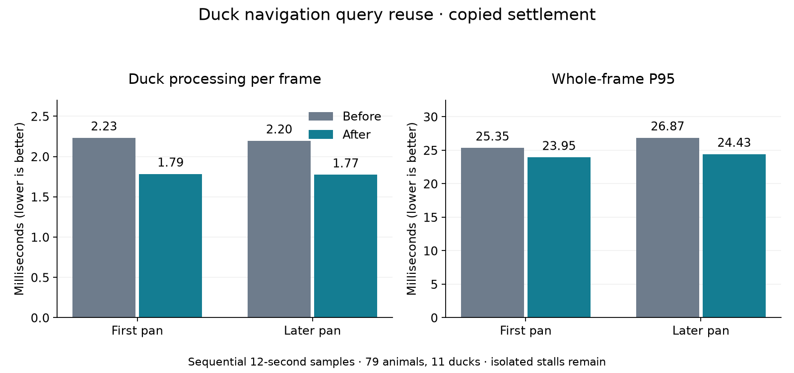

# 186 — Duck navigation query performance

Implemented 2026-10-14. Ducks reuse repeated water and body-clearance queries
within one wildlife update. In the copied settlement, average duck processing
falls **19–20%**, total wildlife processing falls **13%**, and active-pan mean
frame time falls **10–11%**. The deterministic comparison uses **31% less CPU**
and produces exactly the same saved wildlife state after all 1,200 updates.

This completes opportunity 1, duck/wildlife processing. Larger-colony scaling
and long-session/event hitches remain opportunities 2 and 3 for later work.
The unrelated findings in [177](177_project_review_deferred_2026_10_14.md) remain parked.

## What the profile showed

The initial hypothesis included flock scans and animation. A temporary detailed
profile of the original code instead identifies repeated surface/water checks
as the larger cost. During the first active pan, inclusive per-frame means are:

| Original stage | Mean, ms |
|---|---:|
| DuckAgent.advance | 2.525 |
| DuckNavigation.surface | 2.218 |
| DuckNavigation.calm_water | 2.000 |
| DuckNavigation.water_at | 1.546 |
| DuckNavigation.clear_body | 0.946 |
| DuckAgent._pose | 0.143 |
| WildlifeManager._update_flock_context | 0.136 |

These timers are nested and include instrumentation overhead: **do not add them
together or compare them directly with the uninstrumented figures below**.
Flight planning occasionally costs several milliseconds. Flock/pose algorithms
are unchanged; this pass targets the repeated navigation reads.

## Implementation and contract

- `WildlifeManager.advance` opens and closes a query scope around its existing
  synchronous animal loop. Actor order, flock context, decisions, random draws,
  flight routes, movement speed and animation cadence are unchanged.
- `DuckNavigation` reuses water samples, safe/unsafe surfaces in separate maps,
  receiving levels and body-clearance results for identical integer voxel bounds.
  Fractional water levels are never rounded to obtain reuse.
- All five maps share a **4,096-entry limit**. Reaching the limit discards the
  stored queries, then continues reading live data. Scope completion discards
  everything. No query survives into another update, pause or save/restore.
- Standalone queries, initial populations and arrival planning stay uncached.
  Full canopy sweeps remain live. There is no change to offscreen activity,
  visibility rules, population caps, water simulation or save format.
- The scope relies on the current synchronous loop only observing terrain,
  water and placed obstacles. No callback currently changes those within the
  loop. Future world mutation or yielding inside that loop must close/invalidate
  the scope first. Returned sample dictionaries are treated as read-only by callers.

## Measurements

Same copied settlement as earlier passes: seed 2520450404, five dwarves,
79 animals including 11 ducks, 20 furniture items; clear weather, 2560×1440,
Godot 4.7.2, DirectX 12 Forward+, Ryzen 7 9800X3D / Radeon RX 9070 XT.
Uncapped, VSync off, Dummy audio, **12 seconds per phase**, no subsystem-freezing
ablations. Native runs execute sequentially without tests/builds alongside them.
These measurements use the editor executable running the game standalone;
exported-build checks below are functional validation, not export FPS results.

| Native scenario | Mean duck, ms | Duck P99, ms | Mean wildlife, ms | Mean frame, ms | Frame P95, ms | Frame P99, ms | Max frame, ms |
|---|---:|---:|---:|---:|---:|---:|---:|
| Active static | 2.169 → 1.727 | 6.498 → 2.850 | 3.464 → 3.013 | 12.963 → 11.673 | 26.700 → 24.581 | 32.253 → 33.214 | 202.301 → 194.801 |
| Active pan | 2.234 → 1.785 | 6.253 → 3.116 | 3.501 → 3.044 | 12.522 → 11.322 | 25.353 → 23.947 | 32.130 → 29.692 | 37.383 → 37.080 |
| Later active pan | 2.196 → 1.775 | 5.472 → 2.646 | 3.499 → 3.045 | 13.280 → 11.863 | 26.870 → 24.428 | 33.108 → 30.705 | 39.042 → 37.534 |

Both active pans have zero frames over 50 ms before and after. P95 improves
6–9%; P99 improves about 7–8%. Paused pan mean is 1.694 → 1.735 ms, with wildlife
simulation inactive. These are one sequential before/after pair, with two pans
per version. Frame rate changes the number of callbacks and the world evolves,
so the entire frame-time improvement cannot be attributed solely to this change.

**Remaining stalls are retained:** the active-static phase still has a roughly
195 ms wall-clock outlier, with only 5.2 ms recorded scene work in that frame.
The original has a 202 ms outlier with 8.7 ms scene work. Their source is not
established here. Duck maximum cost in the later pan is 13.240 → 13.547 ms,
despite lower P99. This is a reduction in recurring work, not a hard flight-search
budget, elimination of all hitches, or a claim of sustained 60 FPS.

The isolated deterministic fixture alternates which version runs first, using
eight ducks and the same deltas/world changes. Across 1,200 calls, original
wildlife processing takes **1,799.847 ms** versus **1,248.686 ms** with query reuse
(30.6% lower). This includes scope cleanup and the existing actor loop. It is
a controlled fixture, not a whole-game frame rate or a large-colony benchmark.

## Correctness and release validation

- **1,200 exact state comparisons**, including flight routes, positions, needs,
  timers and RNG; 634 sampled duck states are airborne and 8,966 are on water.
  Cases include rising/falling water, a placed obstacle, an outlet, drainage,
  danger, speed, pause and a JSON save/restore halfway through.
- **882 direct navigation comparisons** against frozen original code cover safe
  and unsafe surfaces plus swept clearance. Additional checks exceed the shared
  capacity, observe terrain and occupancy edits on the next update, observe
  standalone fractional water changes, and prove no cached entry outlives its scope.
- **11 distinct fixtures pass:** DuckQueryReuseTest, AnimalNavigationCacheTest,
  RabbitWildlifeTest, DeerWildlifeTest, WolfWildlifeTest, DuckWildlifeTest,
  DeerPopulationTest, DuckPopulationTest, ArrivalEventTest, HerdArrivalTest and
  SaveManagerRoundTripTest. Existing duck checks cover shore rest, new terrain
  blocking a planned flight, loaded canopy clearance, drainage escape, picking,
  wakes, slicing and JSON future equivalence. Save testing includes scene reload
  and backup recovery. The comparison fixture's frozen-script type and mock-water
  notifications were corrected before the final clean run.
- The exported PCK loads the copied settlement with five dwarves and 79 animals.
  All 79 start outside the camera frustum; 72 change position over eight seconds,
  and every retained animal advances its pose clock. Pause freezes exact wildlife
  state; slicing hides and restores actors. Query reuse is active, peaks at 1,216
  entries and leaves zero entries after each update. The source save hash is unchanged.
- Native [duck](concepts/duck_performance_20261014/duck.png) and
  [wolf](concepts/duck_performance_20261014/wolf.png) captures were visually inspected.
  The wolf is partly beneath a canopy; this capture does not prove every collision
  boundary. The dedicated behavior fixtures exercise collision rules. A separate
  release-EXE startup generates the world without script/engine errors.

## Windows build

- Play: `build/windows/releases/20261014-205714-460-66bbc48d/Deepdraft/Deepdraft.exe`
- Share: `build/windows/Deepdraft-Windows-Playtest.zip` (76.9 MiB)
- ZIP SHA256: `829cdc3dd08206bc7a665be88bb3b3be394c640297958e4b9f4b7eeadcc1151d`
- Restart Play or launch this release. No autoload/global-class change or save
  migration is required. Earlier release directories remain available.

Source/package hashes and checks are in
[validation.json](concepts/duck_performance_20261014/validation.json).

## Reproduction and evidence

Use `tools/performance/Run.ps1 -Label <new-label> -SavePath <copied-save>
-NoAblations -Seconds 12`. `CompareDuckQueries.py` preserves phase summaries,
compact active traces and all outliers; `PlotDuckQueries.py` renders the chart.
Run `DuckQueryReuseTest.gd` separately from native timings, with isolated APPDATA
and LOCALAPPDATA. It loads frozen original navigation/manager source from the
evidence folder and compares against the production implementation.

The temporary detailed profiler has been removed from production. Its archived
source (`Profile.gd.txt`, `Instrument.py.txt`) and original scripts explain the
diagnostic measurement; the instrumentation helper targets the frozen baseline
and must only be replayed in a disposable checkout. It overwrites three scripts.

Evidence: [comparison](concepts/duck_performance_20261014/comparison.json),
[exact comparisons](concepts/duck_performance_20261014/query_reuse.json),
[diagnostic stages](concepts/duck_performance_20261014/profile_summary.json),
[diagnostic run](concepts/duck_performance_20261014/profile_report.json),
[regressions](concepts/duck_performance_20261014/regressions.json),
[differential runner](concepts/duck_performance_20261014/differential_runner.json),
[packaged check](concepts/duck_performance_20261014/packed_smoke.json),
[release startup](concepts/duck_performance_20261014/release_startup.json),
[build](concepts/duck_performance_20261014/windows_build.txt).
Full raw traces/logs remain under `tmp/performance_20261014/duck_*` and
`tmp/duck_performance_20261014/`. No commit or push was performed.
