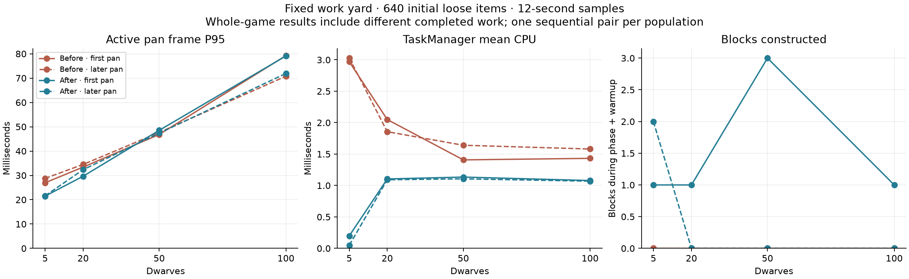

# 187 — Colony scaling and construction planning

**Follow-up:** [188 — Job scheduling performance](188_job_scheduling_performance.md)
measures 30 dwarves and fixes repeated hauling/building preparation. The
observations and build below remain the historical results of this pass.

**Subsequent design direction, 2026-10-14:** The intended maximum is
**30 dwarves**. Routine performance work should use 5/20/30 and prioritize
a mature, busy 30-dwarf settlement. The 50/100 measurements below remain
stress evidence rather than shipping requirements. Thirty dwarves have not
yet been measured here; the runner now accepts that case. No population
enforcement or additional gameplay change accompanies this clarification.
The 20-dwarf hauling issue remains within the intended scale and still needs
investigation. Long-session/event hitch work should stay within this range.

Performance work on opportunity 2, 2026-10-14. This pass measures 5, 20, 50 and
100 dwarves against the same mining, construction and hauling backlog, and
reduces repeated obstacle scans when construction selects a work position.
The unrelated review findings in [177](177_project_review_deferred_2026_10_14.md)
remain parked. Long-session/event hitches are opportunity 3.

## What changed

Previously, `ConstructionWork.work_stands` asked `build_reason` to enumerate
every dwarf and loose item for each candidate block. With hundreds of loose
items, this synchronous preparation can exceed the scheduler's 1 ms allowance
before its resumable route search expands a node. Repeating the preparation
on subsequent wakes can prevent construction from being assigned.

The work-position call now takes one local snapshot of dwarf bounds and loose
item cells. All candidate blocks share it. Actor bounds preserve the original
fractional intersection test; loose-item cell lookup includes reserved and
disallowed items exactly as before. The snapshot is discarded at the end of
the synchronous call. No obstacle state survives a frame or route-search yield.

Terrain, discovery, water, furniture, stockpile designations, placed occupancy
and support still read live state. Final construction commitment still uses the
original live checks. Scheduling priorities, the 1 ms budget, route rules,
three-block dwarf clearance, work speed, offscreen simulation and saves are
unchanged. An existing typed-array ternary in the carrying branch was expanded
to explicit assignment because Godot 4.7 rejected its untyped array literal.

## Benchmark design and boundaries

The new `tools/performance/ColonyScalingBenchmark.gd` runs the real generated
world (seed 1234), native D3D12 Forward+, 2560×1440, uncapped and VSync off,
clear weather and Dummy audio. It uses the editor executable running standalone,
not editor profiling or an exported-build FPS measurement. Runs execute
sequentially without tests or exports alongside them.

A fixed elevated work yard contains 20 pods: 480 mineable blocks, 240 planned
construction blocks, 320 loose stones, 320 loose logs and 20 wood stockpiles.
Only dwarf count changes. Each five-dwarf group has two miners, one builder
and two haulers, using normal work permissions, production work sources,
route finding, physical carrying and commitment. Appearance/traits use the
normal deterministic factory. Wildlife and water keep running.

Each run measures paused camera pan, active pan and a second active pan, with
1.5 seconds of warmup and at least 12 seconds/240 frames per phase. Actual
durations and worker activity are retained in the reports. Progress counters
include warmup. Before and after worlds evolve differently when more jobs can
run: whole-frame differences are not an isolated measurement of the code change.
One sequential pair per population and two evolving pans do not establish
statistical confidence or sustained 60 FPS.

This is an artificial open work yard, not a mature colony with rooms, furniture,
food production, long routes or accumulated saves. Its floor uses live voxel
chunk data and one static mesh, outside the player terrain-edit journal; the
fixture is never saved. Initial calibration accidentally put 11,520 scaffold
cells into that journal and exaggerated terrain rebuild hitches. Those older
`colony_before_*` results are excluded from all comparisons here. Only the
corrected `colony_v2_*` runs are used.

## Controlled correctness and cost

`ConstructionObstacleReuseTest` compares the original scanning algorithm with
the new version over 35 calls: exact stand order, stand-to-target mapping and
all 48 rejection reasons per call (1,680 reason comparisons). Cases include
640 distant items, colocated and reserved items, pickup, dropping, storage,
fractional dwarf overlap and movement, placed obstacles, terrain edits and
carrying a selected work unit. The frozen original's typed-array declaration
is normalized in the test only so that its carrying branch can execute.

Across 24 alternating timed calls, original CPU is **284.106 ms** versus
**31.159 ms** after the change: **89.0% lower**. This is the entire work-stand
query, including snapshot creation and navigation checks, in a controlled
48-cell fixture; it is not a whole-game FPS improvement. All comparisons pass
without script/engine errors. The first test attempt identified the original
typed-array error and is excluded from validation.

## Native results



Ryzen 7 9800X3D / Radeon RX 9070 XT, Godot 4.7.2. All times below are
milliseconds, before → after. P95/P99 describe the slow end of frame times;
maximums retain isolated stalls. These figures include different completed work.

| Dwarves | Pan | Mean frame | Frame P95 | Frame P99 | Max frame | Mean TaskManager |
|---:|---|---:|---:|---:|---:|---:|
| 5 | First | 15.17 → 9.90 | 26.97 → 21.47 | 33.90 → 30.08 | 263.54 → 260.34 | 2.969 → 0.199 |
| 5 | Later | 15.98 → 9.83 | 28.77 → 21.60 | 32.89 → 27.45 | 36.81 → 42.64 | 3.029 → 0.049 |
| 20 | First | 19.88 → 16.58 | 33.41 → 29.66 | 42.26 → 38.95 | 263.09 → 272.35 | 2.049 → 1.104 |
| 20 | Later | 21.42 → 19.07 | 34.51 → 32.35 | 40.41 → 37.75 | 47.79 → 48.92 | 1.856 → 1.092 |
| 50 | First | 29.40 → 28.60 | 46.82 → 48.52 | 54.40 → 58.50 | 257.23 → 273.06 | 1.408 → 1.134 |
| 50 | Later | 29.77 → 28.05 | 47.65 → 47.35 | 54.17 → 52.14 | 60.66 → 60.14 | 1.640 → 1.106 |
| 100 | First | 49.37 → 48.40 | 79.25 → 79.10 | 90.80 → 86.98 | 273.66 → 266.85 | 1.432 → 1.079 |
| 100 | Later | 44.45 → 43.35 | 70.78 → 71.91 | 76.31 → 78.68 | 90.35 → 90.83 | 1.581 → 1.069 |

The five-dwarf yard's mean frame time falls 35–38%, with P95 20–25% lower.
At 20 dwarves, mean frame time falls 11–17% and P95 6–11%. At 50 dwarves,
means fall only 3–6% and P95 is mixed. At 100, the roughly 2% mean difference
and mixed P95 do **not establish a meaningful overall performance improvement**.
TaskManager processing is cheaper at every population, but other costs dominate.

Completed work at the end of both active phases (including warmups):

| Dwarves | Mined blocks | Built blocks | Stored items |
|---:|---:|---:|---:|
| 5 | 24 → 24 | 0 → 3 | 10 → 12 |
| 20 | 96 → 96 | 0 → 1 | 0 → 0 |
| 50 | 240 → 240 | 0 → 3 | 0 → 0 |
| 100 | 343 → 359 | 0 → 1 | 0 → 0 |

The original never constructs a block during these windows. The new version
makes some construction progress, but **20/50/100-dwarf hauling still records
zero deliveries**, and construction throughput remains poor. This pass does
not solve large-colony scheduling. Zero work within the sample does not prove
that a job would never finish in a longer run. All native runs finish without
script/engine errors or task lifecycle violations; the separate
`all_work_types_progressed` field remains false for these heavier cases.

## Remaining opportunities established by this sweep

At 100 dwarves, the final first/later pans spend about **14.9/12.5 ms per frame
in dwarf updates** and **16.0/13.7 ms in the renderer group**. Actor lighting is
inside the renderer group; do not add its nested timer again. GPU means remain
under 3 ms. CPU work, not GPU capacity, is the primary limit in this fixture.

1. Profile dwarf updates internally, especially support checks, needs, idle
   behavior and movement, before changing their frequency or behavior.
2. Profile actor lighting and terrain refreshes separately. Lighting visits
   each registered dwarf mesh every frame; the current group measurements
   identify it as a candidate, not proof that a particular loop is the sole cause.
3. Diagnose scheduling progress under inventory churn. Inspection shows that
   material planning and hauling comparisons restart on broad inventory/idle
   revisions. Frequent mining creates inventory changes while those searches
   are yielding. This is a plausible contributor to the observed starvation;
   invalidation counters and a longer isolated workload should establish its
   contribution before narrowing those correctness checks.

The next agreed review is long-session/event hitches. Keep the above scaling
backlog explicit alongside it. Fog of war, reduced offscreen simulation and
visual-detail reductions are not part of this change.


## Gameplay and package validation

All **12 distinct fixtures** pass without script/engine errors:
ConstructionObstacleReuseTest, ConstructionTest, FloorConstructionTest,
ConstructionInputTest, JobPlanningTest, JobLifecycleTest, JobMixedWorldTest,
FurnitureAssignmentTest, HaulingSelectionTest, HaulingAnimationTest,
NavigationRegressionTest and SaveManagerRoundTripTest.

These cover actual delivery/consumption, late obstacles at commitment,
cancellation with cargo, partial progress, stored supplies, floor construction,
mouse designation, mixed-job recovery, hauling selection, clearance, pause,
slice, save/load and backup recovery. The mixed-job fixture performs 2,161
invariant checks and drains its work backlog. This smaller correctness fixture
does not negate the heavy-workload throughput limitations above.

The exported PCK loads the copied settlement with five dwarves and 79 animals.
All **245** construction rejection comparisons against direct live queries
match. All 79 animals begin offscreen; 72 move during eight seconds, and all
advance their pose clocks. Pause freezes wildlife and slice concealment works.
The source save SHA256 remains
`c815b96df85c9aed2a8ec0f03700dae9ff74218623b93ee6538274598808428d`.
A separate release-EXE startup generates its world without script/engine errors.
These package checks establish functionality, not exported FPS performance.

The native five- and 100-dwarf yard captures and the packaged duck view were
visually inspected. The five-dwarf capture shows completed stone replacing
part of the blue plan; the 100-dwarf capture also shows many waiting workers,
consistent with the retained progress counters.

## Windows build

- Play: `build/windows/releases/20261014-212950-229-5badf814/Deepdraft/Deepdraft.exe`
- Share: `build/windows/Deepdraft-Windows-Playtest.zip` (76.9 MiB).
- ZIP SHA256: `a01ba23406814a027beb38cc52697ee79b76d0fe918e96d3ec3b1ef57d5980fa`.
- Restart Play or launch this release. No autoload/global-class change or save
  migration is required. Previous release directories remain available.

## Reproduction and evidence

For the current design target, run each population sequentially, using a fresh
label to preserve prior data. The historical tables above retain their original
5/20/50/100 cases:

```powershell
foreach ($count in 5,20,30) {
    & tools/performance/RunScaling.ps1 -Population $count -Label ('colony_review_'+$count) -Seconds 12
}
```

The runner isolates application data and disables saves in the benchmark.
`CompareColonyScaling.py` retains the recorded before/after reports and compact
per-frame traces; `PlotColonyScaling.py` renders their chart. The controlled
fixture uses the two frozen original source files in the evidence folder.
The first corrected baseline reports predate adding construction-specific
hash fields; their original construction sources are retained separately.

- [Source/build audit](concepts/colony_scaling_20261014/audit.json)
- [All phase measurements](concepts/colony_scaling_20261014/comparison.json)
- [Controlled query comparison](concepts/colony_scaling_20261014/obstacle_reuse.json)
- [Regression results](concepts/colony_scaling_20261014/regressions_results.json)
- [Packaged settlement checks](concepts/colony_scaling_20261014/packed_packed_smoke.json)
- [Release startup](concepts/colony_scaling_20261014/packed_release_startup.json)
- [Five-dwarf yard](concepts/colony_scaling_20261014/colony_v2_after_5.png)
- [100-dwarf yard](concepts/colony_scaling_20261014/colony_v2_after_100.png)

Individual reports, stdout/stderr, compact frame traces and packaged captures
are retained in the same directory. Initial scaffold calibration results are
retained for transparency but excluded from the corrected comparison.
