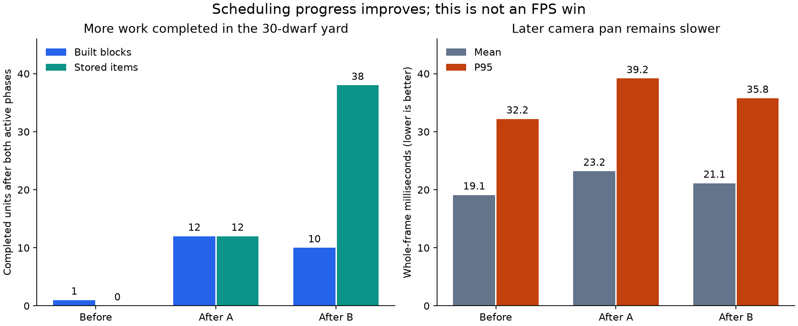

# 188 — Job planning at the 30-dwarf target

Performance follow-up, 2026-10-14. The intended population maximum is 30;
this pass addresses construction and hauling stalls exposed by 187. It does
not add a runtime population cap. The unrelated findings in 177 remain parked.

**Result:** both native 30-dwarf runs now complete construction and hauling.
The controlled hauling comparison costs about 88% less CPU. Whole-game frame
times do not improve consistently: more dwarves perform real work, and the
later pan is slower. This is a scheduling-progress fix, not a claim of 60 FPS
or a complete solution to worker waiting.

## Confirmed causes and changes

The original 30-dwarf baseline finished with 145 mined blocks, one built block
and no stored items. A separate temporary-counter run found 973 hauling-quote
yields, 60 inventory resets and 73 idle-pool resets. It never finished a worker
ranking or assigned hauling. Construction/furniture goal preparation exhausted
the current time allowance 352 times. Instrumented frame times are excluded
from performance comparisons because counters affect the 1 ms deadline.

Two changes remove repeated preparation:

1. A hauling comparison incrementally captures eligible loose items once per
   storage source and inventory revision. It evaluates storage acceptance,
   carry capacity and available room once per distinct item key, then shares
   candidate positions across workers. Each worker retains its own distance
   comparison and route exclusions. Original item order and tie behavior remain.
2. The two-leg furniture/construction planner prepares delivery stands once,
   then yields. The next slice advances pathfinding without repeating the
   expensive construction scan. Before handing off a reachable plan, it
   refreshes legal stands and the source's stand-to-work-unit mapping. A changed
   endpoint causes replanning before any item claim.

Inventory/filter/capacity/claim changes still invalidate hauling comparisons.
Worker-pool changes still admit newly idle nearer workers. Navigation changes,
worker movement and inventory changes still invalidate fetch plans. Reservation,
pickup, delivery and construction commitment retain their live checks. These
are transient planning structures, never saved. There is no offscreen simulation
reduction, work-speed change, priority change or increased scheduler budget.

The budget remains soft: preparation, final validation and physical assignment
can exceed 1 ms synchronously. Measured TaskManager maxima reach 5.3–7.5 ms after
the change, versus 2.5–3.9 ms before; this remains a performance limitation.

## Controlled checks

`JobPreparationReuseTest` compares exact pickup identity against the original
selection loop in 37 cases, including 30 worker positions, exclusions,
reservations, disallowed goods, removal, storage/drop transitions and filters.
It checks expired/resumed quotes, newly available nearer goods, full storage
and read-only planning with no claims. Across 30 workers and 641 items, only
two expensive item-key acceptance checks are needed.

The final gate records **45.182 ms → 5.308 ms** for the 30-worker comparison
(88.3% lower). These controlled query timings are not whole-game speedups.

A delayed stand-preparation fixture reproduces starvation with the frozen
original planner. The new planner completes with one preparation and one
fresh validation, and rejects an endpoint that becomes ineligible while
searching. Existing real construction tests cover physical delivery, material
consumption, blocked commitment, cancellation and preservation of partial work.
Early fixture attempts exposed test setup/type errors; only the strict clean
gate results count as validation.

## Native measurements

Same seed-1234 elevated yard as 187: 480 mining blocks, 240 construction plans,
320 loose stones, 320 loose logs and 20 wood stockpiles. Thirty dwarves comprise
12 miners, six builders and 12 haulers. Water and wildlife continue normally.
Each run uses a fresh isolated profile, paused pan, then two 20-second active
pans with 1.5-second warmups. No tests or exports run alongside measurement.

Godot 4.7.2 standalone editor executable, D3D12 Forward+, 2560×1440, VSync off,
Ryzen 7 9800X3D / Radeon RX 9070 XT. This is an artificial open yard, not a mature
colony or exported-build FPS measurement. Throughput changes alter the evolving
world and therefore frame costs. One baseline and two final runs establish
progress in these samples, not statistical confidence or freedom from starvation.



End of both active phases, including warmups:

| Run | Mined blocks | Built blocks | Stored items | Active / idle at end |
|---|---:|---:|---:|---:|
| Before | 145 | 1 | 0 | 1 / 29 |
| After A | 171 | 12 | 12 | 18 / 12 |
| After B | 157 | 10 | 38 | 10 / 20 |

Frame times in milliseconds, lower is better:

| Run | Pan | Mean | P95 | P99 | Maximum | Mean TaskManager |
|---|---|---:|---:|---:|---:|---:|
| Before | First | 23.56 | 39.76 | 47.72 | 281.67 | 1.151 |
| Before | Later | 19.11 | 32.20 | 38.41 | 44.10 | 1.073 |
| After A | First | 22.23 | 40.32 | 51.94 | 262.28 | 1.087 |
| After A | Later | 23.21 | 39.16 | 47.45 | 53.83 | 1.083 |
| After B | First | 24.31 | 42.45 | 53.81 | 274.50 | 0.865 |
| After B | Later | 21.13 | 35.76 | 45.29 | 64.13 | 1.064 |

First-pan averages are mixed; later mean frame time is 11–21% higher, and later
P95 is 11–22% higher. Extra activity is a plausible contributor, not an isolated
causal measurement of those frame differences. Early 262–282 ms stalls remain
in all runs and are not fixed by this pass.

In After B, measured from the active phase's start including warmup, first
assignments arrive at 0.14 s for mining, 0.24 s for construction and 0.76 s for
hauling. The original diagnostic run assigns no hauling during either active
phase. These figures measure first dispatch, not average queue wait or physical
delivery latency. The later After B phase waits 12.37 s before its next new
hauling assignment, although earlier trips can still be active.

Idle worker observations fall from 60%/94% in the original first/later pans to
49%/44% in After A and 26%/73% in After B. Samples occur every 15 frames and are
not time-weighted. Substantial variation and remaining idle periods are explicit
limits; the backlog does not drain during these short runs.

The additional final-source **20-dwarf** run finishes with 120 mined blocks,
18 built blocks and 34 stored items; 19 workers are active at its end. First
hauling dispatch is 0.43 s. First/later frame means are 17.98/20.80 ms, P95
33.54/35.64 ms and maxima 261.10/51.78 ms. This confirms progress below the
population target. There is no matched 20-second old-code run at 20 dwarves;
do not present it as a speedup over the shorter measurements in 187.

## Validation and package

All **34 distinct fixtures** pass with zero script/engine errors and verified
pass markers: the 32-fixture job reliability suite plus
`JobPreparationReuseTest` and `ConstructionObstacleReuseTest`. Coverage includes
newly idle nearer workers, unreachable pickups, relocation, placement priority,
carried-item cancellation, needs, ladders, construction, navigation and save/load
with backup recovery. `JobMixedWorldTest` drains its work backlog and performs
2,124 lifecycle invariant checks. The smaller mixed fixture is not evidence
that the large yard is free of waiting.

The native exported PCK loads the copied settlement with five dwarves and 79
animals. All five shared hauling quotes match direct live selection, and all
245 construction rejection comparisons match. All 79 animals start offscreen;
72 move during eight seconds and all advance their pose clocks. Pause and
slice concealment checks pass. A separate release-EXE startup generates its
world without script/engine errors. These are functional package checks, not
an exported FPS benchmark.

The original copied-save input remains unchanged, SHA256
`c815b96df85c9aed2a8ec0f03700dae9ff74218623b93ee6538274598808428d`.
The native 30-dwarf capture was visually inspected. `git diff --check` passes.

Windows build:

- Play: `build/windows/releases/20261014-215739-733-56349389/Deepdraft/Deepdraft.exe`
- Share: `build/windows/Deepdraft-Windows-Playtest.zip` (76.9 MiB).
- ZIP SHA256: `4bbf447f53724619a9e6fa1952fb77e159b585de74ddb78df8656fd3f96eba28`.
- Restart Play or launch this release. No save migration, new autoload or
  runtime population cap is introduced. Earlier release folders remain available.

## Next investigations

Continue with the agreed long-session/event-hitch review at 5/20/30 dwarves,
including autosave, arrivals, inventory growth, seasons and repeated edits.
Use a mature settlement and record job completion alongside frame time so
stalled workers cannot make a run appear faster.

For further CPU work, After B's first pan averages 3.45 ms in dwarf updates
and 3.56 ms in underground/actor lighting (nested inside the renderer group).
Those are profiling targets, not proof that a particular loop should be changed.
Construction handoff spikes and inventory-driven planning resets also remain.
The largest After B frame is 274.50 ms, with **249.68 ms in the lighting group**.
This specifically identifies lighting for the event-hitch review; another
218.76 ms wall-frame outlier has only 11.30 ms measured scene CPU and needs
separate attribution rather than being assumed to share that cause.

## Reproduction and evidence

```powershell
& tools/performance/RunScaling.ps1 -Population 30 -Label jobs_review_30 -Seconds 20
& tools/performance/RunScaling.ps1 -Population 20 -Label jobs_review_20 -Seconds 20
```

Use fresh labels; run sequentially. The benchmark disables saving and isolates
application data. Assignment timing and production hashes are recorded by the
updated benchmark. `CollectJobs30.py` preserves reports, full compressed frame
rows, logs, screenshots and the chart. The diagnostic counter scripts and two
instrumented sources are stored as `.txt` evidence only; they are not runtime
dependencies. Reproducing that diagnostic requires temporarily restoring those
sources and copying its runner back to the documented tool path, then restoring
the production files. Do not use diagnostic FPS for a before/after claim.

- [All measured phases](concepts/jobs30_20261014/comparison.json)
- [Controlled preparation checks](concepts/jobs30_20261014/preparation.json)
- [Regression results](concepts/jobs30_20261014/job_gate_results.json)
- [Source/build audit](concepts/jobs30_20261014/audit.json)
- [Packaged settlement checks](concepts/jobs30_20261014/packed_packed_smoke.json)
- [Release startup](concepts/jobs30_20261014/packed_release_startup.json)

Frozen pre-change source files and the before/after native captures are retained
in the same evidence directory. Earlier performance reports remain historical.
