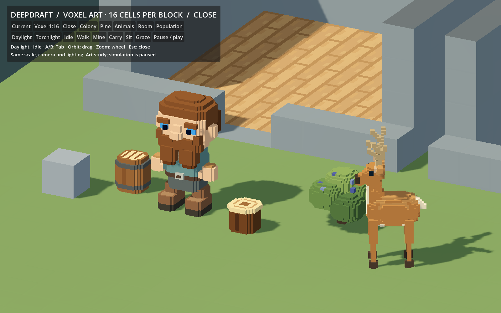
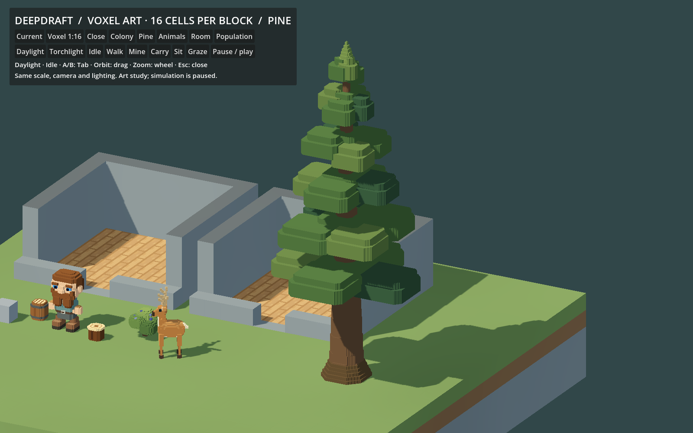
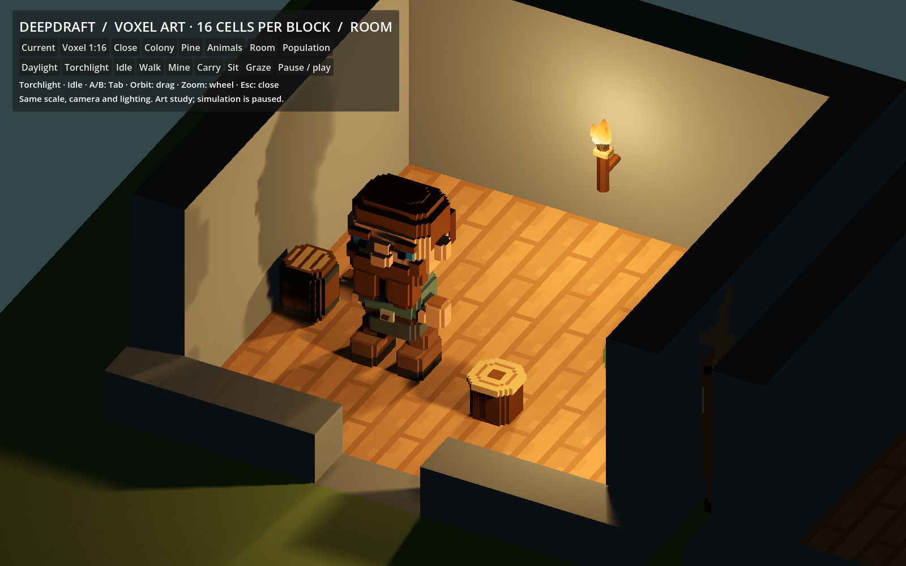

# 221 — 1:16 voxel art study

**2026-10-18 — implemented for review; not a production art migration.**

**Follow-up:** [222 — Voxel shadow proxies](222_voxel_shadow_proxies.md) adds
coarse shadow-only siblings, a Proxy / Detailed shadows comparison and new
measurements. The visual geometry below is preserved. This page's screenshots
and timing sample describe the original detailed-shadow study; current launcher
output/profile is now under `tmp/voxel_shadow_study/`.

Following the project review, the player requested exploration of voxel art for
dwarves, trees, bushes, animals and furniture, with 16 art cells along each world
block. The authorized pilot is now a native Godot comparison with one adult
dwarf, mature pine, ripe blueberry bush, deer, log stool and barrel. Normal Play
still uses the accepted faceted assets. Terrain, saves, IDs and gameplay are
unchanged.

My assessment: 1:16 is workable and gives the small objects a consistent visual
language. It should be an authoring grid, not a requirement to fill every cell
with detail. Large foliage clusters are essential. The deer needs more geometry
than the existing faceted deer; the dwarf and bush need less. These are different
authored shapes, so this is not evidence that voxel art is always cheaper.
Art direction remains the player's decision.

## Review

Double-click [Launch Micro Voxel Study.cmd](../../Launch%20Micro%20Voxel%20Study.cmd).
It opens at 1600×1000 with an isolated user-data profile. F5 still starts the
normal game. No global classes or autoloads were added; no project reload is needed.

- **Current / Voxel 1:16**, or **Tab**: switch at the identical camera position.
- **Close / Colony / Pine / Animals / Room**: matched review views.
- **Daylight / Torchlight**: fixed daylight or existing production torches.
- **Idle / Walk / Mine / Carry / Sit / Graze**: existing dwarf and deer rigs.
- **Pause / play**, drag to orbit, wheel to zoom, Escape to close.
- **Population**: 504 static render snapshots per style, with shared resources.
  This view does not simulate workers or animal behavior.

The grey cube is one world block. Every source cell has side length 0.0625 blocks.
The dwarf is 53 cells tall (3.3125 blocks), stool 12 (0.75), barrel 16 (1.0) and
pine 320 (20.0). The bush's stem extends slightly below ground as a buried root.

[Matched current view](concepts/221_micro_voxel_study/close_0.png) ·
[Voxel colony](concepts/221_micro_voxel_study/colony_1.png) ·
[Current colony](concepts/221_micro_voxel_study/colony_0.png)

## Implementation

The offline authoring profile is
[`data/art/micro_voxel_study.json`](../../data/art/micro_voxel_study.json).
[`generate.py`](../../tools/micro_voxel_study/generate.py) evaluates colored solid
shapes into sparse cell dictionaries and writes 18 GLBs under
`assets/models/studies/micro_voxel_16/`. Eight dwarf parts and six deer parts retain
their articulated hierarchy; the four static specimens each have one mesh surface.
Mirrored hands/feet and four deer legs reuse source resources. No voxel nodes or
runtime furniture baking are introduced.

The new opt-in greedy mesher in `tools/voxel_glb.py` merges only exposed,
coplanar, identically colored faces. The old mesher and writer retain their
behavior for existing generators. Ordering is independent of cell insertion
order. Head, eyes, hair, beard and brows share occupancy because they move as one
rigid assembly; faces between them are omitted. Independently moving limbs never
cull against each other. This removes the head/hair overlap found during review.

Colors are authored in sRGB and converted to linear COLOR_0 once. Furniture uses
the current `camp_log` / `oak_log` semantic swatches and actual CraftMaterials
oak substitution. The viewer uses runtime skin/hair/eye tints, UndergroundLighting,
TerrainLighting and FurnitureLighting with two production torches. The bounded
terrain uses the existing scale study's real WorldData/ChunkMesher fixture,
terrain shader and fixed cutaway. This is not a production slicing test.

The dwarf's final head/body widths are baked. Its temporary registry adapter sets
presentation scales to one and hand/foot rest offsets to the 1:16 grid, restoring
DwarfAssets immediately after assembly. Palms, work reach, pivots and the 1×1×3
logical body remain unchanged. The deer retains its neck/head/hip pivots.
Animation rotates rigid voxel parts; it does not snap moving vertices to world cells.

GLB coordinates are exactly on the 1:16 grid. Godot's default importer compresses
positions and normals. Native checks therefore allow one 16-bit position
quantization interval per AABB axis and a 0.00025 normal vector error. The largest
observed position error is 0.00545 **art cells** on the pine, below 0.6% of one cell.
Import settings were not hand-edited. See Godot's
[compressed attribute format](https://docs.godotengine.org/en/stable/classes/class_renderingserver.html#class-renderingserver-constant-array-flag-compress-attributes).

## Geometry cost

Complete visible rest-pose geometry, excluding hidden readability silhouettes,
tools and carried items. Articulated totals include both hands/feet and four deer
legs. Surface counts remain dwarf 10, deer 9, each static specimen 1.

| Specimen | Current triangles | Voxel triangles | Voxel exposed faces without greedy merging |
|---|---:|---:|---:|
| Dwarf | 2,572 | 1,458 | 13,584 |
| Log stool | 220 | 196 | 1,872 |
| Barrel | 316 | 354 | 2,416 |
| Blueberry bush | 2,780 | 1,842 | 6,176 |
| Deer | 1,308 | 2,774 | 10,684 |
| Mature pine | 4,732 | 7,560 | 232,860 |

The initial pine used stepped cones and cost 30,370 triangles. The delivered
version uses large branch clusters at the same full height. Exact bounds, cell
counts, bytes and hashes are in
[`geometry.json`](../../tools/micro_voxel_study/geometry.json).

## Native rendering sample

The 504-object layout contains 96 dwarves, 96 deer, 96 bushes, 96 stools,
96 barrels and 24 pines. Both styles use matching positions, camera, daylight,
resolution and resource sharing. After 90 warm-up frames, 120 frames are recorded.
Hardware: **AMD Radeon RX 9070 XT, Forward+, D3D12, 1600×1000, VSync on**.

| Measurement | Current | Voxel |
|---|---:|---:|
| GPU render median | 0.991 ms | 1.025 ms |
| GPU render p95 | 1.064 ms | 1.095 ms |
| Render CPU median | 0.646 ms | 0.634 ms |
| Frame interval median | 8.302 ms | 8.293 ms |
| Frame interval p95 | 8.661 ms | 8.633 ms |
| Draw calls reported in frame | 366 | 366 |
| Rendered primitives reported in frame | 1,214,310 | 2,371,240 |

This supports continuing the art exploration. It does **not** establish a low-end
hardware target or full-colony performance. The small GPU difference is within
observed run-to-run variation, and frame intervals are VSync-limited. These are
static render snapshots: AI, hauling, navigation, terrain edits and moving shadows
are not benchmarked. Meshes/materials are shared from one specimen of each style;
production per-dwarf material allocation and appearance variation are not represented.
Full settlement measurement remains necessary before migration. Rendering counters
include passes and engine LOD decisions, not just source triangles.

[Current population](concepts/221_micro_voxel_study/population_0.png) ·
[Voxel population](concepts/221_micro_voxel_study/population_1.png) ·
[Raw native report](concepts/221_micro_voxel_study/native_report.json)

## Validation and boundaries

- Six Python tests pass: solid cube (12 triangles), empty input, hollow geometry
  with a hole and palette boundary, 20 randomized sparse color grids, rigid-part
  occlusion, and sRGB conversion. Tests compare every unit surface, reject
  duplicates, check winding and insertion-order determinism.
- Generator `--check` reproduces every GLB and the geometry report byte for byte.
- 26 native checks pass: imported geometry, compression-aware grid precision,
  axis normals, unit scales, grounded heights, restored registry proportions
  and unchanged fixture terrain.
- 25 native captures cover matched close/colony/tree/animal/room views, three
  phases each of walk/mine/carry/sit, grazing and both populated views. The final
  capture run has no engine or script errors.

Rebuild: `python tools/micro_voxel_study/generate.py`.
Verify: `python tools/micro_voxel_study/test_mesher.py` and
`python tools/micro_voxel_study/generate.py --check`.
Import: `powershell -File tools/micro_voxel_study/Launch.ps1 -Import`.
Recapture: same launcher with `-Capture`. Use `-Godot` for another engine path.
The available Python on this machine is
`C:/Users/akadi/.cache/codex-runtimes/codex-primary-runtime/dependencies/python/python.exe`.

APPDATA and LOCALAPPDATA are isolated under `tmp/micro_voxel_study/profile`.
SaveManager uses testing storage and simulation services are paused. No player
save, production GLB, main scene or project setting was edited. No Windows export,
commit or overnight job was created.

This covers one male adult appearance, one mature summer tree, one ripe bush,
one deer and two furniture pieces. Other appearances, animals, furniture,
seasons, stages and picked/packed plants remain unconverted. Torches, tools,
rough stone and terrain are current assets. Portraits, sleep lids, selection,
all gameplay interactions, seasonal indices, save restoration with replacement
assets and full settlement costs remain production-integration work after the
visual direction is chosen.
