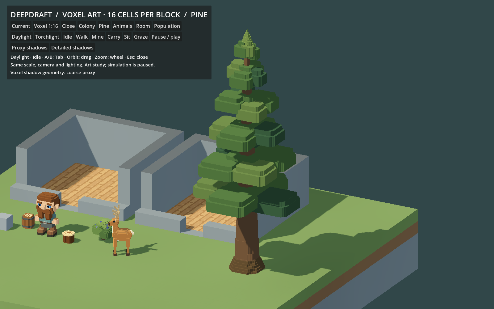

# 222 — Voxel shadow proxies

**2026-10-18 — implemented and validated on all 18 voxel study GLBs.**

The 1:16 visual meshes now use separate, coarser shadow casters. Each exported
GLB contains `VoxelVisual` and `VoxelShadowProxy` as siblings at the same pivot.
Godot sets the visual's Cast Shadow to **Off** and the proxy to **Shadows Only**.
The visual still receives lighting and shadows; only the proxy enters the light's
shadow pass. Broad branches can still shade lower branches, but the tree's fine
surface steps no longer all contribute their own shadow geometry.

The pine's shadow geometry falls from **7,560 to 1,572 triangles (79.2%)**.
All 18 visual POSITION, NORMAL, COLOR_0 and index payloads are byte-identical to
the exports before this change. There is no runtime voxel meshing or cube-node
construction. Static assets stay static; actor proxies follow their rigid parts.

## Review

Open [Launch Micro Voxel Study.cmd](../../Launch%20Micro%20Voxel%20Study.cmd), select
**Voxel 1:16**, then **Pine**. Use **Proxy shadows / Detailed shadows** to compare
the same visible geometry, camera and light. Proxy shadows are the default.
Close, Room and the existing animated poses are also available. Population
compares 504 static snapshots, including switching either shadow mode after loading.
Restart an already-open study to load the new GLBs and controls.



[Detailed pine shadows](concepts/222_voxel_shadow_proxies/shadow_pine_detailed.png) ·
[Close proxy](concepts/222_voxel_shadow_proxies/shadow_close_proxy.png) ·
[Close detailed](concepts/222_voxel_shadow_proxies/shadow_close_detailed.png) ·
[Torchlit proxy](concepts/222_voxel_shadow_proxies/shadow_room_proxy.png) ·
[Torchlit detailed](concepts/222_voxel_shadow_proxies/shadow_room_detailed.png) ·
[Walking pose](concepts/222_voxel_shadow_proxies/walk_55.png)

## Generation

[`tools/voxel_shadow.py`](../../tools/voxel_shadow.py) bins occupied source cells
at a requested stride of four: normally 1:4 shadow cells alongside 1:16 visuals.
Only fully occupied bins survive. Bins at the overall asset boundary are clipped
to its original bounds. This keeps the coarse mesh inside the visible volume,
including negative coordinates, instead of expanding it over visible surfaces
and producing false self-shadowing. Empty holes are not filled.

The proxy ignores color boundaries and uses the existing greedy face merger.
If the result retains less than 60% of source volume or 80% of the source span on
any axis, it retries at stride two and then one. Thin hands, antlers and deer
shins therefore retain finer geometry. Every tiny part is not necessarily cheaper:
the eye proxy has 48 triangles versus 40 visual triangles because its proxy is
closed, while the visual omits faces touching other head parts. Whole assets all
reduce their caster totals. This is an approximate silhouette, not an exact
replacement for detailed shadows.

The request and coverage threshold live in
[`data/art/micro_voxel_study.json`](../../data/art/micro_voxel_study.json).
[`generate.py`](../../tools/micro_voxel_study/generate.py) exports the pair through
the new opt-in `write_glb_meshes()` in `tools/voxel_glb.py`. Legacy single-mesh
exports retain their existing behavior. Each GLB has one shared identity root,
two identity mesh children, world-unit coordinates and one surface per mesh.
See [`geometry.json`](../../tools/micro_voxel_study/geometry.json) for per-part
stride, retained volume, triangles, bounds, bytes and hashes.

## Godot integration

[`VoxelShadowSetup.gd`](../../scripts/components/VoxelShadowSetup.gd) is an `@tool`
component with no global class or autoload. It recognizes the reserved sibling
names, changes only instance flags, and disables GI contribution for the invisible
proxy. Shared imported meshes stay immutable. `configure(root, false)` restores
detailed visual casting and hides the proxy for comparisons.

Existing world loaders call `UndergroundLighting.bind_world_tree()` or
`bind_tree()`. These now invoke proxy setup automatically, even if no lighting
owner exists yet. Late meshes beneath an already-bound tree are configured too.
Invisible proxies skip the atmospheric/actor-light material work. DwarfReadability
also excludes them so it cannot create visible occlusion silhouettes from proxies.

For a new loader outside that path:

```gdscript
var asset = load("res://assets/models/studies/micro_voxel_16/pine.glb").instantiate()
preload("res://scripts/components/VoxelShadowSetup.gd").configure(asset)
add_child(asset)
```

For an editor-authored scene, instance the GLB beneath a wrapper and add a Node
with `VoxelShadowSetup.gd` under that wrapper (or under an editable asset root).
Its `_ready()` configures descendants in the editor and at runtime. Raw glTF does
not store Godot's shadow casting enum: viewing a bare GLB without either setup
path does not apply these roles. No `.import` files were hand-edited.

Proxies and visuals share their parent, pivot and transform, including mirrored
hands/feet. Animation modifies the parent part, so the pair follows together.
Slice visibility also propagates from the existing actor/asset parent.

## Geometry and native rendering sample

Totals include both dwarf hands/feet and four deer legs. Hidden readability
silhouettes, tools and cargo are excluded.

| Specimen | Visual triangles, unchanged | Shadow triangles | Caster reduction |
|---|---:|---:|---:|
| Dwarf | 1,458 | 908 | 37.7% |
| Log stool | 196 | 68 | 65.3% |
| Barrel | 354 | 60 | 83.1% |
| Blueberry bush | 1,842 | 472 | 74.4% |
| Deer | 2,774 | 1,960 | 29.3% |
| Mature pine | 7,560 | 1,572 | 79.2% |

Same 504-object layout as 221: 96 dwarves, deer, bushes, stools and barrels, plus
24 pines. Native Forward+, D3D12, AMD Radeon RX 9070 XT, 1600×1000, VSync on.
Each mode gets 90 warm-up frames and 120 samples. The following pair changes
only shadow geometry, keeping the same 1:16 visible meshes.

| Measurement | Detailed shadows | Proxy shadows |
|---|---:|---:|
| GPU render median | 0.876 ms | 0.712 ms |
| GPU render p95 | 0.931 ms | 0.800 ms |
| Render CPU median | 0.675 ms | 0.682 ms |
| Frame interval median | 8.292 ms | 8.284 ms |
| Frame interval p95 | 8.800 ms | 8.816 ms |
| Reported draw calls | 370 | 370 |
| Reported rendered primitives | 2,371,498 | 1,517,568 |

This sample shows about 19% less GPU render time and 36% fewer rendered primitives.
These are viewport timings/counters across passes, not isolated shadow-pass GPU
measurements. Frame rate is VSync-limited. This does not establish full-colony or
low-end hardware performance. The snapshots share resources, do not run AI or
animate, and do not represent all production appearances/material allocations.
The extra proxy adds a mesh instance per part and increases the 18 source GLBs
from 1,290,664 to 1,741,924 bytes (about 35%); reducing caster geometry is the benefit,
not eliminating all CPU or memory cost. Production settlement benchmarking remains
part of a later art migration.

## Validation and reproduction

- Twelve Python tests pass: original greedy mesher contracts plus proxy volume
  containment, negative/clipped coordinates, preserved holes, thin shins, color
  merging, determinism, invalid inputs and dual-GLB accessor/pivot correctness.
- Generator `--check` reproduces all 18 GLBs and the geometry report exactly.
- [Visual preservation audit](concepts/222_voxel_shadow_proxies/visual_preservation.json)
  verifies all visual attributes and indices against the pre-proxy GLBs.
- [Native report](concepts/222_voxel_shadow_proxies/native_report.json): **51 checks
  pass**, including component setup, repeated setup, unrelated-mesh preservation,
  toggling, import geometry, all 19 actor part pairs at 13 rig poses, and all 2,136
  population pairs when built with proxies initially disabled.
- With light shadows disabled, enabling versus hiding proxies produces
  **byte-identical viewport pixels**. The proxy has no visible render contribution.
- Native paired daylight/torch images and walking pose inspected. Production
  `DwarfReadabilityTest` passes in headless mode; `DwarfLimbLightingTest` passes
  32 native color comparisons in daylight/torchlight. The former emits its existing
  empty-environment fixture warning; capture and limb checks have no engine errors.

```text
python -m unittest discover -s tools/micro_voxel_study -p "test_*.py" -v
python tools/micro_voxel_study/generate.py --check
powershell -File tools/micro_voxel_study/Launch.ps1 -Import
powershell -File tools/micro_voxel_study/Launch.ps1 -Capture
```

Use `generate.py` without `--check` to regenerate. The launcher accepts `-Godot`
for an engine path and isolates APPDATA/LOCALAPPDATA beneath
`tmp/voxel_shadow_study/profile`. Current capture output is in that same study
folder; 221's recorded evidence remains historical. Relevant logs and reports
are preserved alongside the screenshots above.

This implements shadow proxies for the existing voxel pilot, with reusable
generation and Godot setup for future assets. Normal Play still uses the faceted
art. No terrain geometry, save format, gameplay logic, project settings or
production GLBs changed. No global class, Windows export or commit was created.
