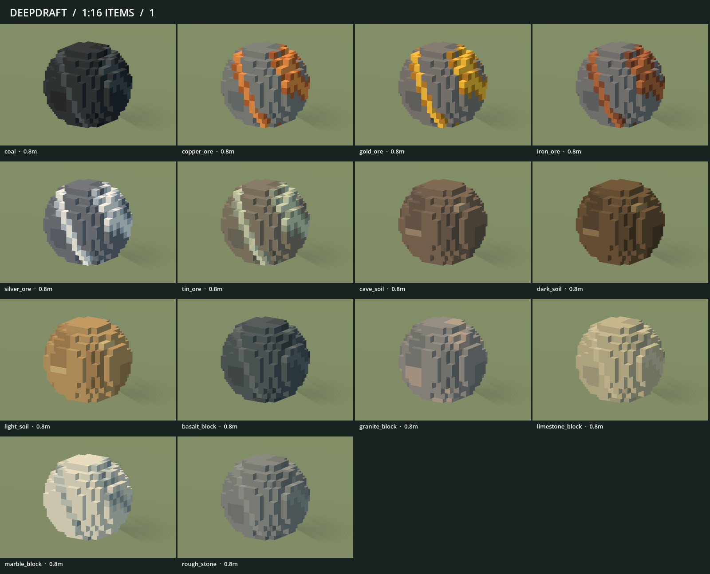

# 225 — Player-authored mined stone, ore and soil

**Superseded catalogue (2026-10-19):** Granite, basalt, limestone and marble
were removed at the player's request in [251](251_retired_stone_types.md), including
their models, thumbnails and editable variants. The fourteen-variant counts and
images below document this earlier art milestone; ten resource variants remain.

**2026-10-18 — complete.** Fourteen loose-resource models now use the shape from
`VoxelFeed/stone_ore_dirt.vox`, with material-specific colors. Production item
paths and gameplay definitions are unchanged. Restart Play to review.

## Source and appearance

The supplied file contains five model payloads. Model **0** is the monochrome
stone shape: a **16×16×16** canvas with **1,088 occupied cells**, spanning source
coordinates 2–13 on each axis. The four other saved model payloads are excluded.
The archived source at `data/art/sources/stone_ore_dirt.vox` is byte-identical to
the user's original, SHA-256
`d7e8b2e4f829d3fd7bbf2850b696d171e4c4d052eb66a784ad6422d53d5c6c1a`.

Every variant preserves the complete occupied-cell set, including the original
cuts and steps. Conversion uses Z-up → Y-up with a handedness-preserving axis
rotation and integer centering/grounding. Each source voxel is **1/16 world unit**;
the final occupied extent is **0.75×0.75×0.75 units**, grounded at Y0. No smoothing,
resampling, extra cells or shape substitutions are applied.

| Variants | Treatment |
|---|---|
| Copper, iron, gold, silver, tin ore | Gray host rock with continuous warm copper, rusty iron, golden, silver-white or pale tin seams |
| Coal | Dark charcoal with subdued blue-gray fractures |
| Rough stone, granite, basalt | Neutral gray, warmer mineral-flecked gray and dark blue-gray |
| Limestone, marble | Warm pale stone and light marble with restrained gray veins |
| Light, dark and cave soil | Sandy tan, rich brown and muted gray-brown, with subtle inclusions |

All **14 editable single-model `.vox` variants** are saved under
`VoxelFeed/colored/stone_ore_dirt/`, retaining the original canvas coordinates.
The input `.vox` and the other VoxelFeed models remain untouched. These outputs
are intentionally clean single-model files, not copies of the unrelated saved
animation payloads. The item builder uses the archived original plus palettes,
so generated VOX files are review/editing deliverables rather than runtime inputs.



## Integration and validation

- `vox_source.py` validates chunk bounds, dimensions, palette indices and exact
  voxel counts. Its single-model writer preserves source coordinates and colors.
  The chunk reader follows the [MagicaVoxel format](https://github.com/ephtracy/voxel-model/blob/master/MagicaVoxel-file-format-vox.txt).
- `mined_resources.py` colors the selected occupancy; `voxel_items.json` owns
  source identity, model index and all material palettes. `items.py` routes only
  the 14 stone/ore/soil paths through this source. The other **78 item exports are
  byte-identical** to the preceding revision. Gems, construction floors, terrain
  and scenery boulders are unchanged.
- Complete 92-item staged gallery and geometry audit passed before activation.
  Installed regeneration is byte-identical. Four source-preservation/color/VOX
  round-trip tests and four existing goods tests pass. Imported checks:
  **1,013 manifest checks / 92 models**, **1,644 item checks / 62 definitions**.
- Native production review covers all 41 existing item/wood/tool/carrying views,
  including the new stone held four at a time. Mining, hauling capacity, loose
  item support and inventory navigation/storage/quantity checks pass. Inventory
  was reviewed at 960/1280/2560, and all **14 affected thumbnails** were regenerated
  and reimported. No gameplay JSON, save semantics or player saves were changed.
- No script errors in accepted runs. Minimal galleries retain their pre-scene
  sky/weather warnings; the inventory fixture reports four ObjectDB instances at
  exit after its assertions pass. This revision does not change inventory lifetime
  management. The warning is retained in its evidence log.

## Cost and shadow behavior

All variants use one greedy visual surface and a separate **108-triangle shadow
proxy**. Detailed meshes have casting Off, proxies Shadows Only. The 14-file
catalogue changes from **6,212 → 11,650 visual triangles**, **1,380 → 1,512 proxy
triangles**, and **725,956 → 1,238,468 GLB bytes**. Proxy geometry is independent
of the mineral color seams; colors therefore do not subdivide the shadow mesh.

A native render-only comparison uses **420 objects / 14 forms**, matched
1600×1000 camera, material and directional shadows, both revisions decoded
identically with LOD disabled. It alternates previous/player/previous/player,
with 60 warmup and 180 sampled frames each. On the RX 9070 XT, GPU p50 is
**0.225 → 0.288 ms**, then **0.218 → 0.251 ms**. Draws remain **34**; measured
primitives increase **227,764 → 394,864**. Frame p95 ranges **0.798–0.917 ms**.
This isolates resource rendering; it is not a new full-game performance claim.

## Evidence, reproduction and recovery

Evidence is saved under `concepts/225_mined_resources/`, including exact-hash
staged and imported reviews, production captures, native test logs, source tests,
costs and the rendering comparison. Recovery of the 34 affected pre-change files
is `tmp/mined_resources_20261018/before.zip`; final files and fingerprints are
saved in `tmp/mined_resources_20261018/complete.zip` and `complete.json`.

```powershell
python tools/voxel_assets/build.py items --check
python -m unittest discover -s tools/voxel_assets -p test_mined_resources.py
python tools/voxel_assets/mined_resources.py --vox-output VoxelFeed/colored/stone_ore_dirt
```

For future edits, update the selected archived source identity or palette in
`voxel_items.json`, then stage/review/activate the complete item family using the
existing pipeline. `Gallery.gd` now accepts optional category filters and four-row
pages for compact native contact sheets; existing gallery defaults are unchanged.
