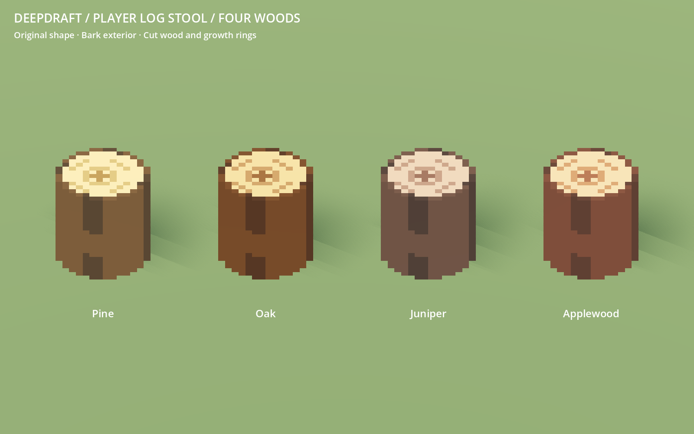
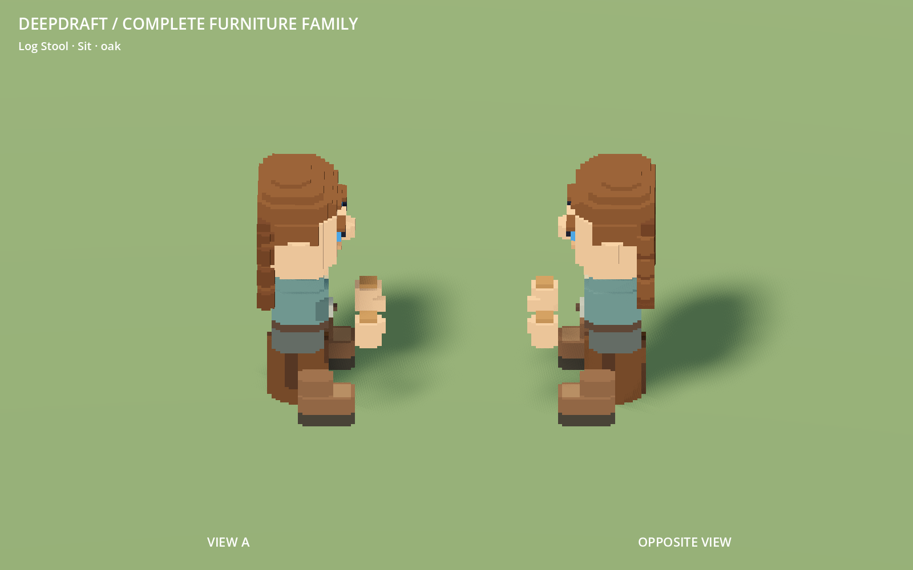

# 226 — Player-authored log stool and wood colors

**2026-10-18 — complete.** The production log stool now uses the exact shape from
`VoxelFeed/log_logchair.vox`. Its sides and top rim show bark; the exposed interior
shows cut wood, pith and growth rings in pine, oak, juniper or applewood. Restart
Play to review. No Windows export, player-save write or unrelated cleanup.



## Source and integration

The input contains one 16×16×16 model with **2,072 occupied cells**, spanning
coordinates 1–14 on all axes. The byte-identical archive is
`data/art/sources/log_logchair.vox`, SHA-256
`5b189c644c1fd1f0f7f7e73cf0e0e9545cfe8bb2609195352bc121280eda768b`.
The original is unchanged. Z-up → Y-up conversion centers and grounds the model
without adding, removing or resampling any occupied cells. At 1:16, its occupied
extent is **0.875×0.875×0.875 world units** with unit root scale.

`voxel_log_chair.json` owns source identity and `log_chair.py` assigns the existing
`camp_log` semantic color roles. Horizontal perimeter cells form bark and dark
furrows; internal cells form the cut surface and growth rings. `furniture.py`
and `author_furniture.py` route this chair through the archived source. The
existing CraftMaterials owner selects species colors on the imported mesh;
no new material type or duplicate species GLB is needed.

Editable, single-model VOX copies preserve source canvas coordinates:
`VoxelFeed/colored/log_logchair/{pine,oak,juniper,applewood}.vox`.
These are editing/review outputs, while the archive and color assignments remain
the reproducible build inputs. The placed-model thumbnail is refreshed.

The new top is two micro-voxels above the previous 0.75-unit seat. Its collision
height is now 0.875; seated body/hands and their occupied clearance move up by
0.125, while feet retain their grounded positions. One-tile occupancy, approach
cells, item/furniture IDs, recipes and material selection remain unchanged.
The other **49 furniture GLBs are byte-identical** to the preceding revision.

## Validation

- Three new source tests pass: exact occupancy/scale, bark versus exposed wood,
  and all four colored VOX round trips. Four existing furniture source tests pass.
  The superseded pilot-stool identity assertion is replaced by exact player-source
  preservation; the barrel anchor remains checked.
- Complete 50-model staged native gallery and geometry audit passed before
  activation. A full installed rebuild is byte-identical.
- **864** native furniture import/material/contact/hinge/flame checks and **731**
  manifest checks over 50 models pass. Four wood palettes recolor correctly through
  the production owner without changing geometry or shared source colors.
- LogStoolTest passes four yaw rotations, exact torso/top contact, grounded boots,
  approach and occupant clearance, claim release, seated save position, old-chair
  restoration and refund. CampfireStoolTest passes placement, independent facing,
  pose clearance and fallback behavior.
- CraftMaterialTest passes four real crafts, hauling, material-filtered installation,
  refund and persistence. DwarfDiningTest passes, including the log stool's meal-to-
  rest pose and claim transfer. Existing behavioral assertions were retained.
- Native review captures all four wood variants from opposite sides and eight
  seated material/angle combinations. The thumbnail is regenerated and imported.
  No errors in accepted runs; minimal fixtures retain their usual sky/weather warnings.



## Rendering cost

| Per stool | Previous | Player shape |
|---|---:|---:|
| Visual triangles | 196 | 402 |
| Shadow triangles | 68 | 84 |
| GLB bytes | 26,252 | 46,684 |

The visual remains a greedy mesh with one vertex-color surface. Its paired,
stride-2 shadow proxy retains 97.3% of occupied volume. Detailed casting is Off;
the proxy is Shadows Only. The proxy submits **79.1% fewer triangles** than casting
the new visual mesh. Color rings do not subdivide proxy geometry.

A matched render-only fixture repeats **420 stools** at 1600×1000 with directional
shadows and LOD disabled. Both revisions are decoded identically and alternate
previous/player/previous/player, with 60 warmup and 180 measured frames per pass.
On the RX 9070 XT, GPU median is **0.193 → 0.212 ms**, then **0.192 → 0.211 ms**.
Draws remain 5; measured primitives rise from 110,884 to 204,124. Frame p95 ranges
0.697–0.724 ms. This isolates repeated-object rendering, not whole-game performance
or low-end hardware. The new coloring increases visual geometry; proxy casting
remains substantially cheaper than detailed casting.

## Evidence and recovery

`concepts/226_log_chair/` contains native captures, gallery fingerprints, audit,
test logs, the rendering report and fixture, and the final rebuild log. The source
test results are recorded in `validation.json`. Pre-change recovery is
`tmp/log_chair_20261018/before.zip`; the final selective checkpoint and fingerprints
are `tmp/log_chair_20261018/complete.zip` and `complete.json`.

```powershell
python tools/voxel_assets/build.py furniture --check
python -m unittest discover -s tools/voxel_assets -p test_log_chair.py
python -m unittest discover -s tools/voxel_assets -p test_furniture.py
python tools/voxel_assets/log_chair.py --vox-output VoxelFeed/colored/log_logchair
& tools/voxel_assets/Run.ps1 -Script res://tools/voxel_assets/LogChairReview.gd -Label log_chair_review
```

For geometry/color edits, stage and review the complete furniture family before
activation. Preserve the approved source occupancy unless the player supplies a
replacement. The benchmark fixture expects the preceding GLB extracted from the
recovery archive to `tmp/log_chair_20261018/before/assets/models/furniture/log_chair.glb`.
Historical checkpoint 224 records migration-time expectations; this revision
explicitly authorizes the stool's new contact/clearance height.
