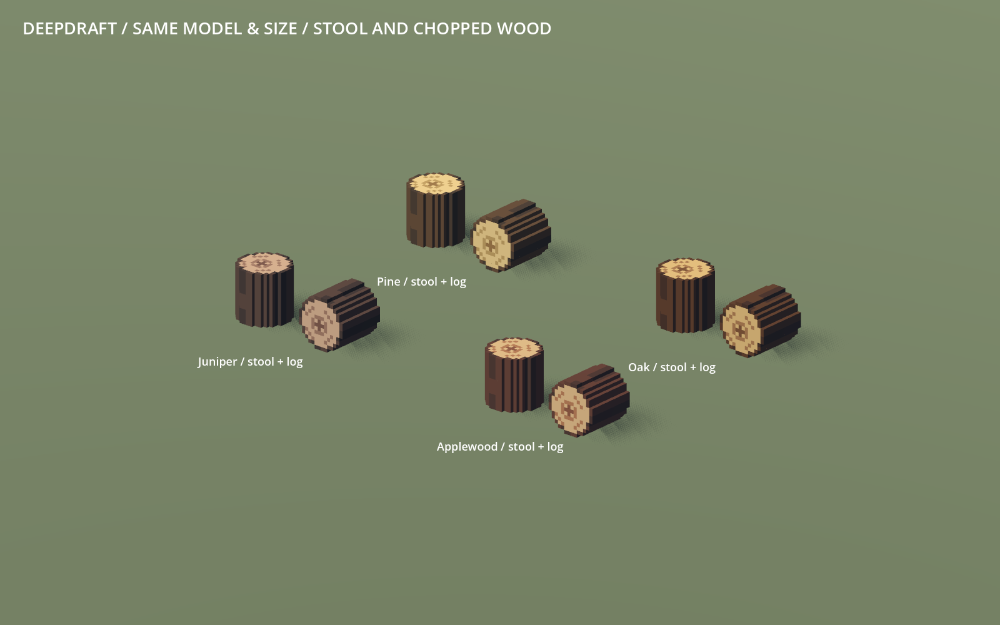
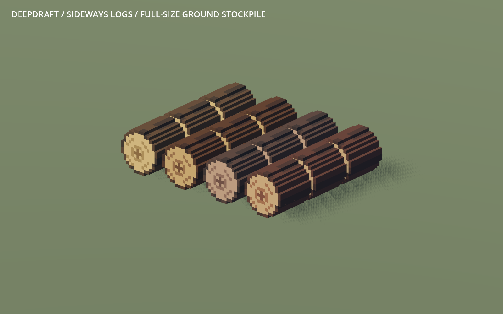

# 227 — Chopped wood using the player log model

**2026-10-18 — complete.** Pine, oak, juniper and applewood drops now use the
log stool's exact **2,072-cell model**, at the same **0.875×0.875×0.875-unit size**,
rotated onto its side. Bark surrounds the cylindrical sides and rim; both cut
ends show the same species-colored wood and growth rings. Restart Play to review.



## Integration

`log_chair.model()` now accepts an optional material ID, while retaining its
unchanged generic stool palette by default. `items.log()` applies an exact
90-degree X rotation in integer cell coordinates, then grounds and centers the
result. `voxel_items.json` maps the four timber paths to their existing material
IDs. Shape, color roles and source archive are shared; there is no second authored
log shape or voxel resampling. The original `VoxelFeed/log_logchair.vox` and the
editable colored VOX copies from 226 remain unchanged.

Ground stockpiles and carrying already use unit-scale item models, so no runtime
storage/hauling code changes were needed. Stockpile logs retain their aligned,
sideways orientation and fit one tile with a 1/8-unit gap between adjacent logs.
Loose drops retain their cosmetic yaw and jitter. Shelf displays retain normal
uniform fitting; they do not redefine the world-size asset.

The four models and four inventory thumbnails are installed. All **88 other item
GLBs**, including staves and mined resources, are byte-identical. All **50 furniture
GLBs** also regenerate byte-identically. Item IDs, recipes, material ownership,
carry limits, counts and save semantics are unchanged. No player-save write,
Windows export or commit was made.



## Validation and cost

- Five goods source tests and three chair source tests pass, including exact
  inverse-rotation equality for all colored cells and identical dimensions.
- Full 92-item staged native gallery/audit passed before activation. Installed
  item and furniture rebuilds pass exact-byte comparison.
- Native import checks: **1,656 item checks / 62 definitions / 92 presentations**
  and **1,013 manifest checks / 92 models**. New ground-storage assertions verify
  rotation reset, unit scale, support height and tile containment for all four logs.
  The old smaller-log radial envelope is replaced by the authorized exact-size
  and aligned-stockpile contracts; crates and staves retain their original checks.
- HaulingCapacityTest, LooseItemSupportTest and CraftMaterialTest pass, covering
  real two-log cargo, containers, cancellation/conservation, support restoration,
  crafting, filtered installation, refunds and persistence. Four thumbnails were
  regenerated and imported.
- Native review captures all four stool/log pairs, a 12-log stockpile and all four
  two-log carrying poses at close and colony scales. The standalone fixtures load
  autoload-dependent helpers after startup; accepted runs have no script errors.
  Minimal fixtures retain their existing sky/weather warnings.

Each log has **402 visual triangles** and an **84-triangle shadow-only proxy**.
Detailed shadow casting stays Off. Across four GLBs, visual triangles change
**640 → 1,608**, proxy triangles **144 → 336**, and bytes **79,912 → 186,732**.
The sideways stride-2 proxies retain 83.8% of occupied volume; the exact visual
occupancy is preserved. Proxy casting submits 79.1% fewer triangles than the new
detailed meshes.

A matched render-only comparison repeats 420 logs across all four woods at
1600×1000, with LOD disabled and identical GLB decoding, materials and directional
shadows. Alternating previous/player/previous/player passes use 60 warmup and
180 measured frames each. On the RX 9070 XT, GPU medians are **0.186 → 0.226 ms**
and **0.184 → 0.325 ms**; draws remain 11. This is repeated-object rendering
evidence, not a whole-game or low-end performance claim.

## Evidence and recovery

`concepts/227_chopped_wood/` contains accepted native logs, source tests, complete
gallery fingerprints, geometry audit, production images, benchmark fixture/report
and rebuild logs. `tmp/chopped_wood_20261018/before.zip` preserves the preceding
14 asset/generator/test files; `complete.zip` and `complete.json` in that directory
record the final selective checkpoint and hashes.

```powershell
python tools/voxel_assets/build.py items --check
python tools/voxel_assets/build.py furniture --check
python -m unittest discover -s tools/voxel_assets -p test_items.py
& tools/voxel_assets/Run.ps1 -Script res://tools/voxel_assets/TimberReview.gd -Label timber_review
```

Future stool shape or role edits also affect chopped wood; review and rebuild
both families. The native TimberReview uses the existing ItemGallery stage through
its new review hook. The benchmark fixture expects the four preceding GLBs under
`tmp/chopped_wood_20261018/before/`, preserving their repository-relative paths.
