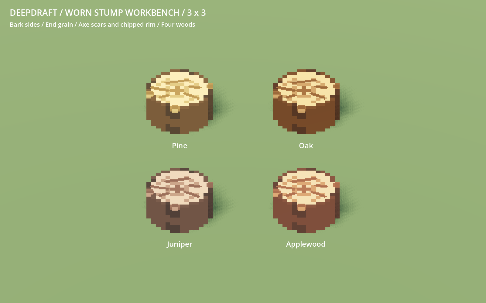
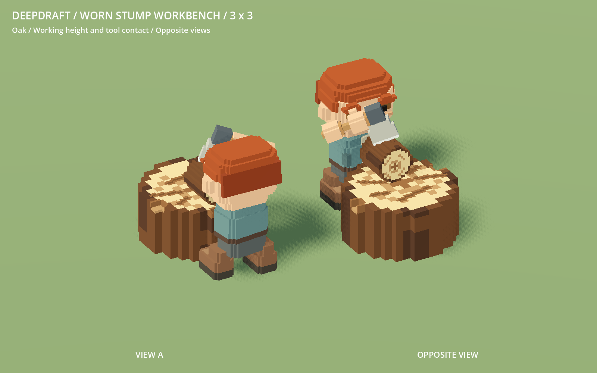

# 228 — Large worn rudimentary workbench

**Shape superseded by [229 — Native voxel scale](229_workbench_voxel_scale.md).**
The player rejected the enlarged chair cells and supplied a workbench-specific
outline. Current production uses that outline at 1:16, 16 cells high; the 3×3
logical footprint and directional crafting from this milestone remain.

**2026-10-18 — complete.** The crude workbench is now a broad log stump with a
true **3×3 footprint**, matching Pine, Oak, Juniper and Applewood material colors.
Five shallow axe scars and three chipped rim areas make the working surface look
used. The production model, placement, crafting contacts and thumbnail are updated.



## Shape and working layout

The player log from 226 supplies the cross-section, bark roles and growth rings.
Its horizontal cells expand threefold into the native 1:16 grid; height becomes
20 cells. The visible stump measures **2.625×1.25×2.625 units**, centered within
the nine-tile footprint. All geometry is baked with unit root scale.

`voxel_workbench.json` owns scale, height, scar paths/depths and chip boxes.
`workbench.py` builds the solid and removes **145** upper cells to make real
grooves and chips, leaving **26,495** cells. Exposed wounds use existing grain/wood
roles. The lower body stays intact. Wear is fixed authored appearance, with no new
durability simulation. The original VOX, stool and chopped-wood shapes are unchanged.

The definition now blocks all nine floor tiles, with a collision height matching
the 1.25-unit top. Its material palette changes to `camp_log`, matching the shared
log's colors. `WorkerCraftOrder.work_surface()` reads the new optional
`crafting_surface_radius`: the work point sits 0.625 units toward the worker instead
of close to the center. Other definitions retain the previous 0.125 default.
Ingredients rest on the top and the axe reaches the material from each side.

The furniture/item/recipe IDs, costs and production rules are unchanged. Saved
benches retain their identity and origin and load the current 3×3 layout; existing
tight layouts may need repositioning to provide the larger area. No original
player save was opened or modified, and no automatic relocation was introduced.



## Validation

- Two workbench source tests pass: exact extents, definition/palette agreement,
  bounded real wear and preserved lower body/contact sample. Four existing
  furniture source tests pass.
- Complete 50-model staged native gallery and geometry audit passed before
  activation. Installed regeneration is byte-identical; all **49 other furniture
  models** are unchanged.
- **864 native furniture checks** and **731 manifest checks / 50 models** pass,
  including all wood palettes, contact height, roots, grid and shadow-node flags.
- WorkerCraftingStumpTest completes **16 batches** across four approaches and four
  rotations, producing 64 torches from 16 logs. Assertions cover restored nine-tile
  occupancy, all twelve open perimeter tiles, worker-facing contact, material/top
  and axe alignment, post-pickup side selection and three blocked sides.
- WorkerCraftingTest, CraftMaterialTest, ProfessionCraftingTest and FurnitureMoveTest
  pass: real delivery, installation, crafting, conservation, pause/interruption,
  material selection, camp seating, moves and save/restore. The camp fixture moves
  its stool two tiles farther from the expanded bench; clearance rules are retained.
- Native review includes four wood variants, opposite views, close wear detail and
  a clean working-pose view. A separate actual-crafting capture records all four
  approaches. The thumbnail is regenerated and imported. Accepted runs have no
  script errors; minimal fixtures retain their sky/weather warnings.

## Rendering cost and recovery

| Per bench | Previous | New |
|---|---:|---:|
| Visual triangles | 722 | 860 |
| Shadow triangles | 108 | 192 |
| GLB bytes | 78,320 | 98,768 |

The visual is one greedy vertex-color surface. The stride-4 inscribed shadow proxy
retains 78.3% of occupied volume and submits **77.7% fewer triangles** than detailed
casting. Visual casting remains Off; the proxy remains Shadows Only.

A matched 64-bench render-only comparison at 1600×1000 uses 3.5-unit spacing,
directional shadows, identical decoding and LOD disabled. Four alternating passes
each use 60 warmup and 180 measured frames. On the RX 9070 XT, GPU medians are
**0.296 → 0.324 ms** and **0.307 → 0.325 ms**; draws remain six. This is isolated
rendering evidence, not a whole-game or low-end performance claim.

Native images/logs, staged hashes, source tests, audit, benchmark fixture/report
and rebuild evidence are under `concepts/228_workbench/`. Pre-change recovery is
`tmp/workbench_20261018/before.zip`; the verified final selective checkpoint is
`complete.zip` with `complete.json` in that directory. No export or commit.

```powershell
python tools/voxel_assets/build.py furniture --check
python -m unittest discover -s tools/voxel_assets -p test_workbench.py
& tools/voxel_assets/Run.ps1 -Script res://tools/voxel_assets/WorkbenchReview.gd -Label workbench_review
& tools/voxel_assets/Run.ps1 -Script res://scripts/tests/WorkerCraftingStumpTest.gd -Label workbench_use -UserArgs '--capture'
```

Restart Play to review. This footprint revision supersedes the one-tile workbench
in historical reports; do not restore that old constraint when regenerating art.
