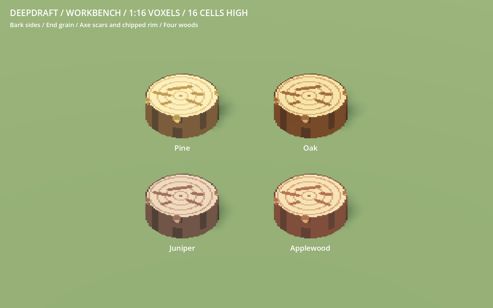
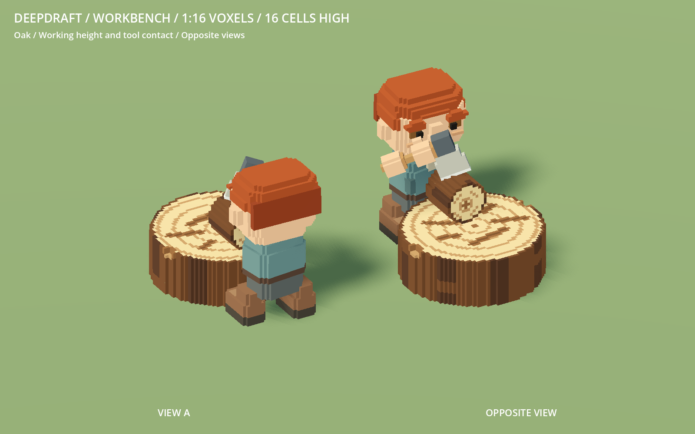

# 229 — Workbench at native voxel scale

**2026-10-18 — complete.** The player rejected the coarse enlarged chair cells in
228 and supplied `VoxelFeed/workbench_example.vox`. The workbench now preserves
that example's exact horizontal outline at **1/16 unit per cell**, extruded to
**16 cells / one world block high**. The previous height was 20 cells.

## Source and geometry

The example contains one model on a 48×48×4 MagicaVoxel canvas. Its two occupied
horizontal layers are identical, each containing 1,616 cells. The occupied outline
is 46×46 cells, with one empty cell around the canvas. The source is archived
byte-for-byte at `data/art/sources/workbench_example.vox`; the original is unchanged.
SHA-256: `930d0bfa63134c5a1100adb0b9de8e10899f6fc919e7bb57b333e90ddf7ccc85`.

`voxel_workbench.json` records the source identity, 16-cell height, ring bands and
wear. `workbench.py` reads the outline directly without horizontal replication,
extrudes it at native cell resolution and colors its one-cell perimeter as bark.
Four one-cell ring bands and fine scars replace the enlarged chair grain. Five
axe scars and three rim chips remove 96 upper cells from the 25,856-cell solid,
leaving 25,760 occupied cells. Wear stays shallow and avoids the four work contacts.

The visible bounds are **2.875×1×2.875 units**, centered and grounded at Y0 with
unit transforms. The existing 3×3 logical footprint, nine blocked tiles, twelve
perimeter approaches and 0.625-unit worker-facing contact are unchanged. Definition
collision and crafting height now match the one-unit top. Save identity and anchor
behavior are unchanged; loading an existing bench uses the current geometry.

Pine, Oak, Juniper and Applewood keep the existing `camp_log` material contract.
Editable colored variants are saved in `VoxelFeed/colored/workbench/`, each on a
48×48×16 canvas with the same production occupancy. These do not overwrite the
two-layer example or change the log chair/chopped wood models.

## Validation

- Four source tests cover exact source-outline extrusion at every intact layer,
  native dimensions, definition/collision agreement, bounded wear, supported
  contacts, and all four editable VOX occupancies and colors. Four existing
  furniture source tests pass.
- The complete staged native 50-model gallery and audit pass before activation.
  The other 49 furniture GLBs are byte-identical to the previous checkpoint.
  Complete furniture regeneration is byte-identical to the installed assets.
- 864 native furniture checks and 731 manifest checks / 50 models pass, including
  imported grid alignment, transforms, all wood palettes, height and shadow flags.
- WorkerCraftingStumpTest completes 16 batches across all four sides and rotations,
  producing 64 torches from 16 logs. New bounds, saved occupancy, perimeter access,
  material/top and axe contacts, post-pickup side choice and blocked sides pass.
- FurnitureMoveTest passes placement, exact-item transport, interruption,
  cancellation, crafting, settings and save restoration.
- Native review covers four woods, opposite views, top wear and a real actor/item
  pose. The catalogue thumbnail is regenerated and imported. Accepted runs have no
  errors; minimal native fixtures retain their usual sky/weather warnings.

## Rendering and checkpoint

| Per workbench | Previous enlarged cells | Corrected outline |
|---|---:|---:|
| Visual triangles | 860 | 2,132 |
| Shadow triangles | 192 | 228 |
| GLB bytes | 98,768 | 219,108 |

The finer outline and rings cost more visual triangles, still baked into one
greedy visual mesh. The stride-4 inscribed proxy retains 79.7% occupied volume
and casts 89.3% fewer triangles than the detailed mesh. Visual casting remains
Off; the proxy remains Shadows Only.

A matched 64-bench render-only fixture at 1600×1000 compares both revisions with
identical decoding, material, camera and light, and LOD disabled. Four alternating
passes use 60 warmup and 180 sampled frames each. RX 9070 XT GPU medians were
0.323→0.373 ms and 0.238→0.373 ms; draws stayed six. This records the extra visual
cost in isolation, not a whole-game or low-end performance claim.

Evidence, images, accepted logs, source/rebuild checks and the benchmark are under
`concepts/229_workbench/`. Recovery is `tmp/workbench_grid_20261018/before.zip`;
the verified selective checkpoint is `complete.zip` with `complete.json` there.
No player-save writes, Windows export, commit or unrelated asset changes.

Restart Play to review. This supersedes the workbench shape and height in 228.
