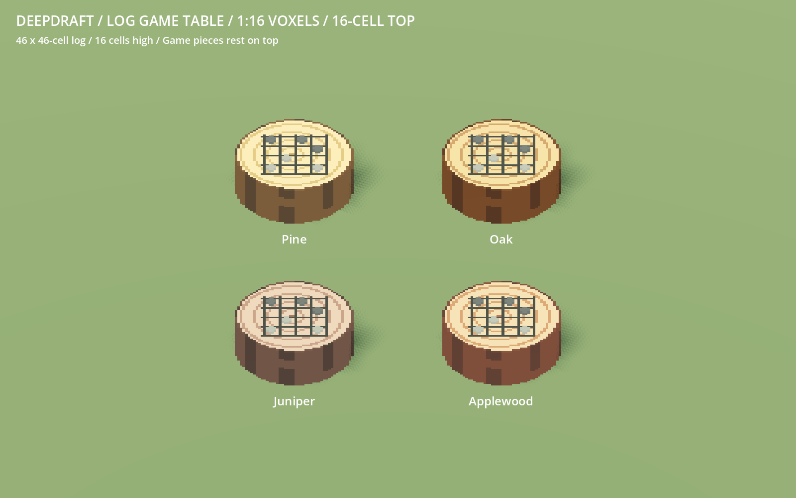

# 230 — Matching log game table

**2026-10-18 — complete.** The rudimentary game table now matches the corrected workbench's
native dimensions: a 46×46-cell occupied outline, 16 cells high at 1:16 scale.
Its existing scratched game board and six stone counters sit on the new top.

## Shape, palette and seating

The shared `workbench_vox` operation now accepts `worn: false`. The game table
uses the exact player example outline and the workbench's fine bark/end grain,
with an intact playing surface. The workbench keeps its existing axe scars and
chips. Its production bytes are unchanged by this addition.

`author_furniture.stump(True)` records the new base and the existing grid, with
five lines along each axis, in `voxel_furniture.json`. The grid is colored into the top
voxel layer. Six separate chamfered counters, three dark stone and three light
stone, rest on that surface. Each counter is four cells across and one cell high,
with twelve occupied cells. There are no floating board plates or per-cell nodes.

The log measures **2.875×1×2.875 units**; counters bring total height to **1.0625**.
The unchanged 3×3 logical footprint blocks all nine tiles. `game_surface_height`
and the base collision now match the one-unit top. `camp_log` supplies Pine, Oak,
Juniper and Applewood colors matching the workbench, stool and chopped logs;
grid markings and both stone colors remain fixed through recoloring.

The two existing separate stool guides and all save/recipe/item IDs remain the
same. Seating obstacle boxes enclose the low log and the raised central counters
separately. This preserves actual occupied volume while avoiding a falsely taller
rim beside the players' resting hands. The existing play pose reads the updated
surface height; no recreation runtime behavior needed changing.

## Rendering

| Per game table | Previous | Matching log |
|---|---:|---:|
| Occupied cells | 15,696 | 25,928 |
| Visual triangles | 2,946 | 2,010 |
| Shadow triangles | 144 | 108 |
| GLB bytes | 286,260 | 196,848 |

One greedy visual mesh uses Cast Shadow Off and its coarser proxy uses Shadows
Only. The stride-4 proxy retains 84.9% occupied volume and submits 94.6% fewer
triangles than detailed casting. Other furniture models retain their exact bytes.

A matched 64-table render-only fixture at 1600×1000 uses identical GLB decoding,
materials, camera and light with LOD disabled. Four alternating passes each use
60 warmup and 180 measured frames. RX 9070 XT GPU medians were 0.408→0.375 ms and
0.410→0.375 ms; draws remained six. This is an isolated rendering comparison,
not a whole-game or low-end performance claim.

## Validation and recovery

- Three game-table source tests prove exact shared log occupancy and height,
  six separate directly supported counters, fixed grid/stone colors and complete
  geometry enclosure by the seating obstacles. Four workbench and four existing
  furniture source tests also pass.
- Complete staged 50-model native gallery/audit passes before activation. Imported
  production art passes 864 furniture checks and 731 manifest checks / 50 models.
  These include grid alignment, transforms, all wood recolors, central height,
  picking and shadow configuration. Full rebuild is byte-identical; the other
  49 furniture GLBs, including the workbench and stool, are unchanged.
- RudimentaryRecreationTest passes real crafting/delivery/placement, both seat
  associations and navigation at every rotation, exact saved bounds and layout
  restoration, two-player recruitment and actual play in four rotations. Each
  player's reaching palm stays over the marked board and above the counters.
  Pause, needs, work interruption, timeout, rewards, cooldown and persistence pass.
- Its old fence test position was inside the recently expanded workbench boundary;
  the fixture moves that post clear of the bench. All installation/conservation
  assertions remain. The new palm assertion uses the source +X anchor because the
  hand node already mirrors X. Recreation runtime code is unchanged.
- Four native wood previews, opposite views, a close board/counter view and actual
  two-player captures are saved. The catalogue thumbnail is rebuilt and imported.
  Accepted runs have no script errors; minimal fixtures retain sky/weather warnings.

Evidence is under `concepts/230_game_table/`. Recovery is
`tmp/game_table_20261018/before.zip`; the verified selective final checkpoint is
`complete.zip` with `complete.json` in that directory. No original source VOX or
player-save writes, Windows export, commit or unrelated asset changes.

Restart Play to review.
