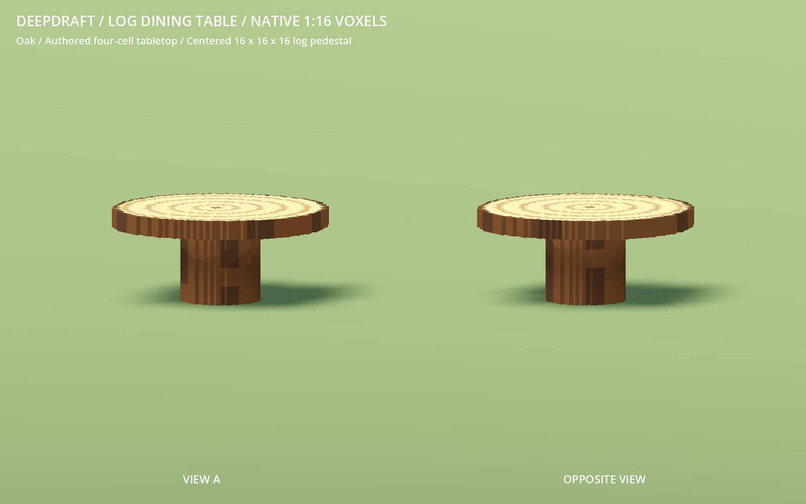

# 231 — Player log dining table

**2026-10-18 — complete.** A new rudimentary Log Dining Table combines the exact
player-authored `VoxelFeed/log_top.vox` tabletop with a centered round log base,
bounded by 16×16×16 native micro-voxels. Both are centered on a 3×3 world footprint.

## Source, dimensions and materials

The original single-model VOX has a 48×48×20 canvas and 6,464 occupied cells.
Its tabletop occupies X/Y [1,47) and source Z [16,20). All four authored top
layers are preserved exactly. The source's empty lower sixteen layers receive
the new pedestal; the space beneath the overhang remains empty. A byte-identical
source copy is archived at `data/art/sources/log_top.vox` with its SHA256 and
dimensions in `voxel_log_table.json`.

Every cell remains 1/16 world unit, with unit mesh transforms. The base is one
unit wide and high; the complete table is **2.875×1.25×2.875 units**. Total height
is twenty micro-voxels, including the four-cell tabletop. `log_table.py` supplies
semantic bark sides/rim and fine cut-wood growth rings using the shared `camp_log`
palette. Pine, Oak, Juniper and Applewood match the stools, workbench and timber.
Editable complete colored VOXs are saved in `VoxelFeed/colored/log_table/`.

## Crafting, placement and dining

Craft → Rudimentary → Dining offers the table for **two matching logs**, with
sixteen seconds of work at the crude workbench. The new packed item uses the
existing crate presentation and normal material identity. Place → Dining shows
its thumbnail and 3×3 footprint. Existing tables retain their own identities.

All nine floor tiles are reserved. Collision and seated-clearance regions
separately enclose the central pedestal and upper slab. Four separate log stools
can use the table; their guides leave a floor-cell gap so resting hands clear
the four-layer slab. These positions remain within existing dining reach. No
dwarf proportions, seating poses or dining runtime behavior were changed.

## Rendering

| Per table | Cost |
|---|---:|
| Occupied cells | 9,792 |
| Visual triangles | 1,846 |
| Shadow triangles | 120 |
| GLB bytes | 182,856 |

The combined mesh uses greedy exposed-face geometry, one visual node with Cast
Shadow Off and one coarser proxy with Shadows Only. The stride-4 proxy retains
66.7% occupied volume and uses 93.5% fewer casting triangles than detailed casting.
There are no per-cell nodes. All other fifty furniture GLBs are byte-identical
to the pre-change checkpoint.

A matched 64-table render-only test at 1600×1000 alternates detailed and proxy
casting over four passes, each with sixty warmup and 180 measured frames. The
same GLB, materials, camera and light are used with LOD disabled. RX 9070 XT GPU
medians were 0.514/0.584 ms and 0.596/0.584 ms for detailed/proxy casting. This
sample shows **no consistent GPU timing improvement**. Submitted primitives
fall from 236,292 to 125,828, with six draws in both modes. These are isolated
rendering measurements, not whole-game or low-end performance claims.

## Validation and checkpoint

- Three source tests verify every authored tabletop cell, the centered native
  pedestal, open overhang, truthful bounds, registration and four editable woods.
  Four existing furniture source tests pass.
- All 51 staged furniture assets pass native gallery/audit before activation.
  Production passes 891 furniture checks and 742 manifest checks across 51 models,
  including imported grid alignment, dimensions, palettes and shadow flags.
  The complete furniture rebuild is byte-identical. New inventory is explicit
  in `voxel_additions.json`, preserving the original migration inventory.
- LogDiningTableTest passes real two-log crafting, delivery and placement,
  exact-item Move, four rotated layouts, all sixteen stool guides/associations,
  four wood save/restore round trips, four proper meals, serving conservation,
  released table claims and the Place card. Native captures include gameplay.
- Four wood previews, opposite views, low pedestal views, a four-stool layout
  and the new imported thumbnail are saved. Accepted runs have no script errors;
  minimal fixtures retain ordinary sky/weather warnings.

Evidence is under `concepts/231_log_table/`. Recovery is
`tmp/log_table_20261018/before.zip`. The selective final checkpoint is
`complete.zip` with its SHA256 inventory in `complete.json` in that directory.
Original source VOX and player saves are unchanged. No Windows export or commit.

Restart Play to review.
