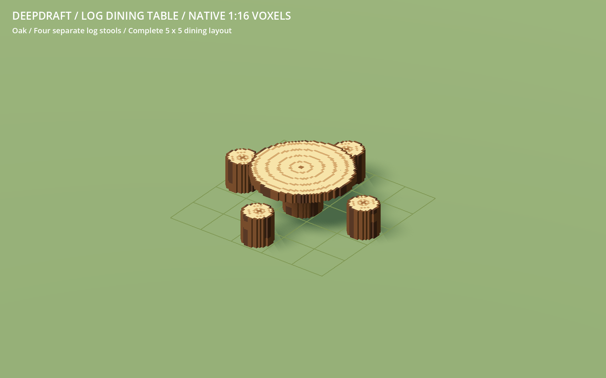

# 232 — Compact log dining layout

**2026-10-18 — complete.** The log dining table stays 3×3. Each of its four
separate stool guides moves inward by exactly one world voxel, producing a
complete **5×5 table-and-four-stool footprint**.

Relative to the table anchor, the guides are north [1,-1], east [3,1], south
[1,3] and west [-1,1], with the same inward-facing rotations. Their previous
positions were [1,-2], [4,1], [1,4] and [-2,1]. Capacity remains four. Table and
stool meshes, voxel scale, materials, shadow proxies, recipes and item IDs are
unchanged. The Place card explains the combined 5×5 arrangement.

The initial gap came from the ordinary stool's resting clearance. An optional
table-local `chair_profile` now supplies raised hands that clear the tabletop
and a beard region beginning at the actual lowest seated beard height. Existing
rounded head clearance and gentle idle turns are retained. These stools face
the table rather than turning their bodies toward a nearby fire. Other stools
keep their original profile. The profile is derived from real/planned table
slots; no shared stool definition or saved variant is mutated. Runtime posture
settings are cached and invalidated with furniture placement changes.

Validation covers all sixteen rotated guides, exact 5×5 bounds, automatic
snapping, all wood save/restore round trips, real crafting and exact-item Move.
Four dwarves reach separate seats and dine simultaneously; actual head meshes
do not overlap, bodies and hands clear the table, four servings are consumed
and all dining claims release. The eating-to-rest hand transition also clears
the slab. Adding a table after its stools, table removal/profile cache refresh,
nearby fire orientation and shared-definition preservation pass.

Four Python source tests pass, including unchanged authored geometry and all
head/hair/beard variants fitting the supported profile. LogStoolTest and
DwarfDiningTest pass. DiningPlacementTest passes personal/communal snapping,
capacity, clearance, access and saves. Its older fixture needed initialized
generated terrain arrays and a real scheduler attempt for the animated fetch;
production completion checks remain intact. Art viewers retain their existing
standalone stool pose through the lightweight owner fallback.

Native previews include a 5×5 floor grid and actual simultaneous dining.
Accepted logs and source results are in `concepts/232_compact_log_table/`.
Recovery and the verified selective checkpoint are
`tmp/log_table_compact_20261018/before.zip` and `complete.zip`, with file hashes
in `complete.json`. No model rebuild, player-save write, Windows export or commit.

Restart Play to load the new guides. Previously placed stools keep their saved
positions; use Move to snap them onto the closer positions.
