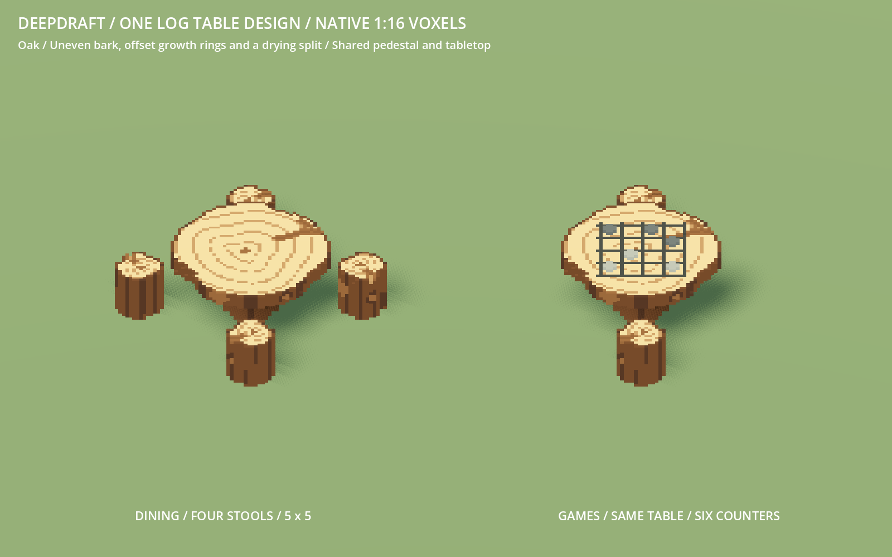

# 233 — Organic logs and one shared table design

**2026-10-18 — complete.** The dining table and game table now share the exact
same sculpted pedestal/tabletop body. The game version adds a scratched board and
six stone counters. Log stools, harvested wood and the workbench use matching
organic details in pine, oak, juniper and applewood.

`organic_log.py` and `voxel_log_detail.json` add broad uneven bark flutes, knots,
small exposed wood patches, off-center warped growth rings and actual carved
drying splits. The large slab has a branching split that opens at its edge and
becomes shallower toward the interior. The workbench keeps its additional axe
scars and rim chips. These are deterministic authored details, with no runtime
noise or cell nodes. All solids remain connected and supported.

The original player VOXs remain byte-identical. Their shapes define the maximum
envelopes; the new pass removes selected cells inside them. Every cell remains
1/16 unit. The tabletop is 46×46 cells across, on a centered 16×16×16 pedestal;
the complete dining table remains 20 cells tall. Four separate stools still fit
the established 5×5 arrangement. Stools and sideways timber remain 14×14×14 cells.
The workbench remains 46×16×46 cells with the established 3×3 working footprint.

`author_furniture.stump(True)` now starts with `log_table_vox`, the same operation
as the dining table. Board marks only recolor surviving top cells, and all six
counters have solid wood beneath them. The game surface is 1.25 units high, with
counter tops at 1.3125. The two-player layout is retained. Collision/seating
bounds follow the shared pedestal and slab plus central counters. The existing
table-local chair profile now also drives `BoardGameRecreation._pose`, keeping
resting hands above the slab; reaching hands use the configured surface height.

Eight GLBs and their eight catalogue/inventory thumbnails are updated. Twelve
editable species VOXs are refreshed in `VoxelFeed/colored/log_logchair/`,
`log_table/` and `workbench/`. Chopped wood remains an exact quarter-turn of the
colored stool cells. The audit confirms that the other 396 production assets,
and 196 additional/study GLBs, are byte-identical.

## Validation

- 45 Python tests pass, covering source identities, native bounds, connected
  geometry, real cracks, supported seats/work contacts, four editable palettes,
  exact stool/timber rotations and exact shared game/dining body occupancy.
- Complete pre-activation native galleries pass for 51 furniture and 92 item
  models. Activation uses their exact reviewed file hashes.
- FurnitureFacetedArtTest passes 891 checks; ItemFacetedArtTest passes 1,656.
  VoxelManifestTest passes 742 furniture and 1,013 item checks, including unit
  transforms, palette surfaces, bounds and correct visual/proxy shadow modes.
- LogDiningTableTest passes actual crafting, exact-item Move, four rotated
  layouts, all wood saves, sixteen compact guides and four simultaneous diners.
- RudimentaryRecreationTest passes real construction/installation, two-player
  play in four rotations, hand clearance, needs/work interruptions and saves.
  LogStoolTest passes fit, access, all rotations and seated persistence.
- WorkerCraftingStumpTest passes all 16 directional crafting batches, work
  contacts, pickup/side selection and blocked approaches.
- Native material, storage, carrying, colony-scale and interaction previews were
  inspected. Both full families regenerate byte-identically (143 models).

## Rendering cost

Greedy visual meshes and separate coarse shadow-only proxies remain active.
No high-detail mesh casts shadows. The added relief increases geometry:

| Model | Visual triangles, before → after | Shadow triangles, before → after |
| --- | ---: | ---: |
| Stool | 402 → 490 | 84 → 84 |
| Each chopped wood | 402 → 490 | 84 → 96 |
| Dining table | 1,846 → 2,232 | 120 → 144 |
| Game table | 2,010 → 2,486 | 108 → 144 |
| Workbench | 2,132 → 2,664 | 228 → 260 |

A matched 1600×1000 Godot render-only sample uses 64 objects, eight of each model,
the same camera/material/light, shadow proxies in both revisions, and LOD off.
Four alternating passes use 60 warm-up and 180 measured frames each. On this
Radeon RX 9070 XT, median GPU rendering time is 0.327 ms before and 0.342 ms after
in both repeats; draw calls remain 20, with median render CPU time 0.063 ms.
This measures this small art sample, not whole-game or low-end performance.
Raw geometry, bytes, benchmark results and captures are retained with the evidence.

## Checkpoint and review

Native captures and logs are in `concepts/233_organic_logs/`. Recovery is
`tmp/organic_logs_20261018/before.zip`; the selective final snapshot is
`tmp/organic_logs_20261018/complete.zip`, verified against `complete.json` hashes.
No player-save write, Windows export, commit or unrelated cleanup was performed.

Restart Play to load the revised models, thumbnails and game-table hand profile.
Existing installed pieces keep their saved position, material and identity.
