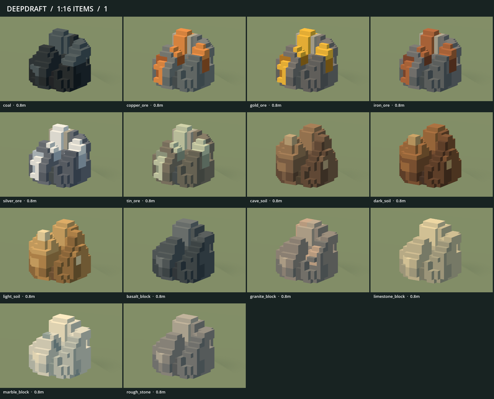
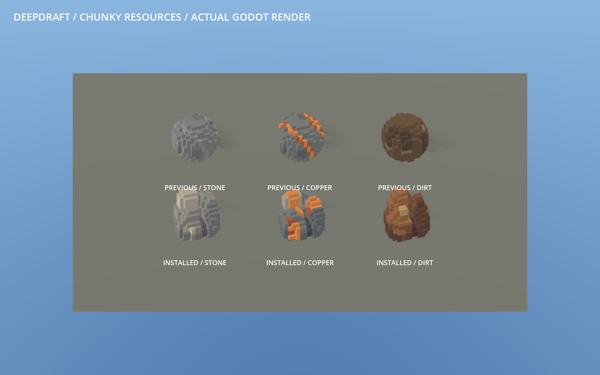

# 238 — Chunky stone, ore and soil

**Superseded catalogue (2026-10-19):** Granite, basalt, limestone and marble
were removed at the player's request in [251](251_retired_stone_types.md), including
their models, thumbnails and editable variants. The fourteen-variant counts and
images below document this earlier art milestone; ten resource variants remain.

2026-10-18. The player approved the lower row of the
[resource concept](../60_asset_creation/reference/proposals/chunky_resources_v1.png)
and asked to replace all stone, ore and dirt goods. All 14 native resource models
and their inventory thumbnails now use that direction in normal Play.

## Installed design

Three connected shapes replace the shared rounded source: asymmetric fractured
stone, a related ore fragment with bold deposits, and joined soil clods with
embedded pebbles. Lower bevels, broad chips and open clefts break up long straight
faces. Color follows substantial masses and mineral patches instead of repeated
stripes or per-cell noise.

| Family | Complete variants |
|---|---|
| Stone | Rough stone, granite, basalt, limestone, marble |
| Ore | Copper, tin, iron, silver, gold, coal |
| Soil | Cave soil, light soil, dark soil |

Every model retains the prior **12×12×12 occupied-cell envelope**, one cell per
1/16 world block, 0.75-unit size, unit root and ground at Y0. Logical quantities,
item keys, paths, carrying costs, storage capacity and save identities are
unchanged. Current saves show the new art when loaded.

The approved illustration guides shape and material hierarchy; the following
images are actual engine renders of the delivered models. Illustrated lighting
and tiny surface details should not be mistaken for an exact native result.

Only these 14 of 386 production GLBs change. The other 78 item GLBs and all 294
non-item GLBs are byte-identical to the before checkpoint. Gems, world terrain,
scenery boulders, wet/dry stone devices and the newly installed timber retain
their art. The original `VoxelFeed/stone_ore_dirt.vox` and archived source are
preserved; their exact spherical occupancy rule is superseded by this approval.

## Source and editable assets

- `data/art/voxel_mined_resources.json`: three authored height maps, chips, ore
  deposits and soil pebble volumes. Heights are integer micro-voxel counts.
- `data/art/voxel_items.json`: per-material semantic palettes, shape selection
  and the preserved original source identity under `mined_original_source`.
- `tools/voxel_assets/mined_resources.py`: deterministic shape and color baking,
  connected voxel solids and editable VOX export. `items.py` keeps the existing
  resource paths. Historical source reading is used only for recovery checks.
- `VoxelFeed/colored/chunky_resources/`: 14 editable single-model VOXs, centered
  within 16×16×16 canvases and verified against every active cell and color.
- `data/art/voxel_manifests/items.json` and `asset_revisions.json`: installed
  geometry, bounds, fingerprints, provenance and before/after metrics.

The approved concept remains under the reference folder and is linked from
[64 — Ongoing art direction](../60_asset_creation/64_hand_hewn_art_direction.md).
Earlier colored spherical VOXs are historical outputs, not the current source.

## Validation

- All **53 Python tests** pass. Resource checks cover the unchanged envelopes,
  three distinct asymmetric silhouettes, connected solids, broad supported feet,
  open clefts, visible mineral fractions, 14 distinct appearances and full VOX
  shape/color roundtrips. The archived original retains its hash and 1,088 cells.
- Full native staged gallery review passes **92 models** before exact-hash
  activation. Production item-art checks pass **1,656 checks**, and the imported
  manifest passes **1,013 checks** over all 92 models. No fallback art is used.
- Mining feedback, loose-item support, hauling capacity and colony inventory
  pass. These exercise contact timing, soil/stone feedback, physical ownership,
  support after mining, quantities, claims, cancellation, mixed carrying loads,
  storage, partial crates, Locate/Inspect, placement and responsive inventory.
- Two obsolete test fixtures referenced furniture retired in 234. Hauling now
  uses the supported packed log table; inventory uses the existing synthetic
  `TestStorageFixture` with rendered contents, and the supported log table for
  placement. Assertions remain active. No retired furniture is restored to Play.
- Native production review captures all 41 existing item/tool/carry views. Nine
  focused views add a matched old/new comparison, all 14 variants, and four-item
  stone/copper/soil loads at close and colony distances. All 14 thumbnails are
  refreshed and reimported.
- The full item builder regenerates **all 92 installed GLBs byte-for-byte**.

Evidence is under `tmp/settlement_art_20261013/chunky_*`; the completion checkpoint
records accepted run labels and superseded failed fixture attempts separately.
Minimal fixtures retain their existing missing-scene/environment or world-seed
startup warnings. Native final-run errors are not waived.

## Rendering cost

Each resource remains one greedy visible surface plus one inscribed shadow-only
proxy. Detailed casting is Off; the proxy casts Shadows Only. Geometry is baked,
with no node per micro voxel.

| Total across 14 models | Previous | Installed |
|---|---:|---:|
| Visible triangles | 11,650 | 7,130 |
| Shadow triangles | 1,512 | 1,996 |
| GLB bytes | 1,238,468 | 867,136 |

The more fractured shapes make shadow proxies slightly more complex (130–158
triangles per object), while simplifying the visible meshes (410–608 triangles).
These are geometry counts, not a whole-game speedup claim.

The matched resource-only benchmark draws 420 objects, 30 of each variant, at
1600×1000 on a Radeon RX 9070 XT. Previous/new/previous/new passes use the same
camera, lighting, material and disabled LOD, with 60 warmup and 180 sampled
frames. Median GPU times are **0.443 → 0.394 ms**, then **0.442 → 0.394 ms**.
Draws remain 34; submitted primitives fall from 394,864 to 273,784. Frame p95
ranges 0.641–0.725 ms. This measures resource rendering only.

Matched `chunky_world_before` / `chunky_world_after` runs pass at 1600×1000, seed
1234, with 24 dwarves, 48 furniture pieces, 2,953 trees, wildlife, hauling,
day/night lighting and slice transitions. Fixture hashes and world fingerprints
match; both isolated save/reloads preserve the tested clock, dwarf identities,
furniture, wildlife, terrain edits and stone units.

| View | GPU median before → after, ms | Frame p95 before → after, ms |
|---|---:|---:|
| Paused close | 0.907 → 0.874 | 8.260 → 8.269 |
| Paused overview | 2.796 → 2.756 | 8.647 → 8.658 |
| Active close | 1.412 → 1.463 | 21.483 → 21.087 |
| Active overview | 3.383 → 3.347 | 21.899 → 21.948 |
| Active night | 1.488 → 1.385 | 21.788 → 21.795 |
| Active slice | 1.477 → 1.764 | 21.454 → 21.572 |

Draw counts match in every view. This single pair shows broadly similar full-game
frame times, with GPU results moving in both directions. It does not establish
a whole-game speedup or low-end support. The full-world fixture uses ordinary
stone goods; the targeted fourteen-form benchmark and art suites cover every
material. Full reports and sample data remain in the run folders.

## Checkpoint and handoff

Recovery files are in `tmp/chunky_resources_20261018/before.zip`, with all 386
production model fingerprints in `production_before.json`. `complete.zip` and
`completion.json` retain the final source, models, thumbnails, editable VOXs,
native evidence and verified hashes.

Restart Play and load the existing save. No global class/autoload or gameplay
save format changed. Original player saves are untouched. No Windows export or
commit was created.
