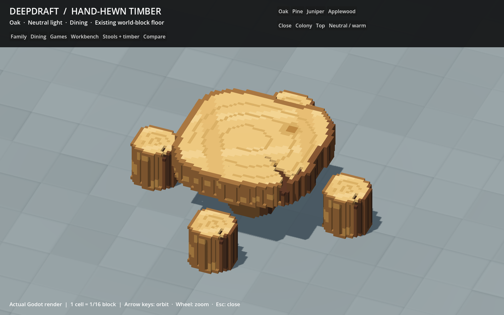
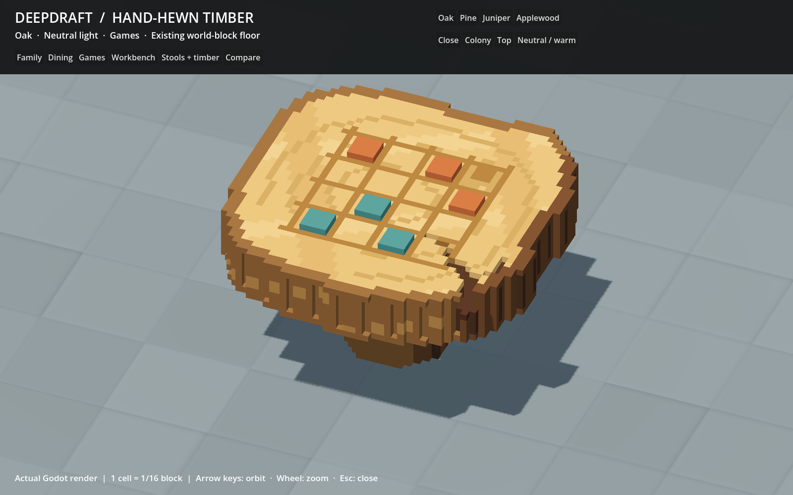

# 239 — Thicker log tabletops

The player approved doubling the dining/game tabletop slab from four to eight
1:16 cells, keeping the sixteen-cell pedestal and 3×3 footprint. The shared
generator now produces both table bodies at 46×24×46 cells (2.875×1.5×2.875
world units). The game board moves onto Y23 and six supported one-cell counters
occupy Y24, giving the game model a 25-cell overall height.

The source outlines, wood palettes, four close dining stools in 5×5, game seat
count, workbench, timber and stool models remain unchanged. Only two production
GLBs change. The same shapes are regenerated for all four editable wood variants
and the native study viewer. This is a proportion refinement toward the original
concept, not a claim that the accepted interim art now matches its quality.

## Interaction and rendering

Collision and seating bounds enclose the raised surface. Table-specific resting
hands and meal grips rise four cells. The head pose rises two cells independently
of the supported torso, keeping long beards clear of the slab during idle bobbing
and game nods. Dining, idle and game owners share the optional head setting;
ordinary seats continue to use their body offset. Saved identities and layout
anchors stay the same, so existing tables update when Play is restarted.

Both models retain one greedy visual mesh and a separate shadow-only proxy.
The visual casts no shadow; the proxy remains Shadows Only. Native grid spacing
stays 1/16 with unit root transforms; no model stretching is used.

| Model | Visual triangles, before → after | Shadow triangles, before → after | New GLB bytes |
|---|---:|---:|---:|
| Dining table | 2,492 → 2,618 | 126 → 136 | 255,344 |
| Game table | 2,566 → 2,692 | 142 → 152 | 263,640 |

The thicker surface adds 126 visible and ten shadow triangles per table.
It does not add mesh instances or material surfaces.

## Native previews

The same folder includes all four woods, colony distance, four actual diners and
two actual game players. These are Godot captures using the current assets.

## Validation and checkpoint

- All 53 Python asset tests pass. Eight-cell slab thickness, shared dining/game
  geometry, supported counters, complete collision bounds, all head/hair source
  bounds, four-wood editable roundtrips and unchanged compact stool guides pass.
- The complete 33-model staged gallery passed before exact-hash activation.
  Only these two production GLBs changed; the other 384 are byte-identical.
  The 33 production furniture models and 20 study models regenerate identically.
- Native import suites pass: 658 furniture checks, 480 manifest checks,
  124 production/study palette checks and 260 study grid/proxy checks.
- Dining passes real two-log crafting, carrying/installing, Move, four rotations,
  four-wood save/restore and four simultaneous diners. Extended assertions cover
  long beards, both extremes of the bite and idle bob, and torso/stool support.
- Recreation passes two players, four rotations, reachable board contacts,
  long-beard/hand clearance against slab and counters, interruption, needs,
  pause, mood and save persistence. The reaching palm clears the counter tops.
- Ordinary stool geometry, rest poses, support and save checks pass. Two
  thumbnails, twelve study views and real dining/game captures are refreshed.

Evidence is under `tmp/settlement_art_20261013/thicker_tables_*`. The first game
checks caught the broad head clearance box touching the raised counter region
and the reaching palm passing too low. Both are corrected with actual geometry
assertions retained. Two old Python height/pose assertions were updated to the
approved geometry. Final accepted runs have no script errors; minimal fixtures
retain their existing missing-scene/environment startup warnings.

Recovery files are in `tmp/thicker_tables_20261018/before.zip` with source and
production hash inventories. `complete.zip` contains the final sources, assets,
previews and accepted test evidence with a verified checksum inventory;
`completion.json` records its hash, changed files and resolved early test attempts.
No failures remain in the accepted checks.

## Full-world comparison

Both isolated full-world runs pass with the same fixture hash and world
fingerprints at 1600×1000 on a Ryzen 7 9800X3D / Radeon RX 9070 XT. All eight
save/reload checks pass, including furniture, dwarf identities, wildlife,
terrain edits, clock and stone conservation. Draw counts match in the sampled
views. The fixture has 24 dwarves, 48 furniture pieces and 2,953 trees.

| View | GPU median before → after, ms | Frame p95 before → after, ms |
|---|---:|---:|
| Paused close | 0.884 → 0.879 | 8.317 → 8.314 |
| Paused overview | 2.996 → 2.988 | 8.815 → 8.858 |
| Active close | 1.466 → 1.447 | 21.942 → 21.153 |
| Active overview | 3.158 → 3.178 | 21.940 → 22.130 |
| Active night | 1.233 → 1.251 | 21.667 → 21.111 |
| Active slice | 1.742 → 1.766 | 21.979 → 21.772 |

This is a general regression check, not a tabletop stress benchmark: its
furniture consists of beds, ordinary stools, doors and campfires. The dedicated
dining/game suites exercise the changed tables and poses. One paired run on
this hardware establishes neither a speedup nor low-end performance.

Restart Play and load the existing save. The current definitions update the
tables at their existing anchors. No new global class or autoload was added;
no project reload is needed. Actual player saves are untouched, and no Windows
export or commit was created.
