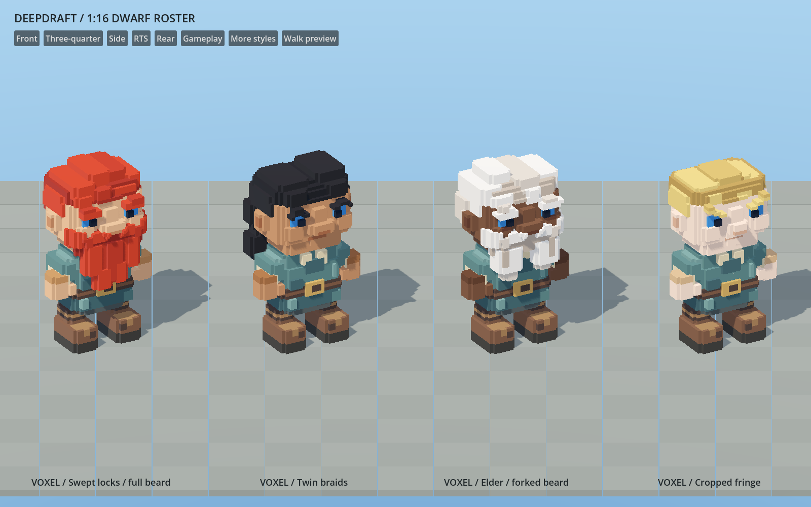

# 241 — Chibi dwarf refinement

The player authorized the dwarf pass after reviewing the remaining gaps in the
hand-hewn art direction. The existing broad head/body proportions are retained.
This pass changes the features that read as repeated layers or plain blocks:
hair, beard masses, cheeks, brows and workwear.

## Appearance changes

- Fourteen hairstyles use broad, offset locks and fringes, with distinct cropped,
  shaved, wild, loose, bun and braided silhouettes. Long styles retain their
  side/back placement. These replace the shared concentric cap terraces.
- All seven beard styles have stronger moustaches, cheek masses and hanging
  sections. Braids alternate substantial segments; forked and long beards retain
  distinct silhouettes.
- Four age heads have fuller cheeks, a broader nose tip, a visible mouth/chin
  break and restrained age accents. All eight eyebrow styles have deeper forms.
  The existing eye geometry and colors remain.
- Workwear has broader sleeves, a linen collar and cuffs, a larger brass buckle,
  a few deliberate tunic folds and boot accents. Runtime skin/hair/eye choices
  retain their IDs and tint behavior; clothing remains baked.

The original [concept](../60_asset_creation/reference/hand_hewn_timber_direction.png)
remains the visual target. This is a native voxel refinement, not a claim to match
the illustration's soft lighting, organic irregularity or material richness.
Several hairstyles still share the same basic swept construction; further visual
work should judge them at colony distance, not only from close-up asset views.

## Preserved contracts

Authoring remains `data/art/voxel_dwarves.json` through `dwarves.py` and the existing
greedy exporter. Every rigid part has one visible vertex-color surface and a
separate shadow-only sibling. No per-cell nodes, runtime remeshing, new materials
per voxel or nonuniform scaling were introduced.

All 43 family files were regenerated and reviewed before exact-hash activation.
Thirty-eight changed; the eye mesh, two scar models and two work tools remain
byte-identical. The other 343 production models are also byte-identical, giving
348 unchanged models across the full 386-model inventory.

Logical navigation/collision remains 1×3×1; visual height stays within 54 cells
(3.375 blocks). Eye/eyelid geometry, palm and sole envelopes, tool grips/striking
points, mirrored limbs, appearance pools and saved identities remain intact.
The initial buckle extended past the torso's established depth and failed real
dining/game clearance. It was recessed to cell Z8; furniture and pose definitions
were not changed. The torso still rests on the approved stool surface.

| Complete 43-model library | Before | After |
|---|---:|---:|
| Visible triangles | 11,336 | 14,276 |
| Shadow triangles | 5,626 | 8,636 |
| GLB bytes | 1,645,140 | 2,192,704 |

These are the sum of every variant, not the cost of one dwarf. The richer shapes
increase geometry. Thin overlays, including some beards/brows, retain finer
proxies when coarsening would lose their shape; not every individual part has a
large shadow reduction. Visual casting remains Off and proxy casting Shadows
Only. There are no extra mesh instances or surfaces per assembled dwarf.

## Native review and validation

The gallery contains nine roster pages in daylight and torchlight, six rear
views, four actual portrait renders, walking/mining/felling/resting poses and a
high-angle view. `hand_hewn_lineup.png` adds four varied appearances with different
skin/hair colors. These are actual Godot renders, not generated concept images.
`before_beards.png` is the matched previous roster for comparison. `dining.png`
shows four actual diners around the unchanged table in the gameplay fixture.

- Eight Python source/pipeline tests pass. They check full variant coverage,
  unique shapes, unchanged contact solids/envelopes, eyes free of skin occlusion,
  no coincident skin/overlay surfaces and work-tool anchors. The obsolete test
  requiring the entire pilot sculpt was replaced with contact assertions.
- All 43 installed GLBs regenerate byte-for-byte. The complete staged native
  gallery passes its hash review. Native import verification passes 474 checks.
- Dwarf art verification passes 7,710 checks across 41 appearance models,
  800 combinations and 22 work/rest cases, including mirrors, saves, slicing,
  tool grip contacts and ground clearance.
- Roster UI, 935 eyelid/meal presentation checks, ground rest, hauling contact
  ownership/conservation, ordinary stool support, all dining outcomes and actual
  four-diner table clearance pass. Native dining captures also pass.
- Recreation passes two players in four rotations, board contacts, long-beard
  and torso clearance, interruptions, needs, pause, mood and persistence.
- Native limb lighting passes 32 paired samples across all four skin tones in
  daylight/torchlight. Existing minimal fixtures retain startup environment
  warnings; accepted runs have no script errors.

Two older test fixtures still referenced retired wooden chairs/tables and a
barrel. Dining now uses the current log table/stool and gives the ordinary log
bench its normal extra clearance. The reversed-seat case tests the current
backless stool. Hauling fetches a buildable packed log stool. This does not add
retired furniture back to production or weaken ownership/conservation tests.

## Full-settlement cost

The clean before/after runs use the same world fingerprints and logical fixture
at 1600×1000 on a Ryzen 7 9800X3D / Radeon RX 9070 XT. They contain 24 dwarves,
48 furniture pieces and 2,953 trees. Both pass all eight save/reload checks:
snapshot validity, dwarf count/identities/appearance, furniture, wildlife,
terrain edits, clock and stone conservation.

The starting mesh-instance count remains 13,750. Paused close draw calls stay at
484; measured primitives rise from 320,532 to 343,128. This agrees with the added
geometry and unchanged rigid-part/surface count.

| View | GPU median before → after, ms | Frame p95 before → after, ms |
|---|---:|---:|
| Paused close | 0.874 → 0.888 | 8.376 → 8.284 |
| Paused overview | 2.961 → 2.964 | 8.763 → 8.938 |
| Active close | 1.212 → 1.243 | 21.266 → 21.035 |
| Active overview | 3.366 → 3.156 | 21.829 → 21.828 |
| Active night | 1.212 → 1.233 | 20.976 → 21.478 |
| Active pan | 1.622 → 1.754 | 22.227 → 21.810 |
| Active slice | 1.463 → 1.472 | 21.701 → 21.337 |

`tmp/chibi_dwarves_20261018/world_comparison.json` contains all ten views. The
clean pair ran sequentially with no other task preview running: the original
production models were temporarily restored/imported for the baseline, then
the reviewed final family was restored/imported for the after run. The earlier
baseline that overlapped a gallery is excluded from this comparison.

This is one matched run per revision on one GPU, not a dwarf stress test or a
low-end hardware guarantee. Paused samples isolate rendering more closely;
active simulation can vary under wall-time budgets. The measurements do not
establish a speedup, but show a small rendering-cost change in this settlement.

## Checkpoint and handoff

Task recovery is `tmp/chibi_dwarves_20261018/before.zip`, with pre-change hashes
for the full production inventory; the additional fixture snapshot is separate.
The completion archive contains the current sources, models, native captures
and validation evidence. `completion.json` records its verified checksum.
`author.py` and `refine_contacts.py` in that temporary folder are one-time
sculpting worksheets, not rebuild commands: the JSON is the editable authority.

Rebuild with `python -X utf8 tools/voxel_assets/build.py dwarves --check`.
Capture the installed roster with `Run.ps1 -Script
res://tools/voxel_assets/DwarfGallery.gd -Label YOUR_LABEL -UserArgs
@('--production','--capture')`.

Restart Play and load the existing save to see the revised dwarves. No new class
or autoload requires an editor reload. Player saves, furniture, trees and world
voxels are untouched. No Windows playtest export or commit was created.
