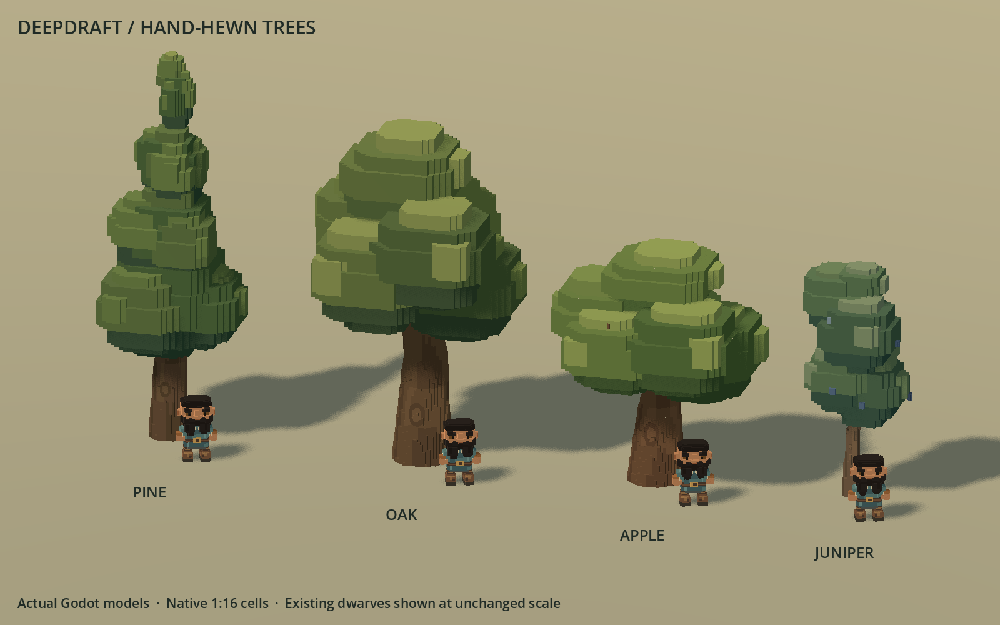

# 242 — Hand-hewn tree refinement

**Later gameplay update (2026-10-19):** [252 — Apple harvesting](252_apple_harvesting.md)
enables non-destructive apple picking using these existing models. The definition
and gameplay comparisons below describe this art pass before that addition.

The player authorized the tree pass on 2026-10-18, continuing the established
[art direction](../60_asset_creation/64_hand_hewn_art_direction.md). This revision
replaces the repeated canopy pucks with substantial, offset foliage lobes and
clearer species silhouettes. It is native voxel art, not a generated concept.

The [previous lineup](concepts/242_chibi_trees/before_hand_hewn_lineup.png) uses
the same camera, lighting and scale dwarves.

## Form and coverage

- **Pine:** fuller, uneven tapering boughs with fewer main tiers.
- **Oak:** a broad connected crown, substantial forks and offset leaf clusters.
- **Apple:** a compact crown, attached spring blossoms and exposed autumn fruit.
- **Juniper:** a dense upright crown with separate berry-bearing/picked states.

All four species retain sapling, mature and ancient forms, all defined seasons
and deterministic shape variants. Deciduous trees become bare in winter;
evergreens retain foliage with snow on exposed upper surfaces. Long bark plates
and a localized knot replace uniformly colored trunks. Grounded branch cleanup
removes detached slivers from the tapered voxel tips.

The complete family contains 94 GLBs at the existing production paths. Source
shapes come from `data/art/voxel_trees.json` and `tools/voxel_assets/trees.py`.
Two/four-cell foliage steps are baked into the native 1:16 grid. These broader
steps reduce fine striped chamfers; no runtime stretching or per-voxel nodes
are introduced. Each tree retains one greedy visible mesh and one shadow proxy.

## Integration boundaries

The four gameplay tree definitions are byte-identical. Existing authored height
envelopes, trunk footprints, collision heights, walking clearance, growth,
placement, felling, harvest amounts, saved identities and seasonal resolution
remain owned by gameplay. Saplings still have no collision. Adult foliage stays
above the existing clearance region and inside the canopy query envelope.

Juniper picking changes only the berry layer; the trunk and leaf cells retain
their geometry and colors. Apple fruit remains visual future content: this art
pass does not enable apple harvesting. Summer/picked and winter/picked variants
retain their established filenames and resolver behavior.

Visual shadow casting stays Off; separate proxies cast Shadows Only through
`VoxelShadowSetup`. Thin bare branches can require finer proxies to retain their
silhouette. A shared material does not merge separate trees into one draw call.

## Native review and validation

All 94 tree GLBs are installed; the other 292 production GLBs are byte-identical.
The canonical concept image and all four gameplay tree definitions retain their
original hashes. `tmp/chibi_trees_20261018/art_audit.json` records every variant,
bounds, file cost, shadow detail and the verified change boundary.

| Complete tree library | Before | After |
|---|---:|---:|
| Visible triangles | 786,526 | 422,532 |
| Shadow triangles | 307,966 | 270,376 |
| GLB bytes | 100,881,804 | 63,934,596 |

These totals cover every variant, not a single simultaneously rendered forest.
Visible geometry falls 46.3%, shadow geometry 12.2% and file size 36.6%. Pine and
juniper proxy totals increase with their fuller silhouettes; oak/apple reduce
the aggregate cost. Two thin bare saplings retain full-resolution shadow proxies.
One visible mesh, one proxy and one surface per tree remain unchanged.

`TreeGallery.gd` captures all species and growth stages beside an actual dwarf,
four-season sheets and juniper harvest states. Its fixed per-species framing
supports matched before/after review. The complete generic gallery additionally
reviews every exact staged GLB before activation. These are actual Godot renders
under neutral daylight; the original timber concept remains the higher artistic
target, not a claim of visual parity.

The retained captures include the complete 94-model gallery, species/stage
and seasonal sheets, matched previous views, and real juniper picking/finished
harvest. The [apple seasons](concepts/242_chibi_trees/apple_seasons.png) and
[juniper states](concepts/242_chibi_trees/juniper_harvest.png) show those changes
without altering the stable trunk/leaf identity. The gallery ground is a plain
review backdrop, not a new terrain texture.
The berry-bearing GLBs in the gallery show available art states; the live
resolver still restricts ripe juniper berries to their existing harvest season.

- Ten source/pipeline tests pass: exact grid and ground, growth height envelopes,
  walking/query bounds, deterministic shape variants, stable seasonal wood,
  connected bare limbs, and every adult fruit/blossom/picked variant. The old
  pine test requiring the pilot's exact sculpt is replaced by export contracts.
- Twelve shared mesher/proxy tests pass.
- All 94 installed GLBs regenerate byte-for-byte from the current sources.
- The complete staged native review passes with all 94 exact hashes. Production
  import is clean; native tree verification passes 2,440 checks and manifest
  verification passes 1,035 checks across all 94 installed models.
- Seasonal refresh passes 243 checks, including every species/stage through
  four seasons, paused nights, retained roots/occupancy, slicing and saved state.
- Real felling passes click/rectangle designation, axe markers, worker execution,
  cancel/sleep/resume, pause, season changes, restore, timber drops/hauling,
  occupancy, saplings and unreachable retry behavior.
- Juniper harvesting passes worker selection, picking, interruptions, fruit
  removal, future-season recovery and persistence. Native captures show the
  actual game interaction. Apple harvesting stays disabled as before.

Accepted native runs contain no script errors. Minimal gallery fixtures still
emit their pre-existing missing-current-scene sky warning. The models remain
procedural: repeated lobe shapes and comparatively simple material variation
are still visible. Passing tests does not establish parity with the concept.

## Full-settlement comparison

Both clean runs use the same world fingerprints and logical fixture at
1600×1000 on a Ryzen 7 9800X3D / Radeon RX 9070 XT: 24 dwarves, 48 furniture pieces
and 2,953 trees. Mesh instances remain 13,750. The before run completed before
generation/gallery work; the after run began after regeneration and all native
tests/previews finished. No competing task preview or export ran during sampling.

| View | GPU median before → after, ms | Frame p95 before → after, ms |
|---|---:|---:|
| Paused close | 0.878 → 0.831 | 8.209 → 8.335 |
| Paused neighborhood | 1.252 → 1.012 | 8.317 → 8.416 |
| Paused overview | 2.735 → 1.796 | 8.669 → 8.678 |
| Active close | 1.361 → 1.319 | 21.896 → 22.453 |
| Active overview | 3.147 → 2.157 | 22.056 → 22.463 |
| Active night | 1.302 → 1.076 | 21.374 → 21.644 |
| Active pan | 1.827 → 1.336 | 21.913 → 22.084 |
| Active slice | 1.765 → 1.240 | 21.638 → 21.890 |

`tmp/chibi_trees_20261018/world_comparison.json` records all ten views. GPU
medians decrease, especially in the tree-heavy overview. Overall frame p95 is
similar or slightly higher; this does not establish an overall FPS improvement.
These are one matched pair on one machine, not a low-end hardware guarantee.
Active simulation can vary under wall-time budgets despite matching initial state.
Paused overview draw calls stay at 713 while measured primitives drop from
3,838,722 to 1,887,020; tree mesh-instance/surface counts remain unchanged.

All eight save/reload checks pass: snapshot validity, dwarf count/identity and
appearance, furniture, wildlife, terrain edits, clock and stone conservation.
The native [settlement view](concepts/242_chibi_trees/world_neighborhood.png) and
[overview](concepts/242_chibi_trees/world_overview.png) show the revised trees
with the existing world and other art. The plain terrain in these views is the
benchmark's established fixture; no world textures or generation were changed.

## Recovery and reproduction

`tmp/chibi_trees_20261018/before.zip` contains the previous tree family, sources,
manifest, gameplay definitions and documentation. Full production fingerprints
are recorded separately. The final completion archive includes installed
sources/models, native previews and validation evidence, verified by SHA256.

Rebuild with `python -X utf8 tools/voxel_assets/build.py trees --check`.
Capture installed trees with `tools/voxel_assets/Run.ps1 -Script
res://tools/voxel_assets/TreeGallery.gd -Label YOUR_LABEL -UserArgs '--production'`.

Restart Play and load the existing save to see the revised trees. No new global
class or autoload requires an editor reload. Player saves, world voxels, other
flora, furniture and dwarves remain unchanged. No Windows export or commit.
