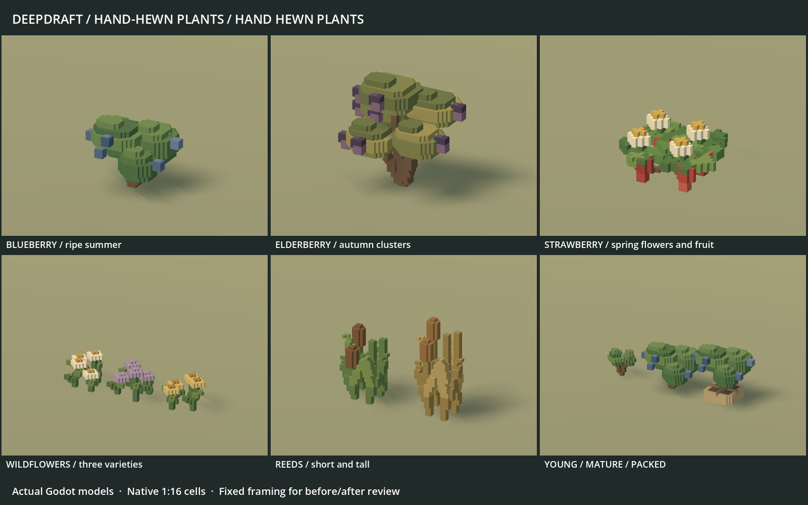

# 243 — Hand-hewn bushes, wildflowers and reeds

The player authorized this pass after the completed tree growth-stage review.
It applies the established [art direction](../60_asset_creation/64_hand_hewn_art_direction.md)
to the complete wild-plant family: **76 native voxel models**, installed at their
existing production paths. These are actual Godot renders, not illustrations.

The [previous family](concepts/243_chibi_plants/before_hand_hewn_plants.png) uses
the same camera, lighting and framing. The [dwarf scale view](concepts/243_chibi_plants/dwarf_scale.png)
shows the unchanged character beside the actual-sized plants.

## Shapes and complete coverage

| Family | Treatment | Models |
|---|---|---:|
| Blueberry | Compact offset leaf masses, exposed blue fruit, cream spring flowers, rusty autumn leaves and bare winter forks | 14 |
| Elderberry | Taller branching fans, substantial foliage, cream blooms and pendant purple autumn clusters | 14 |
| Wild strawberry | Low broad trifoliate rosettes, white flowers, tapered red fruit and dormant leaves | 16 |
| Wildflowers | Broad cream, heather and gold flower heads, thicker stems/leaves, spring buds, autumn seedheads and short winter stems | 24 |
| Reeds | Short/tall clumps with thicker stepped blades and substantial cattail heads | 8 |

All shrubs include young, mature, seasonal, applicable picked and packed forms.
Young shrubs have no crop. Elderberry has an explicitly authored young crown
below the one-block art ceiling; truncating the mature crown made an unacceptable
flat lid in an intermediate preview and was corrected before installation.
Flowers retain all three varieties in four seasons, planted and packed. Reeds
retain both height variants and all four seasons. Flower seasons and reed height
variants are not new gameplay growth stages.

Picking removes only the crop layer: the remaining positions and colors are
identical. Packed plants retain the exact planted model translated above their
existing root bundle or mat. Native-cell stems use connected steps so fine bare
branches, flower heads and berries do not become floating voxel fragments.

## Contracts and integration

The source owners are `tools/voxel_assets/plants.py` and
`data/art/voxel_plants.json`; the installed export authority is
`data/art/voxel_manifests/plants.json`. Integer-cell solids become one greedy
visual surface and one shadow sibling per model. Roots remain unit scale, with
ground at Y0. `VoxelShadowSetup` keeps visual casting Off and proxies Shadows
Only, with proxy GI disabled. Thin plant silhouettes can still need fine proxies.

All three shrub gameplay definitions and `data/entities/surface_details.json`
are byte-identical. Growth timing, winter dormancy, eligible harvest seasons,
regrowth, yields, flower-forage queries, placement spacing, habitat rules,
navigation, clearing, worker timing and saved identities are unchanged. Plants
remain nonblocking. The existing 3×3 planting reservations remain intact.

All other **310 production GLBs** are byte-identical, including trees, dwarves,
furniture, resources and crops. The crop generator shares older world-unit leaf
helpers; those remain compatible and all 14 crop GLBs rebuild byte-for-byte.
The six packed-plant inventory thumbnails are refreshed from imported models.
No removed furniture, new farming systems or terrain textures are introduced.

## Validation and actual previews

- Twelve source/pipeline tests pass, including all 76 paths, integer grid,
  heights, ground contact, connected components, deterministic regeneration,
  crop-only removal, young-canopy depth and exact packed translations.
- Twelve shared mesher/shadow tests pass.
- All 76 installed plant GLBs regenerate byte-for-byte.
- Complete native staged review covers every exact GLB hash before activation.
  Native imported vegetation checks pass **2,163 checks / 76 models**; manifest
  verification passes **837 checks / 76 models**.
- Real cutting planting and maturation, winter dormancy, harvested regrowth,
  harvest interruptions, Move/uproot, ground storage, container identity,
  seasonal display fitting, planting animation and save roundtrips pass.
- Flower relocation/spacing, seasonal bloom and forage state, permanent clearing
  and both reed variants' clearing/season behavior pass.
- All six native inventory thumbnails regenerate successfully.

The [planting capture](concepts/243_chibi_plants/elderberry_middle.png) shows a
real dwarf lowering a packed plant. The [flower placement capture](concepts/243_chibi_plants/planting_spacing.png)
shows the existing reservation and ghost. Complete contact sheets, species
seasons, young forms, harvest pairs, packed forms and comparison captures are
retained beside this document.

Five older test fixtures needed maintenance: two still required retired storage
furniture, two marked terrain maps ready without allocating their heightmap,
and the two capture scripts wrote to shared fixed filenames. Tests now use the
existing synthetic storage fixture or a synthetic display-slot definition,
initialize the flat generated baseline, and honor per-run capture output with
checked PNG writes. No gameplay assertion was weakened and no runtime system
was changed. Earlier failed runs are retained; only clean reruns count as
acceptance. `tmp/chibi_plants_20261018/native_checks.json` names those runs.

Minimal fixtures retain their existing sky/current-scene or unseeded-weather
warnings. The accepted runs contain no script errors. Passing tests establishes
integration, not parity with the original concept's richer materials and rendering.
The foliage still has procedural repetition; the original concept remains the
higher artistic target.

## Rendering cost

| Complete 76-variant library | Before | After |
|---|---:|---:|
| Visible triangles | 60,862 | 80,180 |
| Shadow triangles | 37,974 | 52,874 |
| GLB bytes | 9,243,936 | 12,392,264 |
| Fine proxy fallbacks | 57 | 49 |

Larger flowers, connected stems and stronger leaves increase the total visual
geometry by 31.7% and caster geometry by 39.2%. These are totals across all
alternative states, not one simultaneously rendered patch. Blueberry visible
geometry decreases; the other small-plant families add geometry. One surface
and one proxy per model remain unchanged. Forty-nine thin models use fine
proxies to retain their silhouette; do not describe all plant shadows as coarse.

Both full-settlement runs pass with matching world, plant identity and logical
fixture fingerprints at 1600×1000 on a Ryzen 7 9800X3D / Radeon RX 9070 XT.
The fixture contains 24 dwarves, 48 furniture pieces and 2,953 trees; mesh-instance
count remains 13,750. No task gallery or asset build ran during sampling.

| View | GPU median before → after, ms | Frame p95 before → after, ms |
|---|---:|---:|
| Paused close | 0.831 → 0.833 | 8.341 → 8.281 |
| Paused neighborhood | 1.013 → 1.032 | 8.395 → 8.446 |
| Paused overview | 1.757 → 1.843 | 8.693 → 8.727 |
| Paused night | 0.777 → 0.786 | 8.178 → 8.193 |
| Active close | 1.218 → 1.437 | 26.919 → 21.796 |
| Active neighborhood | 1.291 → 1.484 | 24.398 → 20.623 |
| Active overview | 2.154 → 2.222 | 26.988 → 22.308 |
| Active night | 1.309 → 1.081 | 26.160 → 21.716 |
| Active pan | 1.352 → 1.613 | 26.418 → 22.105 |
| Active slice | 1.554 → 1.342 | 27.152 → 22.146 |

Paused close rendering is nearly unchanged. The overview adds 0.086 ms median
GPU time in this pair, with primitives rising from 1,887,020 to 1,996,510 and draw
calls unchanged at 713. Active timings are mixed and wall-budgeted simulation
can diverge despite the same initial fixture. The lower active frame p95 is not
evidence that this art revision accelerates simulation or the overall game.
This is one pair on one GPU, not a minimum-hardware guarantee.

All eight save/reload checks pass: valid snapshot, dwarf count and appearance,
furniture, wildlife, terrain edits, clock and stone conservation. The
[settlement view](concepts/243_chibi_plants/world_neighborhood.png) and
[wide overview](concepts/243_chibi_plants/world_overview.png) show the installed
plants among the existing terrain, trees and other art. Full measurements and
all limits are in `tmp/chibi_plants_20261018/world_comparison.json`.

## Recovery and reproduction

`tmp/chibi_plants_20261018/` retains `before.zip`, separate original thumbnail
and fixture archives, complete production hashes, `source_checkpoint.zip`,
validation logs, scope/cost audit and the final verified completion archive.
The original canonical art reference retains its SHA256. Player save files are
untouched; all native tests and settlement runs use isolated profiles.

Rebuild verification: `python -X utf8 tools/voxel_assets/build.py plants --check`.
Native review: `tools/voxel_assets/Run.ps1 -Script
res://tools/voxel_assets/PlantGallery.gd -Label YOUR_LABEL -UserArgs '--production'`.

Restart Play and load the existing save to see the new models. No global class
or autoload was added. No Windows export or commit was created.
