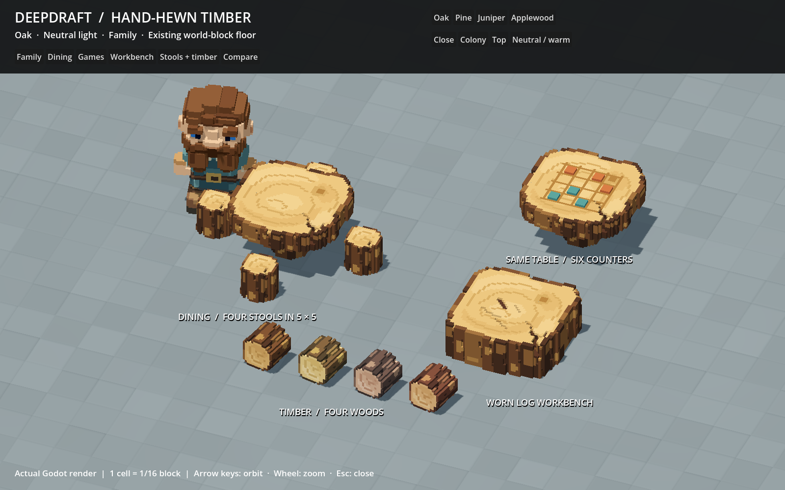
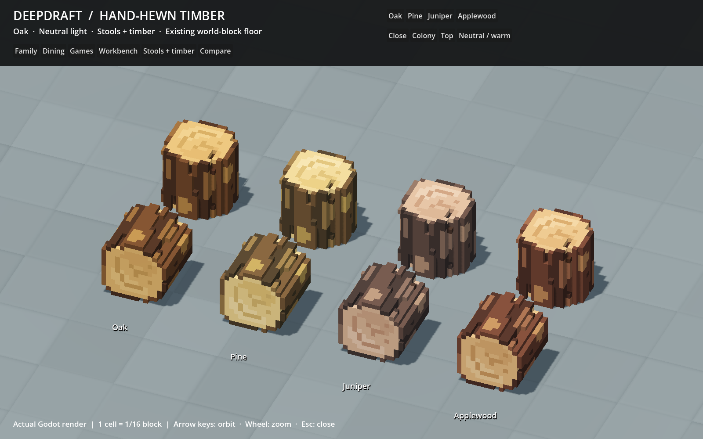

# 244 — Chibi timber refinement

The player approved the next refinement of dining/game tables, log stools,
the rudimentary workbench and sideways timber. All four woods now use unequal
bark plates with staggered clefts, tapered exposed patches and chipped shoulders.
The cut faces have incomplete, offset grain marks and broad fibre patches. The
large drying split has a five-cell-deep mouth that tapers inward; the workbench
retains its localized tool scars.

This is a refinement toward the original
[hand-hewn concept](../60_asset_creation/reference/hand_hewn_timber_direction.png).
The concept remains the higher artistic target. The native art still has simpler
surface modelling and lighting; passing geometry tests does not establish visual
parity. No new concept image replaces the approved reference.

## Preserved dimensions and integration

- Dining: 46×46-cell plan, eight-cell slab above a 16×16×16 pedestal. The body
  remains 24 cells high within the approved 3×3 world-block footprint.
- Games: the exact dining body, with the board and six supported counters above
  the surface. Existing game hand/head contacts remain unchanged.
- Stools: 14×14×14 cells, with intact central seats. Four stools at the established
  cardinal offsets keep the dining arrangement inside 5×5 world blocks.
- Workbench: 46×16×46 cells, solid stump, all four working contacts preserved.
- Loose timber: the exact stool shape and colors rotated onto its side. Same size,
  grounding, carrying and storage contacts.

All cell edges remain 1/16 of a world block. IDs, palettes, definitions, poses,
placement, navigation and save formats are unchanged. Eight production GLBs
change; the other 378 are byte-identical. Four furniture thumbnails and four
loose-log thumbnails are refreshed. The 20 study GLBs and both sets of 20 editable
VOXs are regenerated from the same source. Original player VOXs are preserved.

The source is `tools/voxel_assets/hand_hewn_timber.py`, with authored shapes,
plate divisions, patches and cracks in `data/art/voxel_hand_hewn_timber.json`.
No runtime procedural geometry or extra material surfaces are introduced.

## Native previews

The same folder includes all four woods, neutral/warm light, close/colony/top
views, the before/after comparison captured before activation, actual diners,
game players, an occupied stool and crafting from all four sides. Interaction
captures use the existing minimal test fixture; the study uses the real
world-block floor. Neither changes terrain textures.

## Geometry cost

Each model still has one greedy visual surface and one shadow-only proxy.
Detailed geometry casts no shadow; the proxy is Shadows Only with GI disabled.
The extra chipped edges cost geometry, including some additional proxy faces.

| Model | Visual triangles, before → after | Shadow triangles, before → after | New GLB bytes |
|---|---:|---:|---:|
| Dining table | 2,618 → 3,212 | 136 → 196 | 315,516 |
| Game table | 2,692 → 3,266 | 152 → 208 | 321,600 |
| Log stool | 548 → 676 | 92 → 176 | 80,360 |
| Workbench | 2,502 → 2,974 | 150 → 282 | 301,540 |
| Timber, each wood | 542 → 680 | 98 → 148 | 78,152–78,156 |

The proxies use 6–26% of their visual meshes' triangle counts. This is an art
improvement with a modest absolute geometry increase, not a mesh-count reduction
or a performance optimization.

## Validation

- All 65 source test cases pass across the full run and corrected targeted run;
  all 12 dedicated mesher/shadow tests pass. Exact dimensions, connected solids,
  real splits/chipped rims, seat/work contacts, supported counters, shared table
  geometry, rigid timber rotation, palettes and editable VOX roundtrips pass.
- Complete native staged galleries pass for 33 furniture and 92 item models.
  Activation verifies their exact reviewed hashes. Both production families and
  all 20 study models regenerate byte-identically.
- Native import suites pass: 658 furniture, 1,656 item, 480 furniture-manifest,
  1,013 item-manifest, 124 production/study-palette and 260 study checks.
- Dining passes real crafting/installation, exact-item Move, four rotations,
  four-wood save/restore, four simultaneous diners and conservation. Recreation
  passes crafting, rotation, two players, contacts, interruption, needs and saves.
- Stools pass four rotations, torso/feet fit, access and save restoration.
  Workbench tests complete 16 batches across all approaches and rotations, with
  blocked-side selection and working-material/axe contact checks.
- Hauling animation and capacity tests pass for grips, pickup/carry/lower,
  bundles, containers, storage, cancellation and saved counts.
- Eight thumbnails and twelve native study views are refreshed and inspected.

The initial new crack assertion sampled beyond the irregular outline; its sample
was moved onto the actual five-cell split. No geometry assertion was removed.
The first stool capture run could not overwrite two old PNG paths. The fixture
now accepts the runner's isolated output directory and asserts PNG writes; the
rerun passes. Accepted native runs contain no script errors. Minimal fixtures
retain their existing missing-environment/seed warnings.

## Matched world comparison

Both full-world runs pass with the same logical fixture, terrain fingerprints,
24 dwarves, 48 furniture pieces, 2,953 trees and 13,750 starting mesh instances.
All eight save/reload checks pass. Draw counts match in all ten sampled views.
The machine is a Ryzen 7 9800X3D / Radeon RX 9070 XT at 1600×1000.

| View | GPU median before → after, ms | Frame p95 before → after, ms |
|---|---:|---:|
| Paused close | 0.836 → 0.847 | 8.291 → 8.333 |
| Paused neighborhood | 1.037 → 1.029 | 8.376 → 8.404 |
| Paused night | 0.787 → 0.788 | 8.143 → 8.107 |
| Paused overview | 1.855 → 1.797 | 8.645 → 8.701 |
| Active close | 1.351 → 1.314 | 21.736 → 21.940 |
| Active overview | 2.233 → 2.463 | 21.871 → 22.063 |

Paused rendering is nearly unchanged. Active frame p95 mostly rises slightly,
with mixed GPU results; this is not evidence of an overall speedup. The full
ten-view comparison is `tmp/timber_refinement_20261018/world_comparison.json`.
This fixture includes stools and loose timber but no dining/game tables or
workbench. Dedicated native interaction and study checks cover those models;
the full-world run is not a table stress test. One paired run on this hardware
does not establish low-end performance.

## Checkpoints and review

Evidence is under `tmp/settlement_art_20261013/timber_refine_*`. Recovery,
source and final checkpoints are under `tmp/timber_refinement_20261018/`.
The completion inventory records changed files, accepted checks and resolved
early attempts. Actual player saves are untouched; no Windows export or commit
was created. Restart Play and load the existing save to see the revised art.

The recommended next family is the remaining buildable furniture: beds, doors,
fences/gates, bridges, torches and campfires. Animals and then tools/carried goods
follow. This is a suggested order, not authorization to restore retired furniture.
