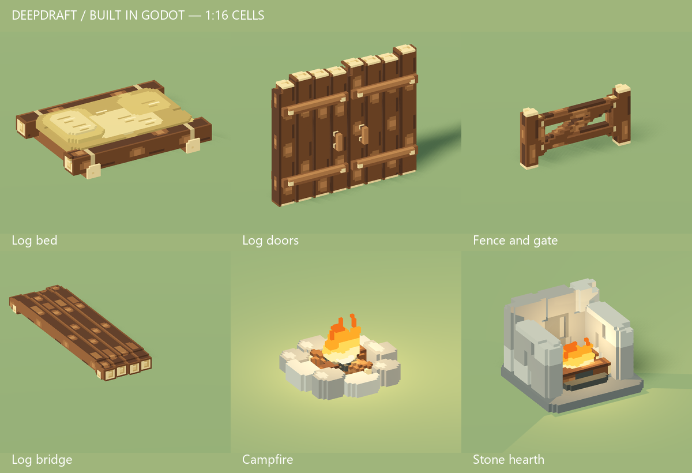
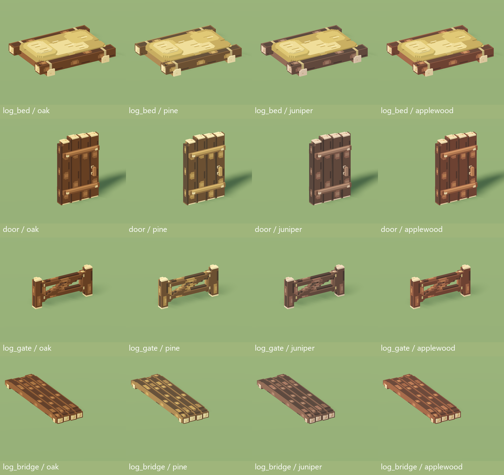
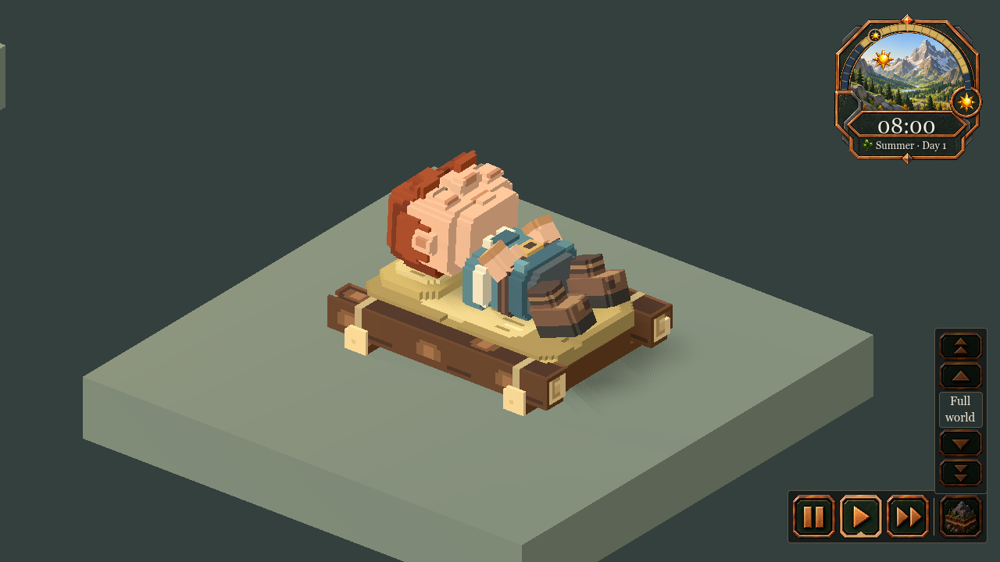

# 245 — Chibi buildable furniture

The player approved all three remaining furniture groups: beds/doors,
fences/gates/bridges, and torches/campfires. The existing buildable stone hearth
is included with the fires. Sixteen production GLBs now use broader, clipped
timber sections, substantial braces and bindings, uneven end cuts and chipped
stone. All four wood palettes remain available through the normal material owner.

This extends the approved
[hand-hewn direction](../60_asset_creation/64_hand_hewn_art_direction.md).
The native art still has simpler surfaces and lighting than the original concept;
the concept remains the higher target. No retired furniture is restored.

## Installed groups

- **Beds and doors:** the log bed has squared framing, tied joints, broad uneven
  bedding and sparse straw marks. All three door widths have stronger braces,
  offset bark patches, readable pulls and a rear diagonal support per leaf.
- **Fences, gates and bridges:** clipped timber sections replace cylindrical
  poles. The gate uses the exact standalone posts, and derived fence rails share
  the timber treatment. All five bridge spans and the packed bridge kit are
  rebuilt, with broad worn patches on the deck.
- **Fires:** the log torch has a thicker handle, bracket and binding. Campfire
  stones have unequal heights and chipped tops around substantial crossed logs.
  The hearth uses staggered stone courses, heavier side caps and a dark firebox.

The other 370 production GLBs are byte-identical, including the earlier timber
family, settlement flag, wet/dry stone and all three flame libraries. Ten
catalogue thumbnails are refreshed. The complete 33-model furniture family is
regenerated and installed through its reviewed manifest.

## Dimensions and ownership

Every cell stays 1/16 of a world block, with unit root scale. The bed remains
64×15×48 cells, with its central sleeping plane at twelve cells. Door leaves keep
their existing pivots, height limits and open clearance. Fence posts retain their
navigation envelope and bridge decks remain flush over the gap, with their
landing tails settled into the banks. All five bridge spans retain their anchors.
The hearth remains 2×2; flame roots, timing, light ranges and heat are unchanged.

Furniture definitions, IDs, source palettes, crafting and save formats are
unchanged. Existing placed furniture acquires the new models on the next launch.
The source is `tools/voxel_assets/author_furniture.py`, which writes the recipe in
`data/art/voxel_furniture.json`. The opt-in hewn beam sampler in `solid_shapes.py`
leaves older beam types unchanged. Geometry is baked offline into greedy surfaces.
Detailed visuals cast no shadows; separate proxies retain their Shadows Only
configuration and disabled GI through the existing owner.

## Native previews

The same folder contains all door widths, five bridge spans, packed kit, four
wood palettes, open leaves, close/colony views, sleeping rotations, and all 26
live flame frames in three sheets. These are actual Godot renders in the minimal
review/gameplay fixtures. The green review floor is a test backdrop; terrain
textures are unchanged.

## Geometry cost

| Model | Visual triangles, before → after | Shadow triangles, before → after | New GLB bytes |
|---|---:|---:|---:|
| Log bed | 1,068 → 1,452 | 340 → 324 | 165,352 |
| Two-wide door | 868 → 2,068 | 524 → 492 | 237,556 |
| Three-wide door | 1,150 → 2,696 | 668 → 644 | 309,328 |
| Four-wide door | 1,732 → 4,132 | 1,044 → 990 | 475,072 |
| Fence post | 86 → 130 | 36 → 28 | 16,532 |
| Derived fence rails | 64 → 324 | 24 → 72 | 38,444 |
| Gate | 534 → 1,144 | 136 → 434 | 150,796 |
| One-span bridge | 1,618 → 1,380 | 388 → 198 | 147,148 |
| Two-span bridge | 1,618 → 1,500 | 388 → 198 | 158,188 |
| Three-span bridge | 1,618 → 1,720 | 388 → 198 | 178,428 |
| Four-span bridge | 1,618 → 1,766 | 388 → 198 | 182,660 |
| Five-span bridge | 1,618 → 2,004 | 388 → 198 | 204,556 |
| Packed bridge kit | 540 → 848 | 272 → 162 | 94,888 |
| Campfire | 1,336 → 2,010 | 408 → 490 | 233,012 |
| Hearth | 810 → 1,350 | 222 → 212 | 146,688 |
| Log torch | 396 → 498 | 112 → 74 | 55,596 |

Fire visual totals include the unchanged first flame frame. Rigid part and mesh
counts do not increase. Several proxies become cheaper, while the more substantial
gate, rails and campfire require additional shadow geometry. This is an art pass,
not a claim of universally lower geometry cost.

## Validation

- All 67 source tests and 12 dedicated mesher/shadow tests pass. Added contact
  checks cover the bed's intact sleeping surface, all five bridge gap surfaces,
  exact shared gate/fence posts and continuous derived rails.
- Complete staged gallery: 33 models. Installed import checks: 658 furniture,
  480 manifest and 129 flame checks. All actual imported wood variants, hinge
  bounds, native cells, visual/proxy flags and flame timing pass.
- Furniture recipe regeneration and all 33 production GLBs reproduce
  byte-identically. The scope audit confirms exactly 16 changed models and 370
  unchanged models; all nineteen furniture definitions remain byte-identical.
- Bedroom gameplay passes crafting, delivery, material, room requirements,
  sleeping access, exclusive claims, wake/removal, four rotations and restoration.
  Door gameplay passes crafting, hinges, clearance, room sealing and restoration.
- Grid fence/gate tests pass shared posts, corners, routes, previews, support,
  construction and restoration. Bridge tests pass spans, placement input,
  construction, support, approaches and corner walking.
- Hearth gameplay passes rotation, footprint, seasons, room heating and lifecycle.
  Native door lighting and torch distance/falloff/wall-occlusion checks pass.
  Hauling animation and capacity checks pass for contacts, storage and saved counts.
- Native installed previews, day/night fires, all 26 live flame frames and ten
  catalogue thumbnails are regenerated and reviewed.

An initial added bridge assertion incorrectly included lowered landing tails;
it now checks the flush gap, while the existing test still verifies lowered tails.
The first bedroom run hit a removed metal wall-torch ID. Bedroom and TorchReach
fixtures now exercise surviving lights; no retired definition is restored.
Bedroom, DoorLighting and TorchReach accept isolated output folders and assert
PNG writes. DoorLighting retains its isolated-profile safety check. Accepted
native runs have no script errors; minimal fixtures retain their established
missing-environment/seed warnings. The input-picking bridge fixture initially
queried uninitialized resource noise while editing its synthetic river. It now
initializes the seeded noise exactly as its base LogBridgeTest does, and accepts
an isolated screenshot folder. The corrected native run passes without errors.

## Matched world comparison

Both full-world runs pass with the same logical fixture, terrain fingerprints,
24 dwarves, 48 furniture pieces, 2,953 trees and 13,750 starting mesh instances.
All eight save/reload checks pass. Draw counts match in all ten sampled views.
The machine is a Ryzen 7 9800X3D / Radeon RX 9070 XT at 1600×1000.

| View | GPU median before → after, ms | Frame p95 before → after, ms |
|---|---:|---:|
| Paused close | 0.836 → 0.851 | 8.260 → 8.295 |
| Paused neighborhood | 1.031 → 1.042 | 8.408 → 8.354 |
| Paused night | 0.783 → 0.793 | 8.159 → 8.180 |
| Paused overview | 1.826 → 1.832 | 8.661 → 8.618 |
| Active close | 1.322 → 1.450 | 21.183 → 21.309 |
| Active overview | 2.439 → 2.185 | 21.717 → 22.374 |

Paused rendering is nearly unchanged in this pair. Active results are mixed;
this does not establish an overall speedup. The fixture includes sixteen beds,
eight doors, eight campfires and sixteen unchanged stools. Other revised models
are covered by dedicated native checks, not a full-world stress test. One run
per revision on this hardware does not establish low-end performance. The full
ten-view comparison is `tmp/chibi_furniture_20261018/world_comparison.json`.

## Checkpoints and review

Verified recovery and the three group checkpoints are in
`tmp/chibi_furniture_20261018/`: `before.zip`, `01_beds_doors.zip`,
`02_fences_bridges.zip` and `03_fire.zip`, each with a hash inventory. The final
checkpoint includes implementation, previews, measured costs and accepted test
evidence. Native run evidence is under `tmp/settlement_art_20261013/chibi_furniture_*`.

Restart Play and load the existing save. Original player saves are untouched;
no Windows export or commit was created. Animals, then tools/carried goods remain
suggested future art passes, outside this completed furniture scope.
