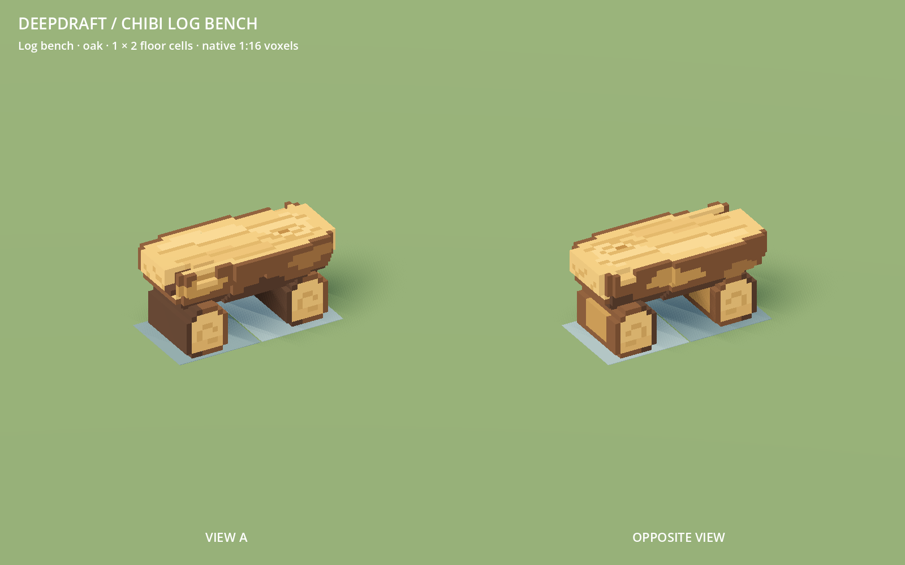
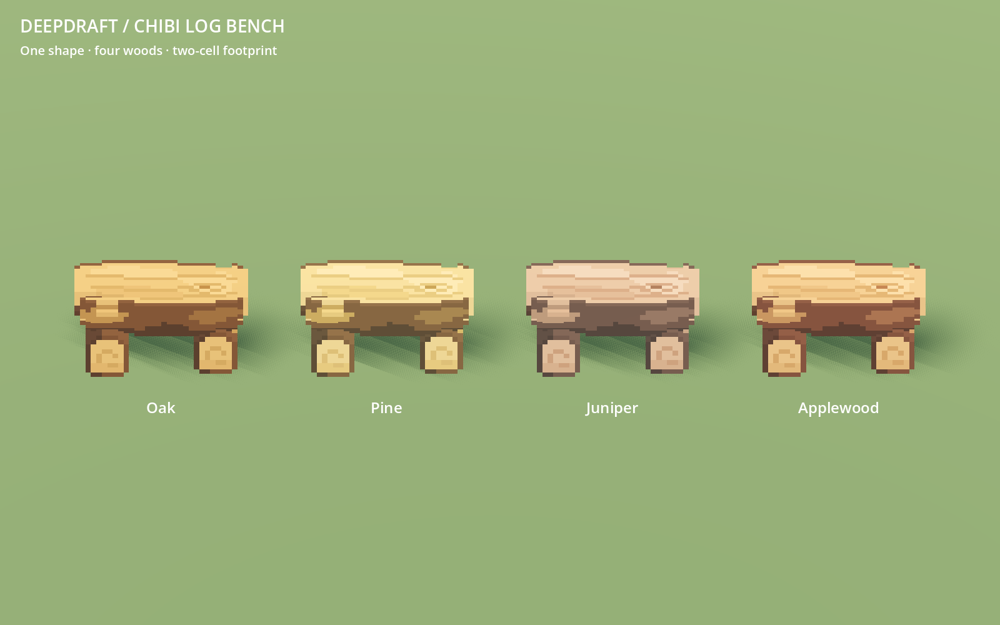
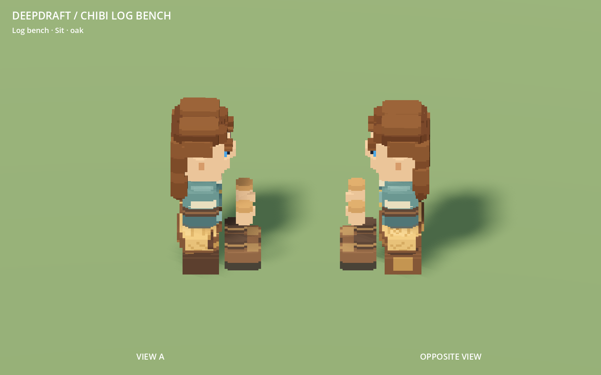

# 248 — Chibi log bench

The player requested a less plain log bench in the current chibi style, occupying
1×2 world voxels. The existing definition already reserved two floor cells;
its model was a rectangular slab on plain feet. The new bench has a thick split
log, curved underside, chipped bark rim, broad irregular bark patches, cut fibres,
end grain, an offset knot and a real tapered drying split. Two substantial
cross-log supports have exposed cut ends and flat ground contacts.

## Size and interaction

The native 1:16 mesh spans 32×16×16 microcells: 2×1 world blocks across the floor,
one block high. Rotation gives 1×2 without moving the saved anchor. IDs, packed
item, cost, crafting recipe, capacity, access cells, navigation occupancy and
collision envelope remain unchanged. This is one broad dwarf seat.

The bench still used an older rest pose. With the current chibi body its torso
bottom was 0.25 block below the seat; both boots overlapped the front edge.
The corrected definition raises the torso to the existing Y1 seat, brings hands
forward, and puts the boot soles on the floor ahead of the wood. Head, beard,
body and boot clearance regions now follow that pose. Existing saved furniture
reconstructs the corrected definition through normal restoration.

## Source and cost

`data/art/voxel_log_bench.json` owns the authored silhouette, patches and cuts;
`tools/voxel_assets/log_bench.py` builds the cells. The existing furniture pipeline
dispatches `log_bench_vox` from `author_furniture.py`. The bench now uses the
shared `hand_hewn_timber` source palette and runtime oak, pine, juniper and
applewood recoloring. Four editable VOXs are in `VoxelFeed/colored/log_bench/`.
The catalog thumbnail is refreshed from the installed model in native Godot.

| Measure | Before | After |
|---|---:|---:|
| Occupied microcells | 5,088 | 4,829 |
| Visual triangles | 152 | 992 |
| Shadow triangles | 60 | 224 |
| GLB bytes | 21,440 | 113,820 |

There is still one greedy visual mesh and one shadow-only proxy. The extra
surface detail costs geometry; no full-world FPS improvement or benchmark is
claimed. The other 385 production GLBs and all study GLBs are byte-identical.
The original hand-hewn concept remains the higher artistic target.

## Validation and evidence

- All 70 Python source tests pass, including three new checks for scale,
  connected support/seat geometry, real cuts, four palettes and VOX roundtrips.
- The complete 33-model furniture family passes its native staged gallery and
  activation hash audit. All 33 installed GLBs regenerate byte-identically.
- `LogBenchTest` passes headless and native: four rotations, exactly two blocked
  floor cells, usable approaches, torso/hand/boot contacts, boot clearance from
  neighboring furniture, safe seated-save position, installed-state restoration
  preserving wood/yaw, and actual worker packing, carrying and reinstalling once.
- `DwarfDiningTest`, `FurnitureFacetedArtTest`, `VoxelManifestTest`,
  `HandHewnProductionTest` and `FurnitureMoveTest` pass.
- Native previews cover both sides, all four woods, colony distance, two floor
  cells and the actual idle seating pose. Native interaction captures exercise
  all four orientations. The minimal interaction fixture retains its existing
  missing-environment warning; accepted runs have no script errors.

The first bench test also counted packed refunds left by its own teardown;
the fixture now clears those before independently restoring the saved installed
snapshot. The contact failures above exposed the real old-pose mismatch and were
fixed in the definition without weakening the contact assertions.

Backups, original/final native renders, source results, gallery, regeneration,
interaction logs and the final hash audit are in `tmp/log_bench_20261019/`.
All four original player save files remain unchanged. No export or commit was
created. Restart Play and load the existing save to see the updated bench.
